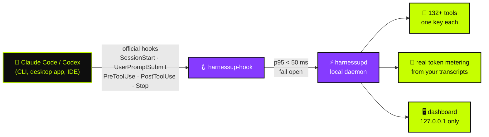

<!-- HarnessUp README · English is the source; translations live in i18n/ -->

<p align="center">
  <a href="https://harnessup.dev"></a>
</p>

<p align="center">
  <b>🇺🇸 English</b> ·
  <a href="i18n/README.pt-BR.md">🇧🇷 Português</a> ·
  <a href="i18n/README.es.md">🇪🇸 Español</a> ·
  <a href="i18n/README.fr.md">🇫🇷 Français</a> ·
  <a href="i18n/README.de.md">🇩🇪 Deutsch</a> ·
  <a href="i18n/README.it.md">🇮🇹 Italiano</a> ·
  <a href="i18n/README.ja.md">🇯🇵 日本語</a> ·
  <a href="i18n/README.ko.md">🇰🇷 한국어</a> ·
  <a href="i18n/README.zh-CN.md">🇨🇳 简体中文</a> ·
  <a href="i18n/README.ar.md">🇸🇦 العربية</a> ·
  <a href="i18n/README.he.md">🇮🇱 עברית</a> ·
  <a href="i18n/README.hi.md">🇮🇳 हिन्दी</a>
</p>

<p align="center">
  <a href="https://www.npmjs.com/package/harnessup"></a>
  <a href="https://github.com/harnessup/harnessup/releases/latest"></a>
  
  
  
  
  <a href="https://github.com/harnessup/harnessup/stargazers"></a>
</p>

<p align="center">
  <a href="https://harnessup.dev/en/install/"></a>
  <a href="https://harnessup.dev/en/plans/"></a>
  <a href="https://harnessup.dev/en/"></a>
  <a href="#-sponsors"></a>
</p>

<h3 align="center">The world's biggest token saver for coding agents.</h3>

<p align="center">
  Over <b>132 tools</b> running on your own machine to cut the token waste of <b>Claude Code</b> and <b>Codex</b>.<br>
  Free measurement, no login, 100% local. Up to <b>78% off your bill</b>, with the proof measured on your own usage.
</p>

<p align="center">
  
</p>

## 📑 Contents

<table>
  <tr>
    <td valign="top">
      <a href="#-the-villain">The villain</a><br>
      <a href="#-what-harnessup-does">What HarnessUp does</a><br>
      <a href="#-the-numbers">The numbers</a><br>
      <a href="#%EF%B8%8F-how-it-works">How it works</a>
    </td>
    <td valign="top">
      <a href="#-tour">Tour</a><br>
      <a href="#-10-fronts-132-tools">10 fronts, 132+ tools</a><br>
      <a href="#-ai-damage-rewound-with-one-button">One-button undo</a><br>
      <a href="#%EF%B8%8F-gallery">Gallery</a>
    </td>
    <td valign="top">
      <a href="#-install-in-one-line">Install</a><br>
      <a href="#-made-for-people-who-live-on-agents">Who it is for</a><br>
      <a href="#-plans">Plans</a><br>
      <a href="#-privacy-and-security">Privacy and security</a>
    </td>
    <td valign="top">
      <a href="#-supported-agents">Supported agents</a><br>
      <a href="#-faq">FAQ</a><br>
      <a href="#-sponsors">Sponsors</a><br>
      <a href="#-meet-hup">Meet Hup</a>
    </td>
  </tr>
</table>

## 🪙 The villain

<table>
  <tr>
    <td width="42%" valign="middle">
      
    </td>
    <td width="58%" valign="middle">
      <p><b>Session #217 · expensive model · high effort.</b></p>
      <p>You ask for a one-line fix. The agent answers with <i>"Sure! I'll help you with that. Great question…"</i>, rereads three files it already read, prints a 4,000-line log and only then writes the fix. The token counter keeps climbing.</p>
      <p>Every <i>"Sure! I'll help you with that"</i> is paid for in the response <b>and reread in every round that follows</b>. Your weekly limit dies on Wednesday.</p>
      <p>HarnessUp asks for direct answers, blocks rereads of unchanged files and cuts giant outputs, so you <b>make it to Friday with room left</b>.</p>
    </td>
  </tr>
</table>

## ⚡ What HarnessUp does

HarnessUp is **not a plugin, an MCP, a skill or a proxy**. It is a second layer that fits under your harness, inside the rules: a local daemon that plugs into the **official hooks** of Claude Code and Codex, measures every token and applies the tools you switch on, each with its own key.

<table>
  <tr>
    <td width="25%" align="center" valign="top">
      <br>
      <h3>📏 Measure</h3>
      <sub>Deep Scan and 19 more measurement and monitoring tools, <b>free</b>. Real token counts from your transcripts, never guesses.</sub>
    </td>
    <td width="25%" align="center" valign="top">
      <br>
      <h3>💸 Save</h3>
      <sub>26 savings tools: compression without calling the model, leaner answers, no rereads, and a swarm of cheap subagents where <i>the expensive model only decides</i>.</sub>
    </td>
    <td width="25%" align="center" valign="top">
      <br>
      <h3>🛡️ Protect</h3>
      <sub>Stop Loss, Antiloop Protector, Secret Lock, Git Shield and one-click undo. AI damage gets rewound with one button.</sub>
    </td>
    <td width="25%" align="center" valign="top">
      <br>
      <h3>🎛️ Control</h3>
      <sub>200+ one-click keys in a local dashboard. One click turns a tool on, another one undoes it. No terminal needed.</sub>
    </td>
  </tr>
</table>

## 📊 The numbers

| | Metric | What it means |
|:---:|---|---|
| 🚀 | **up to 3x** | more work with the same tokens on a fixed plan |
| 💰 | **up to 78%** | less on the bill for API users |
| 📈 | **over 260%** | more throughput in some 5-hour windows |
| 🧰 | **132+** | tools across **10 fronts**, all running on your machine |
| ⌨️ | **200+** | reversible one-click keys in the dashboard |
| ⏱️ | **p95 < 50 ms** | per hook, with a hard **2 s** timeout, so the agent never freezes |
| 🌍 | **12** | languages in the dashboard |

> [!NOTE]
> "Up to" means the biggest gains measured in real usage windows. **Your own number comes from your own transcripts**: HarnessUp measures it for free before you pay anything. See the open math at [harnessup.dev/en/metering](https://harnessup.dev/en/metering/).

## ⚙️ How it works



- **Official surfaces only.** The model runs through the official `claude` and `codex` binaries, with your own account. HarnessUp never reads, stores or passes on your token or key.
- **Fail open, always.** If HarnessUp is slow, off or in error, your agent keeps working as if it were not there.
- **Nothing is irreversible.** Whatever is cut, compressed or blocked stays recoverable.
- **Low confidence passes straight through.** It is better not to save than to hand the model wrong information.

## 🎬 Tour

<p align="center">
  
</p>

## 🧰 10 fronts, 132+ tools

A Swiss Army knife for coding agents. Every tool has its own key, and every key can be undone.

| Front | Tools | Star tool | Highlights |
|---|:---:|---|---|
| 📏 **Metering** | 14 | Deep Scan | Harness History, Inside the Wallet, Model Insights, HarnessUp Bench, Plan Usage |
| 📡 **Monitoring** | 8 | Session Radar | The Numbers, Realtime Events, Reasoning Check, Subagents Work, Plan Advisor |
| 💸 **Savings** | 26 | Cheap Swarm | Smart Compress, Response Diet, Delta Read, Smart Cut, Terminal Guide, WebFetch Diet |
| 🎛️ **Control** | 25 | Stop Loss | Budget Cap, ToolBox, Working Hours, Swarm Commander, Enforce TDD, Force Lint |
| 🛡️ **Protection** | 10 | Smart Return | Secret Lock, UltraShield Guard, Antiloop Protector, Git Shield, Checkpoint |
| 🔐 **Security** | 8 | Sentinel | Smart Security, Security Check, SafeBox, No Touch, No Delete |
| 🚀 **Productivity** | 26 | Code Deck | Smart Commit, Build Now, Super Code Review, HarnessUp Flow, HarnessUp Board |
| 🧪 **Utilities** | 23 | Prompt Optimizer | Token Calculator, Frozen Cache, MetaPrompt, Mirror Master, HarnessUp Shop |
| 🎨 **Customize** | 6 | Status Bar | Info Pills, Cache Alarm, Mod Themes, Finish Line Push |
| 🏗️ **Builders** | 5 | /bones | SPEC/PRD Express, DOCs Generator, Website Builder |

<details>
<summary><b>📏 Metering and 📡 Monitoring</b>: see where every token goes (mostly free)</summary>

<br>

- **Deep Scan** (free): diagnoses the waste in your history and shows what HarnessUp would have saved.
- **Model Insights** (free): 24 questions answered per model version.
- **HarnessUp Bench** (free): score per model and effort level.
- **Openness Meter, Harness Meter, Cache Cycle, Inside the Wallet, Work Analytics, Bad Use, Plan Usage** (free).
- **Session Radar, The Numbers, Uptime, Realtime Events, Reasoning Check, Subagents Work, Harness Update, Plan Advisor** (all free).
- **/diagnostic and /simulate** (Ultra): ask questions about your measured usage and simulate decisions before making them.

</details>

<details>
<summary><b>💸 Savings</b>: the same work for fewer tokens</summary>

<br>

- **Smart Compress** (free): compacts the conversation without calling the model.
- **Response Diet** (free): direct answers, no preamble.
- **Delta Read, Code Finder, Smart Cut, Read Router, Head Limit** (Pro): read only what is needed and never reread an unchanged file.
- **Terminal Guide, Output Diet, WebFetch Diet** (Pro): long command outputs and web pages trimmed before they reach the context.
- **Renew Session, Hot Context, Context Graph, Session Protocol, Memory State** (Pro): sessions that start lean and stay lean.
- **First Pass, Way Out, No Comment, Stature Brake, Rules Auditor, Optimize Harness** (Pro).
- **Cheap Swarm** (Ultra): 26 task classes go to cheap subagents; the expensive model only decides.

</details>

<details>
<summary><b>🎛️ Control</b>: your rules, enforced at tool-call boundaries</summary>

<br>

- **Stop Loss and Budget Cap** (Pro): set a US$ cap and the session stops there.
- **ToolBox** (Pro): 17 ready-made conventions for your agent.
- **Working Hours, Scheduled Break, Reasoning Advisor, Rule Checker, Force Test, No Subagents** (Pro).
- **Swarm Commander, Subs Director, Enforce TDD, Force Lint, Doc Now, Anti-fading, Stick Prompt** (Ultra).
- **Anti-Collision** (GIGA) and **HarnessUp OFF** (free): pause everything without uninstalling.

</details>

<details>
<summary><b>🛡️ Protection and 🔐 Security</b>: nothing leaks, nothing is lost</summary>

<br>

- **Smart Return and Checkpoint** (Pro): rewind what the agent did.
- **Git Shield and Eyes Off** (Pro): protect your history and your sensitive files.
- **SafeBox** (Pro): whatever is cut or blocked stays recoverable for 7 days.
- **Secret Lock, UltraShield Guard, Antiloop Protector, Sandbox Mode, Deny MCP, Blackout** (Ultra).
- **No Touch and No Delete** (Ultra): files the agent can read but never change or delete.
- **Sentinel, Smart Security, Security Check, SEC Station** (GIGA).

</details>

<details>
<summary><b>🚀 Productivity, 🧪 Utilities, 🎨 Customize and 🏗️ Builders</b></summary>

<br>

- **Code Deck** (GIGA): 17+ agent CLIs side by side in 4 slots.
- **HarnessUp Flow and HarnessUp Board** (GIGA): automation described in natural language and an infinite board.
- **Super Code Review** (GIGA): a 0–100 score for every change.
- **Smart Commit, Build Now, Smart Report, Save my Session, GitHub and Deploy in 1 click** (Ultra).
- **Ez Work, Token Calculator, Frozen Cache, Cache Lock, Prompt Optimizer, MetaPrompt (34 types), HarnessUp Shop** (free).
- **Mirror Master** (Pro): keeps CLAUDE.md, AGENTS.md, GEMINI.md, Copilot, Cursor, Windsurf, Cline and Aider instructions in sync.
- **Status Bar, Info Pills, Cache Alarm, Mod Themes** (free) and **Finish Line Push** (Pro).
- **SPEC/PRD Express, DOCs Generator, /bones, DOC for Website, Website Builder** (GIGA).

</details>

<p align="center">Full catalog with every tool: <a href="https://harnessup.dev/en/tools/"><b>harnessup.dev/en/tools</b></a></p>

## ⏪ AI damage, rewound with one button

<table>
  <tr>
    <td width="58%" valign="middle">
      <p>The agent deleted the wrong folder? Leaked a key into the context? Rewrote half the repository at 2 a.m.?</p>
      <ul>
        <li><b>Secret Lock</b> keeps credentials out of the context.</li>
        <li><b>Smart Return</b> and <b>Checkpoint</b> rewind what the agent did.</li>
        <li><b>No Delete</b> and <b>Git Shield</b> stop destructive moves before they happen.</li>
        <li><b>SafeBox</b> keeps everything that was cut or blocked for 7 days.</li>
        <li><b>HarnessUp OFF</b> pauses every tool at once, without uninstalling.</li>
      </ul>
      <p>Brakes act only at tool-call boundaries: HarnessUp <b>never interrupts the agent in the middle of a write</b>.</p>
    </td>
    <td width="42%" valign="middle">
      
    </td>
  </tr>
</table>

## 🖼️ Gallery

<table>
  <tr>
    <td align="center" width="33%"><a href="assets/screens/01-model-insights.png"></a><br><sub><b>Model Insights</b> · compares model versions</sub></td>
    <td align="center" width="33%"><a href="assets/screens/02-subagents-work.png"></a><br><sub><b>Subagents Work</b> · what the team does and costs</sub></td>
    <td align="center" width="33%"><a href="assets/screens/04-bench.png"></a><br><sub><b>HarnessUp Bench</b> · score per model and effort</sub></td>
  </tr>
  <tr>
    <td align="center"><a href="assets/screens/05-cheap-swarm.png"></a><br><sub><b>Cheap Swarm</b> · what the swarm saved</sub></td>
    <td align="center"><a href="assets/screens/06-code-deck.png"></a><br><sub><b>Code Deck</b> · agents in side-by-side terminals</sub></td>
    <td align="center"><a href="assets/screens/07-context-graph.png"></a><br><sub><b>Context Graph</b> · indexed project memory</sub></td>
  </tr>
  <tr>
    <td align="center"><a href="assets/screens/10-antiloop.png"></a><br><sub><b>Antiloop Protector</b> · stops unproductive loops</sub></td>
    <td align="center"><a href="assets/screens/08-openness-meter.png"></a><br><sub><b>Openness Meter</b> · how the session opening evolved</sub></td>
    <td align="center"><a href="assets/screens/09-shop.png"></a><br><sub><b>HarnessUp Shop</b> · installer for agents and MCPs</sub></td>
  </tr>
  <tr>
    <td align="center"><a href="assets/screens/14-flow-canvas.png"></a><br><sub><b>HarnessUp Flow</b> · automation in natural language</sub></td>
    <td align="center"><a href="assets/screens/15-board.png"></a><br><sub><b>HarnessUp Board</b> · infinite board</sub></td>
    <td align="center"><a href="assets/screens/12-ez-work-timer.png"></a><br><sub><b>Ez Work</b> · Ghost Prompt and Work Timer</sub></td>
  </tr>
</table>

<details>
<summary>More screens</summary>
<br>
<p align="center">
  
  
  
</p>
</details>

## 📦 Install in one line

<table>
  <tr>
    <td width="40%" valign="middle">
      
    </td>
    <td width="60%" valign="middle">
      <p>Per user. <b>No admin, no login, no email, no system service.</b> Binaries are checked with SHA-256 before installing, and updates are signed.</p>
      <p><b>npm</b> (Windows, macOS, Linux · Node 18+)</p>

```sh
npm install -g harnessup
```

<p><b>Windows</b> · PowerShell, no Node</p>

```powershell
irm https://harnessup.dev/install.ps1 | iex
```

<p><b>macOS and Linux</b> · no Node, no sudo</p>

```sh
curl -fsSL https://harnessup.dev/install.sh | sh
```

</td>
  </tr>
</table>

Then:

```sh
harnessup install     # connects HarnessUp to Claude Code and Codex
harnessup doctor      # checks the installation
harnessup uninstall   # removes it cleanly
```

<details>
<summary><b>More ways to install</b>: .exe, ZIP, pnpm/yarn/bun, or let your agent do it</summary>

<br>

- **Windows installer**: `HarnessUp-Setup-x64.exe` (Windows 10/11 64-bit, per user) at [harnessup.dev/en/install](https://harnessup.dev/en/install/).
- **ZIP**: download it from [GitHub Releases](https://github.com/harnessup/harnessup/releases/latest) and check it against `SHA256SUMS.txt`.
- **pnpm, yarn, bun**: `pnpm add -g harnessup` · `yarn global add harnessup` · `bun add -g harnessup`.
- **1 prompt**: paste this into Claude Code or Codex and let the agent install it for you:

```text
Install HarnessUp on this machine: run npm install -g harnessup (without Node: on Windows, irm https://harnessup.dev/install.ps1 | iex in PowerShell; on macOS and Linux, curl -fsSL https://harnessup.dev/install.sh | sh in Terminal), confirm it integrated with Claude Code and Codex, and open the dashboard. Don't ask for login, email or admin.
```

- **Coming soon**: winget, Scoop, Chocolatey, Homebrew and Snap.

</details>

📘 Full guide, with updating, uninstalling and troubleshooting: **[INSTALL.md](INSTALL.md)**.

## 👥 Made for people who live on agents

<table>
  <tr>
    <td width="33%" align="center" valign="top">
      <br>
      <h3>On a fixed plan</h3>
      <sub>Claude Pro/Max or ChatGPT plans. <b>Up to 3x</b> more work in the same window: your weekly limit roughly doubles.</sub>
    </td>
    <td width="33%" align="center" valign="top">
      <br>
      <h3>Paying by API</h3>
      <sub>Every token is money. <b>Up to 78% less</b> on the bill, hundreds of dollars a month for heavy users.</sub>
    </td>
    <td width="33%" align="center" valign="top">
      <br>
      <h3>No terminal</h3>
      <sub>A Windows installer and <b>200+ reversible keys</b> in the dashboard. Click, see the number, click again to undo.</sub>
    </td>
  </tr>
</table>

## 💳 Plans

<table>
  <tr>
    <th width="25%">Basic</th>
    <th width="25%">Pro</th>
    <th width="25%">Ultra</th>
    <th width="25%">GIGA UNLIMITED</th>
  </tr>
  <tr align="center">
    <td><h3>FREE</h3><sub>forever</sub></td>
    <td><h3>US$ 9<sub>/mo</sub></h3><sub>or US$ 6/mo billed yearly</sub></td>
    <td><h3>US$ 12<sub>/mo</sub></h3><sub>or US$ 9/mo billed yearly</sub></td>
    <td><h3>US$ 27<sub>/mo</sub></h3><sub>or US$ 19/mo billed yearly</sub></td>
  </tr>
  <tr valign="top">
    <td><sub>1 Claude Code account · 1 project<br>Measures everything: Deep Scan, Monitoring and 20+ free tools</sub></td>
    <td><sub>1 Claude + 1 Codex account · 2 projects<br>Savings, control, protection and undo</sub></td>
    <td><sub>2 Claude + 2 Codex accounts · 6 projects<br>Cheap Swarm, Secret Lock, Antiloop, automations</sub></td>
    <td><sub>Unlimited harnesses, accounts and projects<br>Code Deck, Flow, Board, Security, Builders</sub></td>
  </tr>
</table>

- ✅ **7-day free trial** on paid plans: no card, no signup.
- ✅ Each plan includes everything below it. Unlimited sessions on every plan. Cancel anytime, without a form.
- ✅ Refund within 7 days of purchase. One floating activation per key.
- 👥 **Team**: 10 GIGA licenses for US$ 1,699 a year. **Corporate**: [corporate@harnessup.dev](mailto:corporate@harnessup.dev).

<p align="center"><a href="https://harnessup.dev/en/plans/"><b>Compare every tool per plan, and see the current early-bird discounts →</b></a></p>

## 🔒 Privacy and security

| | |
|---|---|
| 🏠 **100% local** | Everything runs on your machine. No proxy, no API interception, no heavy MCP. |
| 🔑 **Your account, your token** | Runs the official `claude` and `codex` with your account and never reads, stores or passes on your token or key. |
| 🖥️ **Dashboard on 127.0.0.1** | It answers only on your machine. Your account page shows **0 bytes of usage sent**. |
| 🟢 **Fail open** | If HarnessUp is slow, off or in error, the agent keeps working. p95 < 50 ms, hard 2 s timeout. |
| ⏪ **Reversible** | Every key can be undone with one click. SafeBox keeps what was cut for 7 days. |
| 👤 **No account to start** | No login, no email, no password and no admin rights to install and measure. |

Found a vulnerability? Please follow [SECURITY.md](SECURITY.md) instead of opening a public issue.

## 🤖 Supported agents

| Agent | Status | Where |
|---|:---:|---|
| **Claude Code** | ✅ Integrated | CLI, desktop app and IDE extensions, with an account or via API |
| **Codex** | ✅ Integrated | CLI, desktop app and IDE extensions, with an account or via API |
| **Cursor** | 🔜 Coming soon | |
| **OpenCode** | 🔜 Coming soon | |
| **Hermes Agent** | 🔜 Coming soon | |

**Code Deck** already runs 17+ agent CLIs side by side, and **Mirror Master** keeps the instruction files of 8 harnesses in sync.

## ❓ FAQ

<details>
<summary><b>Is it safe?</b></summary>
<br>
Yes. It uses only the official hooks, there is no proxy, and it runs 100% on your machine. If it stops, your agent keeps working as usual.
</details>

<details>
<summary><b>Does it read my token or API key?</b></summary>
<br>
Never. The model runs through the official <code>claude</code> and <code>codex</code> binaries with your own account. HarnessUp never reads, stores or passes on your token or key.
</details>

<details>
<summary><b>Does it slow the agent down?</b></summary>
<br>
No. Hooks have a p95 under 50 ms and a hard 2 s timeout. If anything is slow, the agent goes on without waiting.
</details>

<details>
<summary><b>Does it work for API users?</b></summary>
<br>
Yes, and that is where the savings show the most: every token saved is money that stays in your pocket.
</details>

<details>
<summary><b>Do I need the terminal?</b></summary>
<br>
No. There is a Windows installer and a dashboard with 200+ reversible one-click keys.
</details>

<details>
<summary><b>Do I need a card for the free plan?</b></summary>
<br>
No. Basic is free forever, and paid plans have a 7-day trial with no card and no signup.
</details>

<details>
<summary><b>Does it work on macOS and Linux?</b></summary>
<br>
Yes, through npm or the <code>install.sh</code> script.
</details>

<details>
<summary><b>How many machines can I use?</b></summary>
<br>
One activation at a time per key. The license is floating: move it between machines whenever you want.
</details>

<details>
<summary><b>Why does Windows show a SmartScreen warning on the .exe?</b></summary>
<br>
It is a reputation warning for new publishers. The npm and PowerShell routes have no warning, and the SHA-256 hashes are published at <a href="https://harnessup.dev/en/windows-warning/">harnessup.dev/en/windows-warning</a>. A code-signing certificate is one of the things sponsors help fund.
</details>

<details>
<summary><b>How do I uninstall it?</b></summary>
<br>
Run <code>harnessup uninstall</code>. To pause without uninstalling, switch on <b>HarnessUp OFF</b> in the dashboard.
</details>

<p align="center">More answers at <a href="https://harnessup.dev/en/faq/"><b>harnessup.dev/en/faq</b></a></p>

## 💜 Sponsors

<table>
  <tr>
    <td width="30%" align="center" valign="middle">
      
    </td>
    <td width="70%" valign="middle">
      <p><b>The Basic plan is free forever, and we want it to stay that way.</b> HarnessUp is built by a small independent team, and sponsorship is what keeps measurement free for everyone.</p>
      <p><b>What your sponsorship funds:</b></p>
      <ul>
        <li>🔏 A Windows code-signing certificate, so the SmartScreen warning goes away</li>
        <li>🍎 Testing and support on real macOS and Linux machines</li>
        <li>📦 winget, Scoop, Chocolatey, Homebrew and Snap packages</li>
        <li>🤖 Integration with more agents: Cursor, OpenCode, Hermes Agent</li>
        <li>🌍 Keeping the dashboard and the site in 12 languages</li>
      </ul>
    </td>
  </tr>
</table>

**Why sponsor HarnessUp?** Your logo reaches developers at the exact moment they care about cost, control and security of their coding agents: in this README, in all 12 translations, and on [harnessup.dev](https://harnessup.dev).

<p align="center">
  <a href="mailto:corporate@harnessup.dev?subject=HarnessUp%20sponsorship"></a>
</p>

<table>
  <tr>
    <td align="center" width="33%"><br>🥇<br><b>Your logo here</b><br><sub>Gold sponsor</sub><br><br></td>
    <td align="center" width="33%"><br>🥈<br><b>Your logo here</b><br><sub>Silver sponsor</sub><br><br></td>
    <td align="center" width="33%"><br>🥉<br><b>Your logo here</b><br><sub>Bronze sponsor</sub><br><br></td>
  </tr>
</table>

**Not a company?** You help just as much by ⭐ **starring this repository**, sharing HarnessUp with a friend who burns tokens, or joining the **[affiliate program](https://harnessup.dev/en/affiliates/)**: referred, earned. You don't need to be a customer to join.

## 🤖 Meet Hup

<p align="center">
  
  
  
  
  
</p>

<p align="center">
  <b>Hup</b> is the HarnessUp mascot: a lime keycap in a purple harness who holds on to your tokens,<br>
  stops the preamble with one hand and conducts your subagents with a baton.
</p>

<p align="center">
  
</p>

## 🔗 Links

<p align="center">
  <a href="https://harnessup.dev/en/">Website</a> ·
  <a href="https://harnessup.dev/en/install/">Download</a> ·
  <a href="https://harnessup.dev/en/plans/">Plans</a> ·
  <a href="https://harnessup.dev/en/tools/">Tools</a> ·
  <a href="https://harnessup.dev/en/faq/">FAQ</a> ·
  <a href="https://www.npmjs.com/package/harnessup">npm</a> ·
  <a href="https://github.com/harnessup/harnessup/releases">Releases</a> ·
  <a href="https://github.com/harnessup/harnessup/discussions">Discussions</a> ·
  <a href="SUPPORT.md">Support</a> ·
  <a href="mailto:help@harnessup.dev">help@harnessup.dev</a>
</p>

## 📄 License

HarnessUp is proprietary software, free to start with the Basic plan. This repository distributes the product, its guides and its documentation, and contains no source code. See [LICENSE.md](LICENSE.md). All rights reserved.

<p align="center">
  <br>
  <sub>Made with 💜 and 🍋 · <a href="https://harnessup.dev">harnessup.dev</a></sub>
</p>
