<div dir="rtl">

<p align="center">
  <a href="../README.md"></a>
</p>

<p align="center">
  <a href="../INSTALL.md">🇺🇸 English</a> ·
  <a href="INSTALL.pt-BR.md">🇧🇷 Português</a> ·
  <a href="INSTALL.es.md">🇪🇸 Español</a> ·
  <a href="INSTALL.fr.md">🇫🇷 Français</a> ·
  <a href="INSTALL.de.md">🇩🇪 Deutsch</a> ·
  <a href="INSTALL.it.md">🇮🇹 Italiano</a> ·
  <a href="INSTALL.ja.md">🇯🇵 日本語</a> ·
  <a href="INSTALL.ko.md">🇰🇷 한국어</a> ·
  <a href="INSTALL.zh-CN.md">🇨🇳 简体中文</a> ·
  <b>🇸🇦 العربية</b> ·
  <a href="INSTALL.he.md">🇮🇱 עברית</a> ·
  <a href="INSTALL.hi.md">🇮🇳 हिन्दी</a>
</p>

# دليل التثبيت

كل ما تحتاجه لتثبيت HarnessUp والتحقق منه وتحديثه وإلغاء تثبيته دون مغادرة GitHub. التثبيت لكل مستخدم، بلا مدير وبلا خدمة نظام. تُفحص الملفات التنفيذية بـ SHA-256 قبل التثبيت.

## المحتويات

- [اختيار سريع](#اختيار-سريع)
- [npm](#npm)
- [Windows: PowerShell](#windows-powershell)
- [Windows: مثبت .exe](#windows-مثبت-exe)
- [macOS و Linux: script](#macos-و-linux-script)
- [ZIP (GitHub Releases)](#zip-github-releases)
- [أول استخدام](#أول-استخدام)
- [التحديث](#التحديث)
- [إلغاء التثبيت](#إلغاء-التثبيت)
- [استكشاف الأخطاء وإصلاحها](#استكشاف-الأخطاء-وإصلاحها)
- [قريبا](#قريبا)
- [المساعدة](#المساعدة)


## اختيار سريع

| وضعك | القناة الموصى بها |
|---|---|
| تستخدم Node 18+ وتعمل في الطرفية | [npm](#npm) |
| Windows، تريد سطراً واحداً ودون Node | [PowerShell](#windows-powershell) |
| Windows، وتفضل النقر على "التالي" | [مثبت .exe](#windows-مثبت-exe) |
| Windows، ولا تريد تحذير SmartScreen | [npm](#npm) أو [PowerShell](#windows-powershell) |
| macOS أو Linux، دون Node | [سكربت `install.sh`](#macos-و-linux-script) (beta) |
| macOS أو Linux، مع Node 18+ | [npm](#npm) |
| تفضل التنزيل والتحقق من التجزئة ثم فك الضغط | [ZIP](#zip-github-releases) |


## npm

**المتطلبات**

- Node 18 أو أحدث.
- Windows x64 أو macOS (arm64 أو x64) أو Linux x64. يحمّل npm الحزمة الخاصة بمنصتك فقط.

**الأمر**

```sh
npm install -g harnessup
```

**ماذا يحدث**

- يثبّت npm الحزمة لنظامك، دون جلب أي شيء آخر من الخارج.
- يصبح الأمر `harnessup` متاحاً في الطرفية.
- لربطه بوكيلك، تابع إلى [أول استخدام](#أول-استخدام).

**كيف تتحقق**

```sh
harnessup doctor
```


## Windows: PowerShell

**المتطلبات**

- Windows x64 مع PowerShell. لا حاجة إلى Node ولا إلى مدير.

**الأمر**

```powershell
irm https://harnessup.dev/install.ps1 | iex
```

للتثبيت دون الربط بـ Claude Code الآن:

```powershell
& ([scriptblock]::Create((irm https://harnessup.dev/install.ps1))) -NoHooks
```

**ماذا يحدث**

- ينزّل أحدث إصدار ويتحقق من SHA-256 قبل التثبيت. إذا لم تتطابق التجزئة، لا يُثبَّت شيء.
- يثبّت في مجلد المستخدم (`%LOCALAPPDATA%\HarnessUp\`) ويضيفه إلى PATH.
- يربط بـ Claude Code، إلا إذا استخدمت `-NoHooks`.
- افتح طرفية جديدة بعد ذلك، ليصبح الأمر `harnessup` موجوداً فيها.

**كيف تتحقق**

```powershell
harnessup doctor
```

هذا المسار لا يملك تحذير SmartScreen.


## Windows: مثبت .exe

**المتطلبات**

- Windows x64. لا حاجة إلى مدير.

**الخطوات**

1. نزّل المثبت من [harnessup.dev/install](https://harnessup.dev/install/).
2. شغّل الملف واتبع الشاشات.

**ماذا يحدث**

- يثبّت لكل مستخدم، دون مدير، في `%LOCALAPPDATA%\HarnessUp\`.
- سيعرض Windows تحذير SmartScreen. راجع [SmartScreen](#smartscreen-عند-فتح-exe).

**كيف تتحقق**

افتح طرفية جديدة ونفّذ:

```powershell
harnessup doctor
```


## macOS و Linux: script

> **Beta.** لم يُختبر هذا المسار على جهاز Mac حقيقي بعد.

**المتطلبات**

- macOS (arm64 أو x64) أو Linux x64، مع `curl`.

**الأمر**

```sh
curl -fsSL https://harnessup.dev/install.sh | sh
```

**المتغيرات**

| المتغير | وظيفته |
|---|---|
| `HARNESSUP_DIR` | المجلد الذي يُثبَّت فيه. |
| `HARNESSUP_NO_HOOKS=1` | يثبّت دون الربط بـ Claude Code. |

مثال:

```sh
HARNESSUP_NO_HOOKS=1 curl -fsSL https://harnessup.dev/install.sh | sh
```

**كيف تتحقق**

```sh
harnessup doctor
```


## ZIP (GitHub Releases)

**المتطلبات**

- Windows x64 أو macOS (arm64 أو x64) أو Linux x64. لا حاجة إلى Node ولا إلى مدير.

**الخطوات**

1. نزّل ملف zip لنظامك من [Releases](https://github.com/harnessup/harnessup/releases/latest)، مع `SHA256SUMS.txt`.

   | النظام | الملف |
   |---|---|
   | Windows x64 | `harnessup-1.0.2-windows-amd64.zip` |
   | macOS arm64 | `harnessup-1.0.2-darwin-arm64.zip` |
   | macOS x64 | `harnessup-1.0.2-darwin-amd64.zip` |
   | Linux x64 | `harnessup-1.0.2-linux-amd64.zip` |

2. تحقق من SHA-256 وقارنه بسطر الملف في `SHA256SUMS.txt`. إذا لم يتطابق، لا تستخدمه: احذفه ونزّله من جديد.

   ```powershell
   Get-FileHash -Algorithm SHA256 <file>
   ```

   ```sh
   shasum -a 256 <file>
   ```

3. فك الضغط في مجلد خاص بك، دون مدير: على Windows شيء مثل `C:\Users\<you>\HarnessUp`؛ على macOS وLinux، `~/.local/share/HarnessUp`.
4. على macOS وLinux، إن لزم: `chmod +x harnessup harnessupd harnessup-hook`.
5. ضع المجلد في PATH أو استدعِ البرامج بمسارها.
6. نفّذ `harnessup install` ثم `harnessup doctor`.

**ما في الملف المضغوط**

- Windows: `harnessup.exe` و`harnessupd.exe` و`harnessup-hook.exe` و`harnessup-panel.exe`.
- macOS وLinux: `harnessup` و`harnessupd` و`harnessup-hook`.

على Windows قد يظهر تحذير SmartScreen. راجع [SmartScreen](#smartscreen-عند-فتح-exe).

**التحديث:** نزّل ملف zip الجديد. يحدّث الـ daemon نفسه أيضاً إذا كان المجلد قابلاً للكتابة.

**إلغاء التثبيت:** `harnessup uninstall` ثم احذف المجلد.


## أول استخدام

بعد التثبيت من أي قناة، نفّذ مرة واحدة:

```sh
harnessup install
```

يربط هذا HarnessUp بـ Claude Code ويخبرك بكل ما مسّه. لا شيء من ذلك يغادر جهازك.

> يجب تثبيت Claude Code للربط. بدونه، يحذّر المثبّت ويكمل.

ثم شغّل الـ daemon:

```sh
harnessupd
```

تحقق:

```sh
harnessup doctor
```

يُظهر `doctor` إن كان الربط مثبتاً فعلاً، وأي الأحداث وصلت بالفعل، وعبر أي قنوات يستطيع المنتج التخاطب معك على هذا الجهاز.

<details>
<summary><b>قال <code>doctor</code> "not tested" تحت <code>[communication channels]</code></b></summary>

<br>

افتح Claude Code وأرسل أي رسالة. سيظهر رمز. اكتب:

```sh
harnessup channels <code>
```

إذا **لم** يظهر الرمز، فهذه أيضاً إجابة:

```sh
harnessup channels -missing <channel>
```

</details>


## التحديث

تخبرك اللوحة عند صدور إصدار جديد، على أي قناة.

| القناة | طريقة التحديث |
|---|---|
| مثبّت `.exe` وPowerShell | لا شيء تفعله. يتم التبديل تلقائياً عند إيقاف الـ daemon التالي، ولا يحدث أبداً في منتصف جلسة. إذا لم يكن المجلد قابلاً للكتابة، تُخبرك اللوحة بذلك. |
| npm | `npm install -g harnessup@latest` |


## إلغاء التثبيت

| القناة | طريقة إلغاء التثبيت |
|---|---|
| مثبّت `.exe` | "التطبيقات والميزات" في Windows، كأي برنامج. يزيل الربط بـ Claude Code قبل حذف الملفات. |
| npm وPowerShell والسكربت | `harnessup uninstall` |

```sh
harnessup uninstall
```

يزيل الربط بـ Claude Code ويترك الجهاز كما كان.


## استكشاف الأخطاء وإصلاحها

<details>
<summary><b>"harnessup" غير معروف / command not found</b></summary>

<br>

افتح طرفية جديدة. يسري PATH فقط على الطرفيات التي فُتحت بعد التثبيت. إذا استمر الفشل، فنفّذ `harnessup doctor` من طرفية جديدة وانظر ما يقوله.

</details>

<details id="smartscreen-عند-فتح-exe">
<summary><b>يحذّر SmartScreen عند فتح ملف .exe</b></summary>

<br>

التحذير صحيح: ملف `.exe` لا يملك بعد شهادة توقيع كود، لذا لا يعرف Windows من نشره. هذا لا يعني أن الملف خطير، بل أن Windows لا يعرف من وقّعه.

مساران [npm](#npm) و[PowerShell](#windows-powershell) لا يملكان هذا التحذير. عندما تتوفر الشهادة، يختفي التحذير عن ملف `.exe`.

</details>

<details>
<summary><b>Node قديم</b></summary>

<br>

يحتاج مسار npm إلى Node 18 أو أحدث. تحقق بـ `node --version`. إذا كان أقدم، فحدّث Node أو استخدم [PowerShell](#windows-powershell) (Windows) أو [السكربت](#macos-و-linux-script) (macOS وLinux)، فهما لا يحتاجانه.

</details>

<details>
<summary><b>Claude Code غير موجود</b></summary>

<br>

إذا لم يكن Claude Code مثبتاً، يحذّر المثبّت ويكمل: يُثبَّت HarnessUp لكنه غير مربوط به. ثبّت Claude Code ونفّذ `harnessup install`.

</details>


## قريبا

بلا موعد: winget وScoop وChocolatey وHomebrew وSnap.


## المساعدة

- المشاكل والطلبات: [Issues](https://github.com/harnessup/harnessup/issues)
- الأسئلة والنقاش: [Discussions](https://github.com/harnessup/harnessup/discussions)
- البريد: [support@harnessup.dev](mailto:support@harnessup.dev)

</div>
