<p align="center">
  <a href="../README.md"></a>
</p>

<p align="center">
  <a href="../INSTALL.md">🇺🇸 English</a> ·
  <a href="INSTALL.pt-BR.md">🇧🇷 Português</a> ·
  <b>🇪🇸 Español</b> ·
  <a href="INSTALL.fr.md">🇫🇷 Français</a> ·
  <a href="INSTALL.de.md">🇩🇪 Deutsch</a> ·
  <a href="INSTALL.it.md">🇮🇹 Italiano</a> ·
  <a href="INSTALL.ja.md">🇯🇵 日本語</a> ·
  <a href="INSTALL.ko.md">🇰🇷 한국어</a> ·
  <a href="INSTALL.zh-CN.md">🇨🇳 简体中文</a> ·
  <a href="INSTALL.ar.md">🇸🇦 العربية</a> ·
  <a href="INSTALL.he.md">🇮🇱 עברית</a> ·
  <a href="INSTALL.hi.md">🇮🇳 हिन्दी</a>
</p>

# Guía de instalación

Todo lo que necesitas para instalar, revisar, actualizar y desinstalar HarnessUp sin salir de GitHub. La instalación es por usuario, sin administrador y sin servicio del sistema. Los binarios se verifican con SHA-256 antes de instalarse.

## Índice

- [Elección rápida](#elección-rápida)
- [npm](#npm)
- [Windows: PowerShell](#windows-powershell)
- [Windows: instalador .exe](#windows-instalador-exe)
- [macOS y Linux: script](#macos-y-linux-script)
- [ZIP (GitHub Releases)](#zip-github-releases)
- [Primer uso](#primer-uso)
- [Actualizar](#actualizar)
- [Desinstalar](#desinstalar)
- [Solución de problemas](#solución-de-problemas)
- [Próximamente](#próximamente)
- [Ayuda](#ayuda)


## Elección rápida

| Tu situación | Canal recomendado |
|---|---|
| Usas Node 18+ y vives en la terminal | [npm](#npm) |
| Windows, quieres una línea y sin Node | [PowerShell](#windows-powershell) |
| Windows, prefieres hacer clic en "siguiente" | [instalador .exe](#windows-instalador-exe) |
| Windows, y no quieres la advertencia de SmartScreen | [npm](#npm) o [PowerShell](#windows-powershell) |
| macOS o Linux, sin Node | [script `install.sh`](#macos-y-linux-script) (beta) |
| macOS o Linux, con Node 18+ | [npm](#npm) |
| Prefieres descargar, comprobar el hash y descomprimir | [ZIP](#zip-github-releases) |


## npm

**Requisitos**

- Node 18 o más reciente.
- Windows x64, macOS (arm64 o x64) o Linux x64. npm descarga solo el paquete para tu plataforma.

**Comando**

```sh
npm install -g harnessup
```

**Qué pasa**

- npm instala el paquete para tu sistema, sin traer nada más de fuera.
- El comando `harnessup` queda disponible en la terminal.
- Para conectarlo a tu agente, continúa en [Primer uso](#primer-uso).

**Cómo comprobarlo**

```sh
harnessup doctor
```


## Windows: PowerShell

**Requisitos**

- Windows x64 con PowerShell. No necesitas Node ni administrador.

**Comando**

```powershell
irm https://harnessup.dev/install.ps1 | iex
```

Para instalar sin conectar a Claude Code por ahora:

```powershell
& ([scriptblock]::Create((irm https://harnessup.dev/install.ps1))) -NoHooks
```

**Qué pasa**

- Descarga la versión más reciente y comprueba su SHA-256 antes de instalar. Si el hash no coincide, no se instala nada.
- Instala en tu carpeta de usuario (`%LOCALAPPDATA%\HarnessUp\`) y la añade a tu PATH.
- Conecta con Claude Code, salvo que uses `-NoHooks`.
- Después, abre una terminal nueva para que el comando `harnessup` exista en ella.

**Cómo comprobarlo**

```powershell
harnessup doctor
```

Esta ruta no tiene advertencia de SmartScreen.


## Windows: instalador .exe

**Requisitos**

- Windows x64. No necesitas administrador.

**Pasos**

1. Descarga el instalador en [harnessup.dev/install](https://harnessup.dev/install/).
2. Ejecuta el archivo y sigue las pantallas.

**Qué pasa**

- Se instala por usuario, sin administrador, en `%LOCALAPPDATA%\HarnessUp\`.
- Windows mostrará una advertencia de SmartScreen. Consulta [SmartScreen](#smartscreen-avisa-al-abrir-el-exe).

**Cómo comprobarlo**

Abre una terminal nueva y ejecuta:

```powershell
harnessup doctor
```


## macOS y Linux: script

> **Beta.** Esta ruta todavía no se ha probado en un Mac real.

**Requisitos**

- macOS (arm64 o x64) o Linux x64, con `curl`.

**Comando**

```sh
curl -fsSL https://harnessup.dev/install.sh | sh
```

**Variables**

| Variable | Qué hace |
|---|---|
| `HARNESSUP_DIR` | Carpeta donde instalar. |
| `HARNESSUP_NO_HOOKS=1` | Instala sin conectar a Claude Code. |

Ejemplo:

```sh
HARNESSUP_NO_HOOKS=1 curl -fsSL https://harnessup.dev/install.sh | sh
```

**Cómo comprobarlo**

```sh
harnessup doctor
```


## ZIP (GitHub Releases)

**Requisitos**

- Windows x64, macOS (arm64 o x64) o Linux x64. No necesitas Node ni administrador.

**Pasos**

1. Descarga el zip de tu sistema desde [Releases](https://github.com/harnessup/harnessup/releases/latest), junto con `SHA256SUMS.txt`.

   | Sistema | Archivo |
   |---|---|
   | Windows x64 | `harnessup-1.0.2-windows-amd64.zip` |
   | macOS arm64 | `harnessup-1.0.2-darwin-arm64.zip` |
   | macOS x64 | `harnessup-1.0.2-darwin-amd64.zip` |
   | Linux x64 | `harnessup-1.0.2-linux-amd64.zip` |

2. Comprueba el SHA-256 y compáralo con la línea del archivo en `SHA256SUMS.txt`. Si no coincide, no lo uses: bórralo y descárgalo de nuevo.

   ```powershell
   Get-FileHash -Algorithm SHA256 <archivo>
   ```

   ```sh
   shasum -a 256 <archivo>
   ```

3. Descomprime en una carpeta propia, sin administrador: en Windows, algo como `C:\Users\<tú>\HarnessUp`; en macOS y Linux, `~/.local/share/HarnessUp`.
4. En macOS y Linux, si hace falta: `chmod +x harnessup harnessupd harnessup-hook`.
5. Pon la carpeta en tu PATH o llama a los programas por su ruta.
6. Ejecuta `harnessup install` y después `harnessup doctor`.

**Qué trae el zip**

- Windows: `harnessup.exe`, `harnessupd.exe`, `harnessup-hook.exe` y `harnessup-panel.exe`.
- macOS y Linux: `harnessup`, `harnessupd` y `harnessup-hook`.

En Windows puede aparecer la advertencia de SmartScreen. Consulta [SmartScreen](#smartscreen-avisa-al-abrir-el-exe).

**Actualizar:** descarga el zip nuevo. El daemon también se actualiza solo si la carpeta es escribible.

**Desinstalar:** `harnessup uninstall` y borra la carpeta.


## Primer uso

Después de instalar por cualquier canal, ejecuta una vez:

```sh
harnessup install
```

Esto conecta HarnessUp con Claude Code y te dice todo lo que tocó. Nada de eso sale de tu máquina.

> Claude Code tiene que estar instalado para la conexión. Sin él, el instalador avisa y sigue adelante.

Luego inicia el daemon:

```sh
harnessupd
```

Comprueba:

```sh
harnessup doctor
```

`doctor` muestra si la conexión está realmente instalada, qué eventos llegaron de verdad y por qué canales el producto puede hablarte en esta máquina.

<details>
<summary><b><code>doctor</code> dijo "not tested" en <code>[communication channels]</code></b></summary>

<br>

Abre Claude Code y envía cualquier mensaje. Aparecerá un código. Escribe:

```sh
harnessup channels <code>
```

Si el código **no** aparece, eso también es una respuesta:

```sh
harnessup channels -missing <channel>
```

</details>


## Actualizar

El panel te avisa cuando sale una versión nueva, en cualquier canal.

| Canal | Cómo actualizar |
|---|---|
| Instalador `.exe` y PowerShell | Nada que hacer. El cambio ocurre solo en el próximo apagado del daemon, nunca en medio de una sesión. Si la carpeta no es escribible, el panel lo indica. |
| npm | `npm install -g harnessup@latest` |


## Desinstalar

| Canal | Cómo desinstalar |
|---|---|
| Instalador `.exe` | "Aplicaciones y características" de Windows, como cualquier programa. Quita la conexión con Claude Code antes de borrar los archivos. |
| npm, PowerShell y script | `harnessup uninstall` |

```sh
harnessup uninstall
```

Quita la conexión con Claude Code y deja la máquina como estaba.


## Solución de problemas

<details>
<summary><b>"harnessup" no se reconoce / command not found</b></summary>

<br>

Abre una terminal nueva. El PATH solo se aplica a las terminales abiertas después de la instalación. Si sigue fallando, ejecuta `harnessup doctor` desde una terminal nueva y mira lo que informa.

</details>

<details id="smartscreen-avisa-al-abrir-el-exe">
<summary><b>SmartScreen avisa al abrir el .exe</b></summary>

<br>

El aviso es correcto: el `.exe` todavía no tiene certificado de firma de código, así que Windows no sabe quién lo publicó. Esto no significa que el archivo sea peligroso, solo que Windows no sabe quién lo firmó.

Las rutas [npm](#npm) y [PowerShell](#windows-powershell) no tienen este aviso. Cuando exista el certificado, el aviso desaparecerá para el `.exe`.

</details>

<details>
<summary><b>Node antiguo</b></summary>

<br>

La ruta npm necesita Node 18 o más reciente. Compruébalo con `node --version`. Si es más antiguo, actualiza Node o usa [PowerShell](#windows-powershell) (Windows) o el [script](#macos-y-linux-script) (macOS y Linux), que no lo necesitan.

</details>

<details>
<summary><b>Falta Claude Code</b></summary>

<br>

Sin Claude Code instalado, el instalador avisa y sigue: HarnessUp queda instalado, pero no conectado a él. Instala Claude Code y ejecuta `harnessup install`.

</details>


## Próximamente

Sin fecha: winget, Scoop, Chocolatey, Homebrew y Snap.


## Ayuda

- Problemas y solicitudes: [Issues](https://github.com/harnessup/harnessup/issues)
- Preguntas y debate: [Discussions](https://github.com/harnessup/harnessup/discussions)
- Correo: [support@harnessup.dev](mailto:support@harnessup.dev)
