<div dir="rtl">

<p align="center">
  <a href="../README.md"></a>
</p>

<p align="center">
  <a href="../INSTALL.md">🇺🇸 English</a> ·
  <a href="INSTALL.pt-BR.md">🇧🇷 Português</a> ·
  <a href="INSTALL.es.md">🇪🇸 Español</a> ·
  <a href="INSTALL.fr.md">🇫🇷 Français</a> ·
  <a href="INSTALL.de.md">🇩🇪 Deutsch</a> ·
  <a href="INSTALL.it.md">🇮🇹 Italiano</a> ·
  <a href="INSTALL.ja.md">🇯🇵 日本語</a> ·
  <a href="INSTALL.ko.md">🇰🇷 한국어</a> ·
  <a href="INSTALL.zh-CN.md">🇨🇳 简体中文</a> ·
  <a href="INSTALL.ar.md">🇸🇦 العربية</a> ·
  <b>🇮🇱 עברית</b> ·
  <a href="INSTALL.hi.md">🇮🇳 हिन्दी</a>
</p>

# מדריך התקנה

כל מה שצריך כדי להתקין, לבדוק, לעדכן ולהסיר את HarnessUp בלי לצאת מ-GitHub. ההתקנה היא לכל משתמש, בלי אדמין ובלי שירות מערכת. הבינאריים נבדקים עם SHA-256 לפני ההתקנה.

## תוכן עניינים

- [בחירה מהירה](#בחירה-מהירה)
- [npm](#npm)
- [Windows: PowerShell](#windows-powershell)
- [Windows: מתקין .exe](#windows-מתקין-exe)
- [macOS ו-Linux: script](#macos-ו-linux-script)
- [ZIP (GitHub Releases)](#zip-github-releases)
- [שימוש ראשון](#שימוש-ראשון)
- [עדכון](#עדכון)
- [הסרה](#הסרה)
- [פתרון בעיות](#פתרון-בעיות)
- [בקרוב](#בקרוב)
- [עזרה](#עזרה)


## בחירה מהירה

| המצב שלך | ערוץ מומלץ |
|---|---|
| אתה משתמש ב-Node 18+ ועובד בטרמינל | [npm](#npm) |
| Windows, אתה רוצה שורה אחת ובלי Node | [PowerShell](#windows-powershell) |
| Windows, ואתה מעדיף ללחוץ "הבא" | [מתקין .exe](#windows-מתקין-exe) |
| Windows, ואתה לא רוצה אזהרת SmartScreen | [npm](#npm) או [PowerShell](#windows-powershell) |
| macOS או Linux, בלי Node | [סקריפט `install.sh`](#macos-ו-linux-script) (beta) |
| macOS או Linux, עם Node 18+ | [npm](#npm) |
| אתה מעדיף להוריד, לבדוק את ה-hash ולפתוח את הזיפ | [ZIP](#zip-github-releases) |


## npm

**דרישות**

- Node 18 ומעלה.
- Windows x64, macOS (arm64 או x64) או Linux x64. npm מוריד רק את החבילה של הפלטפורמה שלך.

**פקודה**

```sh
npm install -g harnessup
```

**מה קורה**

- npm מתקין את החבילה למערכת שלך, בלי להביא דבר נוסף מבחוץ.
- הפקודה `harnessup` נעשית זמינה בטרמינל.
- כדי לחבר אותה לסוכן שלך, המשך ל-[שימוש ראשון](#שימוש-ראשון).

**איך בודקים**

```sh
harnessup doctor
```


## Windows: PowerShell

**דרישות**

- Windows x64 עם PowerShell. לא צריך Node ולא אדמין.

**פקודה**

```powershell
irm https://harnessup.dev/install.ps1 | iex
```

כדי להתקין בלי לחבר ל-Claude Code עכשיו:

```powershell
& ([scriptblock]::Create((irm https://harnessup.dev/install.ps1))) -NoHooks
```

**מה קורה**

- מוריד את הגרסה האחרונה ובודק את ה-SHA-256 לפני ההתקנה. אם ה-hash לא תואם, שום דבר לא מותקן.
- מתקין בתיקיית המשתמש שלך (`%LOCALAPPDATA%\HarnessUp\`) ומוסיף אותה ל-PATH שלך.
- מתחבר ל-Claude Code, אלא אם השתמשת ב-`-NoHooks`.
- פתח טרמינל חדש אחר כך, כדי שהפקודה `harnessup` תהיה זמינה בו.

**איך בודקים**

```powershell
harnessup doctor
```

הנתיב הזה לא מציג אזהרת SmartScreen.


## Windows: מתקין .exe

**דרישות**

- Windows x64. לא צריך אדמין.

**שלבים**

1. הורד את המתקין מ-[harnessup.dev/install](https://harnessup.dev/install/).
2. הפעל את הקובץ ועקוב אחרי המסכים.

**מה קורה**

- מתקין לכל משתמש, בלי אדמין, לתוך `%LOCALAPPDATA%\HarnessUp\`.
- Windows יציג אזהרת SmartScreen. ראה [SmartScreen](#smartscreen-בעת-פתיחת-exe).

**איך בודקים**

פתח טרמינל חדש והרץ:

```powershell
harnessup doctor
```


## macOS ו-Linux: script

> **Beta.** הנתיב הזה עוד לא נבדק על Mac אמיתי.

**דרישות**

- macOS (arm64 או x64) או Linux x64, עם `curl`.

**פקודה**

```sh
curl -fsSL https://harnessup.dev/install.sh | sh
```

**משתנים**

| משתנה | מה הוא עושה |
|---|---|
| `HARNESSUP_DIR` | התיקייה להתקנה. |
| `HARNESSUP_NO_HOOKS=1` | מתקין בלי לחבר ל-Claude Code. |

דוגמה:

```sh
HARNESSUP_NO_HOOKS=1 curl -fsSL https://harnessup.dev/install.sh | sh
```

**איך בודקים**

```sh
harnessup doctor
```


## ZIP (GitHub Releases)

**דרישות**

- Windows x64, macOS (arm64 או x64) או Linux x64. לא צריך Node ולא אדמין.

**שלבים**

1. הורד את ה-zip של המערכת שלך מ-[Releases](https://github.com/harnessup/harnessup/releases/latest), יחד עם `SHA256SUMS.txt`.

   | מערכת | קובץ |
   |---|---|
   | Windows x64 | `harnessup-1.0.2-windows-amd64.zip` |
   | macOS arm64 | `harnessup-1.0.2-darwin-arm64.zip` |
   | macOS x64 | `harnessup-1.0.2-darwin-amd64.zip` |
   | Linux x64 | `harnessup-1.0.2-linux-amd64.zip` |

2. בדוק את ה-SHA-256 והשווה לשורה של הקובץ ב-`SHA256SUMS.txt`. אם זה לא תואם, אל תשתמש בו: מחק והורד שוב.

   ```powershell
   Get-FileHash -Algorithm SHA256 <file>
   ```

   ```sh
   shasum -a 256 <file>
   ```

3. פתח את הזיפ לתיקייה משלך, בלי אדמין: ב-Windows משהו כמו `C:\Users\<you>\HarnessUp`; ב-macOS וב-Linux, `~/.local/share/HarnessUp`.
4. ב-macOS וב-Linux, אם צריך: `chmod +x harnessup harnessupd harnessup-hook`.
5. שים את התיקייה ב-PATH או קרא לתוכניות לפי הנתיב שלהן.
6. הרץ `harnessup install` ואחר כך `harnessup doctor`.

**מה יש בזיפ**

- Windows: `harnessup.exe`, `harnessupd.exe`, `harnessup-hook.exe` ו-`harnessup-panel.exe`.
- macOS ו-Linux: `harnessup`, `harnessupd` ו-`harnessup-hook`.

ב-Windows אזהרת SmartScreen עשויה להופיע. ראה [SmartScreen](#smartscreen-בעת-פתיחת-exe).

**עדכון:** הורד את ה-zip החדש. ה-daemon גם מתעדכן בעצמו אם התיקייה ניתנת לכתיבה.

**הסרה:** `harnessup uninstall` ומחק את התיקייה.


## שימוש ראשון

אחרי ההתקנה בכל ערוץ, הרץ פעם אחת:

```sh
harnessup install
```

זה מחבר את HarnessUp ל-Claude Code ומראה לך כל מה שנגע בו. שום דבר מזה לא יוצא מהמחשב שלך.

> Claude Code חייב להיות מותקן כדי להתחבר. בלעדיו, המתקין יציג אזהרה וימשיך.

אחר כך הפעל את ה-daemon:

```sh
harnessupd
```

בדוק:

```sh
harnessup doctor
```

`doctor` מראה אם החיבור באמת מותקן, אילו אירועים הגיעו בפועל, ודרך אילו ערוצים המוצר יכול לדבר איתך במחשב הזה.

<details>
<summary><b><code>doctor</code> אמר "not tested" תחת <code>[communication channels]</code></b></summary>

<br>

פתח את Claude Code ושלח כל הודעה. יופיע קוד. הקלד:

```sh
harnessup channels <code>
```

אם הקוד **לא** מופיע, גם זו תשובה:

```sh
harnessup channels -missing <channel>
```

</details>


## עדכון

הלוח הבקרה יודיע לך כשגרסה חדשה יוצאת, בכל ערוץ.

| ערוץ | איך מעדכנים |
|---|---|
| מתקין `.exe` ו-PowerShell | אין מה לעשות. ההחלפה קורית לבד בכיבוי הבא של ה-daemon, אף פעם לא באמצע סשן. אם התיקייה לא ניתנת לכתיבה, הלוח יאמר זאת. |
| npm | `npm install -g harnessup@latest` |


## הסרה

| ערוץ | איך מסירים |
|---|---|
| מתקין `.exe` | "אפליקציות ותכונות" של Windows, כמו כל תוכנה. מסיר את החיבור ל-Claude Code לפני מחיקת הקבצים. |
| npm, PowerShell וסקריפט | `harnessup uninstall` |

```sh
harnessup uninstall
```

מסיר את החיבור ל-Claude Code ומשאיר את המחשב כמו שהיה.


## פתרון בעיות

<details>
<summary><b>"harnessup" לא מזוהה / command not found</b></summary>

<br>

פתח טרמינל חדש. ה-PATH חל רק על טרמינלים שנפתחו אחרי ההתקנה. אם זה עדיין נכשל, הרץ `harnessup doctor` מטרמינל חדש וראה מה הוא מדווח.

</details>

<details id="smartscreen-בעת-פתיחת-exe">
<summary><b>SmartScreen מזהיר בעת פתיחת ה-.exe</b></summary>

<br>

האזהרה נכונה: ל-`.exe` עדיין אין אישור חתימת קוד, ולכן Windows לא יודע מי פרסם אותו. זה לא אומר שהקובץ מסוכן, רק ש-Windows לא יודע מי חתם עליו.

לנתיבים [npm](#npm) ו-[PowerShell](#windows-powershell) אין אזהרה כזו. כשהאישור יהיה קיים, האזהרה תיעלם עבור ה-`.exe`.

</details>

<details>
<summary><b>Node ישן</b></summary>

<br>

נתיב npm דורש Node 18 ומעלה. בדוק עם `node --version`. אם הוא ישן יותר, עדכן את Node או השתמש ב-[PowerShell](#windows-powershell) (Windows) או ב-[סקריפט](#macos-ו-linux-script) (macOS ו-Linux), שלא דורשים אותו.

</details>

<details>
<summary><b>Claude Code חסר</b></summary>

<br>

בלי Claude Code מותקן, המתקין מציג אזהרה וממשיך: HarnessUp מותקן אבל לא מחובר אליו. התקן את Claude Code והרץ `harnessup install`.

</details>


## בקרוב

ללא תאריך: winget, Scoop, Chocolatey, Homebrew ו-Snap.


## עזרה

- בעיות ובקשות: [Issues](https://github.com/harnessup/harnessup/issues)
- שאלות ודיון: [Discussions](https://github.com/harnessup/harnessup/discussions)
- אימייל: [support@harnessup.dev](mailto:support@harnessup.dev)

</div>
