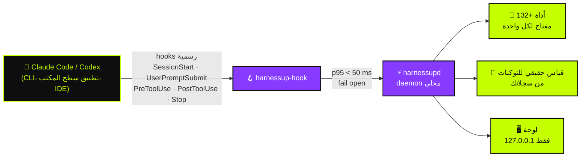

<!-- HarnessUp README · English is the source; translations live in i18n/ -->

<div dir="rtl">

<p align="center">
  <a href="https://harnessup.dev"></a>
</p>

<p align="center">
  <a href="../README.md">🇺🇸 English</a> ·
  <a href="README.pt-BR.md">🇧🇷 Português</a> ·
  <a href="README.es.md">🇪🇸 Español</a> ·
  <a href="README.fr.md">🇫🇷 Français</a> ·
  <a href="README.de.md">🇩🇪 Deutsch</a> ·
  <a href="README.it.md">🇮🇹 Italiano</a> ·
  <a href="README.ja.md">🇯🇵 日本語</a> ·
  <a href="README.ko.md">🇰🇷 한국어</a> ·
  <a href="README.zh-CN.md">🇨🇳 简体中文</a> ·
  <b>🇸🇦 العربية</b> ·
  <a href="README.he.md">🇮🇱 עברית</a> ·
  <a href="README.hi.md">🇮🇳 हिन्दी</a>
</p>

<p align="center">
  <a href="https://www.npmjs.com/package/harnessup"></a>
  <a href="https://github.com/harnessup/harnessup/releases/latest"></a>
  
  
  
  
  <a href="https://github.com/harnessup/harnessup/stargazers"></a>
</p>

<p align="center">
  <a href="https://harnessup.dev/install/"></a>
  <a href="https://harnessup.dev/plans/"></a>
  <a href="https://harnessup.dev/"></a>
  <a href="#-%D8%A7%D9%84%D8%B1%D8%B9%D8%A7%D8%A9"></a>
</p>

<h3 align="center">أكبر موفّر للتوكنات في العالم لوكلاء البرمجة.</h3>

<p align="center">
  أكثر من <b>132 أداة</b> تعمل على جهازك لتقليص هدر التوكنات في <b>Claude Code</b> و<b>Codex</b>.<br>
  قياس مجاني، بلا تسجيل دخول، ومحلي 100%. حتى <b>78% من فاتورتك</b>، مع الدليل المقاس على استخدامك أنت.
</p>

<p align="center">
  
</p>

## 📑 المحتويات

<table>
  <tr>
    <td valign="top">
      <a href="#-الشرير">الشرير</a><br>
      <a href="#-ماذا-يفعل-harnessup">ماذا يفعل HarnessUp</a><br>
      <a href="#-الأرقام">الأرقام</a><br>
      <a href="#%EF%B8%8F-كيف-يعمل">كيف يعمل</a>
    </td>
    <td valign="top">
      <a href="#-جولة">جولة</a><br>
      <a href="#-10-جبهات-132-أداة">10 جبهات، 132+ أداة</a><br>
      <a href="#-أضرار-الذكاء-الاصطناعي-تعاد-بزر-واحد">التراجع بزر واحد</a><br>
      <a href="#%EF%B8%8F-معرض">المعرض</a>
    </td>
    <td valign="top">
      <a href="#-التثبيت-في-سطر">التثبيت</a><br>
      <a href="#-مصنوع-لمن-يعيشون-مع-الوكلاء">لمن هو</a><br>
      <a href="#-الخطط">الخطط</a><br>
      <a href="#-الخصوصية-والأمان">الخصوصية والأمان</a>
    </td>
    <td valign="top">
      <a href="#-الوكلاء-المدعومون">الوكلاء المدعومون</a><br>
      <a href="#-الأسئلة-الشائعة">الأسئلة الشائعة</a><br>
      <a href="#-الرعاة">الرعاة</a><br>
      <a href="#-تعرف-على-hup">تعرّف على Hup</a>
    </td>
  </tr>
</table>

## 🪙 الشرير

<table>
  <tr>
    <td width="42%" valign="middle">
      
    </td>
    <td width="58%" valign="middle">
      <p><b>الجلسة #217 · نموذج مكلف · جهد عالٍ.</b></p>
      <p>تطلب إصلاحاً من سطر واحد. يرد الوكيل بـ <i>"بالتأكيد! سأساعدك في ذلك. سؤال رائع…"</i>، ويعيد قراءة ثلاثة ملفات قرأها من قبل، ويطبع سجلاً من 4000 سطر، ثم يكتب الإصلاح أخيراً. عداد التوكنات لا يتوقف عن الارتفاع.</p>
      <p>كل <i>"بالتأكيد! سأساعدك في ذلك"</i> تُدفع ثمنها في الرد <b>وتُعاد قراءتها في كل جولة تليها</b>. حدّك الأسبوعي ينتهي يوم الأربعاء.</p>
      <p>يطلب HarnessUp إجابات مباشرة، ويمنع إعادة قراءة الملفات التي لم تتغير، ويقلّص المخرجات الضخمة، لكي <b>تصل إلى الجمعة وأمامك متسع</b>.</p>
    </td>
  </tr>
</table>

## ⚡ ماذا يفعل HarnessUp

HarnessUp <b>ليس إضافة ولا MCP ولا skill ولا proxy</b>. إنه طبقة ثانية تتركب تحت الـ harness الخاص بك، ضمن القواعد: daemon محلي يتصل بـ <b>hooks الرسمية</b> في Claude Code وCodex، يقيس كل توكن، ويطبّق الأدوات التي تفعّلها، كل واحدة بمفتاحها الخاص.

<table>
  <tr>
    <td width="25%" align="center" valign="top">
      <br>
      <h3>📏 قياس</h3>
      <sub>Deep Scan و19 أداة قياس ومراقبة أخرى، <b>مجاناً</b>. أعداد توكنات حقيقية من سجلاتك، لا تخمين أبداً.</sub>
    </td>
    <td width="25%" align="center" valign="top">
      <br>
      <h3>💸 توفير</h3>
      <sub>26 أداة توفير: ضغط دون استدعاء النموذج، وردود أخف، ولا إعادة قراءة، وسرب من الوكلاء الفرعيين الرخيصين حيث <i>النموذج المكلف يقرر فقط</i>.</sub>
    </td>
    <td width="25%" align="center" valign="top">
      <br>
      <h3>🛡️ حماية</h3>
      <sub>Stop Loss وAntiloop Protector وSecret Lock وGit Shield والتراجع بنقرة. أضرار الذكاء الاصطناعي تُعاد بزر واحد.</sub>
    </td>
    <td width="25%" align="center" valign="top">
      <br>
      <h3>🎛️ تحكم</h3>
      <sub>أكثر من 200 مفتاح بنقرة واحدة في لوحة محلية. نقرة تشغّل أداة، وأخرى تتراجع عنها. دون حاجة إلى الطرفية.</sub>
    </td>
  </tr>
</table>

## 📊 الأرقام

| | المقياس | ماذا يعني |
|:---:|---|---|
| 🚀 | **حتى 3x** | عمل أكثر بالتوكنات نفسها في خطة ثابتة |
| 💰 | **حتى 78%** | تخفيض الفاتورة لمن يستخدم API |
| 📈 | **أكثر من 260%** | إنتاجية أعلى في بعض نوافذ 5 ساعات |
| 🧰 | **132+** | أداة عبر **10 جبهات**، كلها تعمل على جهازك |
| ⌨️ | **200+** | مفاتيح بنقرة واحدة قابلة للتراجع في اللوحة |
| ⏱️ | **p95 < 50 ms** | لكل hook، مع مهلة قصوى **2 ث**، فلا يتجمّد الوكيل أبداً |
| 🌍 | **12** | لغة في اللوحة |

> [!NOTE]
> "حتى" تعني أكبر المكاسب المقاسة في نوافذ استخدام حقيقية. **رقمك أنت يأتي من سجلاتك**: يقيسه HarnessUp مجاناً قبل أن تدفع أي شيء. راجع الحسابات المفتوحة في [harnessup.dev/metering](https://harnessup.dev/metering/).

## ⚙️ كيف يعمل



- **أسطح رسمية فقط.** يعمل النموذج عبر الملفات التنفيذية الرسمية `claude` و`codex`، بحسابك أنت. لا يقرأ HarnessUp توكنك أو مفتاحك ولا يخزّنه ولا يمرّره أبداً.
- **Fail open، دائماً.** إذا تباطأ HarnessUp أو توقف أو وقع في خطأ، يواصل وكيلك العمل كأنه غير موجود.
- **لا شيء غير قابل للعكس.** كل ما يُقتطع أو يُضغط أو يُحجب يبقى قابلاً للاسترجاع.
- **الثقة المنخفضة تمر مباشرة.** الأفضل ألا توفّر من أن تعطي النموذج معلومات خاطئة.

## 🎬 جولة

<p align="center">
  
</p>

## 🧰 10 جبهات، 132+ أداة

سكين سويسرية لوكلاء البرمجة. لكل أداة مفتاحها الخاص، ولكل مفتاح تراجع.

| الجبهة | الأدوات | الأداة الرئيسية | أبرز ما فيها |
|---|:---:|---|---|
| 📏 **القياس** | 14 | Deep Scan | Harness History وInside the Wallet وModel Insights وHarnessUp Bench وPlan Usage |
| 📡 **المراقبة** | 8 | Session Radar | The Numbers وRealtime Events وReasoning Check وSubagents Work وPlan Advisor |
| 💸 **التوفير** | 26 | Cheap Swarm | Smart Compress وResponse Diet وDelta Read وSmart Cut وTerminal Guide وWebFetch Diet |
| 🎛️ **التحكم** | 25 | Stop Loss | Budget Cap وToolBox وWorking Hours وSwarm Commander وEnforce TDD وForce Lint |
| 🛡️ **الحماية** | 10 | Smart Return | Secret Lock وUltraShield Guard وAntiloop Protector وGit Shield وCheckpoint |
| 🔐 **الأمان** | 8 | Sentinel | Smart Security وSecurity Check وSafeBox وNo Touch وNo Delete |
| 🚀 **الإنتاجية** | 26 | Code Deck | Smart Commit وBuild Now وSuper Code Review وHarnessUp Flow وHarnessUp Board |
| 🧪 **الأدوات المساعدة** | 23 | Prompt Optimizer | Token Calculator وFrozen Cache وMetaPrompt وMirror Master وHarnessUp Shop |
| 🎨 **التخصيص** | 6 | Status Bar | Info Pills وCache Alarm وMod Themes وFinish Line Push |
| 🏗️ **البناة** | 5 | /bones | SPEC/PRD Express وDOCs Generator وWebsite Builder |

<details>
<summary><b>📏 القياس و📡 المراقبة</b>: شاهد أين يذهب كل توكن (معظمها مجاني)</summary>

<br>

- **Deep Scan** (مجاني): يشخّص الهدر في سجلك ويُظهر ما كان HarnessUp سيوفّره.
- **Model Insights** (مجاني): 24 سؤالاً مُجاباً لكل إصدار من النموذج.
- **HarnessUp Bench** (مجاني): تقييم لكل نموذج ومستوى جهد.
- **Openness Meter وHarness Meter وCache Cycle وInside the Wallet وWork Analytics وBad Use وPlan Usage** (مجاني).
- **Session Radar وThe Numbers وUptime وRealtime Events وReasoning Check وSubagents Work وHarness Update وPlan Advisor** (كلها مجانية).
- **/diagnostic و/simulate** (Ultra): اطرح أسئلة عن استخدامك المقاس، وحاكِ القرارات قبل اتخاذها.

</details>

<details>
<summary><b>💸 التوفير</b>: العمل نفسه بتوكنات أقل</summary>

<br>

- **Smart Compress** (مجاني): يضغط المحادثة دون استدعاء النموذج.
- **Response Diet** (مجاني): إجابات مباشرة، بلا مقدمات.
- **Delta Read وCode Finder وSmart Cut وRead Router وHead Limit** (Pro): تقرأ ما هو ضروري فقط ولا تعيد قراءة ملف لم يتغير.
- **Terminal Guide وOutput Diet وWebFetch Diet** (Pro): تُقلَّص مخرجات الأوامر الطويلة وصفحات الويب قبل أن تصل إلى السياق.
- **Renew Session وHot Context وContext Graph وSession Protocol وMemory State** (Pro): جلسات تبدأ خفيفة وتبقى خفيفة.
- **First Pass وWay Out وNo Comment وStature Brake وRules Auditor وOptimize Harness** (Pro).
- **Cheap Swarm** (Ultra): 26 فئة مهام تذهب إلى وكلاء فرعيين رخيصين؛ والنموذج المكلف يقرر فقط.

</details>

<details>
<summary><b>🎛️ التحكم</b>: قواعدك، مفروضة عند حدود استدعاء الأدوات</summary>

<br>

- **Stop Loss وBudget Cap** (Pro): حدّد سقفاً بالدولار الأمريكي فتتوقف الجلسة عنده.
- **ToolBox** (Pro): 17 اتفاقية جاهزة لوكيلك.
- **Working Hours وScheduled Break وReasoning Advisor وRule Checker وForce Test وNo Subagents** (Pro).
- **Swarm Commander وSubs Director وEnforce TDD وForce Lint وDoc Now وAnti-fading وStick Prompt** (Ultra).
- **Anti-Collision** (GIGA) و**HarnessUp OFF** (مجاني): توقف كل شيء دون إلغاء التثبيت.

</details>

<details>
<summary><b>🛡️ الحماية و🔐 الأمان</b>: لا شيء يتسرب، ولا شيء يضيع</summary>

<br>

- **Smart Return وCheckpoint** (Pro): يتراجعان عمّا فعله الوكيل.
- **Git Shield وEyes Off** (Pro): يحميان سجلك وملفاتك الحساسة.
- **SafeBox** (Pro): ما يُقتطع أو يُحجب يبقى قابلاً للاسترجاع 7 أيام.
- **Secret Lock وUltraShield Guard وAntiloop Protector وSandbox Mode وDeny MCP وBlackout** (Ultra).
- **No Touch وNo Delete** (Ultra): ملفات يستطيع الوكيل قراءتها لكنه لا يستطيع تغييرها أو حذفها أبداً.
- **Sentinel وSmart Security وSecurity Check وSEC Station** (GIGA).

</details>

<details>
<summary><b>🚀 الإنتاجية و🧪 الأدوات المساعدة و🎨 التخصيص و🏗️ البناة</b></summary>

<br>

- **Code Deck** (GIGA): أكثر من 17 واجهة سطر أوامر لوكلاء جنباً إلى جنب في 4 خانات.
- **HarnessUp Flow وHarnessUp Board** (GIGA): أتمتة تُوصف بلغة طبيعية، ولوحة لا نهائية.
- **Super Code Review** (GIGA): درجة من 0 إلى 100 لكل تغيير.
- **Smart Commit وBuild Now وSmart Report وSave my Session وGitHub وDeploy بنقرة واحدة** (Ultra).
- **Ez Work وToken Calculator وFrozen Cache وCache Lock وPrompt Optimizer وMetaPrompt (34 نوعاً) وHarnessUp Shop** (مجاني).
- **Mirror Master** (Pro): يُبقي تعليمات CLAUDE.md وAGENTS.md وGEMINI.md وCopilot وCursor وWindsurf وCline وAider متزامنة.
- **Status Bar وInfo Pills وCache Alarm وMod Themes** (مجاني) و**Finish Line Push** (Pro).
- **SPEC/PRD Express وDOCs Generator وbones/ وDOC for Website وWebsite Builder** (GIGA).

</details>

<p align="center">الكتالوج الكامل بكل الأدوات: <a href="https://harnessup.dev/tools/"><b>harnessup.dev/tools</b></a></p>

## ⏪ أضرار الذكاء الاصطناعي، تعاد بزر واحد

<table>
  <tr>
    <td width="58%" valign="middle">
      <p>حذف الوكيل المجلد الخطأ؟ سرّب مفتاحاً إلى السياق؟ أعاد كتابة نصف المستودع في الثانية فجراً؟</p>
      <ul>
        <li><b>Secret Lock</b> يُبقي بيانات الاعتماد خارج السياق.</li>
        <li><b>Smart Return</b> و<b>Checkpoint</b> يتراجعان عمّا فعله الوكيل.</li>
        <li><b>No Delete</b> و<b>Git Shield</b> يوقفان التحركات المدمّرة قبل وقوعها.</li>
        <li><b>SafeBox</b> يحتفظ بكل ما اقتُطع أو حُجب لمدة 7 أيام.</li>
        <li><b>HarnessUp OFF</b> يوقف كل الأدوات دفعة واحدة، دون إلغاء التثبيت.</li>
      </ul>
      <p>تعمل الفرامل عند حدود استدعاء الأدوات فقط: HarnessUp <b>لا يقاطع الوكيل أبداً في منتصف الكتابة</b>.</p>
    </td>
    <td width="42%" valign="middle">
      
    </td>
  </tr>
</table>

## 🖼️ معرض

<table>
  <tr>
    <td align="center" width="33%"><a href="../assets/screens/01-model-insights.png"></a><br><sub><b>Model Insights</b> · يقارن إصدارات النموذج</sub></td>
    <td align="center" width="33%"><a href="../assets/screens/02-subagents-work.png"></a><br><sub><b>Subagents Work</b> · ما يفعله الفريق وما يكلّفه</sub></td>
    <td align="center" width="33%"><a href="../assets/screens/04-bench.png"></a><br><sub><b>HarnessUp Bench</b> · تقييم لكل نموذج وجهد</sub></td>
  </tr>
  <tr>
    <td align="center"><a href="../assets/screens/05-cheap-swarm.png"></a><br><sub><b>Cheap Swarm</b> · ما وفّره السرب</sub></td>
    <td align="center"><a href="../assets/screens/06-code-deck.png"></a><br><sub><b>Code Deck</b> · وكلاء في طرفيات جنباً إلى جنب</sub></td>
    <td align="center"><a href="../assets/screens/07-context-graph.png"></a><br><sub><b>Context Graph</b> · ذاكرة مشروع مفهرسة</sub></td>
  </tr>
  <tr>
    <td align="center"><a href="../assets/screens/10-antiloop.png"></a><br><sub><b>Antiloop Protector</b> · يوقف الحلقات غير المنتجة</sub></td>
    <td align="center"><a href="../assets/screens/08-openness-meter.png"></a><br><sub><b>Openness Meter</b> · كيف تطورت بداية الجلسة</sub></td>
    <td align="center"><a href="../assets/screens/09-shop.png"></a><br><sub><b>HarnessUp Shop</b> · مثبّت للوكلاء وMCP</sub></td>
  </tr>
  <tr>
    <td align="center"><a href="../assets/screens/14-flow-canvas.png"></a><br><sub><b>HarnessUp Flow</b> · أتمتة بلغة طبيعية</sub></td>
    <td align="center"><a href="../assets/screens/15-board.png"></a><br><sub><b>HarnessUp Board</b> · لوحة لا نهائية</sub></td>
    <td align="center"><a href="../assets/screens/12-ez-work-timer.png"></a><br><sub><b>Ez Work</b> · Ghost Prompt وWork Timer</sub></td>
  </tr>
</table>

<details>
<summary>المزيد من الشاشات</summary>
<br>
<p align="center">
  
  
  
</p>
</details>

## 📦 التثبيت في سطر

<table>
  <tr>
    <td width="40%" valign="middle">
      
    </td>
    <td width="60%" valign="middle">
      <p>لكل مستخدم. <b>بلا مدير، بلا تسجيل دخول، بلا بريد، بلا خدمة نظام.</b> تُفحص الملفات التنفيذية بـ SHA-256 قبل التثبيت، والتحديثات موقّعة.</p>
      <p><b>npm</b> (Windows وmacOS وLinux · Node 18+)</p>

```sh
npm install -g harnessup
```

<p><b>Windows</b> · PowerShell، دون Node</p>

```powershell
irm https://harnessup.dev/install.ps1 | iex
```

<p><b>macOS وLinux</b> · دون Node، دون sudo</p>

```sh
curl -fsSL https://harnessup.dev/install.sh | sh
```

</td>
  </tr>
</table>

ثم:

```sh
harnessup install     # يربط HarnessUp بـ Claude Code وCodex
harnessup doctor      # يفحص التثبيت
harnessup uninstall   # يزيله نظيفاً
```

<details>
<summary><b>طرق تثبيت أخرى</b>: .exe، وZIP، وpnpm/yarn/bun، أو اترك وكيلك يتولى الأمر</summary>

<br>

- **مثبّت Windows**: `HarnessUp-Setup-x64.exe` (Windows 10/11 بنظام 64 بت، لكل مستخدم) من [harnessup.dev/install](https://harnessup.dev/install/).
- **ZIP**: نزّله من [GitHub Releases](https://github.com/harnessup/harnessup/releases/latest) وتحقق منه بـ `SHA256SUMS.txt`.
- **pnpm وyarn وbun**: `pnpm add -g harnessup` · `yarn global add harnessup` · `bun add -g harnessup`.
- **1 prompt**: الصق هذا في Claude Code أو Codex ودع الوكيل يثبته عنك:

```text
ثبّت HarnessUp على هذا الجهاز: نفّذ npm install -g harnessup (بدون Node: على Windows، irm https://harnessup.dev/install.ps1 | iex في PowerShell؛ على macOS وLinux، curl -fsSL https://harnessup.dev/install.sh | sh في Terminal)، وتحقق من ربطه بـ Claude Code وCodex، وافتح اللوحة. لا تطلب تسجيل دخول أو بريداً أو صلاحيات مدير.
```

- **قريباً**: winget وScoop وChocolatey وHomebrew وSnap.

</details>

📘 الدليل الكامل، مع التحديث وإلغاء التثبيت واستكشاف الأخطاء: **[INSTALL.ar.md](INSTALL.ar.md)**.

## 👥 مصنوع لمن يعيشون مع الوكلاء

<table>
  <tr>
    <td width="33%" align="center" valign="top">
      <br>
      <h3>على خطة ثابتة</h3>
      <sub>خطط Claude Pro/Max أو ChatGPT. <b>حتى 3x</b> عمل أكثر في النافذة نفسها: حدّك الأسبوعي يتضاعف تقريباً.</sub>
    </td>
    <td width="33%" align="center" valign="top">
      <br>
      <h3>الدفع عبر API</h3>
      <sub>كل توكن مال. <b>حتى 78% أقل</b> في الفاتورة، مئات الدولارات شهرياً لمن يستخدم بكثافة.</sub>
    </td>
    <td width="33%" align="center" valign="top">
      <br>
      <h3>بلا طرفية</h3>
      <sub>مثبّت لـ Windows و<b>أكثر من 200 مفتاح قابل للتراجع</b> في اللوحة. انقر، شاهد الرقم، وانقر مجدداً للتراجع.</sub>
    </td>
  </tr>
</table>

## 💳 الخطط

<table>
  <tr>
    <th width="25%">Basic</th>
    <th width="25%">Pro</th>
    <th width="25%">Ultra</th>
    <th width="25%">GIGA UNLIMITED</th>
  </tr>
  <tr align="center">
    <td><h3>مجاناً</h3><sub>دائماً</sub></td>
    <td><h3>US$ 9<sub>/شهر</sub></h3><sub>أو US$ 6/شهر مع الدفع السنوي</sub></td>
    <td><h3>US$ 12<sub>/شهر</sub></h3><sub>أو US$ 9/شهر مع الدفع السنوي</sub></td>
    <td><h3>US$ 27<sub>/شهر</sub></h3><sub>أو US$ 19/شهر مع الدفع السنوي</sub></td>
  </tr>
  <tr valign="top">
    <td><sub>حساب Claude Code واحد · مشروع واحد<br>يقيس كل شيء: Deep Scan والمراقبة وأكثر من 20 أداة مجانية</sub></td>
    <td><sub>حساب Claude واحد + حساب Codex واحد · مشروعان<br>التوفير والتحكم والحماية والتراجع</sub></td>
    <td><sub>حسابان لـ Claude + حسابان لـ Codex · 6 مشاريع<br>Cheap Swarm وSecret Lock وAntiloop والأتمتة</sub></td>
    <td><sub>Harnesses وحسابات ومشاريع غير محدودة<br>Code Deck وFlow وBoard والأمان والبناة</sub></td>
  </tr>
</table>

- ✅ **تجربة مجانية لمدة 7 أيام** في الخطط المدفوعة: بلا بطاقة، بلا تسجيل.
- ✅ كل خطة تشمل كل ما هو أدناه منها. جلسات غير محدودة في كل الخطط. ألغِ متى شئت، دون استمارة.
- ✅ استرداد خلال 7 أيام من الشراء. تفعيل واحد متنقل لكل مفتاح.
- 👥 **الفريق**: 10 تراخيص GIGA بمبلغ US$ 1,699 سنوياً. **الشركات**: [corporate@harnessup.dev](mailto:corporate@harnessup.dev).

<p align="center"><a href="https://harnessup.dev/plans/"><b>قارن كل أداة حسب الخطة، واطلع على خصومات early-bird الحالية ←</b></a></p>

## 🔒 الخصوصية والأمان

| | |
|---|---|
| 🏠 **محلي 100%** | كل شيء يعمل على جهازك. لا proxy، ولا اعتراض لواجهة API، ولا MCP ثقيل. |
| 🔑 **حسابك، توكنك** | يشغّل `claude` و`codex` الرسميين بحسابك، ولا يقرأ توكنك أو مفتاحك ولا يخزّنه ولا يمرّره أبداً. |
| 🖥️ **اللوحة على 127.0.0.1** | تجيب على جهازك وحده. صفحة حسابك تُظهر **0 بايت من الاستخدام مُرسلة**. |
| 🟢 **Fail open** | إذا تباطأ HarnessUp أو توقف أو وقع في خطأ، يواصل الوكيل العمل. p95 < 50 ms، ومهلة قصوى 2 ث. |
| ⏪ **قابل للعكس** | كل مفتاح يُتراجع عنه بنقرة. SafeBox يحتفظ بما اقتُطع لمدة 7 أيام. |
| 👤 **لا حساب للبدء** | بلا تسجيل دخول، ولا بريد، ولا كلمة مرور، ولا صلاحيات مدير للتثبيت والقياس. |

عثرت على ثغرة؟ اتبع [SECURITY.md](../SECURITY.md) بدل فتح issue عام.

## 🤖 الوكلاء المدعومون

| الوكيل | الحالة | أين |
|---|:---:|---|
| **Claude Code** | ✅ مدمج | CLI وتطبيق سطح المكتب وإضافات IDE، بحساب أو عبر API |
| **Codex** | ✅ مدمج | CLI وتطبيق سطح المكتب وإضافات IDE، بحساب أو عبر API |
| **Cursor** | 🔜 قريباً | |
| **OpenCode** | 🔜 قريباً | |
| **Hermes Agent** | 🔜 قريباً | |

**Code Deck** يشغّل أكثر من 17 واجهة سطر أوامر لوكلاء جنباً إلى جنب، و**Mirror Master** يُبقي ملفات التعليمات لـ 8 harnesses متزامنة.

## ❓ الأسئلة الشائعة

<details>
<summary><b>هل هو آمن؟</b></summary>
<br>
نعم. يستخدم الـ hooks الرسمية فقط، ولا يوجد proxy، ويعمل 100% على جهازك. إذا توقف، يواصل وكيلك العمل كالمعتاد.
</details>

<details>
<summary><b>هل يقرأ توكني أو مفتاح API الخاص بي؟</b></summary>
<br>
أبداً. يعمل النموذج عبر الملفات التنفيذية الرسمية <code>claude</code> و<code>codex</code>، بحسابك أنت. لا يقرأ HarnessUp توكنك أو مفتاحك ولا يخزّنه ولا يمرّره أبداً.
</details>

<details>
<summary><b>هل يبطئ الوكيل؟</b></summary>
<br>
لا. للـ hooks p95 أقل من 50 ms ومهلة قصوى 2 ث. إذا تباطأ شيء ما، يمضي الوكيل دون انتظار.
</details>

<details>
<summary><b>هل يعمل لمستخدمي API؟</b></summary>
<br>
نعم، وهنا يظهر التوفير أكثر: كل توكن يُوفَّر هو مال يبقى في جيبك.
</details>

<details>
<summary><b>هل أحتاج إلى الطرفية؟</b></summary>
<br>
لا. يوجد مثبّت لـ Windows ولوحة فيها أكثر من 200 مفتاح قابل للتراجع بنقرة.
</details>

<details>
<summary><b>هل أحتاج بطاقة للخطة المجانية؟</b></summary>
<br>
لا. Basic مجاني دائماً، وللخطط المدفوعة تجربة لمدة 7 أيام دون بطاقة ودون تسجيل.
</details>

<details>
<summary><b>هل يعمل على macOS وLinux؟</b></summary>
<br>
نعم، عبر npm أو سكربت <code>install.sh</code>.
</details>

<details>
<summary><b>كم جهازاً يمكنني استخدامه؟</b></summary>
<br>
تفعيل واحد في كل مرة لكل مفتاح. الترخيص متنقل: انقله بين الأجهزة متى شئت.
</details>

<details>
<summary><b>لماذا يُظهر Windows تحذير SmartScreen على ملف .exe؟</b></summary>
<br>
هو تحذير سمعة للناشرين الجدد. مسارا npm وPowerShell لا يحملان هذا التحذير، وتُنشر تجزئات SHA-256 على <a href="https://harnessup.dev/windows-warning/">harnessup.dev/windows-warning</a>. شهادة توقيع الكود من الأشياء التي يساعد الرعاة في تمويلها.
</details>

<details>
<summary><b>كيف أُلغي التثبيت؟</b></summary>
<br>
نفّذ <code>harnessup uninstall</code>. للإيقاف المؤقت دون إلغاء التثبيت، فعّل <b>HarnessUp OFF</b> في اللوحة.
</details>

<p align="center">المزيد من الإجابات على <a href="https://harnessup.dev/faq/"><b>harnessup.dev/faq</b></a></p>

## 💜 الرعاة

<table>
  <tr>
    <td width="30%" align="center" valign="middle">
      
    </td>
    <td width="70%" valign="middle">
      <p><b>خطة Basic مجانية دائماً، ونريدها أن تبقى هكذا.</b> يبنيه فريق صغير ومستقل، والرعاية هي ما يُبقي القياس مجانياً للجميع.</p>
      <p><b>ما تموّله رعايتك:</b></p>
      <ul>
        <li>🔏 شهادة توقيع كود لـ Windows، لكي يختفي تحذير SmartScreen</li>
        <li>🍎 اختبار ودعم على أجهزة macOS وLinux حقيقية</li>
        <li>📦 حزم winget وScoop وChocolatey وHomebrew وSnap</li>
        <li>🤖 تكامل مع وكلاء أكثر: Cursor وOpenCode وHermes Agent</li>
        <li>🌍 إبقاء اللوحة والموقع بـ 12 لغة</li>
      </ul>
    </td>
  </tr>
</table>

**لماذا ترعى HarnessUp؟** يصل شعارك إلى المطورين في اللحظة التي يهتمون فيها بتكلفة وكلاء البرمجة الخاصة بهم وتحكمهم وأمانهم: في هذا الـ README، وفي كل الترجمات الـ 12، وعلى [harnessup.dev](https://harnessup.dev).

<p align="center">
  <a href="mailto:corporate@harnessup.dev?subject=HarnessUp%20sponsorship"></a>
</p>

<table>
  <tr>
    <td align="center" width="33%"><br>🥇<br><b>شعارك هنا</b><br><sub>راعٍ ذهبي</sub><br><br></td>
    <td align="center" width="33%"><br>🥈<br><b>شعارك هنا</b><br><sub>راعٍ فضي</sub><br><br></td>
    <td align="center" width="33%"><br>🥉<br><b>شعارك هنا</b><br><sub>راعٍ برونزي</sub><br><br></td>
  </tr>
</table>

**لست شركة؟** تساعد بالقدر نفسه بوضع ⭐ **نجمة على هذا المستودع**، أو بمشاركة HarnessUp مع صديق يحرق التوكنات، أو بالانضمام إلى **[برنامج الشركاء](https://harnessup.dev/affiliates/)**: أحلتَ، وربحت. لا تحتاج إلى أن تكون عميلاً للانضمام.

## 🤖 تعرف على Hup

<p align="center">
  
  
  
  
  
</p>

<p align="center">
  <b>Hup</b> هو تميمة HarnessUp: مفتاح ليموني داخل حزام بنفسجي يمسك بتوكناتك،<br>
  يوقف المقدمة بيد واحدة ويقود وكلاءك الفرعيين بعصا.
</p>

<p align="center">
  
</p>

## 🔗 روابط

<p align="center">
  <a href="https://harnessup.dev/">الموقع</a> ·
  <a href="https://harnessup.dev/install/">التنزيل</a> ·
  <a href="https://harnessup.dev/plans/">الخطط</a> ·
  <a href="https://harnessup.dev/tools/">الأدوات</a> ·
  <a href="https://harnessup.dev/faq/">الأسئلة الشائعة</a> ·
  <a href="https://www.npmjs.com/package/harnessup">npm</a> ·
  <a href="https://github.com/harnessup/harnessup/releases">الإصدارات</a> ·
  <a href="https://github.com/harnessup/harnessup/discussions">النقاشات</a> ·
  <a href="../SUPPORT.md">الدعم</a> ·
  <a href="mailto:help@harnessup.dev">help@harnessup.dev</a>
</p>

## 📄 الترخيص

HarnessUp برنامج مملوك، ومجاني للبدء بخطة Basic. يوزّع هذا المستودع المنتج وأدلته وتوثيقه، ولا يحتوي على كود مصدري. راجع [LICENSE.md](../LICENSE.md). جميع الحقوق محفوظة.

<p align="center">
  <br>
  <sub>صُنع بـ 💜 و🍋 · <a href="https://harnessup.dev">harnessup.dev</a></sub>
</p>

</div>
