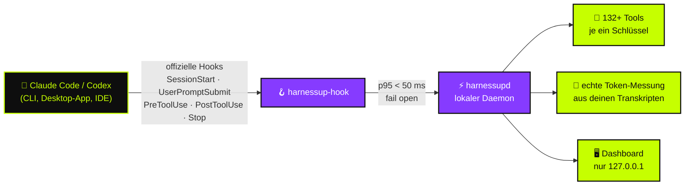

<!-- HarnessUp README · Englisch ist die Quelle; Übersetzungen liegen in i18n/ -->

<p align="center">
  <a href="https://harnessup.dev"></a>
</p>

<p align="center">
  <a href="../README.md">🇺🇸 English</a> ·
  <a href="README.pt-BR.md">🇧🇷 Português</a> ·
  <a href="README.es.md">🇪🇸 Español</a> ·
  <a href="README.fr.md">🇫🇷 Français</a> ·
  <b>🇩🇪 Deutsch</b> ·
  <a href="README.it.md">🇮🇹 Italiano</a> ·
  <a href="README.ja.md">🇯🇵 日本語</a> ·
  <a href="README.ko.md">🇰🇷 한국어</a> ·
  <a href="README.zh-CN.md">🇨🇳 简体中文</a> ·
  <a href="README.ar.md">🇸🇦 العربية</a> ·
  <a href="README.he.md">🇮🇱 עברית</a> ·
  <a href="README.hi.md">🇮🇳 हिन्दी</a>
</p>

<p align="center">
  <a href="https://www.npmjs.com/package/harnessup"></a>
  <a href="https://github.com/harnessup/harnessup/releases/latest"></a>
  
  
  
  
  <a href="https://github.com/harnessup/harnessup/stargazers"></a>
</p>

<p align="center">
  <a href="https://harnessup.dev/de/install/"></a>
  <a href="https://harnessup.dev/de/plans/"></a>
  <a href="https://harnessup.dev/de/"></a>
  <a href="#-sponsoren"></a>
</p>

<h3 align="center">Der größte Token-Sparer für Coding-Agenten der Welt.</h3>

<p align="center">
  Über <b>132 Tools</b> laufen auf deinem eigenen Rechner, um die Token-Verschwendung von <b>Claude Code</b> und <b>Codex</b> zu senken.<br>
  Kostenlose Messung, ohne Login, 100 % lokal. Bis zu <b>78 % weniger auf deiner Rechnung</b>, mit dem Nachweis, gemessen an deiner eigenen Nutzung.
</p>

<p align="center">
  
</p>

## 📑 Inhalt

<table>
  <tr>
    <td valign="top">
      <a href="#-der-bösewicht">Der Bösewicht</a><br>
      <a href="#-was-harnessup-macht">Was HarnessUp macht</a><br>
      <a href="#-die-zahlen">Die Zahlen</a><br>
      <a href="#%EF%B8%8F-so-funktioniert-es">So funktioniert es</a>
    </td>
    <td valign="top">
      <a href="#-tour">Tour</a><br>
      <a href="#-10-bereiche-132-tools">10 Bereiche, 132+ Tools</a><br>
      <a href="#-ki-schäden-mit-einem-knopf-zurückgespult">Rückgängig mit einem Knopf</a><br>
      <a href="#%EF%B8%8F-galerie">Galerie</a>
    </td>
    <td valign="top">
      <a href="#-installation-in-einer-zeile">Installation</a><br>
      <a href="#-gemacht-für-menschen-die-mit-agenten-leben">Für wen es ist</a><br>
      <a href="#-tarife">Tarife</a><br>
      <a href="#-datenschutz-und-sicherheit">Datenschutz und Sicherheit</a>
    </td>
    <td valign="top">
      <a href="#-unterstützte-agenten">Unterstützte Agenten</a><br>
      <a href="#-faq">FAQ</a><br>
      <a href="#-sponsoren">Sponsoren</a><br>
      <a href="#-hup-kennenlernen">Hup kennenlernen</a>
    </td>
  </tr>
</table>

## 🪙 Der Bösewicht

<table>
  <tr>
    <td width="42%" valign="middle">
      
    </td>
    <td width="58%" valign="middle">
      <p><b>Sitzung #217 · teures Modell · hoher Aufwand.</b></p>
      <p>Du bittest um eine Korrektur in einer Zeile. Der Agent antwortet mit <i>„Klar! Ich helfe dir gern dabei. Gute Frage…“</i>, liest drei Dateien erneut, die er schon gelesen hat, gibt ein Protokoll mit 4.000 Zeilen aus und schreibt erst danach die Korrektur. Der Token-Zähler klettert weiter.</p>
      <p>Jedes <i>„Klar! Ich helfe dir gern dabei“</i> wird in der Antwort bezahlt <b>und in jeder folgenden Runde erneut gelesen</b>. Dein Wochenlimit ist am Mittwoch aufgebraucht.</p>
      <p>HarnessUp verlangt direkte Antworten, blockiert das erneute Lesen unveränderter Dateien und kürzt riesige Ausgaben, damit du <b>mit Luft nach oben bis Freitag kommst</b>.</p>
    </td>
  </tr>
</table>

## ⚡ Was HarnessUp macht

HarnessUp ist **kein Plugin, kein MCP, kein Skill und kein Proxy**. Es ist eine zweite Schicht, die sich unter dein Harness einfügt, innerhalb der Regeln: ein lokaler Daemon, der sich in die **offiziellen Hooks** von Claude Code und Codex einklinkt, jeden Token misst und die Tools anwendet, die du einschaltest, jedes mit seinem eigenen Schlüssel.

<table>
  <tr>
    <td width="25%" align="center" valign="top">
      <br>
      <h3>📏 Messen</h3>
      <sub>Deep Scan und 19 weitere Mess- und Überwachungs-Tools, <b>kostenlos</b>. Echte Token-Zahlen aus deinen Transkripten, niemals Schätzungen.</sub>
    </td>
    <td width="25%" align="center" valign="top">
      <br>
      <h3>💸 Sparen</h3>
      <sub>26 Spar-Tools: Komprimierung ohne Modellaufruf, schlankere Antworten, kein erneutes Lesen und ein Schwarm günstiger Subagenten, bei dem <i>das teure Modell nur entscheidet</i>.</sub>
    </td>
    <td width="25%" align="center" valign="top">
      <br>
      <h3>🛡️ Schützen</h3>
      <sub>Stop Loss, Antiloop Protector, Secret Lock, Git Shield und Rückgängig mit einem Klick. KI-Schäden werden mit einem Knopf zurückgespult.</sub>
    </td>
    <td width="25%" align="center" valign="top">
      <br>
      <h3>🎛️ Steuern</h3>
      <sub>Über 200 Ein-Klick-Schalter in einem lokalen Dashboard. Ein Klick schaltet ein Tool ein, ein weiterer macht es rückgängig. Kein Terminal nötig.</sub>
    </td>
  </tr>
</table>

## 📊 Die Zahlen

| | Kennzahl | Was sie bedeutet |
|:---:|---|---|
| 🚀 | **bis zu 3x** | mehr Arbeit mit denselben Tokens bei einem Festpreis-Tarif |
| 💰 | **bis zu 78 %** | weniger auf der Rechnung für API-Nutzer |
| 📈 | **über 260 %** | mehr Durchsatz in manchen 5-Stunden-Fenstern |
| 🧰 | **132+** | Tools in **10 Bereichen**, alle auf deinem Rechner |
| ⌨️ | **200+** | umkehrbare Ein-Klick-Schalter im Dashboard |
| ⏱️ | **p95 < 50 ms** | pro Hook, mit hartem Timeout von **2 s**, damit der Agent nie einfriert |
| 🌍 | **12** | Sprachen im Dashboard |

> [!NOTE]
> „Bis zu“ meint die größten Gewinne, gemessen in echten Nutzungsfenstern. **Deine eigene Zahl stammt aus deinen eigenen Transkripten**: HarnessUp misst sie kostenlos, bevor du etwas bezahlst. Die offene Rechnung findest du unter [harnessup.dev/de/metering](https://harnessup.dev/de/metering/).

## ⚙️ So funktioniert es



- **Nur offizielle Schnittstellen.** Das Modell läuft über die offiziellen Binaries `claude` und `codex` mit deinem eigenen Konto. HarnessUp liest, speichert und gibt deinen Token oder Schlüssel niemals weiter.
- **Fail open, immer.** Wenn HarnessUp langsam, aus oder fehlerhaft ist, arbeitet dein Agent weiter, als wäre es nicht da.
- **Nichts ist unumkehrbar.** Was gekürzt, komprimiert oder blockiert wird, bleibt wiederherstellbar.
- **Geringe Sicherheit geht direkt durch.** Lieber nicht sparen, als dem Modell falsche Informationen zu liefern.

## 🎬 Tour

<p align="center">
  
</p>

## 🧰 10 Bereiche, 132+ Tools

Ein Schweizer Taschenmesser für Coding-Agenten. Jedes Tool hat seinen eigenen Schlüssel, und jeder Schlüssel lässt sich rückgängig machen.

| Bereich | Tools | Star-Tool | Highlights |
|---|:---:|---|---|
| 📏 **Messung** | 14 | Deep Scan | Harness History, Inside the Wallet, Model Insights, HarnessUp Bench, Plan Usage |
| 📡 **Überwachung** | 8 | Session Radar | The Numbers, Realtime Events, Reasoning Check, Subagents Work, Plan Advisor |
| 💸 **Einsparungen** | 26 | Cheap Swarm | Smart Compress, Response Diet, Delta Read, Smart Cut, Terminal Guide, WebFetch Diet |
| 🎛️ **Steuerung** | 25 | Stop Loss | Budget Cap, ToolBox, Working Hours, Swarm Commander, Enforce TDD, Force Lint |
| 🛡️ **Schutz** | 10 | Smart Return | Secret Lock, UltraShield Guard, Antiloop Protector, Git Shield, Checkpoint |
| 🔐 **Sicherheit** | 8 | Sentinel | Smart Security, Security Check, SafeBox, No Touch, No Delete |
| 🚀 **Produktivität** | 26 | Code Deck | Smart Commit, Build Now, Super Code Review, HarnessUp Flow, HarnessUp Board |
| 🧪 **Hilfsprogramme** | 23 | Prompt Optimizer | Token Calculator, Frozen Cache, MetaPrompt, Mirror Master, HarnessUp Shop |
| 🎨 **Anpassung** | 6 | Status Bar | Info Pills, Cache Alarm, Mod Themes, Finish Line Push |
| 🏗️ **Builder** | 5 | /bones | SPEC/PRD Express, DOCs Generator, Website Builder |

<details>
<summary><b>📏 Messung und 📡 Überwachung</b>: sieh, wohin jeder Token geht (größtenteils kostenlos)</summary>

<br>

- **Deep Scan** (kostenlos): diagnostiziert die Verschwendung in deinem Verlauf und zeigt, was HarnessUp gespart hätte.
- **Model Insights** (kostenlos): 24 Fragen, beantwortet pro Modellversion.
- **HarnessUp Bench** (kostenlos): Bewertung pro Modell und Aufwandsstufe.
- **Openness Meter, Harness Meter, Cache Cycle, Inside the Wallet, Work Analytics, Bad Use, Plan Usage** (kostenlos).
- **Session Radar, The Numbers, Uptime, Realtime Events, Reasoning Check, Subagents Work, Harness Update, Plan Advisor** (alle kostenlos).
- **/diagnostic und /simulate** (Ultra): stelle Fragen zu deiner gemessenen Nutzung und simuliere Entscheidungen, bevor du sie triffst.

</details>

<details>
<summary><b>💸 Einsparungen</b>: dieselbe Arbeit für weniger Tokens</summary>

<br>

- **Smart Compress** (kostenlos): verdichtet die Unterhaltung, ohne das Modell aufzurufen.
- **Response Diet** (kostenlos): direkte Antworten, ohne Vorrede.
- **Delta Read, Code Finder, Smart Cut, Read Router, Head Limit** (Pro): lies nur, was nötig ist, und lies nie eine unveränderte Datei erneut.
- **Terminal Guide, Output Diet, WebFetch Diet** (Pro): lange Befehlsausgaben und Webseiten werden gekürzt, bevor sie den Kontext erreichen.
- **Renew Session, Hot Context, Context Graph, Session Protocol, Memory State** (Pro): Sitzungen, die schlank starten und schlank bleiben.
- **First Pass, Way Out, No Comment, Stature Brake, Rules Auditor, Optimize Harness** (Pro).
- **Cheap Swarm** (Ultra): 26 Aufgabenklassen gehen an günstige Subagenten; das teure Modell entscheidet nur.

</details>

<details>
<summary><b>🎛️ Steuerung</b>: deine Regeln, durchgesetzt an den Grenzen der Tool-Aufrufe</summary>

<br>

- **Stop Loss und Budget Cap** (Pro): setze eine Obergrenze in US$, und die Sitzung stoppt dort.
- **ToolBox** (Pro): 17 fertige Konventionen für deinen Agenten.
- **Working Hours, Scheduled Break, Reasoning Advisor, Rule Checker, Force Test, No Subagents** (Pro).
- **Swarm Commander, Subs Director, Enforce TDD, Force Lint, Doc Now, Anti-fading, Stick Prompt** (Ultra).
- **Anti-Collision** (GIGA) und **HarnessUp OFF** (kostenlos): alles pausieren, ohne zu deinstallieren.

</details>

<details>
<summary><b>🛡️ Schutz und 🔐 Sicherheit</b>: nichts leakt, nichts geht verloren</summary>

<br>

- **Smart Return und Checkpoint** (Pro): spule zurück, was der Agent getan hat.
- **Git Shield und Eyes Off** (Pro): schütze deine Historie und deine sensiblen Dateien.
- **SafeBox** (Pro): alles, was gekürzt oder blockiert wird, bleibt 7 Tage wiederherstellbar.
- **Secret Lock, UltraShield Guard, Antiloop Protector, Sandbox Mode, Deny MCP, Blackout** (Ultra).
- **No Touch und No Delete** (Ultra): Dateien, die der Agent lesen, aber nie ändern oder löschen kann.
- **Sentinel, Smart Security, Security Check, SEC Station** (GIGA).

</details>

<details>
<summary><b>🚀 Produktivität, 🧪 Hilfsprogramme, 🎨 Anpassung und 🏗️ Builder</b></summary>

<br>

- **Code Deck** (GIGA): 17+ Agenten-CLIs nebeneinander in 4 Feldern.
- **HarnessUp Flow und HarnessUp Board** (GIGA): Automatisierung in natürlicher Sprache beschrieben und ein unendliches Board.
- **Super Code Review** (GIGA): eine Bewertung von 0 bis 100 für jede Änderung.
- **Smart Commit, Build Now, Smart Report, Save my Session, GitHub und Deploy mit einem Klick** (Ultra).
- **Ez Work, Token Calculator, Frozen Cache, Cache Lock, Prompt Optimizer, MetaPrompt (34 Typen), HarnessUp Shop** (kostenlos).
- **Mirror Master** (Pro): hält die Anweisungen von CLAUDE.md, AGENTS.md, GEMINI.md, Copilot, Cursor, Windsurf, Cline und Aider synchron.
- **Status Bar, Info Pills, Cache Alarm, Mod Themes** (kostenlos) und **Finish Line Push** (Pro).
- **SPEC/PRD Express, DOCs Generator, /bones, DOC for Website, Website Builder** (GIGA).

</details>

<p align="center">Vollständiger Katalog mit jedem Tool: <a href="https://harnessup.dev/de/tools/"><b>harnessup.dev/de/tools</b></a></p>

## ⏪ KI-Schäden, mit einem Knopf zurückgespult

<table>
  <tr>
    <td width="58%" valign="middle">
      <p>Der Agent hat den falschen Ordner gelöscht? Einen Schlüssel in den Kontext geleakt? Um 2 Uhr nachts die halbe Repository umgeschrieben?</p>
      <ul>
        <li><b>Secret Lock</b> hält Zugangsdaten aus dem Kontext heraus.</li>
        <li><b>Smart Return</b> und <b>Checkpoint</b> spulen zurück, was der Agent getan hat.</li>
        <li><b>No Delete</b> und <b>Git Shield</b> stoppen zerstörerische Aktionen, bevor sie passieren.</li>
        <li><b>SafeBox</b> bewahrt alles, was gekürzt oder blockiert wurde, 7 Tage lang auf.</li>
        <li><b>HarnessUp OFF</b> pausiert alle Tools auf einmal, ohne zu deinstallieren.</li>
      </ul>
      <p>Bremsen wirken nur an den Grenzen der Tool-Aufrufe: HarnessUp <b>unterbricht den Agenten nie mitten in einem Schreibvorgang</b>.</p>
    </td>
    <td width="42%" valign="middle">
      
    </td>
  </tr>
</table>

## 🖼️ Galerie

<table>
  <tr>
    <td align="center" width="33%"><a href="../assets/screens/01-model-insights.png"></a><br><sub><b>Model Insights</b> · vergleicht Modellversionen</sub></td>
    <td align="center" width="33%"><a href="../assets/screens/02-subagents-work.png"></a><br><sub><b>Subagents Work</b> · was das Team tut und kostet</sub></td>
    <td align="center" width="33%"><a href="../assets/screens/04-bench.png"></a><br><sub><b>HarnessUp Bench</b> · Bewertung pro Modell und Aufwand</sub></td>
  </tr>
  <tr>
    <td align="center"><a href="../assets/screens/05-cheap-swarm.png"></a><br><sub><b>Cheap Swarm</b> · was der Schwarm gespart hat</sub></td>
    <td align="center"><a href="../assets/screens/06-code-deck.png"></a><br><sub><b>Code Deck</b> · Agenten in Terminals nebeneinander</sub></td>
    <td align="center"><a href="../assets/screens/07-context-graph.png"></a><br><sub><b>Context Graph</b> · indiziertes Projektgedächtnis</sub></td>
  </tr>
  <tr>
    <td align="center"><a href="../assets/screens/10-antiloop.png"></a><br><sub><b>Antiloop Protector</b> · stoppt unproduktive Schleifen</sub></td>
    <td align="center"><a href="../assets/screens/08-openness-meter.png"></a><br><sub><b>Openness Meter</b> · wie sich der Sitzungsbeginn entwickelt hat</sub></td>
    <td align="center"><a href="../assets/screens/09-shop.png"></a><br><sub><b>HarnessUp Shop</b> · Installer für Agenten und MCPs</sub></td>
  </tr>
  <tr>
    <td align="center"><a href="../assets/screens/14-flow-canvas.png"></a><br><sub><b>HarnessUp Flow</b> · Automatisierung in natürlicher Sprache</sub></td>
    <td align="center"><a href="../assets/screens/15-board.png"></a><br><sub><b>HarnessUp Board</b> · unendliches Board</sub></td>
    <td align="center"><a href="../assets/screens/12-ez-work-timer.png"></a><br><sub><b>Ez Work</b> · Ghost Prompt und Work Timer</sub></td>
  </tr>
</table>

<details>
<summary>Weitere Bildschirme</summary>
<br>
<p align="center">
  
  
  
</p>
</details>

## 📦 Installation in einer Zeile

<table>
  <tr>
    <td width="40%" valign="middle">
      
    </td>
    <td width="60%" valign="middle">
      <p>Pro Benutzer. <b>Kein Administrator, kein Login, keine E-Mail, kein Systemdienst.</b> Binaries werden vor der Installation mit SHA-256 geprüft, und Updates sind signiert.</p>
      <p><b>npm</b> (Windows, macOS, Linux · Node 18+)</p>

```sh
npm install -g harnessup
```

<p><b>Windows</b> · PowerShell, ohne Node</p>

```powershell
irm https://harnessup.dev/install.ps1 | iex
```

<p><b>macOS und Linux</b> · ohne Node, ohne sudo</p>

```sh
curl -fsSL https://harnessup.dev/install.sh | sh
```

</td>
  </tr>
</table>

Dann:

```sh
harnessup install     # verbindet HarnessUp mit Claude Code und Codex
harnessup doctor      # prüft die Installation
harnessup uninstall   # entfernt es sauber
```

<details>
<summary><b>Weitere Installationswege</b>: .exe, ZIP, pnpm/yarn/bun, oder lass deinen Agenten es erledigen</summary>

<br>

- **Windows-Installer**: `HarnessUp-Setup-x64.exe` (Windows 10/11 64 Bit, pro Benutzer) unter [harnessup.dev/de/install](https://harnessup.dev/de/install/).
- **ZIP**: lade es von den [GitHub Releases](https://github.com/harnessup/harnessup/releases/latest) herunter und prüfe es gegen `SHA256SUMS.txt`.
- **pnpm, yarn, bun**: `pnpm add -g harnessup` · `yarn global add harnessup` · `bun add -g harnessup`.
- **1 Prompt**: füge dies in Claude Code oder Codex ein und lass den Agenten die Installation für dich übernehmen:

```text
Installiere HarnessUp auf diesem Rechner: führe npm install -g harnessup aus (ohne Node: unter Windows irm https://harnessup.dev/install.ps1 | iex in PowerShell; unter macOS und Linux curl -fsSL https://harnessup.dev/install.sh | sh im Terminal), bestätige, dass es mit Claude Code und Codex verbunden ist, und öffne das Dashboard. Frag nicht nach Login, E-Mail oder Administrator.
```

- **Demnächst**: winget, Scoop, Chocolatey, Homebrew und Snap.

</details>

📘 Vollständige Anleitung, mit Aktualisieren, Deinstallieren und Fehlerbehebung: **[INSTALL.de.md](INSTALL.de.md)**.

## 👥 Gemacht für Menschen, die mit Agenten leben

<table>
  <tr>
    <td width="33%" align="center" valign="top">
      <br>
      <h3>Im Festpreis-Tarif</h3>
      <sub>Claude Pro/Max oder ChatGPT-Tarife. <b>Bis zu 3x</b> mehr Arbeit im selben Zeitfenster: dein Wochenlimit verdoppelt sich ungefähr.</sub>
    </td>
    <td width="33%" align="center" valign="top">
      <br>
      <h3>Bezahlung per API</h3>
      <sub>Jeder Token ist Geld. <b>Bis zu 78 % weniger</b> auf der Rechnung, bei Vielnutzern mehrere hundert Dollar im Monat.</sub>
    </td>
    <td width="33%" align="center" valign="top">
      <br>
      <h3>Ohne Terminal</h3>
      <sub>Ein Windows-Installer und <b>über 200 umkehrbare Schalter</b> im Dashboard. Klicken, die Zahl sehen, nochmal klicken zum Rückgängigmachen.</sub>
    </td>
  </tr>
</table>

## 💳 Tarife

<table>
  <tr>
    <th width="25%">Basic</th>
    <th width="25%">Pro</th>
    <th width="25%">Ultra</th>
    <th width="25%">GIGA UNLIMITED</th>
  </tr>
  <tr align="center">
    <td><h3>KOSTENLOS</h3><sub>für immer</sub></td>
    <td><h3>US$ 9<sub>/Monat</sub></h3><sub>oder US$ 6/Monat bei Jahreszahlung</sub></td>
    <td><h3>US$ 12<sub>/Monat</sub></h3><sub>oder US$ 9/Monat bei Jahreszahlung</sub></td>
    <td><h3>US$ 27<sub>/Monat</sub></h3><sub>oder US$ 19/Monat bei Jahreszahlung</sub></td>
  </tr>
  <tr valign="top">
    <td><sub>1 Claude-Code-Konto · 1 Projekt<br>Misst alles: Deep Scan, Überwachung und über 20 kostenlose Tools</sub></td>
    <td><sub>1 Claude- + 1 Codex-Konto · 2 Projekte<br>Einsparungen, Steuerung, Schutz und Rückgängig</sub></td>
    <td><sub>2 Claude- + 2 Codex-Konten · 6 Projekte<br>Cheap Swarm, Secret Lock, Antiloop, Automatisierungen</sub></td>
    <td><sub>Unbegrenzte Harnesses, Konten und Projekte<br>Code Deck, Flow, Board, Security, Builder</sub></td>
  </tr>
</table>

- ✅ **7 Tage kostenlos testen** bei kostenpflichtigen Tarifen: keine Karte, keine Anmeldung.
- ✅ Jeder Tarif enthält alles, was darunter steht. Unbegrenzte Sitzungen in jedem Tarif. Jederzeit kündbar, ohne Formular.
- ✅ Erstattung innerhalb von 7 Tagen nach dem Kauf. Eine schwebende Aktivierung pro Schlüssel.
- 👥 **Team**: 10 GIGA-Lizenzen für US$ 1.699 pro Jahr. **Unternehmen**: [corporate@harnessup.dev](mailto:corporate@harnessup.dev).

<p align="center"><a href="https://harnessup.dev/de/plans/"><b>Jedes Tool pro Tarif vergleichen und die aktuellen Frühbucherrabatte sehen →</b></a></p>

## 🔒 Datenschutz und Sicherheit

| | |
|---|---|
| 🏠 **100 % lokal** | Alles läuft auf deinem Rechner. Kein Proxy, keine API-Abfangung, kein schweres MCP. |
| 🔑 **Dein Konto, dein Token** | Führt die offiziellen `claude` und `codex` mit deinem Konto aus und liest, speichert und gibt deinen Token oder Schlüssel niemals weiter. |
| 🖥️ **Dashboard auf 127.0.0.1** | Es antwortet nur auf deinem Rechner. Deine Kontoseite zeigt **0 Byte gesendete Nutzung**. |
| 🟢 **Fail open** | Wenn HarnessUp langsam, aus oder fehlerhaft ist, arbeitet der Agent weiter. p95 < 50 ms, hartes Timeout von 2 s. |
| ⏪ **Umkehrbar** | Jeder Schlüssel lässt sich mit einem Klick rückgängig machen. SafeBox bewahrt das Gekürzte 7 Tage lang auf. |
| 👤 **Kein Konto zum Start** | Kein Login, keine E-Mail, kein Passwort und keine Administratorrechte zum Installieren und Messen. |

Eine Sicherheitslücke gefunden? Bitte folge [SECURITY.md](../SECURITY.md), statt ein öffentliches Issue zu eröffnen.

## 🤖 Unterstützte Agenten

| Agent | Status | Wo |
|---|:---:|---|
| **Claude Code** | ✅ Integriert | CLI, Desktop-App und IDE-Erweiterungen, mit Konto oder über die API |
| **Codex** | ✅ Integriert | CLI, Desktop-App und IDE-Erweiterungen, mit Konto oder über die API |
| **Cursor** | 🔜 Demnächst | |
| **OpenCode** | 🔜 Demnächst | |
| **Hermes Agent** | 🔜 Demnächst | |

**Code Deck** läuft bereits mit 17+ Agenten-CLIs nebeneinander, und **Mirror Master** hält die Anweisungsdateien von 8 Harnesses synchron.

## ❓ FAQ

<details>
<summary><b>Ist es sicher?</b></summary>
<br>
Ja. Es nutzt nur die offiziellen Hooks, es gibt keinen Proxy, und es läuft zu 100 % auf deinem Rechner. Wenn es stoppt, arbeitet dein Agent wie gewohnt weiter.
</details>

<details>
<summary><b>Liest es meinen Token oder API-Schlüssel?</b></summary>
<br>
Niemals. Das Modell läuft über die offiziellen Binaries <code>claude</code> und <code>codex</code> mit deinem eigenen Konto. HarnessUp liest, speichert und gibt deinen Token oder Schlüssel niemals weiter.
</details>

<details>
<summary><b>Bremst es den Agenten aus?</b></summary>
<br>
Nein. Hooks haben ein p95 unter 50 ms und ein hartes Timeout von 2 s. Ist etwas langsam, arbeitet der Agent ohne Wartezeit weiter.
</details>

<details>
<summary><b>Funktioniert es für API-Nutzer?</b></summary>
<br>
Ja, und dort sieht man die Einsparungen am deutlichsten: jeder gesparte Token ist Geld, das in deiner Tasche bleibt.
</details>

<details>
<summary><b>Brauche ich das Terminal?</b></summary>
<br>
Nein. Es gibt einen Windows-Installer und ein Dashboard mit über 200 umkehrbaren Ein-Klick-Schaltern.
</details>

<details>
<summary><b>Brauche ich eine Karte für den kostenlosen Tarif?</b></summary>
<br>
Nein. Basic ist für immer kostenlos, und kostenpflichtige Tarife haben 7 Tage Test ohne Karte und ohne Anmeldung.
</details>

<details>
<summary><b>Funktioniert es unter macOS und Linux?</b></summary>
<br>
Ja, über npm oder das Skript <code>install.sh</code>.
</details>

<details>
<summary><b>Wie viele Rechner kann ich nutzen?</b></summary>
<br>
Eine Aktivierung gleichzeitig pro Schlüssel. Die Lizenz ist schwebend: Du kannst sie jederzeit zwischen Rechnern verschieben.
</details>

<details>
<summary><b>Warum zeigt Windows bei der .exe eine SmartScreen-Warnung?</b></summary>
<br>
Es ist eine Reputationswarnung für neue Herausgeber. Die npm- und PowerShell-Wege haben keine Warnung, und die SHA-256-Hashes werden unter <a href="https://harnessup.dev/de/windows-warning/">harnessup.dev/de/windows-warning</a> veröffentlicht. Ein Code-Signing-Zertifikat gehört zu den Dingen, die Sponsoren mitfinanzieren helfen.
</details>

<details>
<summary><b>Wie deinstalliere ich es?</b></summary>
<br>
Führe <code>harnessup uninstall</code> aus. Zum Pausieren ohne Deinstallation schalte im Dashboard <b>HarnessUp OFF</b> ein.
</details>

<p align="center">Weitere Antworten unter <a href="https://harnessup.dev/de/faq/"><b>harnessup.dev/de/faq</b></a></p>

## 💜 Sponsoren

<table>
  <tr>
    <td width="30%" align="center" valign="middle">
      
    </td>
    <td width="70%" valign="middle">
      <p><b>Der Basic-Tarif ist für immer kostenlos, und wir wollen, dass es so bleibt.</b> HarnessUp wird von einem kleinen unabhängigen Team gebaut, und Sponsoring ist das, was die kostenlose Messung für alle möglich macht.</p>
      <p><b>Womit dein Sponsoring finanziert wird:</b></p>
      <ul>
        <li>🔏 Ein Windows-Code-Signing-Zertifikat, damit die SmartScreen-Warnung verschwindet</li>
        <li>🍎 Tests und Support auf echten macOS- und Linux-Rechnern</li>
        <li>📦 Pakete für winget, Scoop, Chocolatey, Homebrew und Snap</li>
        <li>🤖 Integration weiterer Agenten: Cursor, OpenCode, Hermes Agent</li>
        <li>🌍 Dashboard und Website in 12 Sprachen halten</li>
      </ul>
    </td>
  </tr>
</table>

**Warum HarnessUp sponsern?** Dein Logo erreicht Entwickler genau in dem Moment, in dem sie sich um Kosten, Kontrolle und Sicherheit ihrer Coding-Agenten kümmern: in dieser README, in allen 12 Übersetzungen und auf [harnessup.dev](https://harnessup.dev).

<p align="center">
  <a href="mailto:corporate@harnessup.dev?subject=HarnessUp%20Sponsoring"></a>
</p>

<table>
  <tr>
    <td align="center" width="33%"><br>🥇<br><b>Dein Logo hier</b><br><sub>Gold-Sponsor</sub><br><br></td>
    <td align="center" width="33%"><br>🥈<br><b>Dein Logo hier</b><br><sub>Silber-Sponsor</sub><br><br></td>
    <td align="center" width="33%"><br>🥉<br><b>Dein Logo hier</b><br><sub>Bronze-Sponsor</sub><br><br></td>
  </tr>
</table>

**Kein Unternehmen?** Du hilfst genauso, indem du ⭐ **dieses Repository mit einem Stern versiehst**, HarnessUp mit einem Freund teilst, der Tokens verbrennt, oder dem **[Partnerprogramm](https://harnessup.dev/de/affiliates/)** beitrittst: empfohlen, verdient. Du musst kein Kunde sein, um mitzumachen.

## 🤖 Hup kennenlernen

<p align="center">
  
  
  
  
  
</p>

<p align="center">
  <b>Hup</b> ist das Maskottchen von HarnessUp: eine limettengrüne Taste in einem violetten Harness, die deine Tokens festhält,<br>
  mit einer Hand die Vorrede stoppt und deine Subagenten mit einem Taktstock dirigiert.
</p>

<p align="center">
  
</p>

## 🔗 Links

<p align="center">
  <a href="https://harnessup.dev/de/">Webseite</a> ·
  <a href="https://harnessup.dev/de/install/">Download</a> ·
  <a href="https://harnessup.dev/de/plans/">Tarife</a> ·
  <a href="https://harnessup.dev/de/tools/">Tools</a> ·
  <a href="https://harnessup.dev/de/faq/">FAQ</a> ·
  <a href="https://www.npmjs.com/package/harnessup">npm</a> ·
  <a href="https://github.com/harnessup/harnessup/releases">Releases</a> ·
  <a href="https://github.com/harnessup/harnessup/discussions">Diskussionen</a> ·
  <a href="../SUPPORT.md">Support</a> ·
  <a href="mailto:help@harnessup.dev">help@harnessup.dev</a>
</p>

## 📄 Lizenz

HarnessUp ist proprietäre Software, zum Start mit dem Basic-Tarif kostenlos. Dieses Repository verteilt das Produkt, seine Anleitungen und seine Dokumentation und enthält keinen Quellcode. Siehe [LICENSE.md](../LICENSE.md). Alle Rechte vorbehalten.

<p align="center">
  <br>
  <sub>Gemacht mit 💜 und 🍋 · <a href="https://harnessup.dev">harnessup.dev</a></sub>
</p>
