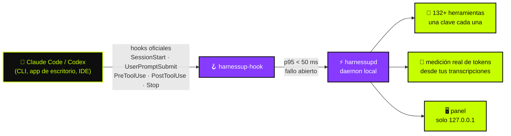

<!-- HarnessUp README · English is the source; translations live in i18n/ -->

<p align="center">
  <a href="https://harnessup.dev"></a>
</p>

<p align="center">
  <a href="../README.md">🇺🇸 English</a> ·
  <a href="README.pt-BR.md">🇧🇷 Português</a> ·
  <b>🇪🇸 Español</b> ·
  <a href="README.fr.md">🇫🇷 Français</a> ·
  <a href="README.de.md">🇩🇪 Deutsch</a> ·
  <a href="README.it.md">🇮🇹 Italiano</a> ·
  <a href="README.ja.md">🇯🇵 日本語</a> ·
  <a href="README.ko.md">🇰🇷 한국어</a> ·
  <a href="README.zh-CN.md">🇨🇳 简体中文</a> ·
  <a href="README.ar.md">🇸🇦 العربية</a> ·
  <a href="README.he.md">🇮🇱 עברית</a> ·
  <a href="README.hi.md">🇮🇳 हिन्दी</a>
</p>

<p align="center">
  <a href="https://www.npmjs.com/package/harnessup"></a>
  <a href="https://github.com/harnessup/harnessup/releases/latest"></a>
  
  
  
  
  <a href="https://github.com/harnessup/harnessup/stargazers"></a>
</p>

<p align="center">
  <a href="https://harnessup.dev/es/install/"></a>
  <a href="https://harnessup.dev/es/plans/"></a>
  <a href="https://harnessup.dev/es/"></a>
  <a href="#-patrocinadores"></a>
</p>

<h3 align="center">El mayor ahorrador de tokens del mundo para agentes de código.</h3>

<p align="center">
  Más de <b>132 herramientas</b> que corren en tu propia máquina para reducir el desperdicio de tokens de <b>Claude Code</b> y <b>Codex</b>.<br>
  Medición gratuita, sin login, 100% local. Hasta <b>78% menos en tu factura</b>, con la prueba medida con tu propio uso.
</p>

<p align="center">
  
</p>

## 📑 Contenido

<table>
  <tr>
    <td valign="top">
      <a href="#-el-villano">El villano</a><br>
      <a href="#-qué-hace-harnessup">Qué hace HarnessUp</a><br>
      <a href="#-los-números">Los números</a><br>
      <a href="#%EF%B8%8F-cómo-funciona">Cómo funciona</a>
    </td>
    <td valign="top">
      <a href="#-recorrido">Recorrido</a><br>
      <a href="#-10-frentes-132-herramientas">10 frentes, 132+ herramientas</a><br>
      <a href="#-el-daño-de-la-ia-deshecho-con-un-botón">Deshacer con un botón</a><br>
      <a href="#%EF%B8%8F-galería">Galería</a>
    </td>
    <td valign="top">
      <a href="#-instala-en-una-línea">Instalar</a><br>
      <a href="#-hecho-para-quien-vive-de-agentes">Para quién es</a><br>
      <a href="#-planes">Planes</a><br>
      <a href="#-privacidad-y-seguridad">Privacidad y seguridad</a>
    </td>
    <td valign="top">
      <a href="#-agentes-compatibles">Agentes compatibles</a><br>
      <a href="#-preguntas-frecuentes">Preguntas frecuentes</a><br>
      <a href="#-patrocinadores">Patrocinadores</a><br>
      <a href="#-conoce-a-hup">Conoce a Hup</a>
    </td>
  </tr>
</table>

## 🪙 El villano

<table>
  <tr>
    <td width="42%" valign="middle">
      
    </td>
    <td width="58%" valign="middle">
      <p><b>Sesión #217 · modelo caro · esfuerzo alto.</b></p>
      <p>Pides una corrección de una línea. El agente responde con <i>"¡Claro! Te ayudo con eso. ¡Buena pregunta…"</i>, vuelve a leer tres archivos que ya leyó, imprime un log de 4.000 líneas y solo entonces escribe la corrección. El contador de tokens no para de subir.</p>
      <p>Cada <i>"¡Claro! Te ayudo con eso"</i> se paga en la respuesta <b>y se vuelve a leer en cada ronda siguiente</b>. Tu límite semanal muere el miércoles.</p>
      <p>HarnessUp pide respuestas directas, bloquea las relecturas de archivos sin cambios y recorta las salidas gigantes, para que <b>llegues al viernes con margen</b>.</p>
    </td>
  </tr>
</table>

## ⚡ Qué hace HarnessUp

HarnessUp <b>no es un plugin, un MCP, una skill ni un proxy</b>. Es una segunda capa que se acomoda debajo de tu harness, dentro de las reglas: un daemon local que se conecta a los <b>hooks oficiales</b> de Claude Code y Codex, mide cada token y aplica las herramientas que enciendes, cada una con su propia clave.

<table>
  <tr>
    <td width="25%" align="center" valign="top">
      <br>
      <h3>📏 Medir</h3>
      <sub>Deep Scan y 19 herramientas más de medición y monitoreo, <b>gratis</b>. Conteos reales de tokens de tus transcripciones, nunca suposiciones.</sub>
    </td>
    <td width="25%" align="center" valign="top">
      <br>
      <h3>💸 Ahorrar</h3>
      <sub>26 herramientas de ahorro: compresión sin llamar al modelo, respuestas más cortas, sin relecturas, y un enjambre de subagentes baratos donde <i>el modelo caro solo decide</i>.</sub>
    </td>
    <td width="25%" align="center" valign="top">
      <br>
      <h3>🛡️ Proteger</h3>
      <sub>Stop Loss, Antiloop Protector, Secret Lock, Git Shield y deshacer con un clic. El daño de la IA se rebobina con un botón.</sub>
    </td>
    <td width="25%" align="center" valign="top">
      <br>
      <h3>🎛️ Controlar</h3>
      <sub>Más de 200 claves de un clic en un panel local. Un clic enciende una herramienta, otro la apaga. No necesitas terminal.</sub>
    </td>
  </tr>
</table>

## 📊 Los números

| | Métrica | Qué significa |
|:---:|---|---|
| 🚀 | **hasta 3x** | más trabajo con los mismos tokens en un plan fijo |
| 💰 | **hasta 78%** | menos en la factura para quien usa API |
| 📈 | **más de 260%** | más rendimiento en algunas ventanas de 5 horas |
| 🧰 | **132+** | herramientas en **10 frentes**, todas corriendo en tu máquina |
| ⌨️ | **200+** | claves reversibles de un clic en el panel |
| ⏱️ | **p95 < 50 ms** | por hook, con un timeout máximo de **2 s**, para que el agente nunca se congele |
| 🌍 | **12** | idiomas en el panel |

> [!NOTE]
> "Hasta" significa las mayores ganancias medidas en ventanas de uso reales. **Tu número sale de tus propias transcripciones**: HarnessUp lo mide gratis antes de que pagues nada. Mira las cuentas abiertas en [harnessup.dev/es/metering](https://harnessup.dev/es/metering/).

## ⚙️ Cómo funciona



- **Solo superficies oficiales.** El modelo corre con los binarios oficiales `claude` y `codex`, con tu propia cuenta. HarnessUp nunca lee, guarda ni transmite tu token o clave.
- **Fallo abierto, siempre.** Si HarnessUp se vuelve lento, se apaga o da error, tu agente sigue trabajando como si no estuviera.
- **Nada es irreversible.** Lo que se recorta, comprime o bloquea sigue siendo recuperable.
- **Baja confianza = pasa directo.** Es mejor no ahorrar que entregarle al modelo información equivocada.

## 🎬 Recorrido

<p align="center">
  
</p>

## 🧰 10 frentes, 132+ herramientas

Una navaja suiza para agentes de código. Cada herramienta tiene su propia clave, y cada clave se puede deshacer.

| Frente | Herramientas | Herramienta estrella | Destacados |
|---|:---:|---|---|
| 📏 **Medición** | 14 | Deep Scan | Harness History, Inside the Wallet, Model Insights, HarnessUp Bench, Plan Usage |
| 📡 **Monitoreo** | 8 | Session Radar | The Numbers, Realtime Events, Reasoning Check, Subagents Work, Plan Advisor |
| 💸 **Ahorro** | 26 | Cheap Swarm | Smart Compress, Response Diet, Delta Read, Smart Cut, Terminal Guide, WebFetch Diet |
| 🎛️ **Control** | 25 | Stop Loss | Budget Cap, ToolBox, Working Hours, Swarm Commander, Enforce TDD, Force Lint |
| 🛡️ **Protección** | 10 | Smart Return | Secret Lock, UltraShield Guard, Antiloop Protector, Git Shield, Checkpoint |
| 🔐 **Seguridad** | 8 | Sentinel | Smart Security, Security Check, SafeBox, No Touch, No Delete |
| 🚀 **Productividad** | 26 | Code Deck | Smart Commit, Build Now, Super Code Review, HarnessUp Flow, HarnessUp Board |
| 🧪 **Utilidades** | 23 | Prompt Optimizer | Token Calculator, Frozen Cache, MetaPrompt, Mirror Master, HarnessUp Shop |
| 🎨 **Personalización** | 6 | Status Bar | Info Pills, Cache Alarm, Mod Themes, Finish Line Push |
| 🏗️ **Constructores** | 5 | /bones | SPEC/PRD Express, DOCs Generator, Website Builder |

<details>
<summary><b>📏 Medición y 📡 Monitoreo</b>: mira a dónde va cada token (casi todo gratis)</summary>

<br>

- **Deep Scan** (gratis): diagnostica el desperdicio en tu historial y muestra lo que HarnessUp habría ahorrado.
- **Model Insights** (gratis): 24 preguntas respondidas por versión de modelo.
- **HarnessUp Bench** (gratis): puntuación por modelo y nivel de esfuerzo.
- **Openness Meter, Harness Meter, Cache Cycle, Inside the Wallet, Work Analytics, Bad Use, Plan Usage** (gratis).
- **Session Radar, The Numbers, Uptime, Realtime Events, Reasoning Check, Subagents Work, Harness Update, Plan Advisor** (todas gratis).
- **/diagnostic y /simulate** (Ultra): haz preguntas sobre tu uso medido y simula decisiones antes de tomarlas.

</details>

<details>
<summary><b>💸 Ahorro</b>: el mismo trabajo con menos tokens</summary>

<br>

- **Smart Compress** (gratis): compacta la conversación sin llamar al modelo.
- **Response Diet** (gratis): respuestas directas, sin preámbulo.
- **Delta Read, Code Finder, Smart Cut, Read Router, Head Limit** (Pro): leen solo lo necesario y nunca releen un archivo sin cambios.
- **Terminal Guide, Output Diet, WebFetch Diet** (Pro): salidas largas de comandos y páginas web recortadas antes de llegar al contexto.
- **Renew Session, Hot Context, Context Graph, Session Protocol, Memory State** (Pro): sesiones que empiezan ligeras y se mantienen ligeras.
- **First Pass, Way Out, No Comment, Stature Brake, Rules Auditor, Optimize Harness** (Pro).
- **Cheap Swarm** (Ultra): 26 clases de tarea van a subagentes baratos; el modelo caro solo decide.

</details>

<details>
<summary><b>🎛️ Control</b>: tus reglas, aplicadas en los límites de llamada a herramientas</summary>

<br>

- **Stop Loss y Budget Cap** (Pro): define un tope en US$ y la sesión se detiene ahí.
- **ToolBox** (Pro): 17 convenciones listas para tu agente.
- **Working Hours, Scheduled Break, Reasoning Advisor, Rule Checker, Force Test, No Subagents** (Pro).
- **Swarm Commander, Subs Director, Enforce TDD, Force Lint, Doc Now, Anti-fading, Stick Prompt** (Ultra).
- **Anti-Collision** (GIGA) y **HarnessUp OFF** (gratis): pausan todo sin desinstalar.

</details>

<details>
<summary><b>🛡️ Protección y 🔐 Seguridad</b>: nada se filtra, nada se pierde</summary>

<br>

- **Smart Return y Checkpoint** (Pro): rebobinan lo que hizo el agente.
- **Git Shield y Eyes Off** (Pro): protegen tu historial y tus archivos sensibles.
- **SafeBox** (Pro): lo que se recorta o bloquea queda recuperable durante 7 días.
- **Secret Lock, UltraShield Guard, Antiloop Protector, Sandbox Mode, Deny MCP, Blackout** (Ultra).
- **No Touch y No Delete** (Ultra): archivos que el agente puede leer pero nunca cambiar ni borrar.
- **Sentinel, Smart Security, Security Check, SEC Station** (GIGA).

</details>

<details>
<summary><b>🚀 Productividad, 🧪 Utilidades, 🎨 Personalización y 🏗️ Constructores</b></summary>

<br>

- **Code Deck** (GIGA): 17+ CLIs de agentes lado a lado en 4 ranuras.
- **HarnessUp Flow y HarnessUp Board** (GIGA): automatizaciones descritas en lenguaje natural y un tablero infinito.
- **Super Code Review** (GIGA): una puntuación de 0 a 100 para cada cambio.
- **Smart Commit, Build Now, Smart Report, Save my Session, GitHub y Deploy en 1 clic** (Ultra).
- **Ez Work, Token Calculator, Frozen Cache, Cache Lock, Prompt Optimizer, MetaPrompt (34 tipos), HarnessUp Shop** (gratis).
- **Mirror Master** (Pro): mantiene sincronizadas las instrucciones de CLAUDE.md, AGENTS.md, GEMINI.md, Copilot, Cursor, Windsurf, Cline y Aider.
- **Status Bar, Info Pills, Cache Alarm, Mod Themes** (gratis) y **Finish Line Push** (Pro).
- **SPEC/PRD Express, DOCs Generator, /bones, DOC for Website, Website Builder** (GIGA).

</details>

<p align="center">Catálogo completo con todas las herramientas: <a href="https://harnessup.dev/es/tools/"><b>harnessup.dev/es/tools</b></a></p>

## ⏪ El daño de la IA, deshecho con un botón

<table>
  <tr>
    <td width="58%" valign="middle">
      <p>¿El agente borró la carpeta equivocada? ¿Filtró una clave al contexto? ¿Reescribió medio repositorio a las 2 de la mañana?</p>
      <ul>
        <li><b>Secret Lock</b> mantiene las credenciales fuera del contexto.</li>
        <li><b>Smart Return</b> y <b>Checkpoint</b> rebobinan lo que hizo el agente.</li>
        <li><b>No Delete</b> y <b>Git Shield</b> frenan los movimientos destructivos antes de que ocurran.</li>
        <li><b>SafeBox</b> guarda durante 7 días todo lo que se recortó o bloqueó.</li>
        <li><b>HarnessUp OFF</b> pausa todas las herramientas de una vez, sin desinstalar.</li>
      </ul>
      <p>Los frenos actúan solo en los límites de llamada a herramientas: HarnessUp <b>nunca interrumpe al agente en medio de una escritura</b>.</p>
    </td>
    <td width="42%" valign="middle">
      
    </td>
  </tr>
</table>

## 🖼️ Galería

<table>
  <tr>
    <td align="center" width="33%"><a href="../assets/screens/01-model-insights.png"></a><br><sub><b>Model Insights</b> · compara versiones de modelo</sub></td>
    <td align="center" width="33%"><a href="../assets/screens/02-subagents-work.png"></a><br><sub><b>Subagents Work</b> · qué hace el equipo y cuánto cuesta</sub></td>
    <td align="center" width="33%"><a href="../assets/screens/04-bench.png"></a><br><sub><b>HarnessUp Bench</b> · puntuación por modelo y esfuerzo</sub></td>
  </tr>
  <tr>
    <td align="center"><a href="../assets/screens/05-cheap-swarm.png"></a><br><sub><b>Cheap Swarm</b> · lo que ahorró el enjambre</sub></td>
    <td align="center"><a href="../assets/screens/06-code-deck.png"></a><br><sub><b>Code Deck</b> · agentes en terminales lado a lado</sub></td>
    <td align="center"><a href="../assets/screens/07-context-graph.png"></a><br><sub><b>Context Graph</b> · memoria del proyecto indexada</sub></td>
  </tr>
  <tr>
    <td align="center"><a href="../assets/screens/10-antiloop.png"></a><br><sub><b>Antiloop Protector</b> · frena los bucles improductivos</sub></td>
    <td align="center"><a href="../assets/screens/08-openness-meter.png"></a><br><sub><b>Openness Meter</b> · cómo evolucionó la apertura de la sesión</sub></td>
    <td align="center"><a href="../assets/screens/09-shop.png"></a><br><sub><b>HarnessUp Shop</b> · instalador de agentes y MCPs</sub></td>
  </tr>
  <tr>
    <td align="center"><a href="../assets/screens/14-flow-canvas.png"></a><br><sub><b>HarnessUp Flow</b> · automatización en lenguaje natural</sub></td>
    <td align="center"><a href="../assets/screens/15-board.png"></a><br><sub><b>HarnessUp Board</b> · tablero infinito</sub></td>
    <td align="center"><a href="../assets/screens/12-ez-work-timer.png"></a><br><sub><b>Ez Work</b> · Ghost Prompt y Work Timer</sub></td>
  </tr>
</table>

<details>
<summary>Más pantallas</summary>
<br>
<p align="center">
  
  
  
</p>
</details>

## 📦 Instala en una línea

<table>
  <tr>
    <td width="40%" valign="middle">
      
    </td>
    <td width="60%" valign="middle">
      <p>Por usuario. <b>Sin admin, sin login, sin correo, sin servicio del sistema.</b> Los binarios se verifican con SHA-256 antes de instalarse, y las actualizaciones van firmadas.</p>
      <p><b>npm</b> (Windows, macOS, Linux · Node 18+)</p>

```sh
npm install -g harnessup
```

<p><b>Windows</b> · PowerShell, sin Node</p>

```powershell
irm https://harnessup.dev/install.ps1 | iex
```

<p><b>macOS y Linux</b> · sin Node, sin sudo</p>

```sh
curl -fsSL https://harnessup.dev/install.sh | sh
```

</td>
  </tr>
</table>

Luego:

```sh
harnessup install     # conecta HarnessUp con Claude Code y Codex
harnessup doctor      # revisa la instalación
harnessup uninstall   # lo quita sin dejar restos
```

<details>
<summary><b>Más formas de instalar</b>: .exe, ZIP, pnpm/yarn/bun, o deja que tu agente lo haga</summary>

<br>

- **Instalador de Windows**: `HarnessUp-Setup-x64.exe` (Windows 10/11 de 64 bits, por usuario) en [harnessup.dev/es/install](https://harnessup.dev/es/install/).
- **ZIP**: descárgalo desde [GitHub Releases](https://github.com/harnessup/harnessup/releases/latest) y compáralo con `SHA256SUMS.txt`.
- **pnpm, yarn, bun**: `pnpm add -g harnessup` · `yarn global add harnessup` · `bun add -g harnessup`.
- **1 prompt**: pega esto en Claude Code o Codex y deja que el agente lo instale por ti:

```text
Instala HarnessUp en esta máquina: ejecuta npm install -g harnessup (sin Node: en Windows, irm https://harnessup.dev/install.ps1 | iex en PowerShell; en macOS y Linux, curl -fsSL https://harnessup.dev/install.sh | sh en la Terminal), confirma que quedó integrado con Claude Code y Codex, y abre el panel. No pidas login, correo ni admin.
```

- **Próximamente**: winget, Scoop, Chocolatey, Homebrew y Snap.

</details>

📘 Guía completa, con actualización, desinstalación y solución de problemas: **[INSTALL.es.md](INSTALL.es.md)**.

## 👥 Hecho para quien vive de agentes

<table>
  <tr>
    <td width="33%" align="center" valign="top">
      <br>
      <h3>En plan fijo</h3>
      <sub>Planes Claude Pro/Max o ChatGPT. <b>Hasta 3x</b> más trabajo en la misma ventana: tu límite semanal casi se duplica.</sub>
    </td>
    <td width="33%" align="center" valign="top">
      <br>
      <h3>Pagando por API</h3>
      <sub>Cada token es dinero. <b>Hasta 78% menos</b> en la factura, cientos de dólares al mes para usuarios intensivos.</sub>
    </td>
    <td width="33%" align="center" valign="top">
      <br>
      <h3>Sin terminal</h3>
      <sub>Un instalador para Windows y <b>más de 200 claves reversibles</b> en el panel. Haz clic, mira el número, haz clic de nuevo para deshacer.</sub>
    </td>
  </tr>
</table>

## 💳 Planes

<table>
  <tr>
    <th width="25%">Basic</th>
    <th width="25%">Pro</th>
    <th width="25%">Ultra</th>
    <th width="25%">GIGA UNLIMITED</th>
  </tr>
  <tr align="center">
    <td><h3>GRATIS</h3><sub>para siempre</sub></td>
    <td><h3>US$ 9<sub>/mes</sub></h3><sub>o US$ 6/mes con facturación anual</sub></td>
    <td><h3>US$ 12<sub>/mes</sub></h3><sub>o US$ 9/mes con facturación anual</sub></td>
    <td><h3>US$ 27<sub>/mes</sub></h3><sub>o US$ 19/mes con facturación anual</sub></td>
  </tr>
  <tr valign="top">
    <td><sub>1 cuenta de Claude Code · 1 proyecto<br>Mide todo: Deep Scan, Monitoreo y más de 20 herramientas gratis</sub></td>
    <td><sub>1 cuenta de Claude + 1 cuenta de Codex · 2 proyectos<br>Ahorro, control, protección y deshacer</sub></td>
    <td><sub>2 cuentas de Claude + 2 cuentas de Codex · 6 proyectos<br>Cheap Swarm, Secret Lock, Antiloop, automatizaciones</sub></td>
    <td><sub>Harnesses, cuentas y proyectos ilimitados<br>Code Deck, Flow, Board, Seguridad, Constructores</sub></td>
  </tr>
</table>

- ✅ **Prueba gratis de 7 días** en los planes de pago: sin tarjeta, sin registro.
- ✅ Cada plan incluye todo lo de abajo. Sesiones ilimitadas en todos los planes. Cancela cuando quieras, sin formularios.
- ✅ Reembolso dentro de los 7 días de la compra. Una activación flotante por clave.
- 👥 **Equipo**: 10 licencias GIGA por US$ 1,699 al año. **Corporativo**: [corporate@harnessup.dev](mailto:corporate@harnessup.dev).

<p align="center"><a href="https://harnessup.dev/es/plans/"><b>Compara todas las herramientas por plan y mira los descuentos early-bird vigentes →</b></a></p>

## 🔒 Privacidad y seguridad

| | |
|---|---|
| 🏠 **100% local** | Todo corre en tu máquina. Sin proxy, sin interceptar la API, sin MCP pesados. |
| 🔑 **Tu cuenta, tu token** | Ejecuta el `claude` y el `codex` oficiales con tu cuenta y nunca lee, guarda ni transmite tu token o clave. |
| 🖥️ **Panel en 127.0.0.1** | Responde solo en tu máquina. Tu página de cuenta muestra **0 bytes de uso enviados**. |
| 🟢 **Fallo abierto** | Si HarnessUp se vuelve lento, se apaga o da error, el agente sigue funcionando. p95 < 50 ms, timeout máximo de 2 s. |
| ⏪ **Reversible** | Cada clave se puede deshacer con un clic. SafeBox guarda lo recortado durante 7 días. |
| 👤 **Sin cuenta para empezar** | Sin login, sin correo, sin contraseña y sin derechos de admin para instalar y medir. |

¿Encontraste una vulnerabilidad? Sigue [SECURITY.md](../SECURITY.md) en lugar de abrir un issue público.

## 🤖 Agentes compatibles

| Agente | Estado | Dónde |
|---|:---:|---|
| **Claude Code** | ✅ Integrado | CLI, app de escritorio y extensiones de IDE, con cuenta o vía API |
| **Codex** | ✅ Integrado | CLI, app de escritorio y extensiones de IDE, con cuenta o vía API |
| **Cursor** | 🔜 Próximamente | |
| **OpenCode** | 🔜 Próximamente | |
| **Hermes Agent** | 🔜 Próximamente | |

**Code Deck** ya ejecuta más de 17 CLIs de agentes lado a lado, y **Mirror Master** mantiene sincronizados los archivos de instrucciones de 8 harnesses.

## ❓ Preguntas frecuentes

<details>
<summary><b>¿Es seguro?</b></summary>
<br>
Sí. Usa solo los hooks oficiales, no hay proxy y corre al 100% en tu máquina. Si se detiene, tu agente sigue funcionando como de costumbre.
</details>

<details>
<summary><b>¿Lee mi token o mi clave de API?</b></summary>
<br>
Nunca. El modelo corre con los binarios oficiales <code>claude</code> y <code>codex</code>, con tu propia cuenta. HarnessUp nunca lee, guarda ni transmite tu token o clave.
</details>

<details>
<summary><b>¿Hace más lento al agente?</b></summary>
<br>
No. Los hooks tienen un p95 por debajo de 50 ms y un timeout máximo de 2 s. Si algo tarda, el agente sigue sin esperar.
</details>

<details>
<summary><b>¿Funciona para quien usa API?</b></summary>
<br>
Sí, y ahí es donde más se nota el ahorro: cada token ahorrado es dinero que se queda en tu bolsillo.
</details>

<details>
<summary><b>¿Necesito la terminal?</b></summary>
<br>
No. Hay un instalador para Windows y un panel con más de 200 claves reversibles de un clic.
</details>

<details>
<summary><b>¿Necesito tarjeta para el plan gratis?</b></summary>
<br>
No. Basic es gratis para siempre, y los planes de pago tienen una prueba de 7 días sin tarjeta y sin registro.
</details>

<details>
<summary><b>¿Funciona en macOS y Linux?</b></summary>
<br>
Sí, con npm o con el script <code>install.sh</code>.
</details>

<details>
<summary><b>¿Cuántas máquinas puedo usar?</b></summary>
<br>
Una activación a la vez por clave. La licencia es flotante: muévela entre máquinas cuando quieras.
</details>

<details>
<summary><b>¿Por qué Windows muestra una advertencia de SmartScreen en el .exe?</b></summary>
<br>
Es una advertencia de reputación para editores nuevos. Las vías npm y PowerShell no tienen esa advertencia, y los hashes SHA-256 se publican en <a href="https://harnessup.dev/es/windows-warning/">harnessup.dev/es/windows-warning</a>. Un certificado de firma de código es una de las cosas que financian los patrocinadores.
</details>

<details>
<summary><b>¿Cómo lo desinstalo?</b></summary>
<br>
Ejecuta <code>harnessup uninstall</code>. Para pausar sin desinstalar, activa <b>HarnessUp OFF</b> en el panel.
</details>

<p align="center">Más respuestas en <a href="https://harnessup.dev/es/faq/"><b>harnessup.dev/es/faq</b></a></p>

## 💜 Patrocinadores

<table>
  <tr>
    <td width="30%" align="center" valign="middle">
      
    </td>
    <td width="70%" valign="middle">
      <p><b>El plan Basic es gratis para siempre, y queremos que siga siendo así.</b> HarnessUp lo construye un equipo pequeño e independiente, y el patrocinio es lo que mantiene gratuita la medición para todos.</p>
      <p><b>Lo que financia tu patrocinio:</b></p>
      <ul>
        <li>🔏 Un certificado de firma de código para Windows, para que desaparezca la advertencia de SmartScreen</li>
        <li>🍎 Pruebas y soporte en máquinas reales con macOS y Linux</li>
        <li>📦 Paquetes para winget, Scoop, Chocolatey, Homebrew y Snap</li>
        <li>🤖 Integración con más agentes: Cursor, OpenCode, Hermes Agent</li>
        <li>🌍 Mantener el panel y el sitio en 12 idiomas</li>
      </ul>
    </td>
  </tr>
</table>

**¿Por qué patrocinar HarnessUp?** Tu logo llega a los desarrolladores en el momento exacto en que les importan el costo, el control y la seguridad de sus agentes de código: en este README, en las 12 traducciones y en [harnessup.dev](https://harnessup.dev).

<p align="center">
  <a href="mailto:corporate@harnessup.dev?subject=Patrocinio%20HarnessUp"></a>
</p>

<table>
  <tr>
    <td align="center" width="33%"><br>🥇<br><b>Tu logo aquí</b><br><sub>Patrocinador oro</sub><br><br></td>
    <td align="center" width="33%"><br>🥈<br><b>Tu logo aquí</b><br><sub>Patrocinador plata</sub><br><br></td>
    <td align="center" width="33%"><br>🥉<br><b>Tu logo aquí</b><br><sub>Patrocinador bronce</sub><br><br></td>
  </tr>
</table>

**¿No eres empresa?** Ayudas igual de mucho dando ⭐ **a este repositorio**, compartiendo HarnessUp con un amigo que quema tokens, o uniéndote al **[programa de afiliados](https://harnessup.dev/es/affiliates/)**: recomiendas, ganas. No hace falta ser cliente para unirte.

## 🤖 Conoce a Hup

<p align="center">
  
  
  
  
  
</p>

<p align="center">
  <b>Hup</b> es la mascota de HarnessUp: una tecla lima dentro de un arnés morado que sostiene tus tokens,<br>
  detiene el preámbulo con una mano y dirige a tus subagentes con una batuta.
</p>

<p align="center">
  
</p>

## 🔗 Enlaces

<p align="center">
  <a href="https://harnessup.dev/es/">Sitio web</a> ·
  <a href="https://harnessup.dev/es/install/">Descargar</a> ·
  <a href="https://harnessup.dev/es/plans/">Planes</a> ·
  <a href="https://harnessup.dev/es/tools/">Herramientas</a> ·
  <a href="https://harnessup.dev/es/faq/">FAQ</a> ·
  <a href="https://www.npmjs.com/package/harnessup">npm</a> ·
  <a href="https://github.com/harnessup/harnessup/releases">Releases</a> ·
  <a href="https://github.com/harnessup/harnessup/discussions">Discusiones</a> ·
  <a href="../SUPPORT.md">Soporte</a> ·
  <a href="mailto:help@harnessup.dev">help@harnessup.dev</a>
</p>

## 📄 Licencia

HarnessUp es software propietario, gratis para empezar con el plan Basic. Este repositorio distribuye el producto, sus guías y su documentación, y no contiene código fuente. Consulta [LICENSE.md](../LICENSE.md). Todos los derechos reservados.

<p align="center">
  <br>
  <sub>Hecho con 💜 y 🍋 · <a href="https://harnessup.dev">harnessup.dev</a></sub>
</p>
