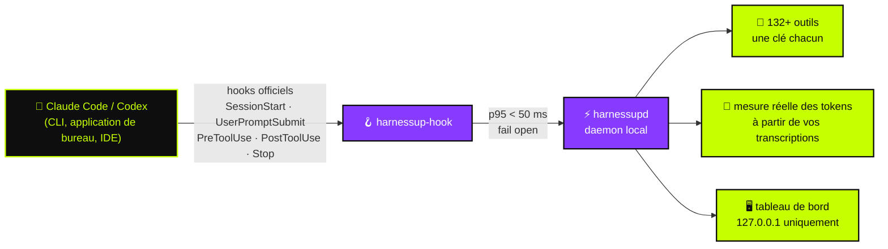

<!-- README HarnessUp · l'anglais est la source ; les traductions sont dans i18n/ -->

<p align="center">
  <a href="https://harnessup.dev"></a>
</p>

<p align="center">
  <a href="../README.md">🇺🇸 English</a> ·
  <a href="README.pt-BR.md">🇧🇷 Português</a> ·
  <a href="README.es.md">🇪🇸 Español</a> ·
  <b>🇫🇷 Français</b> ·
  <a href="README.de.md">🇩🇪 Deutsch</a> ·
  <a href="README.it.md">🇮🇹 Italiano</a> ·
  <a href="README.ja.md">🇯🇵 日本語</a> ·
  <a href="README.ko.md">🇰🇷 한국어</a> ·
  <a href="README.zh-CN.md">🇨🇳 简体中文</a> ·
  <a href="README.ar.md">🇸🇦 العربية</a> ·
  <a href="README.he.md">🇮🇱 עברית</a> ·
  <a href="README.hi.md">🇮🇳 हिन्दी</a>
</p>

<p align="center">
  <a href="https://www.npmjs.com/package/harnessup"></a>
  <a href="https://github.com/harnessup/harnessup/releases/latest"></a>
  
  
  
  
  <a href="https://github.com/harnessup/harnessup/stargazers"></a>
</p>

<p align="center">
  <a href="https://harnessup.dev/fr/install/"></a>
  <a href="https://harnessup.dev/fr/plans/"></a>
  <a href="https://harnessup.dev/fr/"></a>
  <a href="#-sponsors"></a>
</p>

<h3 align="center">La plus grande économie de tokens pour les agents de code du monde.</h3>

<p align="center">
  Plus de <b>132 outils</b> qui tournent sur votre propre machine pour réduire le gaspillage de tokens de <b>Claude Code</b> et <b>Codex</b>.<br>
  Mesure gratuite, sans connexion, 100 % local. Jusqu'à <b>78 % de réduction sur votre facture</b>, avec la preuve mesurée sur votre propre usage.
</p>

<p align="center">
  
</p>

## 📑 Sommaire

<table>
  <tr>
    <td valign="top">
      <a href="#-le-méchant">Le méchant</a><br>
      <a href="#-ce-que-fait-harnessup">Ce que fait HarnessUp</a><br>
      <a href="#-les-chiffres">Les chiffres</a><br>
      <a href="#%EF%B8%8F-fonctionnement">Fonctionnement</a>
    </td>
    <td valign="top">
      <a href="#-visite">Visite</a><br>
      <a href="#-10-axes-plus-de-132-outils">10 axes, plus de 132 outils</a><br>
      <a href="#-les-dégâts-de-lia-annulés-dun-clic">Annulation en un clic</a><br>
      <a href="#%EF%B8%8F-galerie">Galerie</a>
    </td>
    <td valign="top">
      <a href="#-installer-en-une-ligne">Installer</a><br>
      <a href="#-fait-pour-ceux-qui-vivent-avec-les-agents">À qui ça s'adresse</a><br>
      <a href="#-offres">Offres</a><br>
      <a href="#-confidentialité-et-sécurité">Confidentialité et sécurité</a>
    </td>
    <td valign="top">
      <a href="#-agents-compatibles">Agents compatibles</a><br>
      <a href="#-faq">FAQ</a><br>
      <a href="#-sponsors">Sponsors</a><br>
      <a href="#-rencontrez-hup">Rencontrez Hup</a>
    </td>
  </tr>
</table>

## 🪙 Le méchant

<table>
  <tr>
    <td width="42%" valign="middle">
      
    </td>
    <td width="58%" valign="middle">
      <p><b>Session n° 217 · modèle coûteux · effort élevé.</b></p>
      <p>Vous demandez une correction d'une ligne. L'agent répond <i>« Bien sûr ! Je vais vous aider avec ça. Excellente question… »</i>, relit trois fichiers déjà lus, affiche un journal de 4 000 lignes, et n'écrit enfin la correction qu'ensuite. Le compteur de tokens ne cesse de grimper.</p>
      <p>Chaque <i>« Bien sûr ! Je vais vous aider avec ça »</i> est payé dans la réponse <b>et relu à chaque tour qui suit</b>. Votre limite hebdomadaire expire le mercredi.</p>
      <p>HarnessUp demande des réponses directes, bloque les relectures de fichiers inchangés et réduit les sorties géantes, pour que vous <b>arriviez à vendredi avec de la marge</b>.</p>
    </td>
  </tr>
</table>

## ⚡ Ce que fait HarnessUp

HarnessUp n'est **ni un plugin, ni un MCP, ni un skill, ni un proxy**. C'est une seconde couche qui se glisse sous votre harnais, dans le respect des règles : un daemon local qui se branche sur les **hooks officiels** de Claude Code et de Codex, mesure chaque token et applique les outils que vous activez, chacun avec sa propre clé.

<table>
  <tr>
    <td width="25%" align="center" valign="top">
      <br>
      <h3>📏 Mesurer</h3>
      <sub>Deep Scan et 19 autres outils de mesure et de suivi, <b>gratuits</b>. Des comptes de tokens réels tirés de vos transcriptions, jamais des suppositions.</sub>
    </td>
    <td width="25%" align="center" valign="top">
      <br>
      <h3>💸 Économiser</h3>
      <sub>26 outils d'économie : compression sans appel au modèle, réponses plus sobres, aucune relecture, et un essaim de sous-agents bon marché où <i>le modèle coûteux ne fait que décider</i>.</sub>
    </td>
    <td width="25%" align="center" valign="top">
      <br>
      <h3>🛡️ Protéger</h3>
      <sub>Stop Loss, Antiloop Protector, Secret Lock, Git Shield et annulation en un clic. Les dégâts de l'IA se rembobinent d'un seul bouton.</sub>
    </td>
    <td width="25%" align="center" valign="top">
      <br>
      <h3>🎛️ Contrôler</h3>
      <sub>Plus de 200 interrupteurs en un clic dans un tableau de bord local. Un clic active un outil, un autre clic l'annule. Aucun terminal nécessaire.</sub>
    </td>
  </tr>
</table>

## 📊 Les chiffres

| | Indicateur | Ce que ça veut dire |
|:---:|---|---|
| 🚀 | **jusqu'à 3x** | plus de travail avec les mêmes tokens sur un forfait fixe |
| 💰 | **jusqu'à 78 %** | moins sur la facture pour les utilisateurs de l'API |
| 📈 | **plus de 260 %** | plus de débit sur certaines fenêtres de 5 heures |
| 🧰 | **132+** | outils répartis sur **10 axes**, tous tournant sur votre machine |
| ⌨️ | **200+** | interrupteurs réversibles en un clic dans le tableau de bord |
| ⏱️ | **p95 < 50 ms** | par hook, avec un délai maximal strict de **2 s**, pour que l'agent ne se fige jamais |
| 🌍 | **12** | langues du tableau de bord |

> [!NOTE]
> « Jusqu'à » désigne les gains les plus élevés mesurés sur de vraies fenêtres d'utilisation. **Votre propre chiffre vient de vos propres transcriptions** : HarnessUp le mesure gratuitement avant que vous ne payiez quoi que ce soit. Voir le calcul détaillé sur [harnessup.dev/fr/metering](https://harnessup.dev/fr/metering/).

## ⚙️ Fonctionnement



- **Uniquement des surfaces officielles.** Le modèle tourne via les binaires officiels `claude` et `codex`, avec votre propre compte. HarnessUp ne lit, ne stocke ni ne transmet jamais votre token ni votre clé.
- **Fail open, toujours.** Si HarnessUp est lent, éteint ou en erreur, votre agent continue de fonctionner comme s'il n'était pas là.
- **Rien n'est irréversible.** Tout ce qui est coupé, compressé ou bloqué reste récupérable.
- **Une faible confiance passe directement.** Mieux vaut ne rien économiser que de fournir au modèle une information erronée.

## 🎬 Visite

<p align="center">
  
</p>

## 🧰 10 axes, plus de 132 outils

Un couteau suisse pour les agents de code. Chaque outil a sa propre clé, et chaque clé peut être annulée.

| Axe | Outils | Outil phare | Points forts |
|---|:---:|---|---|
| 📏 **Mesure** | 14 | Deep Scan | Harness History, Inside the Wallet, Model Insights, HarnessUp Bench, Plan Usage |
| 📡 **Surveillance** | 8 | Session Radar | The Numbers, Realtime Events, Reasoning Check, Subagents Work, Plan Advisor |
| 💸 **Économies** | 26 | Cheap Swarm | Smart Compress, Response Diet, Delta Read, Smart Cut, Terminal Guide, WebFetch Diet |
| 🎛️ **Contrôle** | 25 | Stop Loss | Budget Cap, ToolBox, Working Hours, Swarm Commander, Enforce TDD, Force Lint |
| 🛡️ **Protection** | 10 | Smart Return | Secret Lock, UltraShield Guard, Antiloop Protector, Git Shield, Checkpoint |
| 🔐 **Sécurité** | 8 | Sentinel | Smart Security, Security Check, SafeBox, No Touch, No Delete |
| 🚀 **Productivité** | 26 | Code Deck | Smart Commit, Build Now, Super Code Review, HarnessUp Flow, HarnessUp Board |
| 🧪 **Utilitaires** | 23 | Prompt Optimizer | Token Calculator, Frozen Cache, MetaPrompt, Mirror Master, HarnessUp Shop |
| 🎨 **Personnalisation** | 6 | Status Bar | Info Pills, Cache Alarm, Mod Themes, Finish Line Push |
| 🏗️ **Bâtisseurs** | 5 | /bones | SPEC/PRD Express, DOCs Generator, Website Builder |

<details>
<summary><b>📏 Mesure et 📡 Surveillance</b> : voir où part chaque token (en grande partie gratuit)</summary>

<br>

- **Deep Scan** (gratuit) : diagnostique le gaspillage dans votre historique et montre ce que HarnessUp aurait économisé.
- **Model Insights** (gratuit) : 24 questions auxquelles on répond par version de modèle.
- **HarnessUp Bench** (gratuit) : score par modèle et par niveau d'effort.
- **Openness Meter, Harness Meter, Cache Cycle, Inside the Wallet, Work Analytics, Bad Use, Plan Usage** (gratuits).
- **Session Radar, The Numbers, Uptime, Realtime Events, Reasoning Check, Subagents Work, Harness Update, Plan Advisor** (tous gratuits).
- **/diagnostic et /simulate** (Ultra) : posez des questions sur votre usage mesuré et simulez les décisions avant de les prendre.

</details>

<details>
<summary><b>💸 Économies</b> : le même travail pour moins de tokens</summary>

<br>

- **Smart Compress** (gratuit) : compacte la conversation sans appeler le modèle.
- **Response Diet** (gratuit) : réponses directes, sans préambule.
- **Delta Read, Code Finder, Smart Cut, Read Router, Head Limit** (Pro) : ne lisez que ce qui est nécessaire et ne relisez jamais un fichier inchangé.
- **Terminal Guide, Output Diet, WebFetch Diet** (Pro) : les longues sorties de commandes et les pages web sont réduites avant d'atteindre le contexte.
- **Renew Session, Hot Context, Context Graph, Session Protocol, Memory State** (Pro) : des sessions qui démarrent légères et restent légères.
- **First Pass, Way Out, No Comment, Stature Brake, Rules Auditor, Optimize Harness** (Pro).
- **Cheap Swarm** (Ultra) : 26 classes de tâches confiées à des sous-agents bon marché ; le modèle coûteux ne fait que décider.

</details>

<details>
<summary><b>🎛️ Contrôle</b> : vos règles, appliquées aux frontières des appels d'outils</summary>

<br>

- **Stop Loss et Budget Cap** (Pro) : fixez un plafond en US$ et la session s'arrête là.
- **ToolBox** (Pro) : 17 conventions prêtes à l'emploi pour votre agent.
- **Working Hours, Scheduled Break, Reasoning Advisor, Rule Checker, Force Test, No Subagents** (Pro).
- **Swarm Commander, Subs Director, Enforce TDD, Force Lint, Doc Now, Anti-fading, Stick Prompt** (Ultra).
- **Anti-Collision** (GIGA) et **HarnessUp OFF** (gratuit) : tout mettre en pause sans désinstaller.

</details>

<details>
<summary><b>🛡️ Protection et 🔐 Sécurité</b> : rien ne fuit, rien ne se perd</summary>

<br>

- **Smart Return et Checkpoint** (Pro) : rembobinez ce que l'agent a fait.
- **Git Shield et Eyes Off** (Pro) : protégez votre historique et vos fichiers sensibles.
- **SafeBox** (Pro) : tout ce qui est coupé ou bloqué reste récupérable pendant 7 jours.
- **Secret Lock, UltraShield Guard, Antiloop Protector, Sandbox Mode, Deny MCP, Blackout** (Ultra).
- **No Touch et No Delete** (Ultra) : fichiers que l'agent peut lire mais jamais modifier ni supprimer.
- **Sentinel, Smart Security, Security Check, SEC Station** (GIGA).

</details>

<details>
<summary><b>🚀 Productivité, 🧪 Utilitaires, 🎨 Personnalisation et 🏗️ Bâtisseurs</b></summary>

<br>

- **Code Deck** (GIGA) : plus de 17 CLI d'agents côte à côte, en 4 emplacements.
- **HarnessUp Flow et HarnessUp Board** (GIGA) : des automatisations décrites en langage naturel et un tableau infini.
- **Super Code Review** (GIGA) : une note de 0 à 100 pour chaque modification.
- **Smart Commit, Build Now, Smart Report, Save my Session, GitHub et Deploy en 1 clic** (Ultra).
- **Ez Work, Token Calculator, Frozen Cache, Cache Lock, Prompt Optimizer, MetaPrompt (34 types), HarnessUp Shop** (gratuits).
- **Mirror Master** (Pro) : garde synchronisées les instructions de CLAUDE.md, AGENTS.md, GEMINI.md, Copilot, Cursor, Windsurf, Cline et Aider.
- **Status Bar, Info Pills, Cache Alarm, Mod Themes** (gratuits) et **Finish Line Push** (Pro).
- **SPEC/PRD Express, DOCs Generator, /bones, DOC for Website, Website Builder** (GIGA).

</details>

<p align="center">Catalogue complet, avec chaque outil : <a href="https://harnessup.dev/fr/tools/"><b>harnessup.dev/fr/tools</b></a></p>

## ⏪ Les dégâts de l'IA, annulés d'un clic

<table>
  <tr>
    <td width="58%" valign="middle">
      <p>L'agent a supprimé le mauvais dossier ? Il a fait fuiter une clé dans le contexte ? Il a réécrit la moitié du dépôt à 2 h du matin ?</p>
      <ul>
        <li><b>Secret Lock</b> garde les identifiants hors du contexte.</li>
        <li><b>Smart Return</b> et <b>Checkpoint</b> rembobinent ce que l'agent a fait.</li>
        <li><b>No Delete</b> et <b>Git Shield</b> bloquent les déplacements destructeurs avant qu'ils n'arrivent.</li>
        <li><b>SafeBox</b> conserve pendant 7 jours tout ce qui a été coupé ou bloqué.</li>
        <li><b>HarnessUp OFF</b> met en pause tous les outils d'un coup, sans désinstaller.</li>
      </ul>
      <p>Les freins n'agissent qu'aux frontières des appels d'outils : HarnessUp <b>n'interrompt jamais l'agent au milieu d'une écriture</b>.</p>
    </td>
    <td width="42%" valign="middle">
      
    </td>
  </tr>
</table>

## 🖼️ Galerie

<table>
  <tr>
    <td align="center" width="33%"><a href="../assets/screens/01-model-insights.png"></a><br><sub><b>Model Insights</b> · compare les versions de modèles</sub></td>
    <td align="center" width="33%"><a href="../assets/screens/02-subagents-work.png"></a><br><sub><b>Subagents Work</b> · ce que fait et coûte l'équipe</sub></td>
    <td align="center" width="33%"><a href="../assets/screens/04-bench.png"></a><br><sub><b>HarnessUp Bench</b> · score par modèle et par effort</sub></td>
  </tr>
  <tr>
    <td align="center"><a href="../assets/screens/05-cheap-swarm.png"></a><br><sub><b>Cheap Swarm</b> · ce que l'essaim a économisé</sub></td>
    <td align="center"><a href="../assets/screens/06-code-deck.png"></a><br><sub><b>Code Deck</b> · agents dans des terminaux côte à côte</sub></td>
    <td align="center"><a href="../assets/screens/07-context-graph.png"></a><br><sub><b>Context Graph</b> · mémoire de projet indexée</sub></td>
  </tr>
  <tr>
    <td align="center"><a href="../assets/screens/10-antiloop.png"></a><br><sub><b>Antiloop Protector</b> · arrête les boucles improductives</sub></td>
    <td align="center"><a href="../assets/screens/08-openness-meter.png"></a><br><sub><b>Openness Meter</b> · l'évolution de l'ouverture des sessions</sub></td>
    <td align="center"><a href="../assets/screens/09-shop.png"></a><br><sub><b>HarnessUp Shop</b> · installateur d'agents et de MCP</sub></td>
  </tr>
  <tr>
    <td align="center"><a href="../assets/screens/14-flow-canvas.png"></a><br><sub><b>HarnessUp Flow</b> · automatisation en langage naturel</sub></td>
    <td align="center"><a href="../assets/screens/15-board.png"></a><br><sub><b>HarnessUp Board</b> · tableau infini</sub></td>
    <td align="center"><a href="../assets/screens/12-ez-work-timer.png"></a><br><sub><b>Ez Work</b> · Ghost Prompt et Work Timer</sub></td>
  </tr>
</table>

<details>
<summary>Plus d'écrans</summary>
<br>
<p align="center">
  
  
  
</p>
</details>

## 📦 Installer en une ligne

<table>
  <tr>
    <td width="40%" valign="middle">
      
    </td>
    <td width="60%" valign="middle">
      <p>Par utilisateur. <b>Sans administrateur, sans connexion, sans e-mail, sans service système.</b> Les binaires sont vérifiés avec SHA-256 avant l'installation, et les mises à jour sont signées.</p>
      <p><b>npm</b> (Windows, macOS, Linux · Node 18+)</p>

```sh
npm install -g harnessup
```

<p><b>Windows</b> · PowerShell, sans Node</p>

```powershell
irm https://harnessup.dev/install.ps1 | iex
```

<p><b>macOS et Linux</b> · sans Node, sans sudo</p>

```sh
curl -fsSL https://harnessup.dev/install.sh | sh
```

</td>
  </tr>
</table>

Ensuite :

```sh
harnessup install     # connecte HarnessUp à Claude Code et Codex
harnessup doctor      # vérifie l'installation
harnessup uninstall   # le supprime proprement
```

<details>
<summary><b>Autres façons d'installer</b> : .exe, ZIP, pnpm/yarn/bun, ou laissez votre agent s'en charger</summary>

<br>

- **Installateur Windows** : `HarnessUp-Setup-x64.exe` (Windows 10/11 64 bits, par utilisateur) sur [harnessup.dev/fr/install](https://harnessup.dev/fr/install/).
- **ZIP** : téléchargez-le depuis les [Releases GitHub](https://github.com/harnessup/harnessup/releases/latest) et vérifiez-le avec `SHA256SUMS.txt`.
- **pnpm, yarn, bun** : `pnpm add -g harnessup` · `yarn global add harnessup` · `bun add -g harnessup`.
- **1 prompt** : collez ceci dans Claude Code ou Codex et laissez l'agent l'installer pour vous :

```text
Installe HarnessUp sur cette machine : exécute npm install -g harnessup (sans Node : sous Windows, irm https://harnessup.dev/install.ps1 | iex dans PowerShell ; sous macOS et Linux, curl -fsSL https://harnessup.dev/install.sh | sh dans le Terminal), vérifie qu'il est intégré à Claude Code et Codex, et ouvre le tableau de bord. Ne demande ni connexion, ni e-mail, ni droits d'administrateur.
```

- **Bientôt disponible** : winget, Scoop, Chocolatey, Homebrew et Snap.

</details>

📘 Guide complet, avec la mise à jour, la désinstallation et le dépannage : **[INSTALL.fr.md](INSTALL.fr.md)**.

## 👥 Fait pour ceux qui vivent avec les agents

<table>
  <tr>
    <td width="33%" align="center" valign="top">
      <br>
      <h3>Sur un forfait fixe</h3>
      <sub>Forfaits Claude Pro/Max ou ChatGPT. <b>Jusqu'à 3x</b> plus de travail dans la même fenêtre : votre limite hebdomadaire est à peu près doublée.</sub>
    </td>
    <td width="33%" align="center" valign="top">
      <br>
      <h3>Payer à l'API</h3>
      <sub>Chaque token est de l'argent. <b>Jusqu'à 78 % de moins</b> sur la facture, des centaines de dollars par mois pour les gros utilisateurs.</sub>
    </td>
    <td width="33%" align="center" valign="top">
      <br>
      <h3>Sans terminal</h3>
      <sub>Un installateur Windows et <b>plus de 200 interrupteurs réversibles</b> dans le tableau de bord. Cliquez, voyez le chiffre, recliquez pour annuler.</sub>
    </td>
  </tr>
</table>

## 💳 Offres

<table>
  <tr>
    <th width="25%">Basic</th>
    <th width="25%">Pro</th>
    <th width="25%">Ultra</th>
    <th width="25%">GIGA UNLIMITED</th>
  </tr>
  <tr align="center">
    <td><h3>GRATUIT</h3><sub>pour toujours</sub></td>
    <td><h3>US$ 9<sub>/mois</sub></h3><sub>ou US$ 6/mois facturé annuellement</sub></td>
    <td><h3>US$ 12<sub>/mois</sub></h3><sub>ou US$ 9/mois facturé annuellement</sub></td>
    <td><h3>US$ 27<sub>/mois</sub></h3><sub>ou US$ 19/mois facturé annuellement</sub></td>
  </tr>
  <tr valign="top">
    <td><sub>1 compte Claude Code · 1 projet<br>Mesure tout : Deep Scan, Surveillance et plus de 20 outils gratuits</sub></td>
    <td><sub>1 compte Claude + 1 compte Codex · 2 projets<br>Économies, contrôle, protection et annulation</sub></td>
    <td><sub>2 comptes Claude + 2 comptes Codex · 6 projets<br>Cheap Swarm, Secret Lock, Antiloop, automatisations</sub></td>
    <td><sub>Harnais, comptes et projets illimités<br>Code Deck, Flow, Board, Security, Builders</sub></td>
  </tr>
</table>

- ✅ **Essai gratuit de 7 jours** sur les forfaits payants : sans carte, sans inscription.
- ✅ Chaque forfait inclut tout ce qui figure en dessous. Sessions illimitées sur chaque forfait. Résiliation à tout moment, sans formulaire.
- ✅ Remboursement dans les 7 jours suivant l'achat. Une activation flottante par clé.
- 👥 **Équipe** : 10 licences GIGA pour US$ 1 699 par an. **Entreprise** : [corporate@harnessup.dev](mailto:corporate@harnessup.dev).

<p align="center"><a href="https://harnessup.dev/fr/plans/"><b>Comparez chaque outil par forfait, et découvrez les offres de lancement en cours →</b></a></p>

## 🔒 Confidentialité et sécurité

| | |
|---|---|
| 🏠 **100 % local** | Tout tourne sur votre machine. Pas de proxy, pas d'interception de l'API, pas de MCP lourd. |
| 🔑 **Votre compte, votre token** | Fait tourner les binaires officiels `claude` et `codex` avec votre compte, et ne lit, ne stocke ni ne transmet jamais votre token ni votre clé. |
| 🖥️ **Tableau de bord sur 127.0.0.1** | Il ne répond que sur votre machine. La page de votre compte affiche **0 octet d'usage envoyé**. |
| 🟢 **Fail open** | Si HarnessUp est lent, éteint ou en erreur, l'agent continue de fonctionner. p95 < 50 ms, délai maximal strict de 2 s. |
| ⏪ **Réversible** | Chaque clé s'annule en un clic. SafeBox conserve pendant 7 jours ce qui a été coupé. |
| 👤 **Aucun compte pour commencer** | Ni connexion, ni e-mail, ni mot de passe, ni droits d'administrateur pour installer et mesurer. |

Vous avez trouvé une vulnérabilité ? Merci de suivre [SECURITY.md](../SECURITY.md) plutôt que d'ouvrir un ticket public.

## 🤖 Agents compatibles

| Agent | Statut | Où |
|---|:---:|---|
| **Claude Code** | ✅ Intégré | CLI, application de bureau et extensions IDE, avec un compte ou via l'API |
| **Codex** | ✅ Intégré | CLI, application de bureau et extensions IDE, avec un compte ou via l'API |
| **Cursor** | 🔜 Bientôt | |
| **OpenCode** | 🔜 Bientôt | |
| **Hermes Agent** | 🔜 Bientôt | |

**Code Deck** fait déjà tourner plus de 17 CLI d'agents côte à côte, et **Mirror Master** garde synchronisés les fichiers d'instructions de 8 harnais.

## ❓ FAQ

<details>
<summary><b>C'est sûr ?</b></summary>
<br>
Oui. Il n'utilise que les hooks officiels, il n'y a pas de proxy, et il tourne à 100 % sur votre machine. S'il s'arrête, votre agent continue de fonctionner normalement.
</details>

<details>
<summary><b>Lit-il mon token ou ma clé d'API ?</b></summary>
<br>
Jamais. Le modèle tourne via les binaires officiels <code>claude</code> et <code>codex</code> avec votre propre compte. HarnessUp ne lit, ne stocke ni ne transmet jamais votre token ni votre clé.
</details>

<details>
<summary><b>Ralentit-il l'agent ?</b></summary>
<br>
Non. Les hooks ont un p95 inférieur à 50 ms et un délai maximal strict de 2 s. Si quelque chose est lent, l'agent continue sans attendre.
</details>

<details>
<summary><b>Fonctionne-t-il pour les utilisateurs de l'API ?</b></summary>
<br>
Oui, et c'est là que les économies se voient le plus : chaque token économisé est de l'argent qui reste dans votre poche.
</details>

<details>
<summary><b>Ai-je besoin du terminal ?</b></summary>
<br>
Non. Il existe un installateur Windows et un tableau de bord avec plus de 200 interrupteurs réversibles en un clic.
</details>

<details>
<summary><b>Faut-il une carte pour le forfait gratuit ?</b></summary>
<br>
Non. Basic est gratuit pour toujours, et les forfaits payants ont un essai de 7 jours sans carte ni inscription.
</details>

<details>
<summary><b>Fonctionne-t-il sous macOS et Linux ?</b></summary>
<br>
Oui, via npm ou le script <code>install.sh</code>.
</details>

<details>
<summary><b>Combien de machines puis-je utiliser ?</b></summary>
<br>
Une activation à la fois par clé. La licence est flottante : vous pouvez la déplacer d'une machine à l'autre quand vous voulez.
</details>

<details>
<summary><b>Pourquoi Windows affiche-t-il un avertissement SmartScreen sur le .exe ?</b></summary>
<br>
C'est un avertissement de réputation pour les nouveaux éditeurs. Les voies npm et PowerShell n'ont aucun avertissement, et les empreintes SHA-256 sont publiées sur <a href="https://harnessup.dev/fr/windows-warning/">harnessup.dev/fr/windows-warning</a>. Un certificat de signature de code fait partie des dépenses que les sponsors aident à financer.
</details>

<details>
<summary><b>Comment le désinstaller ?</b></summary>
<br>
Exécutez <code>harnessup uninstall</code>. Pour mettre en pause sans désinstaller, activez <b>HarnessUp OFF</b> dans le tableau de bord.
</details>

<p align="center">Plus de réponses sur <a href="https://harnessup.dev/fr/faq/"><b>harnessup.dev/fr/faq</b></a></p>

## 💜 Sponsors

<table>
  <tr>
    <td width="30%" align="center" valign="middle">
      
    </td>
    <td width="70%" valign="middle">
      <p><b>Le forfait Basic est gratuit pour toujours, et nous voulons qu'il le reste.</b> HarnessUp est développé par une petite équipe indépendante, et le sponsoring est ce qui permet de garder la mesure gratuite pour tous.</p>
      <p><b>À quoi sert votre sponsoring :</b></p>
      <ul>
        <li>🔏 Un certificat de signature de code Windows, pour que l'avertissement SmartScreen disparaisse</li>
        <li>🍎 Tests et support sur de vraies machines macOS et Linux</li>
        <li>📦 Paquets winget, Scoop, Chocolatey, Homebrew et Snap</li>
        <li>🤖 Intégration avec d'autres agents : Cursor, OpenCode, Hermes Agent</li>
        <li>🌍 Maintenir le tableau de bord et le site en 12 langues</li>
      </ul>
    </td>
  </tr>
</table>

**Pourquoi sponsoriser HarnessUp ?** Votre logo atteint les développeurs au moment exact où ils se soucient du coût, du contrôle et de la sécurité de leurs agents de code : dans ce README, dans les 12 traductions, et sur [harnessup.dev](https://harnessup.dev).

<p align="center">
  <a href="mailto:corporate@harnessup.dev?subject=Sponsoring%20HarnessUp"></a>
</p>

<table>
  <tr>
    <td align="center" width="33%"><br>🥇<br><b>Votre logo ici</b><br><sub>Sponsor or</sub><br><br></td>
    <td align="center" width="33%"><br>🥈<br><b>Votre logo ici</b><br><sub>Sponsor argent</sub><br><br></td>
    <td align="center" width="33%"><br>🥉<br><b>Votre logo ici</b><br><sub>Sponsor bronze</sub><br><br></td>
  </tr>
</table>

**Vous n'êtes pas une entreprise ?** Vous aidez tout autant en ⭐ **mettant une étoile à ce dépôt**, en partageant HarnessUp avec un ami qui brûle des tokens, ou en rejoignant le **[programme d'affiliation](https://harnessup.dev/fr/affiliates/)** : recommandé, rémunéré. Vous n'avez pas besoin d'être client pour y participer.

## 🤖 Rencontrez Hup

<p align="center">
  
  
  
  
  
</p>

<p align="center">
  <b>Hup</b> est la mascotte de HarnessUp : une touche de clavier citron dans un harnais violet, qui tient vos tokens,<br>
  arrête le préambule d'une main et dirige vos sous-agents avec une baguette.
</p>

<p align="center">
  
</p>

## 🔗 Liens

<p align="center">
  <a href="https://harnessup.dev/fr/">Site web</a> ·
  <a href="https://harnessup.dev/fr/install/">Téléchargement</a> ·
  <a href="https://harnessup.dev/fr/plans/">Offres</a> ·
  <a href="https://harnessup.dev/fr/tools/">Outils</a> ·
  <a href="https://harnessup.dev/fr/faq/">FAQ</a> ·
  <a href="https://www.npmjs.com/package/harnessup">npm</a> ·
  <a href="https://github.com/harnessup/harnessup/releases">Versions</a> ·
  <a href="https://github.com/harnessup/harnessup/discussions">Discussions</a> ·
  <a href="../SUPPORT.md">Support</a> ·
  <a href="mailto:help@harnessup.dev">help@harnessup.dev</a>
</p>

## 📄 Licence

HarnessUp est un logiciel propriétaire, gratuit pour démarrer avec le forfait Basic. Ce dépôt distribue le produit, ses guides et sa documentation, et ne contient aucun code source. Voir [LICENSE.md](../LICENSE.md). Tous droits réservés.

<p align="center">
  <br>
  <sub>Fait avec 💜 et 🍋 · <a href="https://harnessup.dev">harnessup.dev</a></sub>
</p>
