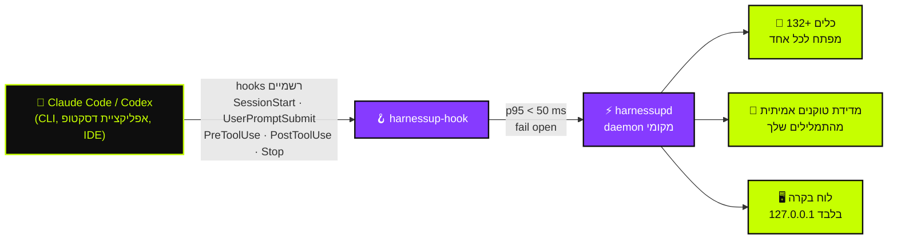

<!-- HarnessUp README · English is the source; translations live in i18n/ -->

<div dir="rtl">

<p align="center">
  <a href="https://harnessup.dev"></a>
</p>

<p align="center">
  <a href="../README.md">🇺🇸 English</a> ·
  <a href="README.pt-BR.md">🇧🇷 Português</a> ·
  <a href="README.es.md">🇪🇸 Español</a> ·
  <a href="README.fr.md">🇫🇷 Français</a> ·
  <a href="README.de.md">🇩🇪 Deutsch</a> ·
  <a href="README.it.md">🇮🇹 Italiano</a> ·
  <a href="README.ja.md">🇯🇵 日本語</a> ·
  <a href="README.ko.md">🇰🇷 한국어</a> ·
  <a href="README.zh-CN.md">🇨🇳 简体中文</a> ·
  <a href="README.ar.md">🇸🇦 العربية</a> ·
  <b>🇮🇱 עברית</b> ·
  <a href="README.hi.md">🇮🇳 हिन्दी</a>
</p>

<p align="center">
  <a href="https://www.npmjs.com/package/harnessup"></a>
  <a href="https://github.com/harnessup/harnessup/releases/latest"></a>
  
  
  
  
  <a href="https://github.com/harnessup/harnessup/stargazers"></a>
</p>

<p align="center">
  <a href="https://harnessup.dev/install/"></a>
  <a href="https://harnessup.dev/plans/"></a>
  <a href="https://harnessup.dev/"></a>
  <a href="#-%D7%A0%D7%95%D7%AA%D7%A0%D7%99-%D7%97%D7%A1%D7%95%D7%AA"></a>
</p>

<h3 align="center">חוסך הטוקנים הגדול בעולם לסוכני קוד.</h3>

<p align="center">
  מעל <b>132 כלים</b> שפועלים על המחשב שלך כדי לצמצם את בזבוז הטוקנים של <b>Claude Code</b> ו-<b>Codex</b>.<br>
  מדידה חינמית, בלי התחברות, 100% מקומי. עד <b>78% מהחשבון שלך</b>, עם ההוכחה שנמדדה על השימוש שלך עצמך.
</p>

<p align="center">
  
</p>

## 📑 תוכן עניינים

<table>
  <tr>
    <td valign="top">
      <a href="#-הנבל">הנבל</a><br>
      <a href="#-מה-harnessup-עושה">מה HarnessUp עושה</a><br>
      <a href="#-המספרים">המספרים</a><br>
      <a href="#%EF%B8%8F-איך-זה-עובד">איך זה עובד</a>
    </td>
    <td valign="top">
      <a href="#-סיור">סיור</a><br>
      <a href="#-10-חזיתות-132-כלים">10 חזיתות, 132+ כלים</a><br>
      <a href="#-נזקי-ai-מבוטלים-בכפתור-אחד">ביטול בכפתור אחד</a><br>
      <a href="#%EF%B8%8F-גלריה">גלריה</a>
    </td>
    <td valign="top">
      <a href="#-התקנה-בשורה-אחת">התקנה</a><br>
      <a href="#-נבנה-לאנשים-שחיים-עם-סוכנים">למי זה מיועד</a><br>
      <a href="#-תוכניות">תוכניות</a><br>
      <a href="#-פרטיות-ואבטחה">פרטיות ואבטחה</a>
    </td>
    <td valign="top">
      <a href="#-סוכנים-נתמכים">סוכנים נתמכים</a><br>
      <a href="#-שאלות-נפוצות">שאלות נפוצות</a><br>
      <a href="#-נותני-חסות">נותני חסות</a><br>
      <a href="#-הכירו-את-hup">הכירו את Hup</a>
    </td>
  </tr>
</table>

## 🪙 הנבל

<table>
  <tr>
    <td width="42%" valign="middle">
      
    </td>
    <td width="58%" valign="middle">
      <p><b>סשן #217 · מודל יקר · מאמץ גבוה.</b></p>
      <p>אתה מבקש תיקון של שורה אחת. הסוכן עונה <i>"בטח! אני אעזור לך עם זה. שאלה מצוינת…"</i>, קורא מחדש שלושה קבצים שכבר קרא, מדפיס לוג של 4,000 שורות, ורק אז כותב את התיקון. מונה הטוקנים ממשיך לטפס.</p>
      <p>כל <i>"בטח! אני אעזור לך עם זה"</i> משולם בתשובה <b>ונקרא מחדש בכל סבב שאחריו</b>. המכסה השבועית שלך נגמרת ביום רביעי.</p>
      <p>HarnessUp מבקש תשובות ישירות, חוסם קריאות חוזרות של קבצים שלא השתנו, וחותך פלטים ענקיים, כדי ש<b>תגיע ליום שישי עם מרווח</b>.</p>
    </td>
  </tr>
</table>

## ⚡ מה HarnessUp עושה

HarnessUp <b>אינו תוסף, MCP, skill או proxy</b>. זו שכבה שנייה שמתחברת מתחת ל-harness שלך, בתוך הכללים: daemon מקומי שמתחבר ל-<b>hooks הרשמיים</b> של Claude Code ו-Codex, מודד כל טוקן ומפעיל את הכלים שאתה מדליק, כל אחד עם המפתח שלו.

<table>
  <tr>
    <td width="25%" align="center" valign="top">
      <br>
      <h3>📏 מדידה</h3>
      <sub>Deep Scan ועוד 19 כלי מדידה וניטור, <b>בחינם</b>. ספירות טוקנים אמיתיות מהתמלילים שלך, לעולם לא ניחושים.</sub>
    </td>
    <td width="25%" align="center" valign="top">
      <br>
      <h3>💸 חיסכון</h3>
      <sub>26 כלי חיסכון: דחיסה בלי לקרוא למודל, תשובות רזות יותר, בלי קריאות חוזרות, ונחיל של סוכני משנה זולים שבו <i>המודל היקר רק מחליט</i>.</sub>
    </td>
    <td width="25%" align="center" valign="top">
      <br>
      <h3>🛡️ הגנה</h3>
      <sub>Stop Loss, Antiloop Protector, Secret Lock, Git Shield וביטול בלחיצה. נזקי ה-AI מתגלגלים לאחור בכפתור אחד.</sub>
    </td>
    <td width="25%" align="center" valign="top">
      <br>
      <h3>🎛️ שליטה</h3>
      <sub>מעל 200 מפתחות בלחיצה אחת בלוח מקומי. לחיצה אחת מדליקה כלי, לחיצה אחרת מבטלת אותו. בלי צורך בטרמינל.</sub>
    </td>
  </tr>
</table>

## 📊 המספרים

| | מדד | מה זה אומר |
|:---:|---|---|
| 🚀 | **עד 3x** | יותר עבודה עם אותם טוקנים בתוכנית קבועה |
| 💰 | **עד 78%** | פחות בחשבון למי שעובד עם API |
| 📈 | **מעל 260%** | תפוקה גבוהה יותר בחלק מחלונות 5 השעות |
| 🧰 | **132+** | כלים על פני **10 חזיתות**, כולם רצים על המחשב שלך |
| ⌨️ | **200+** | מפתחות הפיכים בלחיצה אחת בלוח |
| ⏱️ | **p95 < 50 ms** | לכל hook, עם timeout קשיח של **2 s**, כך שהסוכן לעולם לא קופא |
| 🌍 | **12** | שפות בלוח |

> [!NOTE]
> "עד" פירושו המקסימום שנמדד בחלונות שימוש אמיתיים. **המספר שלך מגיע מהתמלילים שלך**: HarnessUp מודד אותו בחינם לפני שאתה משלם משהו. ראה את החישובים הפתוחים ב-[harnessup.dev/metering](https://harnessup.dev/metering/).

## ⚙️ איך זה עובד



- **רק משטחים רשמיים.** המודל רץ דרך הבינאריים הרשמיים `claude` ו-`codex`, עם החשבון שלך. HarnessUp לעולם לא קורא, שומר או מעביר את הטוקן או המפתח שלך.
- **Fail open, תמיד.** אם HarnessUp איטי, כבוי או בשגיאה, הסוכן שלך ממשיך לעבוד כאילו הוא לא שם.
- **שום דבר לא בלתי הפיך.** מה שנחתך, נדחס או נחסם נשאר ניתן לשחזור.
- **ביטחון נמוך עובר ישר.** עדיף לא לחסוך מאשר למסור למודל מידע שגוי.

## 🎬 סיור

<p align="center">
  
</p>

## 🧰 10 חזיתות, 132+ כלים

סכין שוויצרית לסוכני קוד. לכל כלי יש מפתח משלו, ולכל מפתח אפשר לבטל.

| חזית | כלים | כלי מרכזי | עיקרי הדברים |
|---|:---:|---|---|
| 📏 **מדידה** | 14 | Deep Scan | Harness History, Inside the Wallet, Model Insights, HarnessUp Bench, Plan Usage |
| 📡 **ניטור** | 8 | Session Radar | The Numbers, Realtime Events, Reasoning Check, Subagents Work, Plan Advisor |
| 💸 **חיסכון** | 26 | Cheap Swarm | Smart Compress, Response Diet, Delta Read, Smart Cut, Terminal Guide, WebFetch Diet |
| 🎛️ **שליטה** | 25 | Stop Loss | Budget Cap, ToolBox, Working Hours, Swarm Commander, Enforce TDD, Force Lint |
| 🛡️ **הגנה** | 10 | Smart Return | Secret Lock, UltraShield Guard, Antiloop Protector, Git Shield, Checkpoint |
| 🔐 **אבטחה** | 8 | Sentinel | Smart Security, Security Check, SafeBox, No Touch, No Delete |
| 🚀 **פרודוקטיביות** | 26 | Code Deck | Smart Commit, Build Now, Super Code Review, HarnessUp Flow, HarnessUp Board |
| 🧪 **כלי עזר** | 23 | Prompt Optimizer | Token Calculator, Frozen Cache, MetaPrompt, Mirror Master, HarnessUp Shop |
| 🎨 **התאמה אישית** | 6 | Status Bar | Info Pills, Cache Alarm, Mod Themes, Finish Line Push |
| 🏗️ **בונים** | 5 | /bones | SPEC/PRD Express, DOCs Generator, Website Builder |

<details>
<summary><b>📏 מדידה ו-📡 ניטור</b>: ראה לאן הולך כל טוקן (כמעט הכול בחינם)</summary>

<br>

- **Deep Scan** (בחינם): מאבחן את הבזבוז בהיסטוריה שלך ומראה מה HarnessUp היה חוסך.
- **Model Insights** (בחינם): 24 שאלות שנענות לכל גרסת מודל.
- **HarnessUp Bench** (בחינם): ציון לכל מודל ולכל רמת מאמץ.
- **Openness Meter, Harness Meter, Cache Cycle, Inside the Wallet, Work Analytics, Bad Use, Plan Usage** (בחינם).
- **Session Radar, The Numbers, Uptime, Realtime Events, Reasoning Check, Subagents Work, Harness Update, Plan Advisor** (הכול בחינם).
- **/diagnostic ו-/simulate** (Ultra): שאל שאלות על השימוש הנמדד שלך, ודמה החלטות לפני שאתה מקבל אותן.

</details>

<details>
<summary><b>💸 חיסכון</b>: אותה עבודה בפחות טוקנים</summary>

<br>

- **Smart Compress** (בחינם): מכווץ את השיחה בלי לקרוא למודל.
- **Response Diet** (בחינם): תשובות ישירות, בלי פתיחים.
- **Delta Read, Code Finder, Smart Cut, Read Router, Head Limit** (Pro): קוראים רק את מה שנחוץ ולעולם לא קוראים מחדש קובץ שלא השתנה.
- **Terminal Guide, Output Diet, WebFetch Diet** (Pro): פלטים ארוכים של פקודות ודפי רשת נחתכים לפני שהם מגיעים להקשר.
- **Renew Session, Hot Context, Context Graph, Session Protocol, Memory State** (Pro): סשנים שמתחילים רזים ונשארים רזים.
- **First Pass, Way Out, No Comment, Stature Brake, Rules Auditor, Optimize Harness** (Pro).
- **Cheap Swarm** (Ultra): 26 סוגי משימות הולכים לסוכני משנה זולים; המודל היקר רק מחליט.

</details>

<details>
<summary><b>🎛️ שליטה</b>: הכללים שלך, נאכפים בגבולות קריאה לכלים</summary>

<br>

- **Stop Loss ו-Budget Cap** (Pro): הגדר תקרה בדולרים והסשן נעצר שם.
- **ToolBox** (Pro): 17 מוסכמות מוכנות לסוכן שלך.
- **Working Hours, Scheduled Break, Reasoning Advisor, Rule Checker, Force Test, No Subagents** (Pro).
- **Swarm Commander, Subs Director, Enforce TDD, Force Lint, Doc Now, Anti-fading, Stick Prompt** (Ultra).
- **Anti-Collision** (GIGA) ו-**HarnessUp OFF** (בחינם): משהים הכול בלי להסיר.

</details>

<details>
<summary><b>🛡️ הגנה ו-🔐 אבטחה</b>: שום דבר לא דולף, שום דבר לא הולך לאיבוד</summary>

<br>

- **Smart Return ו-Checkpoint** (Pro): מגלגלים לאחור את מה שהסוכן עשה.
- **Git Shield ו-Eyes Off** (Pro): מגינים על ההיסטוריה שלך ועל הקבצים הרגישים שלך.
- **SafeBox** (Pro): מה שנחתך או נחסם נשאר ניתן לשחזור במשך 7 ימים.
- **Secret Lock, UltraShield Guard, Antiloop Protector, Sandbox Mode, Deny MCP, Blackout** (Ultra).
- **No Touch ו-No Delete** (Ultra): קבצים שהסוכן יכול לקרוא אבל לעולם לא לשנות או למחוק.
- **Sentinel, Smart Security, Security Check, SEC Station** (GIGA).

</details>

<details>
<summary><b>🚀 פרודוקטיביות, 🧪 כלי עזר, 🎨 התאמה אישית ו-🏗️ בונים</b></summary>

<br>

- **Code Deck** (GIGA): מעל 17 CLI של סוכנים זה לצד זה ב-4 משבצות.
- **HarnessUp Flow ו-HarnessUp Board** (GIGA): אוטומציות שמתוארות בשפה טבעית, ולוח אינסופי.
- **Super Code Review** (GIGA): ציון של 0 עד 100 לכל שינוי.
- **Smart Commit, Build Now, Smart Report, Save my Session, GitHub ו-Deploy בלחיצה אחת** (Ultra).
- **Ez Work, Token Calculator, Frozen Cache, Cache Lock, Prompt Optimizer, MetaPrompt (34 סוגים), HarnessUp Shop** (בחינם).
- **Mirror Master** (Pro): שומר על הוראות CLAUDE.md, AGENTS.md, GEMINI.md, Copilot, Cursor, Windsurf, Cline ו-Aider מסונכרנות.
- **Status Bar, Info Pills, Cache Alarm, Mod Themes** (בחינם) ו-**Finish Line Push** (Pro).
- **SPEC/PRD Express, DOCs Generator, /bones, DOC for Website, Website Builder** (GIGA).

</details>

<p align="center">הקטלוג המלא עם כל הכלים: <a href="https://harnessup.dev/tools/"><b>harnessup.dev/tools</b></a></p>

## ⏪ נזקי AI, מבוטלים בכפתור אחד

<table>
  <tr>
    <td width="58%" valign="middle">
      <p>הסוכן מחק את התיקייה הלא נכונה? הדליף מפתח להקשר? כתב מחדש חצי מהמאגר בשתיים בלילה?</p>
      <ul>
        <li><b>Secret Lock</b> שומר על פרטי ההתחברות מחוץ להקשר.</li>
        <li><b>Smart Return</b> ו-<b>Checkpoint</b> מגלגלים לאחור את מה שהסוכן עשה.</li>
        <li><b>No Delete</b> ו-<b>Git Shield</b> עוצרים מהלכים הרסניים לפני שהם קורים.</li>
        <li><b>SafeBox</b> שומר 7 ימים על כל מה שנחתך או נחסם.</li>
        <li><b>HarnessUp OFF</b> משהה כל הכלים בבת אחת, בלי להסיר.</li>
      </ul>
      <p>הבלמים פועלים רק בגבולות קריאה לכלים: HarnessUp <b>לעולם לא עוצר את הסוכן באמצע כתיבה</b>.</p>
    </td>
    <td width="42%" valign="middle">
      
    </td>
  </tr>
</table>

## 🖼️ גלריה

<table>
  <tr>
    <td align="center" width="33%"><a href="../assets/screens/01-model-insights.png"></a><br><sub><b>Model Insights</b> · משווה גרסאות מודל</sub></td>
    <td align="center" width="33%"><a href="../assets/screens/02-subagents-work.png"></a><br><sub><b>Subagents Work</b> · מה הצוות עושה ועולה</sub></td>
    <td align="center" width="33%"><a href="../assets/screens/04-bench.png"></a><br><sub><b>HarnessUp Bench</b> · ציון לכל מודל ומאמץ</sub></td>
  </tr>
  <tr>
    <td align="center"><a href="../assets/screens/05-cheap-swarm.png"></a><br><sub><b>Cheap Swarm</b> · מה הנחיל חסך</sub></td>
    <td align="center"><a href="../assets/screens/06-code-deck.png"></a><br><sub><b>Code Deck</b> · סוכנים בטרמינלים זה לצד זה</sub></td>
    <td align="center"><a href="../assets/screens/07-context-graph.png"></a><br><sub><b>Context Graph</b> · זיכרון פרויקט מאונדקס</sub></td>
  </tr>
  <tr>
    <td align="center"><a href="../assets/screens/10-antiloop.png"></a><br><sub><b>Antiloop Protector</b> · עוצר לולאות לא פרודוקטיביות</sub></td>
    <td align="center"><a href="../assets/screens/08-openness-meter.png"></a><br><sub><b>Openness Meter</b> · איך פתיחת הסשן השתנתה</sub></td>
    <td align="center"><a href="../assets/screens/09-shop.png"></a><br><sub><b>HarnessUp Shop</b> · מתקין לסוכנים ול-MCP</sub></td>
  </tr>
  <tr>
    <td align="center"><a href="../assets/screens/14-flow-canvas.png"></a><br><sub><b>HarnessUp Flow</b> · אוטומציה בשפה טבעית</sub></td>
    <td align="center"><a href="../assets/screens/15-board.png"></a><br><sub><b>HarnessUp Board</b> · לוח אינסופי</sub></td>
    <td align="center"><a href="../assets/screens/12-ez-work-timer.png"></a><br><sub><b>Ez Work</b> · Ghost Prompt ו-Work Timer</sub></td>
  </tr>
</table>

<details>
<summary>עוד מסכים</summary>
<br>
<p align="center">
  
  
  
</p>
</details>

## 📦 התקנה בשורה אחת

<table>
  <tr>
    <td width="40%" valign="middle">
      
    </td>
    <td width="60%" valign="middle">
      <p>לכל משתמש. <b>בלי אדמין, בלי התחברות, בלי אימייל, בלי שירות מערכת.</b> הבינאריים נבדקים עם SHA-256 לפני ההתקנה, והעדכונים חתומים.</p>
      <p><b>npm</b> (Windows, macOS, Linux · Node 18+)</p>

```sh
npm install -g harnessup
```

<p><b>Windows</b> · PowerShell, בלי Node</p>

```powershell
irm https://harnessup.dev/install.ps1 | iex
```

<p><b>macOS ו-Linux</b> · בלי Node, בלי sudo</p>

```sh
curl -fsSL https://harnessup.dev/install.sh | sh
```

</td>
  </tr>
</table>

ואז:

```sh
harnessup install     # מחבר את HarnessUp ל-Claude Code ול-Codex
harnessup doctor      # בודק את ההתקנה
harnessup uninstall   # מסיר את הכול בנקיון
```

<details>
<summary><b>דרכים נוספות להתקנה</b>: .exe, ZIP, pnpm/yarn/bun, או תן לסוכן שלך לעשות את זה</summary>

<br>

- **מתקין Windows**: `HarnessUp-Setup-x64.exe` (Windows 10/11 בגרסת 64 ביט, לכל משתמש) ב-[harnessup.dev/install](https://harnessup.dev/install/).
- **ZIP**: הורד מ-[GitHub Releases](https://github.com/harnessup/harnessup/releases/latest) ובדוק מול `SHA256SUMS.txt`.
- **pnpm, yarn, bun**: `pnpm add -g harnessup` · `yarn global add harnessup` · `bun add -g harnessup`.
- **1 prompt**: הדבק את זה ב-Claude Code או ב-Codex ותן לסוכן להתקין בשבילך:

```text
התקן את HarnessUp על המחשב הזה: הרץ npm install -g harnessup (בלי Node: ב-Windows, irm https://harnessup.dev/install.ps1 | iex ב-PowerShell; ב-macOS וב-Linux, curl -fsSL https://harnessup.dev/install.sh | sh ב-Terminal), ודא שהוא מחובר ל-Claude Code ול-Codex, ופתח את לוח הבקרה. אל תבקש התחברות, אימייל או אדמין.
```

- **בקרוב**: winget, Scoop, Chocolatey, Homebrew ו-Snap.

</details>

📘 המדריך המלא, עם עדכון, הסרה ופתרון בעיות: **[INSTALL.he.md](INSTALL.he.md)**.

## 👥 נבנה לאנשים שחיים עם סוכנים

<table>
  <tr>
    <td width="33%" align="center" valign="top">
      <br>
      <h3>בתוכנית קבועה</h3>
      <sub>תוכניות Claude Pro/Max או ChatGPT. <b>עד 3x</b> יותר עבודה באותו חלון: המכסה השבועית שלך כמעט מוכפלת.</sub>
    </td>
    <td width="33%" align="center" valign="top">
      <br>
      <h3>משלמים דרך API</h3>
      <sub>כל טוקן הוא כסף. <b>עד 78% פחות</b> בחשבון, מאות דולרים בחודש למשתמשים כבדים.</sub>
    </td>
    <td width="33%" align="center" valign="top">
      <br>
      <h3>בלי טרמינל</h3>
      <sub>מתקין ל-Windows ו-<b>מעל 200 מפתחות הפיכים</b> בלוח. לחץ, ראה את המספר, לחץ שוב כדי לבטל.</sub>
    </td>
  </tr>
</table>

## 💳 תוכניות

<table>
  <tr>
    <th width="25%">Basic</th>
    <th width="25%">Pro</th>
    <th width="25%">Ultra</th>
    <th width="25%">GIGA UNLIMITED</th>
  </tr>
  <tr align="center">
    <td><h3>בחינם</h3><sub>לתמיד</sub></td>
    <td><h3>US$ 9<sub>/לחודש</sub></h3><sub>או US$ 6/לחודש בתשלום שנתי</sub></td>
    <td><h3>US$ 12<sub>/לחודש</sub></h3><sub>או US$ 9/לחודש בתשלום שנתי</sub></td>
    <td><h3>US$ 27<sub>/לחודש</sub></h3><sub>או US$ 19/לחודש בתשלום שנתי</sub></td>
  </tr>
  <tr valign="top">
    <td><sub>חשבון Claude Code אחד · פרויקט אחד<br>מודד הכול: Deep Scan, ניטור ומעל 20 כלים בחינם</sub></td>
    <td><sub>חשבון Claude אחד + חשבון Codex אחד · 2 פרויקטים<br>חיסכון, שליטה, הגנה וביטול</sub></td>
    <td><sub>2 חשבונות Claude + 2 חשבונות Codex · 6 פרויקטים<br>Cheap Swarm, Secret Lock, Antiloop, אוטומציות</sub></td>
    <td><sub>Harness, חשבונות ופרויקטים בלי הגבלה<br>Code Deck, Flow, Board, אבטחה, בונים</sub></td>
  </tr>
</table>

- ✅ **ניסיון חינמי של 7 ימים** בתוכניות בתשלום: בלי כרטיס, בלי הרשמה.
- ✅ כל תוכנית כוללת הכול מתחתיה. סשנים בלי הגבלה בכל התוכניות. בטל מתי שתרצה, בלי טופס.
- ✅ החזר כספי עד 7 ימים מהרכישה. הפעלה צפה אחת לכל מפתח.
- 👥 **צוות**: 10 רישיונות GIGA ב-US$ 1,699 לשנה. **תאגידי**: [corporate@harnessup.dev](mailto:corporate@harnessup.dev).

<p align="center"><a href="https://harnessup.dev/plans/"><b>השווה כל כלי לפי תוכנית, וראה את ההנחות early-bird הנוכחיות ←</b></a></p>

## 🔒 פרטיות ואבטחה

| | |
|---|---|
| 🏠 **100% מקומי** | הכול רץ על המחשב שלך. בלי proxy, בלי יירוט API, בלי MCP כבד. |
| 🔑 **החשבון שלך, הטוקן שלך** | מריץ את `claude` ו-`codex` הרשמיים עם החשבון שלך, ולעולם לא קורא, שומר או מעביר את הטוקן או המפתח שלך. |
| 🖥️ **לוח בקרה על 127.0.0.1** | עונה רק על המחשב שלך. דף החשבון שלך מציג **0 בייט שימוש שנשלחו**. |
| 🟢 **Fail open** | אם HarnessUp איטי, כבוי או בשגיאה, הסוכן ממשיך לעבוד. p95 < 50 ms, timeout קשיח של 2 s. |
| ⏪ **הפיך** | כל מפתח מבוטל בלחיצה אחת. SafeBox שומר את מה שנחתך במשך 7 ימים. |
| 👤 **בלי חשבון כדי להתחיל** | בלי התחברות, בלי אימייל, בלי סיסמה ובלי הרשאות אדמין כדי להתקין ולמדוד. |

מצאת פגיעות? אנא עקוב אחרי [SECURITY.md](../SECURITY.md) במקום לפתוח issue ציבורי.

## 🤖 סוכנים נתמכים

| סוכן | סטטוס | איפה |
|---|:---:|---|
| **Claude Code** | ✅ מחובר | CLI, אפליקציית דסקטופ והרחבות IDE, עם חשבון או דרך API |
| **Codex** | ✅ מחובר | CLI, אפליקציית דסקטופ והרחבות IDE, עם חשבון או דרך API |
| **Cursor** | 🔜 בקרוב | |
| **OpenCode** | 🔜 בקרוב | |
| **Hermes Agent** | 🔜 בקרוב | |

**Code Deck** כבר מריץ מעל 17 CLI של סוכנים זה לצד זה, ו-**Mirror Master** שומר על קובצי ההוראות של 8 harnesses מסונכרנים.

## ❓ שאלות נפוצות

<details>
<summary><b>זה בטוח?</b></summary>
<br>
כן. הוא משתמש רק ב-hooks הרשמיים, אין proxy, והוא רץ ב-100% על המחשב שלך. אם הוא נעצר, הסוכן שלך ממשיך לעבוד כרגיל.
</details>

<details>
<summary><b>האם הוא קורא את הטוקן או מפתח ה-API שלי?</b></summary>
<br>
לעולם לא. המודל רץ דרך הבינאריים הרשמיים <code>claude</code> ו-<code>codex</code>, עם החשבון שלך. HarnessUp לעולם לא קורא, שומר או מעביר את הטוקן או המפתח שלך.
</details>

<details>
<summary><b>האם הוא מאט את הסוכן?</b></summary>
<br>
לא. ל-hooks יש p95 מתחת ל-50 ms ו-timeout קשיח של 2 s. אם משהו איטי, הסוכן ממשיך בלי לחכות.
</details>

<details>
<summary><b>האם זה עובד למשתמשי API?</b></summary>
<br>
כן, ושם החיסכון בולט ביותר: כל טוקן שנחסך הוא כסף שנשאר בכיס שלך.
</details>

<details>
<summary><b>צריך טרמינל?</b></summary>
<br>
לא. יש מתקין ל-Windows ולוח בקרה עם מעל 200 מפתחות הפיכים בלחיצה.
</details>

<details>
<summary><b>צריך כרטיס לתוכנית החינמית?</b></summary>
<br>
לא. Basic חינמי לתמיד, ולתוכניות בתשלום יש ניסיון של 7 ימים בלי כרטיס ובלי הרשמה.
</details>

<details>
<summary><b>האם זה עובד ב-macOS וב-Linux?</b></summary>
<br>
כן, דרך npm או דרך הסקריפט <code>install.sh</code>.
</details>

<details>
<summary><b>כמה מחשבים אפשר להשתמש?</b></summary>
<br>
הפעלה אחת בכל רגע לכל מפתח. הרישיון צף: העבר אותו בין מחשבים מתי שתרצה.
</details>

<details>
<summary><b>למה Windows מציג אזהרת SmartScreen על ה-.exe?</b></summary>
<br>
זו אזהרת מוניטין למפרסמים חדשים. מסלולי npm ו-PowerShell אינם מציגים אזהרה כזו, וערכי ה-SHA-256 מפורסמים ב-<a href="https://harnessup.dev/windows-warning/">harnessup.dev/windows-warning</a>. אישור חתימת קוד הוא אחד הדברים שהנותנים מסייעים לממן.
</details>

<details>
<summary><b>איך מסירים את זה?</b></summary>
<br>
הרץ <code>harnessup uninstall</code>. כדי להשהות בלי להסיר, הדלק את <b>HarnessUp OFF</b> בלוח הבקרה.
</details>

<p align="center">עוד תשובות ב-<a href="https://harnessup.dev/faq/"><b>harnessup.dev/faq</b></a></p>

## 💜 נותני חסות

<table>
  <tr>
    <td width="30%" align="center" valign="middle">
      
    </td>
    <td width="70%" valign="middle">
      <p><b>תוכנית Basic חינמית לתמיד, ואנחנו רוצים שזה יישאר כך.</b> HarnessUp נבנה על ידי צוות קטן ועצמאי, וחסות היא מה שמשאיר את המדידה חינמית לכולם.</p>
      <p><b>מה החסות שלך מממנת:</b></p>
      <ul>
        <li>🔏 אישור חתימת קוד ל-Windows, כדי שאזהרת SmartScreen תיעלם</li>
        <li>🍎 בדיקות ותמיכה על מחשבי macOS ו-Linux אמיתיים</li>
        <li>📦 חבילות winget, Scoop, Chocolatey, Homebrew ו-Snap</li>
        <li>🤖 שילוב עם סוכנים נוספים: Cursor, OpenCode, Hermes Agent</li>
        <li>🌍 שמירה על לוח הבקרה והאתר ב-12 שפות</li>
      </ul>
    </td>
  </tr>
</table>

**למה לתמוך ב-HarnessUp?** הלוגו שלך מגיע למפתחים ברגע המדויק שבו הם דואגים לעלות, לשליטה ולאבטחה של סוכני הקוד שלהם: ב-README הזה, בכל 12 התרגומים, וב-[harnessup.dev](https://harnessup.dev).

<p align="center">
  <a href="mailto:corporate@harnessup.dev?subject=HarnessUp%20sponsorship"></a>
</p>

<table>
  <tr>
    <td align="center" width="33%"><br>🥇<br><b>הלוגו שלך כאן</b><br><sub>נותן חסות זהב</sub><br><br></td>
    <td align="center" width="33%"><br>🥈<br><b>הלוגו שלך כאן</b><br><sub>נותן חסות כסף</sub><br><br></td>
    <td align="center" width="33%"><br>🥉<br><b>הלוגו שלך כאן</b><br><sub>נותן חסות ארד</sub><br><br></td>
  </tr>
</table>

**לא חברה?** גם אתה עוזר לא פחות בכך ש⭐ **תיתן כוכב למאגר הזה**, תשתף את HarnessUp עם חבר ששורף טוקנים, או תצטרף ל**[תוכנית השותפים](https://harnessup.dev/affiliates/)**: הפניה, והשתכרות. אינך צריך להיות לקוח כדי להצטרף.

## 🤖 הכירו את Hup

<p align="center">
  
  
  
  
  
</p>

<p align="center">
  <b>Hup</b> היא המסקוט של HarnessUp: מפתח ליים בתוך רתמה סגולה שמחזיקה את הטוקנים שלך,<br>
  עוצרת את הפתיח ביד אחת ומנצחת על סוכני המשנה שלך במקל.
</p>

<p align="center">
  
</p>

## 🔗 קישורים

<p align="center">
  <a href="https://harnessup.dev/">אתר</a> ·
  <a href="https://harnessup.dev/install/">הורדה</a> ·
  <a href="https://harnessup.dev/plans/">תוכניות</a> ·
  <a href="https://harnessup.dev/tools/">כלים</a> ·
  <a href="https://harnessup.dev/faq/">שאלות נפוצות</a> ·
  <a href="https://www.npmjs.com/package/harnessup">npm</a> ·
  <a href="https://github.com/harnessup/harnessup/releases">שחרורים</a> ·
  <a href="https://github.com/harnessup/harnessup/discussions">דיונים</a> ·
  <a href="../SUPPORT.md">תמיכה</a> ·
  <a href="mailto:help@harnessup.dev">help@harnessup.dev</a>
</p>

## 📄 רישיון

HarnessUp הוא תוכנה קניינית, חינמית להתחלה עם תוכנית Basic. המאגר הזה מפיץ את המוצר, המדריכים והתיעוד שלו, ואינו מכיל קוד מקור. ראה [LICENSE.md](../LICENSE.md). כל הזכויות שמורות.

<p align="center">
  <br>
  <sub>נוצר עם 💜 ו-🍋 · <a href="https://harnessup.dev">harnessup.dev</a></sub>
</p>

</div>
