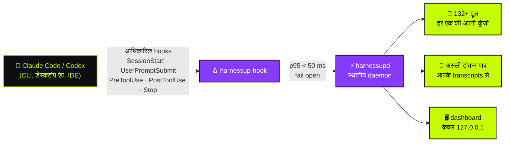

<!-- HarnessUp README · अंग्रेज़ी स्रोत है; अनुवाद i18n/ में हैं -->

<p align="center">
  <a href="https://harnessup.dev"></a>
</p>

<p align="center">
  <a href="../README.md">🇺🇸 English</a> ·
  <a href="README.pt-BR.md">🇧🇷 Português</a> ·
  <a href="README.es.md">🇪🇸 Español</a> ·
  <a href="README.fr.md">🇫🇷 Français</a> ·
  <a href="README.de.md">🇩🇪 Deutsch</a> ·
  <a href="README.it.md">🇮🇹 Italiano</a> ·
  <a href="README.ja.md">🇯🇵 日本語</a> ·
  <a href="README.ko.md">🇰🇷 한국어</a> ·
  <a href="README.zh-CN.md">🇨🇳 简体中文</a> ·
  <a href="README.ar.md">🇸🇦 العربية</a> ·
  <a href="README.he.md">🇮🇱 עברית</a> ·
  <b>🇮🇳 हिन्दी</b>
</p>

<p align="center">
  <a href="https://www.npmjs.com/package/harnessup"></a>
  <a href="https://github.com/harnessup/harnessup/releases/latest"></a>
  
  
  
  
  <a href="https://github.com/harnessup/harnessup/stargazers"></a>
</p>

<p align="center">
  <a href="https://harnessup.dev/hi/install/"></a>
  <a href="https://harnessup.dev/hi/plans/"></a>
  <a href="https://harnessup.dev/hi/"></a>
  <a href="#-स्पॉन्सर"></a>
</p>

<h3 align="center">कोडिंग एजेंट्स के लिए दुनिया का सबसे बड़ा टोकन बचतकर्ता।</h3>

<p align="center">
  आपकी अपनी मशीन पर चलने वाले <b>132 से ज़्यादा टूल</b>, जो <b>Claude Code</b> और <b>Codex</b> की टोकन बर्बादी घटाते हैं।<br>
  मुफ़्त माप, बिना लॉगिन, 100 % स्थानीय। <b>आपके बिल पर 78 % तक की बचत</b>, सबूत आपके अपने इस्तेमाल के माप के साथ।
</p>

<p align="center">
  
</p>

## 📑 सामग्री

<table>
  <tr>
    <td valign="top">
      <a href="#-खलनायक">खलनायक</a><br>
      <a href="#-harnessup-क्या-करता-है">HarnessUp क्या करता है</a><br>
      <a href="#-नंबर">नंबर</a><br>
      <a href="#%EF%B8%8F-यह-कैसे-काम-करता-है">यह कैसे काम करता है</a>
    </td>
    <td valign="top">
      <a href="#-टूर">टूर</a><br>
      <a href="#-10-क्षेत्र-132-टूल">10 क्षेत्र, 132+ टूल</a><br>
      <a href="#-ai-का-नुकसान-एक-बटन-में-वापस">एक बटन से वापसी</a><br>
      <a href="#%EF%B8%8F-गैलरी">गैलरी</a>
    </td>
    <td valign="top">
      <a href="#-एक-लाइन-में-इंस्टॉल">इंस्टॉल</a><br>
      <a href="#-उनके-लिए-जो-एजेंट-के-साथ-जीते-हैं">किनके लिए है</a><br>
      <a href="#-प्लान">प्लान</a><br>
      <a href="#-गोपनीयता-और-सुरक्षा">गोपनीयता और सुरक्षा</a>
    </td>
    <td valign="top">
      <a href="#-समर्थित-एजेंट">समर्थित एजेंट</a><br>
      <a href="#-faq">FAQ</a><br>
      <a href="#-स्पॉन्सर">स्पॉन्सर</a><br>
      <a href="#-hup-से-मिलें">Hup से मिलें</a>
    </td>
  </tr>
</table>

## 🪙 खलनायक

<table>
  <tr>
    <td width="42%" valign="middle">
      
    </td>
    <td width="58%" valign="middle">
      <p><b>सेशन #217 · महंगा मॉडल · ज़्यादा प्रयास।</b></p>
      <p>आप एक लाइन के सुधार के लिए कहते हैं। एजेंट जवाब देता है <i>"ज़रूर! मैं इसमें आपकी मदद करूँगा। बढ़िया सवाल…"</i>, तीन ऐसी फ़ाइलें फिर से पढ़ता है जो वह पहले ही पढ़ चुका है, 4,000 लाइनों का लॉग छापता है और उसके बाद ही सुधार लिखता है। टोकन काउंटर लगातार चढ़ता रहता है।</p>
      <p>हर <i>"ज़रूर! मैं इसमें आपकी मदद करूँगा"</i> जवाब में चुकाया जाता है <b>और उसके बाद की हर राउंड में फिर से पढ़ा जाता है</b>। आपकी साप्ताहिक सीमा बुधवार को ख़त्म हो जाती है।</p>
      <p>HarnessUp सीधे जवाब माँगता है, बिना बदली फ़ाइलों को दोबारा पढ़ने से रोकता है और विशाल आउटपुट को छोटा करता है, ताकि आप <b>शुक्रवार तक गुंजाइश के साथ पहुँच जाएँ</b>।</p>
    </td>
  </tr>
</table>

## ⚡ HarnessUp क्या करता है

HarnessUp **न प्लगइन है, न MCP, न skill, न proxy**। यह एक दूसरी परत है जो नियमों के दायरे में आपके harness के नीचे फिट होती है: एक स्थानीय daemon जो Claude Code और Codex के **आधिकारिक hooks** से जुड़ता है, हर टोकन मापता है और आपके चालू किए टूल लागू करता है, हर एक अपनी अलग कुंजी के साथ।

<table>
  <tr>
    <td width="25%" align="center" valign="top">
      <br>
      <h3>📏 मापें</h3>
      <sub>Deep Scan और 19 और माप व निगरानी टूल, <b>मुफ़्त</b>। आपके transcripts से असली टोकन गिनती, कभी अंदाज़ा नहीं।</sub>
    </td>
    <td width="25%" align="center" valign="top">
      <br>
      <h3>💸 बचाएँ</h3>
      <sub>26 बचत टूल: मॉडल को बुलाए बिना कम्प्रेशन, दुबले जवाब, कोई दोबारा पढ़ना नहीं, और सस्ते subagents का झुंड, जहाँ <i>महँगा मॉडल सिर्फ़ फ़ैसला करता है</i>।</sub>
    </td>
    <td width="25%" align="center" valign="top">
      <br>
      <h3>🛡️ सुरक्षा</h3>
      <sub>Stop Loss, Antiloop Protector, Secret Lock, Git Shield और एक क्लिक में वापसी। AI का नुकसान एक बटन से वापस हो जाता है।</sub>
    </td>
    <td width="25%" align="center" valign="top">
      <br>
      <h3>🎛️ नियंत्रण</h3>
      <sub>स्थानीय dashboard में 200+ एक-क्लिक कुंजियाँ। एक क्लिक से टूल चालू, दूसरे से वापस। कोई terminal नहीं चाहिए।</sub>
    </td>
  </tr>
</table>

## 📊 नंबर

| | माप | इसका मतलब |
|:---:|---|---|
| 🚀 | **3x तक** | एक फ़िक्स्ड प्लान पर उन्हीं टोकन से ज़्यादा काम |
| 💰 | **78% तक** | API उपयोगकर्ताओं के बिल में कमी |
| 📈 | **260% से ज़्यादा** | कुछ 5-घंटे की विंडो में ज़्यादा थ्रूपुट |
| 🧰 | **132+** | **10 क्षेत्रों** में टूल, सभी आपकी मशीन पर चलते हैं |
| ⌨️ | **200+** | dashboard में वापस हो सकने वाली एक-क्लिक कुंजियाँ |
| ⏱️ | **p95 < 50 ms** | हर hook के लिए, सख़्त **2 s** timeout के साथ, ताकि एजेंट कभी न अटके |
| 🌍 | **12** | dashboard की भाषाएँ |

> [!NOTE]
> "तक" का मतलब असली उपयोग की विंडो में मापे गए सबसे बड़े लाभ हैं। **आपका अपना आँकड़ा आपके अपने transcripts से आता है**: HarnessUp इसे आपके कुछ भी चुकाने से पहले मुफ़्त में मापता है। खुला हिसाब यहाँ देखें: [harnessup.dev/hi/metering](https://harnessup.dev/hi/metering/).

## ⚙️ यह कैसे काम करता है



- **केवल आधिकारिक सतहें।** मॉडल आपके अपने खाते के साथ आधिकारिक `claude` और `codex` binaries से चलता है। HarnessUp आपका token या कुंजी कभी नहीं पढ़ता, स्टोर नहीं करता और आगे नहीं भेजता।
- **Fail open, हमेशा।** अगर HarnessUp धीमा हो, बंद हो या गड़बड़ी में हो, तो आपका एजेंट ऐसे चलता रहता है जैसे वह मौजूद ही न हो।
- **कुछ भी अपरिवर्तनीय नहीं।** जो कुछ काटा, कम्प्रेस या ब्लॉक किया जाता है, वह वापस पाया जा सकता है।
- **कम भरोसा सीधा निकल जाता है।** मॉडल को गलत जानकारी देने से बेहतर है कि बचत न की जाए।

## 🎬 टूर

<p align="center">
  
</p>

## 🧰 10 क्षेत्र, 132+ टूल

कोडिंग एजेंट्स के लिए एक स्विस आर्मी चाकू। हर टूल की अपनी कुंजी है, और हर कुंजी वापस हो सकती है।

| क्षेत्र | टूल | मुख्य टूल | ख़ास बातें |
|---|:---:|---|---|
| 📏 **माप** | 14 | Deep Scan | Harness History, Inside the Wallet, Model Insights, HarnessUp Bench, Plan Usage |
| 📡 **निगरानी** | 8 | Session Radar | The Numbers, Realtime Events, Reasoning Check, Subagents Work, Plan Advisor |
| 💸 **बचत** | 26 | Cheap Swarm | Smart Compress, Response Diet, Delta Read, Smart Cut, Terminal Guide, WebFetch Diet |
| 🎛️ **नियंत्रण** | 25 | Stop Loss | Budget Cap, ToolBox, Working Hours, Swarm Commander, Enforce TDD, Force Lint |
| 🛡️ **सुरक्षा** | 10 | Smart Return | Secret Lock, UltraShield Guard, Antiloop Protector, Git Shield, Checkpoint |
| 🔐 **सिक्योरिटी** | 8 | Sentinel | Smart Security, Security Check, SafeBox, No Touch, No Delete |
| 🚀 **उत्पादकता** | 26 | Code Deck | Smart Commit, Build Now, Super Code Review, HarnessUp Flow, HarnessUp Board |
| 🧪 **उपयोगिताएँ** | 23 | Prompt Optimizer | Token Calculator, Frozen Cache, MetaPrompt, Mirror Master, HarnessUp Shop |
| 🎨 **अनुकूलन** | 6 | Status Bar | Info Pills, Cache Alarm, Mod Themes, Finish Line Push |
| 🏗️ **बिल्डर** | 5 | /bones | SPEC/PRD Express, DOCs Generator, Website Builder |

<details>
<summary><b>📏 माप और 📡 निगरानी</b>: देखें हर टोकन कहाँ जाता है (ज़्यादातर मुफ़्त)</summary>

<br>

- **Deep Scan** (मुफ़्त): आपके इतिहास की बर्बादी का निदान करता है और दिखाता है कि HarnessUp क्या बचा सकता था।
- **Model Insights** (मुफ़्त): हर मॉडल संस्करण के लिए 24 सवालों के जवाब।
- **HarnessUp Bench** (मुफ़्त): हर मॉडल और प्रयास स्तर का स्कोर।
- **Openness Meter, Harness Meter, Cache Cycle, Inside the Wallet, Work Analytics, Bad Use, Plan Usage** (मुफ़्त)।
- **Session Radar, The Numbers, Uptime, Realtime Events, Reasoning Check, Subagents Work, Harness Update, Plan Advisor** (सभी मुफ़्त)।
- **/diagnostic और /simulate** (Ultra): अपने मापे गए उपयोग के बारे में सवाल पूछें और फ़ैसले लेने से पहले उन्हें सिम्युलेट करें।

</details>

<details>
<summary><b>💸 बचत</b>: वही काम, कम टोकन में</summary>

<br>

- **Smart Compress** (मुफ़्त): मॉडल को बुलाए बिना बातचीत को समेटता है।
- **Response Diet** (मुफ़्त): सीधे जवाब, कोई भूमिका नहीं।
- **Delta Read, Code Finder, Smart Cut, Read Router, Head Limit** (Pro): सिर्फ़ ज़रूरी पढ़ें और कभी बिना बदली फ़ाइल को दोबारा न पढ़ें।
- **Terminal Guide, Output Diet, WebFetch Diet** (Pro): लंबे कमांड आउटपुट और वेब पेज context तक पहुँचने से पहले छोटे कर दिए जाते हैं।
- **Renew Session, Hot Context, Context Graph, Session Protocol, Memory State** (Pro): ऐसे सेशन जो हल्के शुरू होते हैं और हल्के रहते हैं।
- **First Pass, Way Out, No Comment, Stature Brake, Rules Auditor, Optimize Harness** (Pro)।
- **Cheap Swarm** (Ultra): 26 कार्य-वर्ग सस्ते subagents के पास जाते हैं; महँगा मॉडल सिर्फ़ फ़ैसला करता है।

</details>

<details>
<summary><b>🎛️ नियंत्रण</b>: आपके नियम, tool-call की सीमाओं पर लागू</summary>

<br>

- **Stop Loss और Budget Cap** (Pro): US$ में सीमा तय करें और सेशन वहीं रुक जाता है।
- **ToolBox** (Pro): आपके एजेंट के लिए 17 तैयार conventions।
- **Working Hours, Scheduled Break, Reasoning Advisor, Rule Checker, Force Test, No Subagents** (Pro)।
- **Swarm Commander, Subs Director, Enforce TDD, Force Lint, Doc Now, Anti-fading, Stick Prompt** (Ultra)।
- **Anti-Collision** (GIGA) और **HarnessUp OFF** (मुफ़्त): बिना अनइंस्टॉल किए सब कुछ रोकें।

</details>

<details>
<summary><b>🛡️ सुरक्षा और 🔐 सिक्योरिटी</b>: कुछ लीक नहीं होता, कुछ खोता नहीं</summary>

<br>

- **Smart Return और Checkpoint** (Pro): एजेंट ने जो किया उसे वापस लें।
- **Git Shield और Eyes Off** (Pro): अपने इतिहास और संवेदनशील फ़ाइलों की रक्षा करें।
- **SafeBox** (Pro): जो कुछ काटा या ब्लॉक किया गया, वह 7 दिन तक वापस पाया जा सकता है।
- **Secret Lock, UltraShield Guard, Antiloop Protector, Sandbox Mode, Deny MCP, Blackout** (Ultra)।
- **No Touch और No Delete** (Ultra): ऐसी फ़ाइलें जिन्हें एजेंट पढ़ सकता है पर कभी बदल या मिटा नहीं सकता।
- **Sentinel, Smart Security, Security Check, SEC Station** (GIGA)।

</details>

<details>
<summary><b>🚀 उत्पादकता, 🧪 उपयोगिताएँ, 🎨 अनुकूलन और 🏗️ बिल्डर</b></summary>

<br>

- **Code Deck** (GIGA): 4 स्लॉट में 17+ एजेंट CLI एक साथ।
- **HarnessUp Flow और HarnessUp Board** (GIGA): प्राकृतिक भाषा में वर्णित automation और एक अनंत board।
- **Super Code Review** (GIGA): हर बदलाव के लिए 0 से 100 का स्कोर।
- **Smart Commit, Build Now, Smart Report, Save my Session, GitHub और Deploy एक क्लिक में** (Ultra)।
- **Ez Work, Token Calculator, Frozen Cache, Cache Lock, Prompt Optimizer, MetaPrompt (34 प्रकार), HarnessUp Shop** (मुफ़्त)।
- **Mirror Master** (Pro): CLAUDE.md, AGENTS.md, GEMINI.md, Copilot, Cursor, Windsurf, Cline और Aider के निर्देश एक-दूसरे से मेल में रखता है।
- **Status Bar, Info Pills, Cache Alarm, Mod Themes** (मुफ़्त) और **Finish Line Push** (Pro)।
- **SPEC/PRD Express, DOCs Generator, /bones, DOC for Website, Website Builder** (GIGA)।

</details>

<p align="center">हर टूल वाली पूरी सूची: <a href="https://harnessup.dev/hi/tools/"><b>harnessup.dev/hi/tools</b></a></p>

## ⏪ AI का नुकसान, एक बटन में वापस

<table>
  <tr>
    <td width="58%" valign="middle">
      <p>एजेंट ने गलत फ़ोल्डर मिटा दिया? context में कोई कुंजी लीक कर दी? रात 2 बजे आधा repository फिर से लिख डाला?</p>
      <ul>
        <li><b>Secret Lock</b> credentials को context से बाहर रखता है।</li>
        <li><b>Smart Return</b> और <b>Checkpoint</b> एजेंट के किए को वापस लेते हैं।</li>
        <li><b>No Delete</b> और <b>Git Shield</b> विनाशकारी कदमों को होने से पहले रोकते हैं।</li>
        <li><b>SafeBox</b> वह सब 7 दिन तक रखता है जो काटा या ब्लॉक किया गया।</li>
        <li><b>HarnessUp OFF</b> बिना अनइंस्टॉल किए सभी टूल एक साथ रोक देता है।</li>
      </ul>
      <p>ब्रेक केवल tool-call की सीमाओं पर लगते हैं: HarnessUp एजेंट को <b>किसी लिखाई के बीच में कभी नहीं रोकता</b>।</p>
    </td>
    <td width="42%" valign="middle">
      
    </td>
  </tr>
</table>

## 🖼️ गैलरी

<table>
  <tr>
    <td align="center" width="33%"><a href="../assets/screens/01-model-insights.png"></a><br><sub><b>Model Insights</b> · मॉडल संस्करणों की तुलना</sub></td>
    <td align="center" width="33%"><a href="../assets/screens/02-subagents-work.png"></a><br><sub><b>Subagents Work</b> · टीम क्या करती है और कितना खर्च होता है</sub></td>
    <td align="center" width="33%"><a href="../assets/screens/04-bench.png"></a><br><sub><b>HarnessUp Bench</b> · हर मॉडल और प्रयास का स्कोर</sub></td>
  </tr>
  <tr>
    <td align="center"><a href="../assets/screens/05-cheap-swarm.png"></a><br><sub><b>Cheap Swarm</b> · झुंड ने क्या बचाया</sub></td>
    <td align="center"><a href="../assets/screens/06-code-deck.png"></a><br><sub><b>Code Deck</b> · साथ-साथ terminals में एजेंट</sub></td>
    <td align="center"><a href="../assets/screens/07-context-graph.png"></a><br><sub><b>Context Graph</b> · इंडेक्स की गई प्रोजेक्ट मेमोरी</sub></td>
  </tr>
  <tr>
    <td align="center"><a href="../assets/screens/10-antiloop.png"></a><br><sub><b>Antiloop Protector</b> · बेकार लूप रोकता है</sub></td>
    <td align="center"><a href="../assets/screens/08-openness-meter.png"></a><br><sub><b>Openness Meter</b> · सेशन की शुरुआत कैसे बदली</sub></td>
    <td align="center"><a href="../assets/screens/09-shop.png"></a><br><sub><b>HarnessUp Shop</b> · एजेंट और MCP का इंस्टॉलर</sub></td>
  </tr>
  <tr>
    <td align="center"><a href="../assets/screens/14-flow-canvas.png"></a><br><sub><b>HarnessUp Flow</b> · प्राकृतिक भाषा में automation</sub></td>
    <td align="center"><a href="../assets/screens/15-board.png"></a><br><sub><b>HarnessUp Board</b> · अनंत board</sub></td>
    <td align="center"><a href="../assets/screens/12-ez-work-timer.png"></a><br><sub><b>Ez Work</b> · Ghost Prompt और Work Timer</sub></td>
  </tr>
</table>

<details>
<summary>और स्क्रीन</summary>
<br>
<p align="center">
  
  
  
</p>
</details>

## 📦 एक लाइन में इंस्टॉल

<table>
  <tr>
    <td width="40%" valign="middle">
      
    </td>
    <td width="60%" valign="middle">
      <p>हर उपयोगकर्ता के लिए। <b>कोई एडमिन नहीं, कोई लॉगिन नहीं, कोई ईमेल नहीं, कोई सिस्टम सेवा नहीं।</b> इंस्टॉल से पहले binaries की SHA-256 से जाँच होती है, और updates signed होते हैं।</p>
      <p><b>npm</b> (Windows, macOS, Linux · Node 18+)</p>

```sh
npm install -g harnessup
```

<p><b>Windows</b> · PowerShell, बिना Node</p>

```powershell
irm https://harnessup.dev/install.ps1 | iex
```

<p><b>macOS और Linux</b> · बिना Node, बिना sudo</p>

```sh
curl -fsSL https://harnessup.dev/install.sh | sh
```

</td>
  </tr>
</table>

फिर:

```sh
harnessup install     # HarnessUp को Claude Code और Codex से जोड़ता है
harnessup doctor      # इंस्टॉलेशन जाँचता है
harnessup uninstall   # इसे साफ़-सुथरा हटाता है
```

<details>
<summary><b>इंस्टॉल करने के और तरीके</b>: .exe, ZIP, pnpm/yarn/bun, या अपने एजेंट से करवाएँ</summary>

<br>

- **Windows इंस्टॉलर**: `HarnessUp-Setup-x64.exe` (Windows 10/11 64-bit, हर उपयोगकर्ता के लिए) [harnessup.dev/hi/install](https://harnessup.dev/hi/install/) पर।
- **ZIP**: इसे [GitHub Releases](https://github.com/harnessup/harnessup/releases/latest) से डाउनलोड करें और `SHA256SUMS.txt` से मिलाएँ।
- **pnpm, yarn, bun**: `pnpm add -g harnessup` · `yarn global add harnessup` · `bun add -g harnessup`।
- **1 prompt**: इसे Claude Code या Codex में चिपकाएँ और एजेंट को आपके लिए इंस्टॉल करने दें:

```text
इस मशीन पर HarnessUp इंस्टॉल करें: npm install -g harnessup चलाएँ (Node के बिना: Windows पर PowerShell में irm https://harnessup.dev/install.ps1 | iex; macOS और Linux पर Terminal में curl -fsSL https://harnessup.dev/install.sh | sh), पुष्टि करें कि यह Claude Code और Codex से जुड़ गया है, और dashboard खोलें। लॉगिन, ईमेल या एडमिन न माँगें।
```

- **जल्द आ रहा है**: winget, Scoop, Chocolatey, Homebrew और Snap।

</details>

📘 अपडेट, अनइंस्टॉल और समस्या-निवारण के साथ पूरी गाइड: **[INSTALL.hi.md](INSTALL.hi.md)**।

## 👥 उनके लिए जो एजेंट के साथ जीते हैं

<table>
  <tr>
    <td width="33%" align="center" valign="top">
      <br>
      <h3>फ़िक्स्ड प्लान पर</h3>
      <sub>Claude Pro/Max या ChatGPT प्लान। उसी विंडो में <b>3x तक</b> ज़्यादा काम: आपकी साप्ताहिक सीमा लगभग दोगुनी हो जाती है।</sub>
    </td>
    <td width="33%" align="center" valign="top">
      <br>
      <h3>API से भुगतान</h3>
      <sub>हर टोकन पैसा है। बिल पर <b>78% तक कम</b>, भारी उपयोगकर्ताओं के लिए हर महीने सैकड़ों डॉलर।</sub>
    </td>
    <td width="33%" align="center" valign="top">
      <br>
      <h3>बिना terminal</h3>
      <sub>एक Windows इंस्टॉलर और dashboard में <b>200+ वापस हो सकने वाली कुंजियाँ</b>। क्लिक करें, संख्या देखें, वापस करने के लिए फिर क्लिक करें।</sub>
    </td>
  </tr>
</table>

## 💳 प्लान

<table>
  <tr>
    <th width="25%">Basic</th>
    <th width="25%">Pro</th>
    <th width="25%">Ultra</th>
    <th width="25%">GIGA UNLIMITED</th>
  </tr>
  <tr align="center">
    <td><h3>मुफ़्त</h3><sub>हमेशा के लिए</sub></td>
    <td><h3>US$ 9<sub>/माह</sub></h3><sub>या सालाना भुगतान पर US$ 6/माह</sub></td>
    <td><h3>US$ 12<sub>/माह</sub></h3><sub>या सालाना भुगतान पर US$ 9/माह</sub></td>
    <td><h3>US$ 27<sub>/माह</sub></h3><sub>या सालाना भुगतान पर US$ 19/माह</sub></td>
  </tr>
  <tr valign="top">
    <td><sub>1 Claude Code खाता · 1 प्रोजेक्ट<br>सब कुछ मापता है: Deep Scan, निगरानी और 20+ मुफ़्त टूल</sub></td>
    <td><sub>1 Claude + 1 Codex खाता · 2 प्रोजेक्ट<br>बचत, नियंत्रण, सुरक्षा और वापसी</sub></td>
    <td><sub>2 Claude + 2 Codex खाते · 6 प्रोजेक्ट<br>Cheap Swarm, Secret Lock, Antiloop, automations</sub></td>
    <td><sub>असीमित harnesses, खाते और प्रोजेक्ट<br>Code Deck, Flow, Board, Security, Builders</sub></td>
  </tr>
</table>

- ✅ भुगतान वाले प्लान पर **7 दिन का मुफ़्त ट्रायल**: कोई कार्ड नहीं, कोई साइनअप नहीं।
- ✅ हर प्लान में उसके नीचे का सब कुछ शामिल है। हर प्लान पर असीमित सेशन। कभी भी रद्द करें, किसी फ़ॉर्म के बिना।
- ✅ खरीद के 7 दिन के भीतर रिफ़ंड। हर कुंजी पर एक floating activation।
- 👥 **Team**: 10 GIGA लाइसेंस US$ 1,699 प्रति वर्ष। **Corporate**: [corporate@harnessup.dev](mailto:corporate@harnessup.dev).

<p align="center"><a href="https://harnessup.dev/hi/plans/"><b>हर प्लान पर हर टूल की तुलना करें, और मौजूदा early-bird छूट देखें →</b></a></p>

## 🔒 गोपनीयता और सुरक्षा

| | |
|---|---|
| 🏠 **100% स्थानीय** | सब कुछ आपकी मशीन पर चलता है। कोई proxy नहीं, कोई API interception नहीं, कोई भारी MCP नहीं। |
| 🔑 **आपका खाता, आपका token** | आपके खाते से आधिकारिक `claude` और `codex` चलाता है और आपका token या कुंजी कभी नहीं पढ़ता, स्टोर नहीं करता या आगे नहीं भेजता। |
| 🖥️ **127.0.0.1 पर dashboard** | यह केवल आपकी मशीन पर जवाब देता है। आपके खाते के पेज पर **0 bytes of usage sent** दिखता है। |
| 🟢 **Fail open** | अगर HarnessUp धीमा, बंद या गड़बड़ी में हो, तो एजेंट चलता रहता है। p95 < 50 ms, सख़्त 2 s timeout। |
| ⏪ **वापस हो सकने वाला** | हर कुंजी एक क्लिक में वापस हो सकती है। SafeBox काटा गया सामान 7 दिन रखता है। |
| 👤 **शुरू करने के लिए कोई खाता नहीं** | इंस्टॉल और माप के लिए कोई लॉगिन, ईमेल, पासवर्ड या एडमिन अधिकार नहीं। |

कोई कमज़ोरी मिली? सार्वजनिक issue खोलने के बजाय कृपया [SECURITY.md](../SECURITY.md) का पालन करें।

## 🤖 समर्थित एजेंट

| एजेंट | स्थिति | कहाँ |
|---|:---:|---|
| **Claude Code** | ✅ एकीकृत | CLI, डेस्कटॉप ऐप और IDE extensions, खाते के साथ या API से |
| **Codex** | ✅ एकीकृत | CLI, डेस्कटॉप ऐप और IDE extensions, खाते के साथ या API से |
| **Cursor** | 🔜 जल्द आ रहा है | |
| **OpenCode** | 🔜 जल्द आ रहा है | |
| **Hermes Agent** | 🔜 जल्द आ रहा है | |

**Code Deck** पहले से 17+ एजेंट CLI साथ-साथ चलाता है, और **Mirror Master** 8 harnesses की निर्देश फ़ाइलों को मेल में रखता है।

## ❓ FAQ

<details>
<summary><b>क्या यह सुरक्षित है?</b></summary>
<br>
हाँ। यह केवल आधिकारिक hooks इस्तेमाल करता है, कोई proxy नहीं है, और यह 100% आपकी मशीन पर चलता है। अगर यह रुक जाए, तो आपका एजेंट हमेशा की तरह चलता रहता है।
</details>

<details>
<summary><b>क्या यह मेरा token या API कुंजी पढ़ता है?</b></summary>
<br>
कभी नहीं। मॉडल आपके अपने खाते के साथ आधिकारिक <code>claude</code> और <code>codex</code> binaries से चलता है। HarnessUp आपका token या कुंजी कभी नहीं पढ़ता, स्टोर नहीं करता या आगे नहीं भेजता।
</details>

<details>
<summary><b>क्या यह एजेंट को धीमा करता है?</b></summary>
<br>
नहीं। hooks का p95 50 ms से कम है और सख़्त timeout 2 s है। अगर कुछ धीमा हो, तो एजेंट बिना इंतज़ार किए आगे बढ़ जाता है।
</details>

<details>
<summary><b>क्या यह API उपयोगकर्ताओं के लिए काम करता है?</b></summary>
<br>
हाँ, और बचत यहीं सबसे ज़्यादा दिखती है: हर बचाया गया टोकन ऐसा पैसा है जो आपकी जेब में रहता है।
</details>

<details>
<summary><b>क्या मुझे terminal चाहिए?</b></summary>
<br>
नहीं। एक Windows इंस्टॉलर है और 200+ वापस हो सकने वाली एक-क्लिक कुंजियों वाला dashboard है।
</details>

<details>
<summary><b>क्या मुफ़्त प्लान के लिए कार्ड चाहिए?</b></summary>
<br>
नहीं। Basic हमेशा के लिए मुफ़्त है, और भुगतान वाले प्लान पर बिना कार्ड और बिना साइनअप के 7 दिन का ट्रायल है।
</details>

<details>
<summary><b>क्या यह macOS और Linux पर काम करता है?</b></summary>
<br>
हाँ, npm या <code>install.sh</code> स्क्रिप्ट के ज़रिए।
</details>

<details>
<summary><b>मैं कितनी मशीनें इस्तेमाल कर सकता हूँ?</b></summary>
<br>
हर कुंजी पर एक समय में एक activation। लाइसेंस floating है: आप इसे जब चाहें मशीनों के बीच ले जा सकते हैं।
</details>

<details>
<summary><b>.exe पर Windows SmartScreen चेतावनी क्यों दिखाता है?</b></summary>
<br>
यह नए प्रकाशकों के लिए एक प्रतिष्ठा चेतावनी है। npm और PowerShell रास्तों पर कोई चेतावनी नहीं है, और SHA-256 hashes <a href="https://harnessup.dev/hi/windows-warning/">harnessup.dev/hi/windows-warning</a> पर प्रकाशित हैं। code-signing certificate उन चीज़ों में से एक है जिनके लिए sponsors मदद करते हैं।
</details>

<details>
<summary><b>इसे कैसे अनइंस्टॉल करूँ?</b></summary>
<br>
<code>harnessup uninstall</code> चलाएँ। बिना अनइंस्टॉल किए रोकने के लिए dashboard में <b>HarnessUp OFF</b> चालू करें।
</details>

<p align="center">और जवाब <a href="https://harnessup.dev/hi/faq/"><b>harnessup.dev/hi/faq</b></a> पर</p>

## 💜 स्पॉन्सर

<table>
  <tr>
    <td width="30%" align="center" valign="middle">
      
    </td>
    <td width="70%" valign="middle">
      <p><b>Basic प्लान हमेशा के लिए मुफ़्त है, और हम चाहते हैं कि ऐसा ही रहे।</b> HarnessUp एक छोटी स्वतंत्र टीम बनाती है, और स्पॉन्सरशिप ही वह चीज़ है जो माप को सबके लिए मुफ़्त रखती है।</p>
      <p><b>आपकी स्पॉन्सरशिप किस चीज़ को फ़ंड करती है:</b></p>
      <ul>
        <li>🔏 एक Windows code-signing certificate, ताकि SmartScreen चेतावनी चली जाए</li>
        <li>🍎 असली macOS और Linux मशीनों पर टेस्टिंग और सपोर्ट</li>
        <li>📦 winget, Scoop, Chocolatey, Homebrew और Snap पैकेज</li>
        <li>🤖 और एजेंट्स के साथ इंटीग्रेशन: Cursor, OpenCode, Hermes Agent</li>
        <li>🌍 dashboard और साइट को 12 भाषाओं में रखना</li>
      </ul>
    </td>
  </tr>
</table>

**HarnessUp को स्पॉन्सर क्यों करें?** आपका लोगो ठीक उसी पल डेवलपर्स तक पहुँचता है जब वे अपने कोडिंग एजेंट्स की लागत, नियंत्रण और सुरक्षा की परवाह कर रहे होते हैं: इस README में, सभी 12 अनुवादों में, और [harnessup.dev](https://harnessup.dev) पर।

<p align="center">
  <a href="mailto:corporate@harnessup.dev?subject=HarnessUp%20%E0%A4%B8%E0%A5%8D%E0%A4%AA%E0%A5%89%E0%A4%A8%E0%A5%8D%E0%A4%B8%E0%A4%B0%E0%A4%B6%E0%A4%BF%E0%A4%AA"></a>
</p>

<table>
  <tr>
    <td align="center" width="33%"><br>🥇<br><b>यहाँ आपका लोगो</b><br><sub>गोल्ड स्पॉन्सर</sub><br><br></td>
    <td align="center" width="33%"><br>🥈<br><b>यहाँ आपका लोगो</b><br><sub>सिल्वर स्पॉन्सर</sub><br><br></td>
    <td align="center" width="33%"><br>🥉<br><b>यहाँ आपका लोगो</b><br><sub>ब्रॉन्ज़ स्पॉन्सर</sub><br><br></td>
  </tr>
</table>

**कंपनी नहीं हैं?** आप उतनी ही मदद कर सकते हैं: ⭐ **इस repository को star करके**, HarnessUp को ऐसे दोस्त के साथ साझा करके जो टोकन जलाता है, या **[affiliate program](https://harnessup.dev/hi/affiliates/)** से जुड़कर: जिसे आपने भेजा, उसके बदले आपको मिलता है। शामिल होने के लिए ग्राहक होना ज़रूरी नहीं।

## 🤖 Hup से मिलें

<p align="center">
  
  
  
  
  
</p>

<p align="center">
  <b>Hup</b> HarnessUp का मैस्कॉट है: एक बैंगनी harness में नींबू-हरी keycap, जो आपके टोकन थामे रखता है,<br>
  एक हाथ से भूमिका रोकता है और छड़ी से आपके subagents का संचालन करता है।
</p>

<p align="center">
  
</p>

## 🔗 लिंक

<p align="center">
  <a href="https://harnessup.dev/hi/">वेबसाइट</a> ·
  <a href="https://harnessup.dev/hi/install/">डाउनलोड</a> ·
  <a href="https://harnessup.dev/hi/plans/">प्लान</a> ·
  <a href="https://harnessup.dev/hi/tools/">टूल</a> ·
  <a href="https://harnessup.dev/hi/faq/">FAQ</a> ·
  <a href="https://www.npmjs.com/package/harnessup">npm</a> ·
  <a href="https://github.com/harnessup/harnessup/releases">Releases</a> ·
  <a href="https://github.com/harnessup/harnessup/discussions">Discussions</a> ·
  <a href="../SUPPORT.md">सहायता</a> ·
  <a href="mailto:help@harnessup.dev">help@harnessup.dev</a>
</p>

## 📄 लाइसेंस

HarnessUp एक मालिकाना (proprietary) सॉफ़्टवेयर है, Basic प्लान के साथ शुरू करने के लिए मुफ़्त। यह repository उत्पाद, उसकी गाइड और उसका दस्तावेज़ीकरण वितरित करता है, और इसमें कोई source code नहीं है। देखें [LICENSE.md](../LICENSE.md)। सर्वाधिकार सुरक्षित।

<p align="center">
  <br>
  <sub>💜 और 🍋 से बनाया गया · <a href="https://harnessup.dev">harnessup.dev</a></sub>
</p>
