<!-- HarnessUp README · English is the source; translations live in i18n/ -->

<p align="center">
  <a href="https://harnessup.dev"></a>
</p>

<p align="center">
  <a href="../README.md">🇺🇸 English</a> ·
  <a href="README.pt-BR.md">🇧🇷 Português</a> ·
  <a href="README.es.md">🇪🇸 Español</a> ·
  <a href="README.fr.md">🇫🇷 Français</a> ·
  <a href="README.de.md">🇩🇪 Deutsch</a> ·
  <b>🇮🇹 Italiano</b> ·
  <a href="README.ja.md">🇯🇵 日本語</a> ·
  <a href="README.ko.md">🇰🇷 한국어</a> ·
  <a href="README.zh-CN.md">🇨🇳 简体中文</a> ·
  <a href="README.ar.md">🇸🇦 العربية</a> ·
  <a href="README.he.md">🇮🇱 עברית</a> ·
  <a href="README.hi.md">🇮🇳 हिन्दी</a>
</p>

<p align="center">
  <a href="https://www.npmjs.com/package/harnessup"></a>
  <a href="https://github.com/harnessup/harnessup/releases/latest"></a>
  
  
  
  
  <a href="https://github.com/harnessup/harnessup/stargazers"></a>
</p>

<p align="center">
  <a href="https://harnessup.dev/it/install/"></a>
  <a href="https://harnessup.dev/it/plans/"></a>
  <a href="https://harnessup.dev/it/"></a>
  <a href="#-sponsor"></a>
</p>

<h3 align="center">Il miglior risparmiatore di token al mondo per agenti di codice.</h3>

<p align="center">
  Oltre <b>132 strumenti</b> che girano sulla tua macchina per tagliare lo spreco di token di <b>Claude Code</b> e <b>Codex</b>.<br>
  Misurazione gratuita, senza login, 100% locale. Fino al <b>78% in meno sulla bolletta</b>, con la prova misurata sul tuo uso.
</p>

<p align="center">
  
</p>

## 📑 Indice

<table>
  <tr>
    <td valign="top">
      <a href="#-il-cattivo">Il cattivo</a><br>
      <a href="#-cosa-fa-harnessup">Cosa fa HarnessUp</a><br>
      <a href="#-i-numeri">I numeri</a><br>
      <a href="#%EF%B8%8F-come-funziona">Come funziona</a>
    </td>
    <td valign="top">
      <a href="#-panoramica">Panoramica</a><br>
      <a href="#-10-fronti-132-strumenti">10 fronti, 132+ strumenti</a><br>
      <a href="#-danni-dellia-annullati-con-un-pulsante">Annulla con un pulsante</a><br>
      <a href="#%EF%B8%8F-galleria">Galleria</a>
    </td>
    <td valign="top">
      <a href="#-installa-in-una-riga">Installa</a><br>
      <a href="#-fatto-per-chi-vive-di-agenti">Per chi</a><br>
      <a href="#-piani">Piani</a><br>
      <a href="#-privacy-e-sicurezza">Privacy e sicurezza</a>
    </td>
    <td valign="top">
      <a href="#-agenti-supportati">Agenti supportati</a><br>
      <a href="#-domande-frequenti">FAQ</a><br>
      <a href="#-sponsor">Sponsor</a><br>
      <a href="#-conosci-hup">Conosci Hup</a>
    </td>
  </tr>
</table>

## 🪙 Il cattivo

<table>
  <tr>
    <td width="42%" valign="middle">
      
    </td>
    <td width="58%" valign="middle">
      <p><b>Sessione #217 · modello costoso · impegno alto.</b></p>
      <p>Chiedi una correzione di una riga. L'agente risponde con <i>"Certo! Ti aiuto con questo. Ottima domanda…"</i>, rilegge tre file che aveva già letto, stampa un log di 4.000 righe e solo allora scrive la correzione. Il contatore dei token continua a salire.</p>
      <p>Ogni <i>"Certo! Ti aiuto con questo"</i> si paga nella risposta <b>e viene riletto in ogni round successivo</b>. Il tuo limite settimanale muore mercoledì.</p>
      <p>HarnessUp chiede risposte dirette, blocca le riletture di file invariati e taglia gli output giganti, così <b>arrivi a venerdì con margine</b>.</p>
    </td>
  </tr>
</table>

## ⚡ Cosa fa HarnessUp

HarnessUp <b>non è un plugin, un MCP, una skill né un proxy</b>. È un secondo livello che si inserisce sotto il tuo harness, nel rispetto delle regole: un daemon locale che si collega agli <b>hook ufficiali</b> di Claude Code e Codex, misura ogni token e applica gli strumenti che accendi, ciascuno con la sua chiave.

<table>
  <tr>
    <td width="25%" align="center" valign="top">
      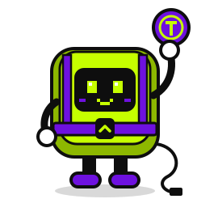<br>
      <h3>📏 Misurare</h3>
      <sub>Deep Scan e altri 19 strumenti di misurazione e monitoraggio, <b>gratis</b>. Conteggi reali dei token dalle tue trascrizioni, mai supposizioni.</sub>
    </td>
    <td width="25%" align="center" valign="top">
      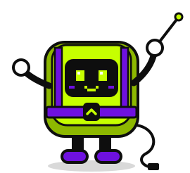<br>
      <h3>💸 Risparmiare</h3>
      <sub>26 strumenti di risparmio: compressione senza chiamare il modello, risposte più snelle, niente riletture, e uno sciame di subagenti economici dove <i>il modello costoso decide soltanto</i>.</sub>
    </td>
    <td width="25%" align="center" valign="top">
      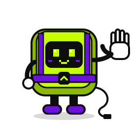<br>
      <h3>🛡️ Proteggere</h3>
      <sub>Stop Loss, Antiloop Protector, Secret Lock, Git Shield e annullamento con un clic. I danni dell'IA si riavvolgono con un pulsante.</sub>
    </td>
    <td width="25%" align="center" valign="top">
      <br>
      <h3>🎛️ Controllare</h3>
      <sub>Oltre 200 tasti da un clic in una dashboard locale. Un clic accende uno strumento, un altro lo annulla. Non serve il terminale.</sub>
    </td>
  </tr>
</table>

## 📊 I numeri

| | Metrica | Cosa significa |
|:---:|---|---|
| 🚀 | **fino a 3x** | più lavoro con gli stessi token su un piano fisso |
| 💰 | **fino al 78%** | meno in bolletta per chi usa le API |
| 📈 | **oltre 260%** | più throughput in alcune finestre di 5 ore |
| 🧰 | **132+** | strumenti su **10 fronti**, tutti in esecuzione sulla tua macchina |
| ⌨️ | **200+** | tasti reversibili da un clic nella dashboard |
| ⏱️ | **p95 < 50 ms** | per hook, con un timeout massimo di **2 s**, così l'agente non si blocca mai |
| 🌍 | **12** | lingue nella dashboard |

> [!NOTE]
> "Fino a" significa i guadagni maggiori misurati in finestre di utilizzo reali. **Il tuo numero viene dalle tue trascrizioni**: HarnessUp lo misura gratis prima che tu paghi qualsiasi cosa. Vedi i conti aperti su [harnessup.dev/it/metering](https://harnessup.dev/it/metering/).

## ⚙️ Come funziona

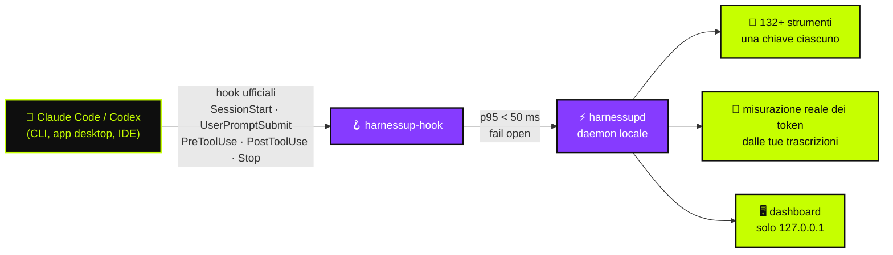

- **Solo superfici ufficiali.** Il modello gira con i binari ufficiali `claude` e `codex`, con il tuo account. HarnessUp non legge, non conserva e non inoltra mai il tuo token o la tua chiave.
- **Fail open, sempre.** Se HarnessUp è lento, spento o in errore, il tuo agente continua a lavorare come se non ci fosse.
- **Niente è irreversibile.** Ciò che viene tagliato, compresso o bloccato resta recuperabile.
- **Bassa affidabilità passa dritto.** Meglio non risparmiare che consegnare al modello informazioni sbagliate.

## 🎬 Panoramica

<p align="center">
  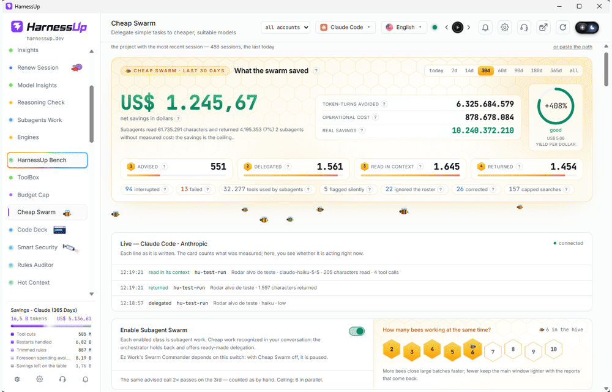
</p>

## 🧰 10 fronti, 132+ strumenti

Un coltellino svizzero per agenti di codice. Ogni strumento ha la sua chiave, e ogni chiave si può annullare.

| Fronte | Strumenti | Strumento di punta | Evidenze |
|---|:---:|---|---|
| 📏 **Misurazione** | 14 | Deep Scan | Harness History, Inside the Wallet, Model Insights, HarnessUp Bench, Plan Usage |
| 📡 **Monitoraggio** | 8 | Session Radar | The Numbers, Realtime Events, Reasoning Check, Subagents Work, Plan Advisor |
| 💸 **Risparmio** | 26 | Cheap Swarm | Smart Compress, Response Diet, Delta Read, Smart Cut, Terminal Guide, WebFetch Diet |
| 🎛️ **Controllo** | 25 | Stop Loss | Budget Cap, ToolBox, Working Hours, Swarm Commander, Enforce TDD, Force Lint |
| 🛡️ **Protezione** | 10 | Smart Return | Secret Lock, UltraShield Guard, Antiloop Protector, Git Shield, Checkpoint |
| 🔐 **Sicurezza** | 8 | Sentinel | Smart Security, Security Check, SafeBox, No Touch, No Delete |
| 🚀 **Produttività** | 26 | Code Deck | Smart Commit, Build Now, Super Code Review, HarnessUp Flow, HarnessUp Board |
| 🧪 **Utilità** | 23 | Prompt Optimizer | Token Calculator, Frozen Cache, MetaPrompt, Mirror Master, HarnessUp Shop |
| 🎨 **Personalizzazione** | 6 | Status Bar | Info Pills, Cache Alarm, Mod Themes, Finish Line Push |
| 🏗️ **Costruttori** | 5 | /bones | SPEC/PRD Express, DOCs Generator, Website Builder |

<details>
<summary><b>📏 Misurazione e 📡 Monitoraggio</b>: vedi dove va ogni token (quasi tutto gratis)</summary>

<br>

- **Deep Scan** (gratis): diagnostica lo spreco nella tua cronologia e mostra ciò che HarnessUp avrebbe risparmiato.
- **Model Insights** (gratis): 24 domande con risposta per ogni versione del modello.
- **HarnessUp Bench** (gratis): punteggio per modello e livello di impegno.
- **Openness Meter, Harness Meter, Cache Cycle, Inside the Wallet, Work Analytics, Bad Use, Plan Usage** (gratis).
- **Session Radar, The Numbers, Uptime, Realtime Events, Reasoning Check, Subagents Work, Harness Update, Plan Advisor** (tutti gratis).
- **/diagnostic e /simulate** (Ultra): fai domande sul tuo utilizzo misurato e simula le decisioni prima di prenderle.

</details>

<details>
<summary><b>💸 Risparmio</b>: lo stesso lavoro con meno token</summary>

<br>

- **Smart Compress** (gratis): compatta la conversazione senza chiamare il modello.
- **Response Diet** (gratis): risposte dirette, senza preamboli.
- **Delta Read, Code Finder, Smart Cut, Read Router, Head Limit** (Pro): leggono solo ciò che serve e non rileggono mai un file invariato.
- **Terminal Guide, Output Diet, WebFetch Diet** (Pro): output lunghi di comandi e pagine web ridotti prima di arrivare al contesto.
- **Renew Session, Hot Context, Context Graph, Session Protocol, Memory State** (Pro): sessioni che iniziano snelle e restano snelle.
- **First Pass, Way Out, No Comment, Stature Brake, Rules Auditor, Optimize Harness** (Pro).
- **Cheap Swarm** (Ultra): 26 classi di attività vanno a subagenti economici; il modello costoso decide soltanto.

</details>

<details>
<summary><b>🎛️ Controllo</b>: le tue regole, applicate ai confini delle chiamate agli strumenti</summary>

<br>

- **Stop Loss e Budget Cap** (Pro): imposta un tetto in US$ e la sessione si ferma lì.
- **ToolBox** (Pro): 17 convenzioni pronte per il tuo agente.
- **Working Hours, Scheduled Break, Reasoning Advisor, Rule Checker, Force Test, No Subagents** (Pro).
- **Swarm Commander, Subs Director, Enforce TDD, Force Lint, Doc Now, Anti-fading, Stick Prompt** (Ultra).
- **Anti-Collision** (GIGA) e **HarnessUp OFF** (gratis): mettono in pausa tutto senza disinstallare.

</details>

<details>
<summary><b>🛡️ Protezione e 🔐 Sicurezza</b>: niente trapela, niente si perde</summary>

<br>

- **Smart Return e Checkpoint** (Pro): riavvolgono ciò che l'agente ha fatto.
- **Git Shield e Eyes Off** (Pro): proteggono la tua cronologia e i tuoi file sensibili.
- **SafeBox** (Pro): ciò che viene tagliato o bloccato resta recuperabile per 7 giorni.
- **Secret Lock, UltraShield Guard, Antiloop Protector, Sandbox Mode, Deny MCP, Blackout** (Ultra).
- **No Touch e No Delete** (Ultra): file che l'agente può leggere ma mai modificare o cancellare.
- **Sentinel, Smart Security, Security Check, SEC Station** (GIGA).

</details>

<details>
<summary><b>🚀 Produttività, 🧪 Utilità, 🎨 Personalizzazione e 🏗️ Costruttori</b></summary>

<br>

- **Code Deck** (GIGA): 17+ CLI di agenti affiancate in 4 slot.
- **HarnessUp Flow e HarnessUp Board** (GIGA): automazioni descritte in linguaggio naturale e una lavagna infinita.
- **Super Code Review** (GIGA): un punteggio da 0 a 100 per ogni modifica.
- **Smart Commit, Build Now, Smart Report, Save my Session, GitHub e Deploy in 1 clic** (Ultra).
- **Ez Work, Token Calculator, Frozen Cache, Cache Lock, Prompt Optimizer, MetaPrompt (34 tipi), HarnessUp Shop** (gratis).
- **Mirror Master** (Pro): tiene sincronizzate le istruzioni di CLAUDE.md, AGENTS.md, GEMINI.md, Copilot, Cursor, Windsurf, Cline e Aider.
- **Status Bar, Info Pills, Cache Alarm, Mod Themes** (gratis) e **Finish Line Push** (Pro).
- **SPEC/PRD Express, DOCs Generator, /bones, DOC for Website, Website Builder** (GIGA).

</details>

<p align="center">Catalogo completo con tutti gli strumenti: <a href="https://harnessup.dev/it/tools/"><b>harnessup.dev/it/tools</b></a></p>

## ⏪ Danni dell'IA annullati con un pulsante

<table>
  <tr>
    <td width="58%" valign="middle">
      <p>L'agente ha cancellato la cartella sbagliata? Ha fatto trapelare una chiave nel contesto? Ha riscritto mezzo repository alle 2 di notte?</p>
      <ul>
        <li><b>Secret Lock</b> tiene le credenziali fuori dal contesto.</li>
        <li><b>Smart Return</b> e <b>Checkpoint</b> riavvolgono ciò che l'agente ha fatto.</li>
        <li><b>No Delete</b> e <b>Git Shield</b> bloccano le mosse distruttive prima che accadano.</li>
        <li><b>SafeBox</b> conserva per 7 giorni tutto ciò che è stato tagliato o bloccato.</li>
        <li><b>HarnessUp OFF</b> mette in pausa tutti gli strumenti in una volta, senza disinstallare.</li>
      </ul>
      <p>I freni agiscono solo ai confini delle chiamate agli strumenti: HarnessUp <b>non interrompe mai l'agente nel mezzo di una scrittura</b>.</p>
    </td>
    <td width="42%" valign="middle">
      
    </td>
  </tr>
</table>

## 🖼️ Galleria

<table>
  <tr>
    <td align="center" width="33%"><a href="../assets/screens/01-model-insights.png">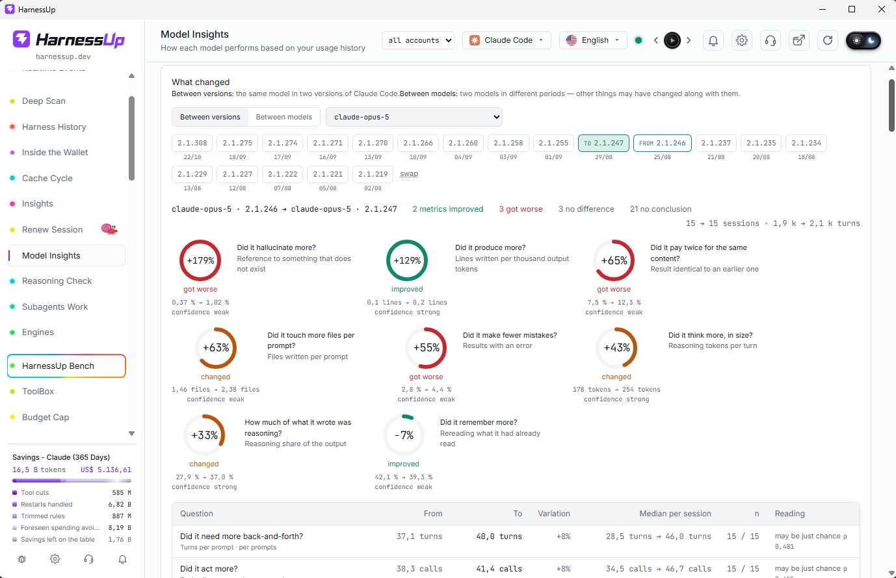</a><br><sub><b>Model Insights</b> · confronta le versioni del modello</sub></td>
    <td align="center" width="33%"><a href="../assets/screens/02-subagents-work.png">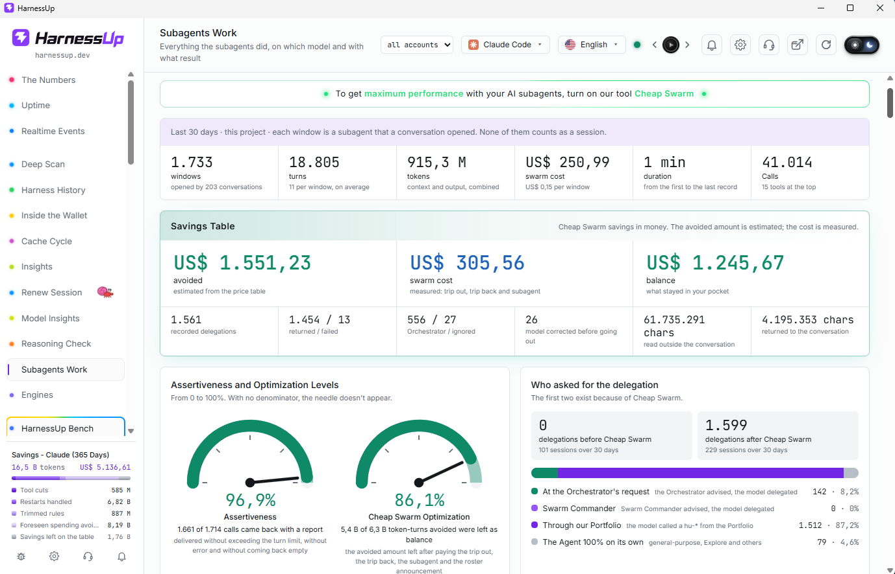</a><br><sub><b>Subagents Work</b> · cosa fa la squadra e quanto costa</sub></td>
    <td align="center" width="33%"><a href="../assets/screens/04-bench.png">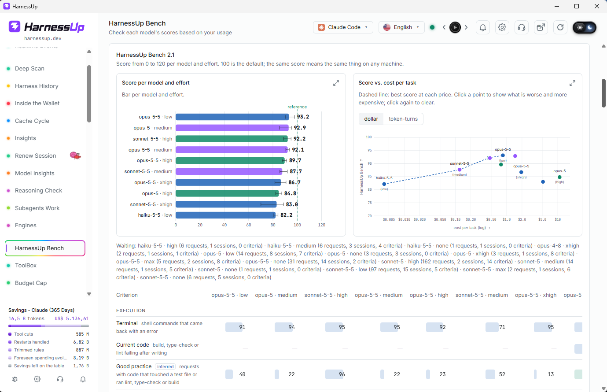</a><br><sub><b>HarnessUp Bench</b> · punteggio per modello e impegno</sub></td>
  </tr>
  <tr>
    <td align="center"><a href="../assets/screens/05-cheap-swarm.png">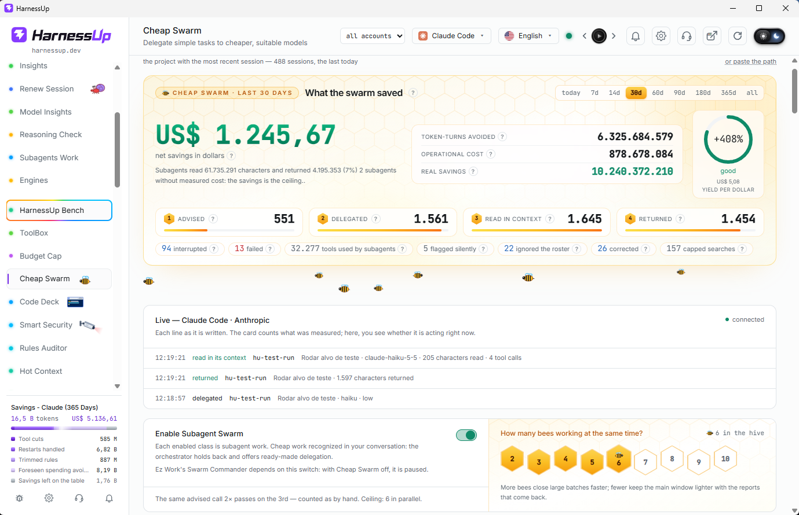</a><br><sub><b>Cheap Swarm</b> · quanto ha risparmiato lo sciame</sub></td>
    <td align="center"><a href="../assets/screens/06-code-deck.png">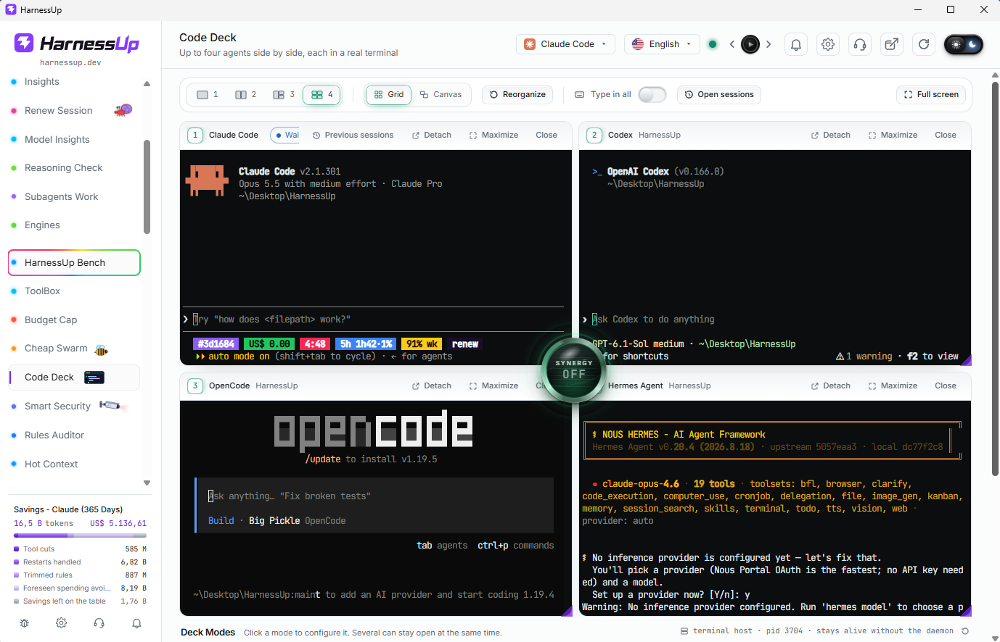</a><br><sub><b>Code Deck</b> · agenti in terminali affiancati</sub></td>
    <td align="center"><a href="../assets/screens/07-context-graph.png">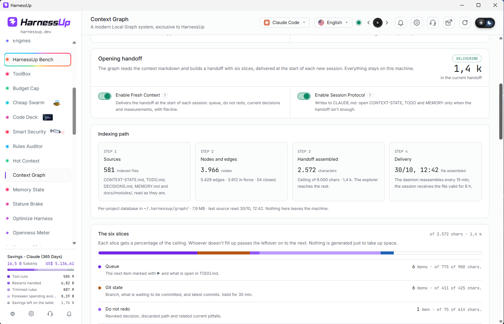</a><br><sub><b>Context Graph</b> · memoria di progetto indicizzata</sub></td>
  </tr>
  <tr>
    <td align="center"><a href="../assets/screens/10-antiloop.png">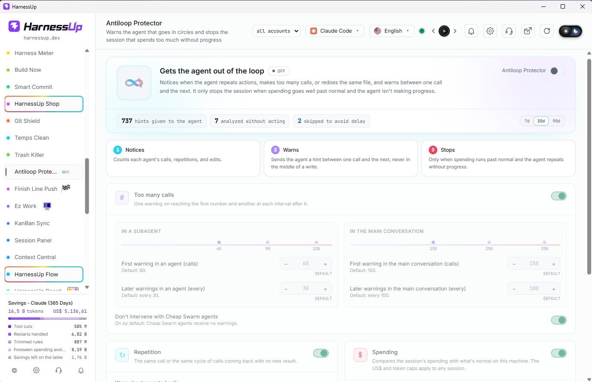</a><br><sub><b>Antiloop Protector</b> · ferma i loop improduttivi</sub></td>
    <td align="center"><a href="../assets/screens/08-openness-meter.png">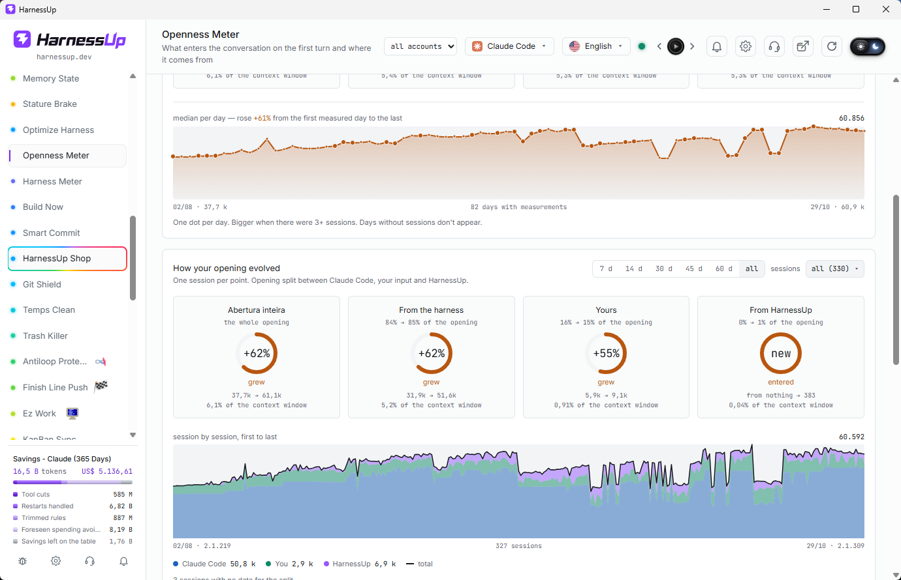</a><br><sub><b>Openness Meter</b> · come si è evoluta l'apertura della sessione</sub></td>
    <td align="center"><a href="../assets/screens/09-shop.png">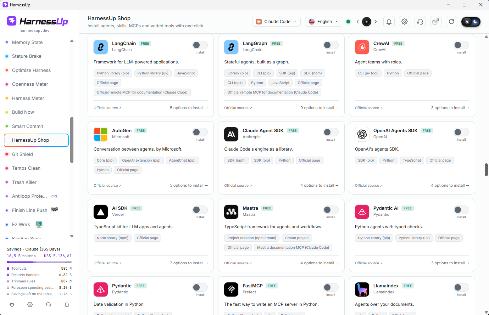</a><br><sub><b>HarnessUp Shop</b> · installatore di agenti e MCP</sub></td>
  </tr>
  <tr>
    <td align="center"><a href="../assets/screens/14-flow-canvas.png">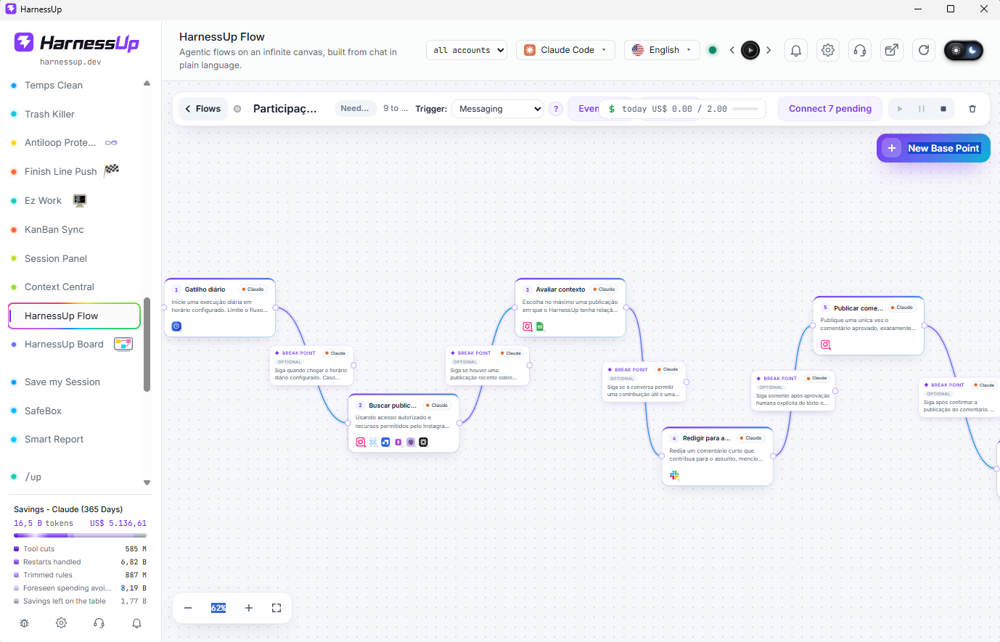</a><br><sub><b>HarnessUp Flow</b> · automazione in linguaggio naturale</sub></td>
    <td align="center"><a href="../assets/screens/15-board.png">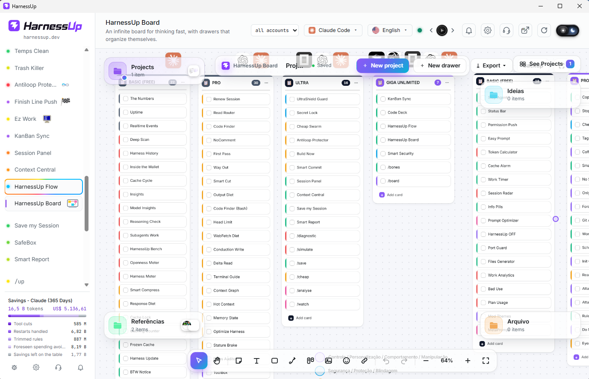</a><br><sub><b>HarnessUp Board</b> · lavagna infinita</sub></td>
    <td align="center"><a href="../assets/screens/12-ez-work-timer.png">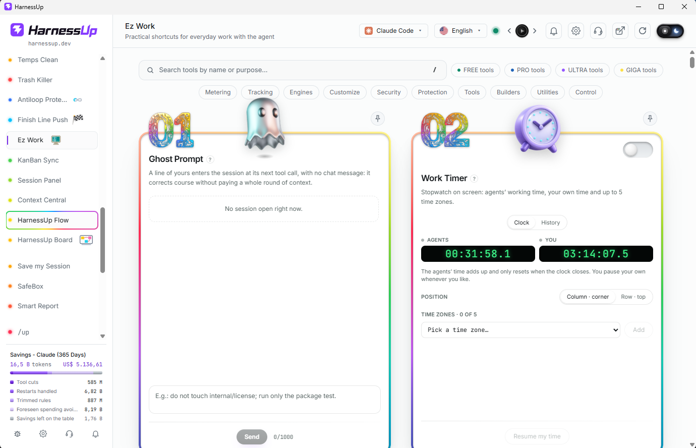</a><br><sub><b>Ez Work</b> · Ghost Prompt e Work Timer</sub></td>
  </tr>
</table>

<details>
<summary>Altre schermate</summary>
<br>
<p align="center">
  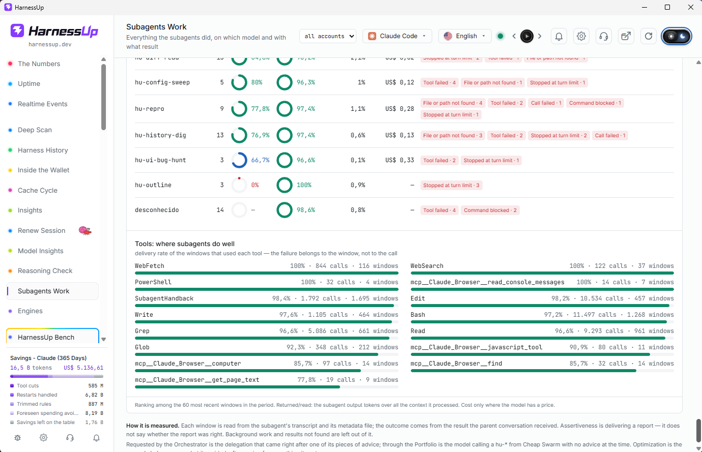
  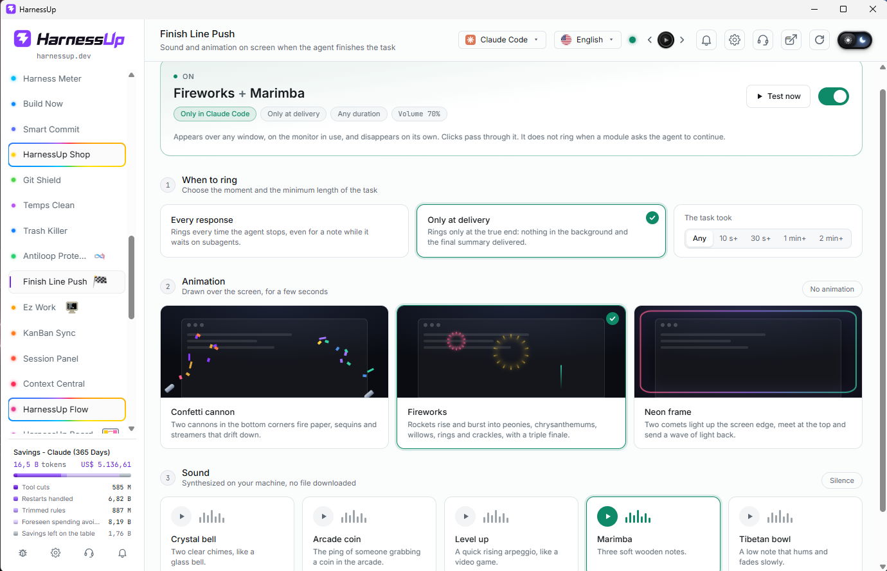
  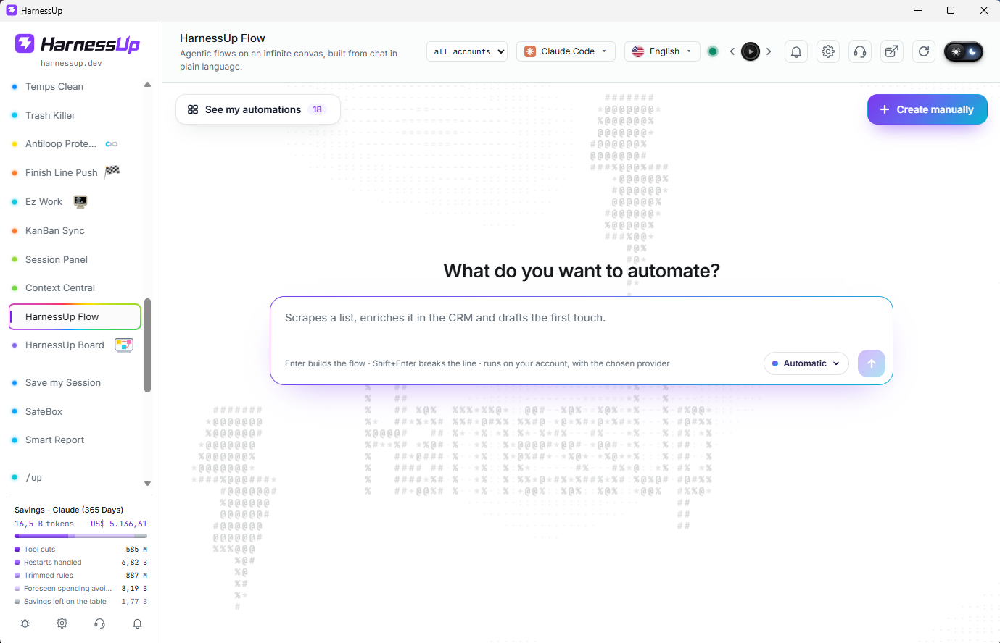
</p>
</details>

## 📦 Installa in una riga

<table>
  <tr>
    <td width="40%" valign="middle">
      
    </td>
    <td width="60%" valign="middle">
      <p>Per utente. <b>Niente admin, niente login, niente email, niente servizi di sistema.</b> I binari vengono verificati con SHA-256 prima dell'installazione, e gli aggiornamenti sono firmati.</p>
      <p><b>npm</b> (Windows, macOS, Linux · Node 18+)</p>

```sh
npm install -g harnessup
```

<p><b>Windows</b> · PowerShell, senza Node</p>

```powershell
irm https://harnessup.dev/install.ps1 | iex
```

<p><b>macOS e Linux</b> · senza Node, senza sudo</p>

```sh
curl -fsSL https://harnessup.dev/install.sh | sh
```

</td>
  </tr>
</table>

Poi:

```sh
harnessup install     # collega HarnessUp a Claude Code e Codex
harnessup doctor      # verifica l'installazione
harnessup uninstall   # lo rimuove senza lasciare tracce
```

<details>
<summary><b>Altri modi di installare</b>: .exe, ZIP, pnpm/yarn/bun, oppure lascia fare al tuo agente</summary>

<br>

- **Installer per Windows**: `HarnessUp-Setup-x64.exe` (Windows 10/11 a 64 bit, per utente) su [harnessup.dev/it/install](https://harnessup.dev/it/install/).
- **ZIP**: scaricalo da [GitHub Releases](https://github.com/harnessup/harnessup/releases/latest) e confrontalo con `SHA256SUMS.txt`.
- **pnpm, yarn, bun**: `pnpm add -g harnessup` · `yarn global add harnessup` · `bun add -g harnessup`.
- **1 prompt**: incolla questo in Claude Code o Codex e lascia che sia l'agente a installarlo per te:

```text
Installa HarnessUp su questa macchina: esegui npm install -g harnessup (senza Node: su Windows, irm https://harnessup.dev/install.ps1 | iex in PowerShell; su macOS e Linux, curl -fsSL https://harnessup.dev/install.sh | sh nel Terminale), conferma che è integrato con Claude Code e Codex, e apri la dashboard. Non chiedere login, email né admin.
```

- **In arrivo**: winget, Scoop, Chocolatey, Homebrew e Snap.

</details>

📘 Guida completa, con aggiornamento, disinstallazione e risoluzione dei problemi: **[INSTALL.it.md](INSTALL.it.md)**.

## 👥 Fatto per chi vive di agenti

<table>
  <tr>
    <td width="33%" align="center" valign="top">
      <br>
      <h3>Su piano fisso</h3>
      <sub>Piani Claude Pro/Max o ChatGPT. <b>Fino a 3x</b> più lavoro nella stessa finestra: il tuo limite settimanale praticamente raddoppia.</sub>
    </td>
    <td width="33%" align="center" valign="top">
      <br>
      <h3>Pagando via API</h3>
      <sub>Ogni token è denaro. <b>Fino al 78% in meno</b> in bolletta, centinaia di dollari al mese per chi usa molto.</sub>
    </td>
    <td width="33%" align="center" valign="top">
      <br>
      <h3>Senza terminale</h3>
      <sub>Un installer per Windows e <b>oltre 200 tasti reversibili</b> nella dashboard. Clicchi, vedi il numero, cliccchi di nuovo per annullare.</sub>
    </td>
  </tr>
</table>

## 💳 Piani

<table>
  <tr>
    <th width="25%">Basic</th>
    <th width="25%">Pro</th>
    <th width="25%">Ultra</th>
    <th width="25%">GIGA UNLIMITED</th>
  </tr>
  <tr align="center">
    <td><h3>GRATIS</h3><sub>per sempre</sub></td>
    <td><h3>US$ 9<sub>/mese</sub></h3><sub>o US$ 6/mese con fatturazione annuale</sub></td>
    <td><h3>US$ 12<sub>/mese</sub></h3><sub>o US$ 9/mese con fatturazione annuale</sub></td>
    <td><h3>US$ 27<sub>/mese</sub></h3><sub>o US$ 19/mese con fatturazione annuale</sub></td>
  </tr>
  <tr valign="top">
    <td><sub>1 account Claude Code · 1 progetto<br>Misura tutto: Deep Scan, Monitoraggio e oltre 20 strumenti gratis</sub></td>
    <td><sub>1 account Claude + 1 account Codex · 2 progetti<br>Risparmio, controllo, protezione e annullamento</sub></td>
    <td><sub>2 account Claude + 2 account Codex · 6 progetti<br>Cheap Swarm, Secret Lock, Antiloop, automazioni</sub></td>
    <td><sub>Harness, account e progetti illimitati<br>Code Deck, Flow, Board, Sicurezza, Costruttori</sub></td>
  </tr>
</table>

- ✅ **Prova gratuita di 7 giorni** sui piani a pagamento: senza carta, senza registrazione.
- ✅ Ogni piano include tutto ciò che sta sotto. Sessioni illimitate su ogni piano. Annulla quando vuoi, senza moduli.
- ✅ Rimborso entro 7 giorni dall'acquisto. Un'attivazione fluttuante per chiave.
- 👥 **Team**: 10 licenze GIGA per US$ 1,699 all'anno. **Aziendale**: [corporate@harnessup.dev](mailto:corporate@harnessup.dev).

<p align="center"><a href="https://harnessup.dev/it/plans/"><b>Confronta tutti gli strumenti per piano e scopri gli sconti early-bird attivi →</b></a></p>

## 🔒 Privacy e sicurezza

| | |
|---|---|
| 🏠 **100% locale** | Tutto gira sulla tua macchina. Nessun proxy, nessuna intercettazione delle API, nessun MCP pesante. |
| 🔑 **Il tuo account, il tuo token** | Esegue i binari ufficiali `claude` e `codex` con il tuo account e non legge, non conserva né inoltra mai il tuo token o la tua chiave. |
| 🖥️ **Dashboard su 127.0.0.1** | Risponde solo sulla tua macchina. La pagina del tuo account mostra **0 byte di utilizzo inviati**. |
| 🟢 **Fail open** | Se HarnessUp è lento, spento o in errore, l'agente continua a funzionare. p95 < 50 ms, timeout massimo di 2 s. |
| ⏪ **Reversibile** | Ogni chiave si annulla con un clic. SafeBox conserva per 7 giorni ciò che è stato tagliato. |
| 👤 **Nessun account per iniziare** | Niente login, niente email, niente password e niente diritti admin per installare e misurare. |

Hai trovato una vulnerabilità? Segui [SECURITY.md](../SECURITY.md) invece di aprire una issue pubblica.

## 🤖 Agenti supportati

| Agente | Stato | Dove |
|---|:---:|---|
| **Claude Code** | ✅ Integrato | CLI, app desktop ed estensioni IDE, con account o tramite API |
| **Codex** | ✅ Integrato | CLI, app desktop ed estensioni IDE, con account o tramite API |
| **Cursor** | 🔜 In arrivo | |
| **OpenCode** | 🔜 In arrivo | |
| **Hermes Agent** | 🔜 In arrivo | |

**Code Deck** esegue già oltre 17 CLI di agenti affiancate, e **Mirror Master** mantiene sincronizzati i file di istruzioni di 8 harness.

## ❓ Domande frequenti

<details>
<summary><b>È sicuro?</b></summary>
<br>
Sì. Usa solo gli hook ufficiali, non c'è alcun proxy e gira al 100% sulla tua macchina. Se si ferma, il tuo agente continua a funzionare come al solito.
</details>

<details>
<summary><b>Legge il mio token o la mia chiave API?</b></summary>
<br>
Mai. Il modello gira tramite i binari ufficiali <code>claude</code> e <code>codex</code>, con il tuo account. HarnessUp non legge, non conserva né inoltra mai il tuo token o la tua chiave.
</details>

<details>
<summary><b>Rallenta l'agente?</b></summary>
<br>
No. Gli hook hanno un p95 sotto i 50 ms e un timeout massimo di 2 s. Se qualcosa è lento, l'agente va avanti senza aspettare.
</details>

<details>
<summary><b>Funziona per chi usa le API?</b></summary>
<br>
Sì, ed è lì che il risparmio si vede di più: ogni token risparmiato è denaro che resta in tasca tua.
</details>

<details>
<summary><b>Serve il terminale?</b></summary>
<br>
No. C'è un installer per Windows e una dashboard con oltre 200 tasti reversibili da un clic.
</details>

<details>
<summary><b>Serve una carta per il piano gratuito?</b></summary>
<br>
No. Basic è gratis per sempre, e i piani a pagamento hanno una prova di 7 giorni senza carta e senza registrazione.
</details>

<details>
<summary><b>Funziona su macOS e Linux?</b></summary>
<br>
Sì, tramite npm o lo script <code>install.sh</code>.
</details>

<details>
<summary><b>Quante macchine posso usare?</b></summary>
<br>
Un'attivazione alla volta per chiave. La licenza è fluttuante: spostala tra le macchine quando vuoi.
</details>

<details>
<summary><b>Perché Windows mostra un avviso di SmartScreen sul .exe?</b></summary>
<br>
È un avviso di reputazione per i nuovi editori. Le vie npm e PowerShell non hanno questo avviso, e gli hash SHA-256 sono pubblicati su <a href="https://harnessup.dev/it/windows-warning/">harnessup.dev/it/windows-warning</a>. Un certificato di firma del codice è una delle cose che gli sponsor aiutano a finanziare.
</details>

<details>
<summary><b>Come lo disinstallo?</b></summary>
<br>
Esegui <code>harnessup uninstall</code>. Per mettere in pausa senza disinstallare, attiva <b>HarnessUp OFF</b> nella dashboard.
</details>

<p align="center">Altre risposte su <a href="https://harnessup.dev/it/faq/"><b>harnessup.dev/it/faq</b></a></p>

## 💜 Sponsor

<table>
  <tr>
    <td width="30%" align="center" valign="middle">
      
    </td>
    <td width="70%" valign="middle">
      <p><b>Il piano Basic è gratis per sempre, e vogliamo che resti così.</b> HarnessUp è sviluppato da un piccolo team indipendente, e lo sponsor è ciò che mantiene la misurazione gratuita per tutti.</p>
      <p><b>Cosa finanzia il tuo sponsor:</b></p>
      <ul>
        <li>🔏 Un certificato di firma del codice per Windows, così l'avviso di SmartScreen scompare</li>
        <li>🍎 Test e supporto su macchine reali con macOS e Linux</li>
        <li>📦 Pacchetti per winget, Scoop, Chocolatey, Homebrew e Snap</li>
        <li>🤖 Integrazione con più agenti: Cursor, OpenCode, Hermes Agent</li>
        <li>🌍 Mantenere la dashboard e il sito in 12 lingue</li>
      </ul>
    </td>
  </tr>
</table>

**Perché sponsorizzare HarnessUp?** Il tuo logo raggiunge gli sviluppatori nel momento esatto in cui si preoccupano di costi, controllo e sicurezza dei loro agenti di codice: in questo README, in tutte le 12 traduzioni e su [harnessup.dev](https://harnessup.dev).

<p align="center">
  <a href="mailto:corporate@harnessup.dev?subject=Sponsorizzazione%20HarnessUp"></a>
</p>

<table>
  <tr>
    <td align="center" width="33%"><br>🥇<br><b>Il tuo logo qui</b><br><sub>Sponsor oro</sub><br><br></td>
    <td align="center" width="33%"><br>🥈<br><b>Il tuo logo qui</b><br><sub>Sponsor argento</sub><br><br></td>
    <td align="center" width="33%"><br>🥉<br><b>Il tuo logo qui</b><br><sub>Sponsor bronzo</sub><br><br></td>
  </tr>
</table>

**Non sei un'azienda?** Aiuti altrettanto mettendo ⭐ **una stella a questo repository**, condividendo HarnessUp con un amico che brucia token, o entrando nel **[programma affiliati](https://harnessup.dev/it/affiliates/)**: hai segnalato, hai guadagnato. Non serve essere clienti per partecipare.

## 🤖 Conosci Hup

<p align="center">
  
  
  
  
  
</p>

<p align="center">
  <b>Hup</b> è la mascotte di HarnessUp: un tasto lime dentro un'imbracatura viola che tiene stretti i tuoi token,<br>
  ferma il preambolo con una mano e dirige i tuoi subagenti con una bacchetta.
</p>

<p align="center">
  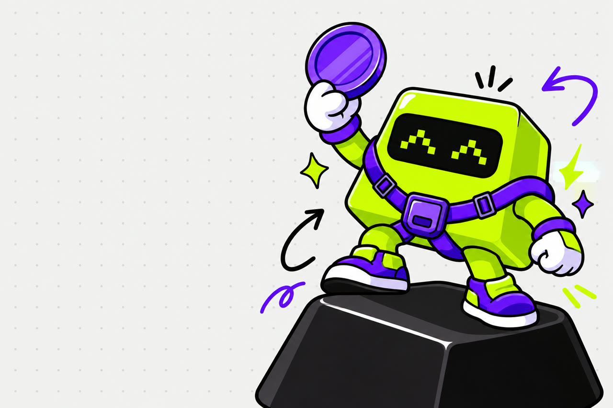
</p>

## 🔗 Link

<p align="center">
  <a href="https://harnessup.dev/it/">Sito</a> ·
  <a href="https://harnessup.dev/it/install/">Download</a> ·
  <a href="https://harnessup.dev/it/plans/">Piani</a> ·
  <a href="https://harnessup.dev/it/tools/">Strumenti</a> ·
  <a href="https://harnessup.dev/it/faq/">FAQ</a> ·
  <a href="https://www.npmjs.com/package/harnessup">npm</a> ·
  <a href="https://github.com/harnessup/harnessup/releases">Release</a> ·
  <a href="https://github.com/harnessup/harnessup/discussions">Discussioni</a> ·
  <a href="../SUPPORT.md">Supporto</a> ·
  <a href="mailto:help@harnessup.dev">help@harnessup.dev</a>
</p>

## 📄 Licenza

HarnessUp è un software proprietario, gratis per iniziare con il piano Basic. Questo repository distribuisce il prodotto, le sue guide e la sua documentazione, e non contiene codice sorgente. Vedi [LICENSE.md](../LICENSE.md). Tutti i diritti riservati.

<p align="center">
  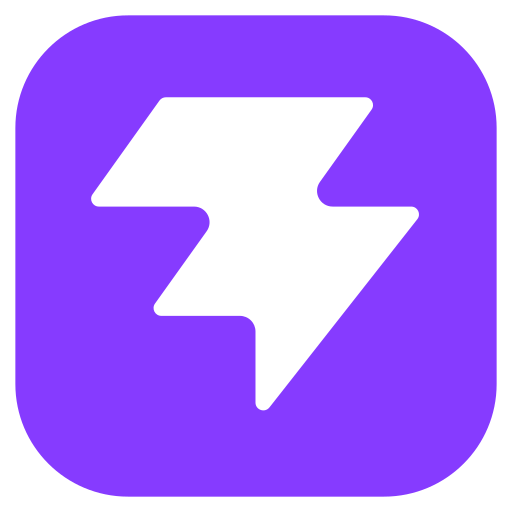<br>
  <sub>Fatto con 💜 e 🍋 · <a href="https://harnessup.dev">harnessup.dev</a></sub>
</p>
