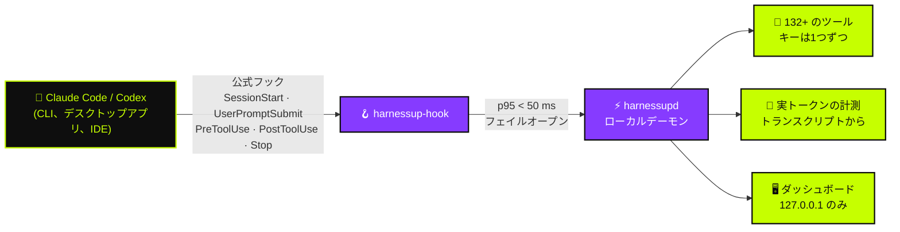

<!-- HarnessUp README · 原文は英語です。翻訳は i18n/ にあります -->

<p align="center">
  <a href="https://harnessup.dev"></a>
</p>

<p align="center">
  <a href="../README.md">🇺🇸 English</a> ·
  <a href="README.pt-BR.md">🇧🇷 Português</a> ·
  <a href="README.es.md">🇪🇸 Español</a> ·
  <a href="README.fr.md">🇫🇷 Français</a> ·
  <a href="README.de.md">🇩🇪 Deutsch</a> ·
  <a href="README.it.md">🇮🇹 Italiano</a> ·
  <b>🇯🇵 日本語</b> ·
  <a href="README.ko.md">🇰🇷 한국어</a> ·
  <a href="README.zh-CN.md">🇨🇳 简体中文</a> ·
  <a href="README.ar.md">🇸🇦 العربية</a> ·
  <a href="README.he.md">🇮🇱 עברית</a> ·
  <a href="README.hi.md">🇮🇳 हिन्दी</a>
</p>

<p align="center">
  <a href="https://www.npmjs.com/package/harnessup"></a>
  <a href="https://github.com/harnessup/harnessup/releases/latest"></a>
  
  
  
  
  <a href="https://github.com/harnessup/harnessup/stargazers"></a>
</p>

<p align="center">
  <a href="https://harnessup.dev/ja/install/"></a>
  <a href="https://harnessup.dev/ja/plans/"></a>
  <a href="https://harnessup.dev/ja/"></a>
  <a href="#-%E3%82%B9%E3%83%9D%E3%83%B3%E3%82%B5%E3%83%BC"></a>
</p>

<h3 align="center">コーディングエージェントのための、世界最大のトークン節約ツール。</h3>

<p align="center">
  ご自身のマシンで動く <b>132 以上のツール</b>が、<b>Claude Code</b> と <b>Codex</b> のトークンの無駄を減らします。<br>
  計測は無料、ログイン不要、100% ローカル。ご自身の利用データで測った証拠とともに、<b>請求額を最大 78% 削減</b>します。
</p>

<p align="center">
  
</p>

## 📑 目次

<table>
  <tr>
    <td valign="top">
      <a href="#-諸悪の根源">諸悪の根源</a><br>
      <a href="#-harnessup-でできること">HarnessUp でできること</a><br>
      <a href="#-%E6%95%B0%E5%AD%97%E3%81%A7%E8%A6%8B%E3%82%8B">数字で見る</a><br>
      <a href="#%EF%B8%8F-%E4%BB%95%E7%B5%84%E3%81%BF">仕組み</a>
    </td>
    <td valign="top">
      <a href="#-%E3%83%84%E3%82%A2%E3%83%BC">ツアー</a><br>
      <a href="#-10-%E3%81%AE%E9%A0%98%E5%9F%9F132-%E4%BB%A5%E4%B8%8A%E3%81%AE%E3%83%84%E3%83%BC%E3%83%AB">10 の領域、132 以上のツール</a><br>
      <a href="#-ai-%E3%81%AE%E8%A2%AB%E5%AE%B3%E3%82%92%E3%83%9C%E3%82%BF%E3%83%B3%E4%B8%80%E3%81%A4%E3%81%A7%E5%B7%BB%E3%81%8D%E6%88%BB%E3%81%99">ボタン一つで巻き戻す</a><br>
      <a href="#-%E3%82%AE%E3%83%A3%E3%83%A9%E3%83%AA%E3%83%BC">ギャラリー</a>
    </td>
    <td valign="top">
      <a href="#-%E4%B8%80%E8%A1%8C%E3%81%A7%E3%82%A4%E3%83%B3%E3%82%B9%E3%83%88%E3%83%BC%E3%83%AB">インストール</a><br>
      <a href="#-%E3%82%A8%E3%83%BC%E3%82%B8%E3%82%A7%E3%83%B3%E3%83%88%E3%81%A8%E6%9A%AE%E3%82%89%E3%81%99%E4%BA%BA%E3%81%AE%E3%81%9F%E3%82%81%E3%81%AB">対象ユーザー</a><br>
      <a href="#-%E3%83%97%E3%83%A9%E3%83%B3">プラン</a><br>
      <a href="#-%E3%83%97%E3%83%A9%E3%82%A4%E3%83%90%E3%82%B7%E3%83%BC%E3%81%A8%E3%82%BB%E3%82%AD%E3%83%A5%E3%83%AA%E3%83%86%E3%82%A3">プライバシーとセキュリティ</a>
    </td>
    <td valign="top">
      <a href="#-%E5%AF%BE%E5%BF%9C%E3%82%A8%E3%83%BC%E3%82%B8%E3%82%A7%E3%83%B3%E3%83%88">対応エージェント</a><br>
      <a href="#-faq">FAQ</a><br>
      <a href="#-%E3%82%B9%E3%83%9D%E3%83%B3%E3%82%B5%E3%83%BC">スポンサー</a><br>
      <a href="#-hup-%E3%81%AB%E4%BC%9A%E3%81%86">Hup に会う</a>
    </td>
  </tr>
</table>

## 🪙 諸悪の根源

<table>
  <tr>
    <td width="42%" valign="middle">
      
    </td>
    <td width="58%" valign="middle">
      <p><b>セッション #217 · 高価なモデル · 高い思考量。</b></p>
      <p>1行の修正をお願いします。エージェントは <i>「もちろんです！お手伝いしますね。いい質問ですね…」</i> と答え、もう読んだ3つのファイルをもう一度読み、4,000行のログを出してから、ようやく修正を書きます。トークンのカウンターは上がり続けます。</p>
      <p>「もちろんです、お手伝いしますね」のひと言ごとに、応答の中でお金を払い、<b>それ以降のやり取りのたびにもう一度読み込まれます</b>。週の上限は水曜日に尽きてしまいます。</p>
      <p>HarnessUp は直接的な回答を求め、変更のないファイルの再読み込みを止め、巨大な出力を切り詰めます。だから <b>金曜日まで余裕をもって使い切れます</b>。</p>
    </td>
  </tr>
</table>

## ⚡ HarnessUp でできること

HarnessUp は **プラグイン、MCP、スキル、プロキシのいずれでもありません**。ルールの範囲内で、ハーネスの下に収まる第2の層です。公式の **フック** に接続するローカルデーモンとして、Claude Code と Codex のすべてのトークンを計測し、お使いのツールを、それぞれ独自のキーで適用します。

<table>
  <tr>
    <td width="25%" align="center" valign="top">
      <br>
      <h3>📏 計測</h3>
      <sub>Deep Scan と、ほかの計測・監視ツール 19 種が<b>無料</b>。トランスクリプトからの実際のトークン数で、推測はしません。</sub>
    </td>
    <td width="25%" align="center" valign="top">
      <br>
      <h3>💸 節約</h3>
      <sub>26 の節約ツール：モデルを呼ばずに圧縮し、回答を簡潔にし、再読み込みを止め、<i>高価なモデルは判断だけを行う</i>安価なサブエージェントの群れを動かします。</sub>
    </td>
    <td width="25%" align="center" valign="top">
      <br>
      <h3>🛡️ 保護</h3>
      <sub>Stop Loss、Antiloop Protector、Secret Lock、Git Shield、そしてワンクリックの取り消し。AI による被害は、ボタン一つで巻き戻せます。</sub>
    </td>
    <td width="25%" align="center" valign="top">
      <br>
      <h3>🎛️ 制御</h3>
      <sub>ローカルのダッシュボードにある 200 以上のワンクリックのキー。1回のクリックで有効にし、もう1回で元に戻せます。ターミナルは不要です。</sub>
    </td>
  </tr>
</table>

## 📊 数字で見る

| | 指標 | 意味 |
|:---:|---|---|
| 🚀 | **最大3倍** | 固定プランで、同じトークン数でより多くの作業 |
| 💰 | **最大78%** | API 利用者の請求額の削減 |
| 📈 | **260%超** | 一部の5時間枠でのスループットの増加 |
| 🧰 | **132+** | **10 の領域**にまたがる、すべてご自身のマシンで動くツール |
| ⌨️ | **200+** | ダッシュボードの、元に戻せるワンクリックのキー |
| ⏱️ | **p95 < 50 ms** | フックごと。上限は **2 秒**で、エージェントが固まりません |
| 🌍 | **12** | ダッシュボードの対応言語 |

> [!NOTE]
> 「最大」は、実際の利用時間枠で測定された最大の効果を指します。**ご自身の数字は、ご自身のトランスクリプトから出ます**。HarnessUp は、お金を払う前に無料で計測します。計算の内訳は [harnessup.dev/ja/metering](https://harnessup.dev/ja/metering/) で公開しています。

## ⚙️ 仕組み



- **公式の仕組みだけを使います。** モデルは、公式の `claude` と `codex` のバイナリを、お使いのアカウントで動かします。HarnessUp が、お客様のトークンやキーを読み取ったり、保存したり、渡したりすることは決してありません。
- **常にフェイルオープン。** HarnessUp が遅い、停止している、またはエラーになっても、エージェントはまるで HarnessUp がないかのように動き続けます。
- **取り返しのつかないことはありません。** 切り詰め、圧縮、またはブロックされたものは、すべて復元できる状態で残ります。
- **確信が低いものは、そのまま通します。** 間違った情報をモデルに渡すくらいなら、節約しないほうがよいからです。

## 🎬 ツアー

<p align="center">
  
</p>

## 🧰 10 の領域、132 以上のツール

コーディングエージェントのためのスイスアーミーナイフです。ツールはそれぞれ独自のキーを持ち、どのキーも元に戻せます。

| 領域 | ツール数 | 注目のツール | 主な機能 |
|---|:---:|---|---|
| 📏 **計測** | 14 | Deep Scan | Harness History、Inside the Wallet、Model Insights、HarnessUp Bench、Plan Usage |
| 📡 **監視** | 8 | Session Radar | The Numbers、Realtime Events、Reasoning Check、Subagents Work、Plan Advisor |
| 💸 **節約** | 26 | Cheap Swarm | Smart Compress、Response Diet、Delta Read、Smart Cut、Terminal Guide、WebFetch Diet |
| 🎛️ **制御** | 25 | Stop Loss | Budget Cap、ToolBox、Working Hours、Swarm Commander、Enforce TDD、Force Lint |
| 🛡️ **保護** | 10 | Smart Return | Secret Lock、UltraShield Guard、Antiloop Protector、Git Shield、Checkpoint |
| 🔐 **セキュリティ** | 8 | Sentinel | Smart Security、Security Check、SafeBox、No Touch、No Delete |
| 🚀 **生産性** | 26 | Code Deck | Smart Commit、Build Now、Super Code Review、HarnessUp Flow、HarnessUp Board |
| 🧪 **ユーティリティ** | 23 | Prompt Optimizer | Token Calculator、Frozen Cache、MetaPrompt、Mirror Master、HarnessUp Shop |
| 🎨 **カスタマイズ** | 6 | Status Bar | Info Pills、Cache Alarm、Mod Themes、Finish Line Push |
| 🏗️ **ビルダー** | 5 | /bones | SPEC/PRD Express、DOCs Generator、Website Builder |

<details>
<summary><b>📏 計測と 📡 監視</b>：すべてのトークンの行き先を把握（ほぼ無料）</summary>

<br>

- **Deep Scan**（無料）：履歴の無駄を診断し、HarnessUp が節約できた量を示します。
- **Model Insights**（無料）：モデルのバージョンごとに 24 の質問に答えます。
- **HarnessUp Bench**（無料）：モデルと思考量ごとのスコア。
- **Openness Meter、Harness Meter、Cache Cycle、Inside the Wallet、Work Analytics、Bad Use、Plan Usage**（無料）。
- **Session Radar、The Numbers、Uptime、Realtime Events、Reasoning Check、Subagents Work、Harness Update、Plan Advisor**（すべて無料）。
- **/diagnostic と /simulate**（Ultra）：計測した利用状況について質問し、判断を下す前にシミュレーションします。

</details>

<details>
<summary><b>💸 節約</b>：同じ作業を、より少ないトークンで</summary>

<br>

- **Smart Compress**（無料）：モデルを呼ばずに会話をまとめます。
- **Response Diet**（無料）：直接的な回答にし、前置きをなくします。
- **Delta Read、Code Finder、Smart Cut、Read Router、Head Limit**（Pro）：必要なものだけを読み、変更のないファイルは二度と読みません。
- **Terminal Guide、Output Diet、WebFetch Diet**（Pro）：長いコマンド出力とウェブページを、コンテキストに届く前に切り詰めます。
- **Renew Session、Hot Context、Context Graph、Session Protocol、Memory State**（Pro）：軽く始まり、軽いまま続くセッション。
- **First Pass、Way Out、No Comment、Stature Brake、Rules Auditor、Optimize Harness**（Pro）。
- **Cheap Swarm**（Ultra）：26 種類のタスクを安価なサブエージェントに任せ、高価なモデルは判断だけを行います。

</details>

<details>
<summary><b>🎛️ 制御</b>：あなたのルールを、ツール呼び出しの境界で適用</summary>

<br>

- **Stop Loss と Budget Cap**（Pro）：米ドルの上限を設定すると、そこでセッションが止まります。
- **ToolBox**（Pro）：エージェント向けの、すぐに使える 17 のルール。
- **Working Hours、Scheduled Break、Reasoning Advisor、Rule Checker、Force Test、No Subagents**（Pro）。
- **Swarm Commander、Subs Director、Enforce TDD、Force Lint、Doc Now、Anti-fading、Stick Prompt**（Ultra）。
- **Anti-Collision**（GIGA）と **HarnessUp OFF**（無料）：アンインストールせずに、すべてを一時停止します。

</details>

<details>
<summary><b>🛡️ 保護</b>と<b>🔐 セキュリティ</b>：何も漏れず、何も失われない</summary>

<br>

- **Smart Return と Checkpoint**（Pro）：エージェントの作業を巻き戻します。
- **Git Shield と Eyes Off**（Pro）：履歴と機密ファイルを守ります。
- **SafeBox**（Pro）：切り詰められたもの、ブロックされたものは、7 日間復元できる状態で残ります。
- **Secret Lock、UltraShield Guard、Antiloop Protector、Sandbox Mode、Deny MCP、Blackout**（Ultra）。
- **No Touch と No Delete**（Ultra）：エージェントが読めても、変更や削除はできないファイル。
- **Sentinel、Smart Security、Security Check、SEC Station**（GIGA）。

</details>

<details>
<summary><b>🚀 生産性、🧪 ユーティリティ、🎨 カスタマイズ、🏗️ ビルダー</b></summary>

<br>

- **Code Deck**（GIGA）：17 以上のエージェント CLI を、4 つの枠に並べて表示。
- **HarnessUp Flow と HarnessUp Board**（GIGA）：自然言語で記述する自動化と、無限のボード。
- **Super Code Review**（GIGA）：すべての変更に 0〜100 のスコア。
- **Smart Commit、Build Now、Smart Report、Save my Session、GitHub と Deploy のワンクリック**（Ultra）。
- **Ez Work、Token Calculator、Frozen Cache、Cache Lock、Prompt Optimizer、MetaPrompt（34 種類）、HarnessUp Shop**（無料）。
- **Mirror Master**（Pro）：CLAUDE.md、AGENTS.md、GEMINI.md、Copilot、Cursor、Windsurf、Cline、Aider の指示ファイルを同期します。
- **Status Bar、Info Pills、Cache Alarm、Mod Themes**（無料）と **Finish Line Push**（Pro）。
- **SPEC/PRD Express、DOCs Generator、/bones、DOC for Website、Website Builder**（GIGA）。

</details>

<p align="center">すべてのツールを掲載した完全なカタログ：<a href="https://harnessup.dev/ja/tools/"><b>harnessup.dev/ja/tools</b></a></p>

## ⏪ AI の被害をボタン一つで巻き戻す

<table>
  <tr>
    <td width="58%" valign="middle">
      <p>エージェントが間違ったフォルダを消した？ キーをコンテキストに漏らした？ 深夜2時にリポジトリの半分を書き換えた？</p>
      <ul>
        <li><b>Secret Lock</b> は、認証情報をコンテキストから遠ざけます。</li>
        <li><b>Smart Return</b> と <b>Checkpoint</b> は、エージェントの作業を巻き戻します。</li>
        <li><b>No Delete</b> と <b>Git Shield</b> は、破壊的な操作が起きる前に止めます。</li>
        <li><b>SafeBox</b> は、切り詰められたもの、ブロックされたものを 7 日間保管します。</li>
        <li><b>HarnessUp OFF</b> は、アンインストールせずに、すべてのツールを一度に止めます。</li>
      </ul>
      <p>ブレーキは、ツール呼び出しの境界でのみ働きます。HarnessUp は、<b>書き込みの途中でエージェントを中断することは決してありません</b>。</p>
    </td>
    <td width="42%" valign="middle">
      
    </td>
  </tr>
</table>

## 🖼 ギャラリー

<table>
  <tr>
    <td align="center" width="33%"><a href="../assets/screens/01-model-insights.png"></a><br><sub><b>Model Insights</b> · モデルのバージョンを比較</sub></td>
    <td align="center" width="33%"><a href="../assets/screens/02-subagents-work.png"></a><br><sub><b>Subagents Work</b> · チームの作業と費用</sub></td>
    <td align="center" width="33%"><a href="../assets/screens/04-bench.png"></a><br><sub><b>HarnessUp Bench</b> · モデルと思考量ごとのスコア</sub></td>
  </tr>
  <tr>
    <td align="center"><a href="../assets/screens/05-cheap-swarm.png"></a><br><sub><b>Cheap Swarm</b> · 群れが節約した量</sub></td>
    <td align="center"><a href="../assets/screens/06-code-deck.png"></a><br><sub><b>Code Deck</b> · 並んだターミナルで動くエージェント</sub></td>
    <td align="center"><a href="../assets/screens/07-context-graph.png"></a><br><sub><b>Context Graph</b> · インデックス化されたプロジェクトの記憶</sub></td>
  </tr>
  <tr>
    <td align="center"><a href="../assets/screens/10-antiloop.png"></a><br><sub><b>Antiloop Protector</b> · 非生産的なループを止める</sub></td>
    <td align="center"><a href="../assets/screens/08-openness-meter.png"></a><br><sub><b>Openness Meter</b> · セッションの書き出しがどう変わったか</sub></td>
    <td align="center"><a href="../assets/screens/09-shop.png"></a><br><sub><b>HarnessUp Shop</b> · エージェントと MCP のインストーラー</sub></td>
  </tr>
  <tr>
    <td align="center"><a href="../assets/screens/14-flow-canvas.png"></a><br><sub><b>HarnessUp Flow</b> · 自然言語による自動化</sub></td>
    <td align="center"><a href="../assets/screens/15-board.png"></a><br><sub><b>HarnessUp Board</b> · 無限のボード</sub></td>
    <td align="center"><a href="../assets/screens/12-ez-work-timer.png"></a><br><sub><b>Ez Work</b> · Ghost Prompt と Work Timer</sub></td>
  </tr>
</table>

<details>
<summary>その他のスクリーン</summary>
<br>
<p align="center">
  
  
  
</p>
</details>

## 📦 一行でインストール

<table>
  <tr>
    <td width="40%" valign="middle">
      
    </td>
    <td width="60%" valign="middle">
      <p>ユーザーごとのインストール。<b>管理者権限もログインもメールアドレスもシステムサービスも不要です。</b>インストール前にバイナリを SHA-256 で検証し、更新には署名が付きます。</p>
      <p><b>npm</b>（Windows、macOS、Linux · Node 18+）</p>

```sh
npm install -g harnessup
```

<p><b>Windows</b> · PowerShell、Node 不要</p>

```powershell
irm https://harnessup.dev/install.ps1 | iex
```

<p><b>macOS と Linux</b> · Node 不要、sudo 不要</p>

```sh
curl -fsSL https://harnessup.dev/install.sh | sh
```

</td>
  </tr>
</table>

その後：

```sh
harnessup install     # HarnessUp を Claude Code と Codex に接続します
harnessup doctor      # インストールを確認します
harnessup uninstall   # きれいに取り除きます
```

<details>
<summary><b>ほかのインストール方法</b>：.exe、ZIP、pnpm/yarn/bun、またはエージェントに任せる</summary>

<br>

- **Windows インストーラー**：`HarnessUp-Setup-x64.exe`（Windows 10/11 64 ビット、ユーザーごと）を [harnessup.dev/ja/install](https://harnessup.dev/ja/install/) から。
- **ZIP**：[GitHub Releases](https://github.com/harnessup/harnessup/releases/latest) からダウンロードし、`SHA256SUMS.txt` と照合します。
- **pnpm、yarn、bun**：`pnpm add -g harnessup` · `yarn global add harnessup` · `bun add -g harnessup`。
- **プロンプト 1 つ**：これを Claude Code または Codex に貼り付けると、エージェントがインストールしてくれます：

```text
このマシンに HarnessUp をインストールしてください：npm install -g harnessup を実行します（Node がない場合は、Windows では PowerShell で irm https://harnessup.dev/install.ps1 | iex、macOS と Linux では Terminal で curl -fsSL https://harnessup.dev/install.sh | sh）。Claude Code と Codex に統合されたことを確認し、ダッシュボードを開いてください。ログイン、メールアドレス、管理者権限は求めないでください。
```

- **近日公開**：winget、Scoop、Chocolatey、Homebrew、Snap。

</details>

📘 更新、アンインストール、トラブルシューティングを含む完全なガイド：**[INSTALL.md](INSTALL.ja.md)**。

## 👥 エージェントと暮らす人のために

<table>
  <tr>
    <td width="33%" align="center" valign="top">
      <br>
      <h3>固定プランの場合</h3>
      <sub>Claude Pro/Max または ChatGPT のプラン。同じ時間枠で<b>最大3倍</b>の作業：週の上限がおおよそ2倍になります。</sub>
    </td>
    <td width="33%" align="center" valign="top">
      <br>
      <h3>API で支払う場合</h3>
      <sub>トークンはすべてお金です。請求額が<b>最大78%減</b>。ヘビーユーザーでは月に数百ドルの差になります。</sub>
    </td>
    <td width="33%" align="center" valign="top">
      <br>
      <h3>ターミナル不要</h3>
      <sub>Windows インストーラーと、ダッシュボードの<b>200 以上の元に戻せるキー</b>。クリックして数字を確認し、もう一度クリックすれば元に戻せます。</sub>
    </td>
  </tr>
</table>

## 💳 プラン

<table>
  <tr>
    <th width="25%">Basic</th>
    <th width="25%">Pro</th>
    <th width="25%">Ultra</th>
    <th width="25%">GIGA UNLIMITED</th>
  </tr>
  <tr align="center">
    <td><h3>無料</h3><sub>ずっと無料</sub></td>
    <td><h3>US$ 9<sub>/月</sub></h3><sub>または年払いで US$ 6/月</sub></td>
    <td><h3>US$ 12<sub>/月</sub></h3><sub>または年払いで US$ 9/月</sub></td>
    <td><h3>US$ 27<sub>/月</sub></h3><sub>または年払いで US$ 19/月</sub></td>
  </tr>
  <tr valign="top">
    <td><sub>Claude Code アカウント 1 つ · プロジェクト 1 つ<br>すべてを計測：Deep Scan、監視、20 以上の無料ツール</sub></td>
    <td><sub>Claude と Codex のアカウント各 1 つ · プロジェクト 2 つ<br>節約、制御、保護、取り消し</sub></td>
    <td><sub>Claude と Codex のアカウント各 2 つ · プロジェクト 6 つ<br>Cheap Swarm、Secret Lock、Antiloop、自動化</sub></td>
    <td><sub>ハーネス、アカウント、プロジェクトは無制限<br>Code Deck、Flow、Board、セキュリティ、ビルダー</sub></td>
  </tr>
</table>

- ✅ 有料プランは **7 日間の無料トライアル**：カード不要、登録不要。
- ✅ 各プランには、その下のプランのすべてが含まれます。すべてのプランでセッションは無制限。いつでも解約でき、申し込みフォームは不要です。
- ✅ 購入から 7 日以内の返金。キー 1 つにつき、移動可能なアクティベーションが 1 つ。
- 👥 **チーム**：GIGA ライセンス 10 件で年額 US$ 1,699。**法人**：[corporate@harnessup.dev](mailto:corporate@harnessup.dev)。

<p align="center"><a href="https://harnessup.dev/ja/plans/"><b>プランごとのツールを比較し、現在の早期割引を確認する →</b></a></p>

## 🔒 プライバシーとセキュリティ

| | |
|---|---|
| 🏠 **100% ローカル** | すべてがお使いのマシン上で動きます。プロキシも、API の傍受も、重い MCP もありません。 |
| 🔑 **あなたのアカウント、あなたのトークン** | 公式の `claude` と `codex` を、お使いのアカウントで動かします。トークンやキーを読み取ったり、保存したり、渡したりすることは決してありません。 |
| 🖥️ **127.0.0.1 のダッシュボード** | お使いのマシンからのみ応答します。アカウントのページには **送信された利用データ 0 バイト** と表示されます。 |
| 🟢 **フェイルオープン** | HarnessUp が遅い、停止している、またはエラーでも、エージェントは動き続けます。p95 < 50 ms、上限 2 秒。 |
| ⏪ **元に戻せる** | すべてのキーは、ワンクリックで取り消せます。SafeBox は、切り詰められたものを 7 日間保管します。 |
| 👤 **始めるのにアカウントは不要** | インストールと計測に、ログイン、メールアドレス、パスワード、管理者権限は不要です。 |

脆弱性を見つけましたか？ 公開の Issue を立てる代わりに、[SECURITY.md](../SECURITY.md) の手順に従ってください。

## 🤖 対応エージェント

| エージェント | 状況 | 提供形態 |
|---|:---:|---|
| **Claude Code** | ✅ 統合済み | CLI、デスクトップアプリ、IDE 拡張。アカウントまたは API で利用 |
| **Codex** | ✅ 統合済み | CLI、デスクトップアプリ、IDE 拡張。アカウントまたは API で利用 |
| **Cursor** | 🔜 近日公開 | |
| **OpenCode** | 🔜 近日公開 | |
| **Hermes Agent** | 🔜 近日公開 | |

**Code Deck** は、17 以上のエージェント CLI を並べて動かせます。**Mirror Master** は、8 つのハーネスの指示ファイルを同期します。

## ❓ FAQ

<details>
<summary><b>安全ですか？</b></summary>
<br>
はい。公式のフックだけを使い、プロキシはなく、100% ご自身のマシン上で動きます。停止しても、エージェントはいつも通り動き続けます。
</details>

<details>
<summary><b>トークンや API キーを読み取りますか？</b></summary>
<br>
決して読み取りません。モデルは、お使いのアカウントで公式の <code>claude</code> と <code>codex</code> のバイナリを通して動きます。HarnessUp が、トークンやキーを読み取ったり、保存したり、渡したりすることは決してありません。
</details>

<details>
<summary><b>エージェントが遅くなりますか？</b></summary>
<br>
いいえ。フックの p95 は 50 ms 未満で、上限は 2 秒です。遅いものがあっても、エージェントは待たずに進みます。
</details>

<details>
<summary><b>API 利用者でも使えますか？</b></summary>
<br>
はい。節約の効果が最も大きく出るのがここです。節約したトークンはすべて、お財布に残るお金です。
</details>

<details>
<summary><b>ターミナルは必要ですか？</b></summary>
<br>
いいえ。Windows インストーラーと、200 以上の元に戻せるワンクリックのキーがあるダッシュボードがあります。
</details>

<details>
<summary><b>無料プランにカードは必要ですか？</b></summary>
<br>
いいえ。Basic はずっと無料で、有料プランには、カードも登録も不要な 7 日間のトライアルがあります。
</details>

<details>
<summary><b>macOS と Linux でも使えますか？</b></summary>
<br>
はい。npm または <code>install.sh</code> スクリプトから使えます。
</details>

<details>
<summary><b>何台のマシンで使えますか？</b></summary>
<br>
キー 1 つにつき、同時にアクティベーションは 1 つです。ライセンスは移動可能で、好きなときにマシン間で移せます。
</details>

<details>
<summary><b>なぜ .exe で Windows の SmartScreen 警告が出るのですか？</b></summary>
<br>
新しい発行元に対する評判の警告です。npm と PowerShell の方法には警告はなく、SHA-256 のハッシュは <a href="https://harnessup.dev/ja/windows-warning/">harnessup.dev/ja/windows-warning</a> で公開しています。コード署名証明書は、スポンサーが資金を支援してくれるものの一つです。
</details>

<details>
<summary><b>アンインストールするには？</b></summary>
<br>
<code>harnessup uninstall</code> を実行します。アンインストールせずに一時停止するには、ダッシュボードで <b>HarnessUp OFF</b> を有効にします。
</details>

<p align="center">その他の回答は <a href="https://harnessup.dev/ja/faq/"><b>harnessup.dev/ja/faq</b></a> で</p>

## 💜 スポンサー

<table>
  <tr>
    <td width="30%" align="center" valign="middle">
      
    </td>
    <td width="70%" valign="middle">
      <p><b>Basic プランはずっと無料です。そしてこれからも無料であり続けてほしいと考えています。</b>HarnessUp は小さな独立チームが作っており、スポンサーシップが、計測を全員にとって無料に保つ支えになっています。</p>
      <p><b>スポンサーシップの使い道：</b></p>
      <ul>
        <li>🔏 Windows のコード署名証明書。SmartScreen の警告をなくすため</li>
        <li>🍎 実際の macOS と Linux マシンでのテストとサポート</li>
        <li>📦 winget、Scoop、Chocolatey、Homebrew、Snap のパッケージ</li>
        <li>🤖 より多くのエージェントとの統合：Cursor、OpenCode、Hermes Agent</li>
        <li>🌍 ダッシュボードとサイトを 12 言語に保つこと</li>
      </ul>
    </td>
  </tr>
</table>

**なぜ HarnessUp をスポンサーするのか？** あなたのロゴは、コーディングエージェントのコスト、制御、セキュリティを最も気にしている開発者に、まさにその瞬間に届きます。この README、全 12 言語の翻訳、そして [harnessup.dev](https://harnessup.dev) に掲載されます。

<p align="center">
  <a href="mailto:corporate@harnessup.dev?subject=HarnessUp%20sponsorship"></a>
</p>

<table>
  <tr>
    <td align="center" width="33%"><br>🥇<br><b>ここにあなたのロゴ</b><br><sub>ゴールドスポンサー</sub><br><br></td>
    <td align="center" width="33%"><br>🥈<br><b>ここにあなたのロゴ</b><br><sub>シルバースポンサー</sub><br><br></td>
    <td align="center" width="33%"><br>🥉<br><b>ここにあなたのロゴ</b><br><sub>ブロンズスポンサー</sub><br><br></td>
  </tr>
</table>

**企業ではありませんか？** ⭐ **このリポジトリにスターを付ける**、トークンを浪費している友人に HarnessUp を紹介する、または **[アフィリエイトプログラム](https://harnessup.dev/ja/affiliates/)** に参加する、ことでも同じくらい助けになります。紹介すれば、報酬が得られます。参加にお客様である必要はありません。

## 🤖 Hup に会う

<p align="center">
  
  
  
  
  
</p>

<p align="center">
  <b>Hup</b> は HarnessUp のマスコットです。紫のハーネスを着たライム色のキーキャップで、あなたのトークンを守り、<br>
  片手で前置きを止め、バトンでサブエージェントを指揮します。
</p>

<p align="center">
  
</p>

## 🔗 リンク

<p align="center">
  <a href="https://harnessup.dev/ja/">ウェブサイト</a> ·
  <a href="https://harnessup.dev/ja/install/">ダウンロード</a> ·
  <a href="https://harnessup.dev/ja/plans/">プラン</a> ·
  <a href="https://harnessup.dev/ja/tools/">ツール</a> ·
  <a href="https://harnessup.dev/ja/faq/">FAQ</a> ·
  <a href="https://www.npmjs.com/package/harnessup">npm</a> ·
  <a href="https://github.com/harnessup/harnessup/releases">リリース</a> ·
  <a href="https://github.com/harnessup/harnessup/discussions">ディスカッション</a> ·
  <a href="../SUPPORT.md">サポート</a> ·
  <a href="mailto:help@harnessup.dev">help@harnessup.dev</a>
</p>

## 📄 ライセンス

HarnessUp はプロプライエタリ・ソフトウェアです。Basic プランで無料で始められます。このリポジトリは製品、そのガイド、ドキュメントを配布するもので、ソースコードは含みません。詳しくは [LICENSE.md](../LICENSE.md) をご覧ください。全著作権所有。

<p align="center">
  <br>
  <sub>💜 と 🍋 を込めて · <a href="https://harnessup.dev">harnessup.dev</a></sub>
</p>
