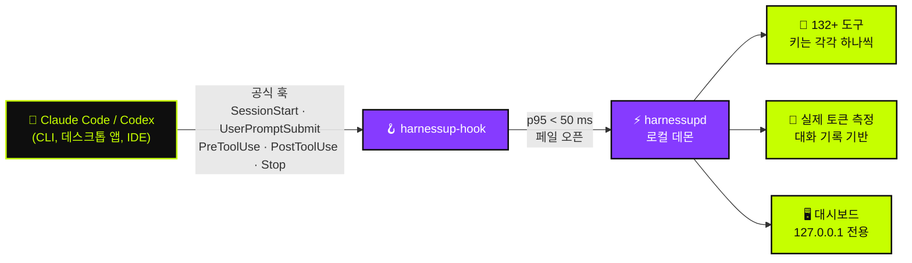

<!-- HarnessUp README · 원문은 영어이며, 번역은 i18n/ 에 있습니다 -->

<p align="center">
  <a href="https://harnessup.dev"></a>
</p>

<p align="center">
  <a href="../README.md">🇺🇸 English</a> ·
  <a href="README.pt-BR.md">🇧🇷 Português</a> ·
  <a href="README.es.md">🇪🇸 Español</a> ·
  <a href="README.fr.md">🇫🇷 Français</a> ·
  <a href="README.de.md">🇩🇪 Deutsch</a> ·
  <a href="README.it.md">🇮🇹 Italiano</a> ·
  <a href="README.ja.md">🇯🇵 日本語</a> ·
  <b>🇰🇷 한국어</b> ·
  <a href="README.zh-CN.md">🇨🇳 简体中文</a> ·
  <a href="README.ar.md">🇸🇦 العربية</a> ·
  <a href="README.he.md">🇮🇱 עברית</a> ·
  <a href="README.hi.md">🇮🇳 हिन्दी</a>
</p>

<p align="center">
  <a href="https://www.npmjs.com/package/harnessup"></a>
  <a href="https://github.com/harnessup/harnessup/releases/latest"></a>
  
  
  
  
  <a href="https://github.com/harnessup/harnessup/stargazers"></a>
</p>

<p align="center">
  <a href="https://harnessup.dev/ko/install/"></a>
  <a href="https://harnessup.dev/ko/plans/"></a>
  <a href="https://harnessup.dev/ko/"></a>
  <a href="#-%EC%8A%A4%ED%8F%B0%EC%84%9C"></a>
</p>

<h3 align="center">코딩 에이전트를 위한 세계 최대의 토큰 절약 도구.</h3>

<p align="center">
  내 컴퓨터에서 실행되는 <b>132개 이상의 도구</b>가 <b>Claude Code</b>와 <b>Codex</b>의 토큰 낭비를 줄여 줘요.<br>
  측정은 무료, 로그인 불필요, 100% 로컬. 내 사용량으로 측정한 근거와 함께 <b>요금을 최대 78% 줄여 줘요</b>.
</p>

<p align="center">
  
</p>

## 📑 목차

<table>
  <tr>
    <td valign="top">
      <a href="#-%EC%95%85%EB%8B%B9">악당</a><br>
      <a href="#-harnessup%EC%9D%B4-%ED%95%98%EB%8A%94-%EC%9D%BC">HarnessUp이 하는 일</a><br>
      <a href="#-%EC%88%AB%EC%9E%90%EB%A1%9C-%EB%B3%B4%EA%B8%B0">숫자로 보기</a><br>
      <a href="#%EF%B8%8F-%EC%9E%91%EB%8F%99-%EB%B0%A9%EC%8B%9D">작동 방식</a>
    </td>
    <td valign="top">
      <a href="#-%ED%88%AC%EC%96%B4">투어</a><br>
      <a href="#-10%EA%B0%9C-%EC%98%81%EC%97%AD-132%EA%B0%9C-%EC%9D%B4%EC%83%81%EC%9D%98-%EB%8F%84%EA%B5%AC">10개 영역, 132개 이상의 도구</a><br>
      <a href="#-ai-%ED%94%BC%ED%95%B4%EB%A5%BC-%EB%B2%84%ED%8A%BC-%ED%95%9C-%EB%B2%88%EC%9C%BC%EB%A1%9C-%EB%90%98%EB%8F%8C%EB%A6%AC%EA%B8%B0">버튼 한 번으로 되돌리기</a><br>
      <a href="#-%EA%B0%A4%EB%9F%AC%EB%A6%AC">갤러리</a>
    </td>
    <td valign="top">
      <a href="#-%ED%95%9C-%EC%A4%84%EB%A1%9C-%EC%84%A4%EC%B9%98">설치</a><br>
      <a href="#-%EC%97%90%EC%9D%B4%EC%A0%84%ED%8A%B8%EC%99%80-%ED%95%A8%EA%BB%98-%EC%82%AC%EB%8A%94-%EB%B6%84%EB%93%A4%EC%9D%84-%EC%9C%84%ED%95%B4">대상 사용자</a><br>
      <a href="#-%EC%9A%94%EA%B8%88%EC%A0%9C">요금제</a><br>
      <a href="#-%EA%B0%9C%EC%9D%B8%EC%A0%95%EB%B3%B4-%EB%B3%B4%ED%98%B8%EC%99%80-%EB%B3%B4%EC%95%88">개인정보 보호와 보안</a>
    </td>
    <td valign="top">
      <a href="#-%EC%A7%80%EC%9B%90%ED%95%98%EB%8A%94-%EC%97%90%EC%9D%B4%EC%A0%84%ED%8A%B8">지원하는 에이전트</a><br>
      <a href="#-faq">FAQ</a><br>
      <a href="#-%EC%8A%A4%ED%8F%B0%EC%84%9C">스폰서</a><br>
      <a href="#-hup-%EB%A7%8C%EB%82%98%EA%B8%B0">Hup 만나기</a>
    </td>
  </tr>
</table>

## 🪙 악당

<table>
  <tr>
    <td width="42%" valign="middle">
      
    </td>
    <td width="58%" valign="middle">
      <p><b>세션 #217 · 비싼 모델 · 높은 노력 수준.</b></p>
      <p>한 줄짜리 수정을 부탁해요. 에이전트는 <i>"물론이죠! 도와드릴게요. 좋은 질문이에요…"</i>라고 답하고, 이미 읽은 파일 세 개를 다시 읽고, 4,000줄짜리 로그를 출력한 뒤에야 수정을 써요. 토큰 카운터는 계속 올라가요.</p>
      <p>"물론이죠! 도와드릴게요"라는 말 한마디마다 응답에서 비용이 나가고, <b>그다음 모든 라운드에서 다시 읽혀요</b>. 주간 한도는 수요일에 바닥나요.</p>
      <p>HarnessUp은 바로 답하는 응답을 요청하고, 바뀌지 않은 파일을 다시 읽는 것을 막고, 거대한 출력을 줄여요. 그래서 <b>여유를 남기고 금요일까지 버틸 수 있어요</b>.</p>
    </td>
  </tr>
</table>

## ⚡ HarnessUp이 하는 일

HarnessUp은 **플러그인도, MCP도, 스킬도, 프록시도 아니에요**. 규칙 안에서 하네스 아래에 들어가는 두 번째 계층이에요. Claude Code와 Codex의 **공식 훅**에 연결되는 로컬 데몬으로, 모든 토큰을 측정하고, 켜 둔 도구를 각각 고유한 키로 적용해요.

<table>
  <tr>
    <td width="25%" align="center" valign="top">
      <br>
      <h3>📏 측정</h3>
      <sub>Deep Scan과 그 밖의 측정·모니터링 도구 19개가 <b>무료</b>. 대화 기록에서 가져온 실제 토큰 수로, 추측은 하지 않아요.</sub>
    </td>
    <td width="25%" align="center" valign="top">
      <br>
      <h3>💸 절약</h3>
      <sub>절약 도구 26개: 모델을 호출하지 않는 압축, 더 간결한 답변, 다시 읽기 방지, 그리고 <i>비싼 모델은 결정만 하는</i> 저렴한 서브에이전트 떼.</sub>
    </td>
    <td width="25%" align="center" valign="top">
      <br>
      <h3>🛡️ 보호</h3>
      <sub>Stop Loss, Antiloop Protector, Secret Lock, Git Shield, 그리고 원클릭 실행 취소. AI가 낸 피해는 버튼 한 번으로 되돌릴 수 있어요.</sub>
    </td>
    <td width="25%" align="center" valign="top">
      <br>
      <h3>🎛️ 제어</h3>
      <sub>로컬 대시보드의 200개 이상 원클릭 키. 한 번 클릭해서 켜고, 또 한 번 클릭해서 되돌려요. 터미널은 필요 없어요.</sub>
    </td>
  </tr>
</table>

## 📊 숫자로 보기

| | 지표 | 의미 |
|:---:|---|---|
| 🚀 | **최대 3배** | 정액 요금제에서 같은 토큰으로 더 많은 작업 |
| 💰 | **최대 78%** | API 사용자의 청구 금액 절감 |
| 📈 | **260% 이상** | 일부 5시간 구간에서의 처리량 증가 |
| 🧰 | **132+** | **10개 영역**에 걸친, 모두 내 컴퓨터에서 실행되는 도구 |
| ⌨️ | **200+** | 대시보드의 되돌릴 수 있는 원클릭 키 |
| ⏱️ | **p95 < 50 ms** | 훅 하나당. 최대 **2초** 제한이 있어 에이전트가 멈추지 않아요 |
| 🌍 | **12** | 대시보드 지원 언어 |

> [!NOTE]
> "최대"는 실제 사용 구간에서 측정된 가장 큰 효과를 뜻해요. **내 숫자는 내 대화 기록에서 나와요**. HarnessUp은 돈을 내기 전에 무료로 측정해 줘요. 계산 내용은 [harnessup.dev/ko/metering](https://harnessup.dev/ko/metering/)에 공개되어 있어요.

## ⚙️ 작동 방식



- **공식 경로만 사용해요.** 모델은 공식 `claude`와 `codex` 바이너리를 통해, 내 계정으로 실행돼요. HarnessUp은 내 토큰이나 키를 읽거나, 저장하거나, 전달하지 않아요.
- **항상 페일 오픈.** HarnessUp이 느리거나, 꺼져 있거나, 오류가 나도 에이전트는 HarnessUp이 없는 것처럼 계속 작동해요.
- **되돌릴 수 없는 것은 없어요.** 잘리거나, 압축되거나, 차단된 것은 모두 복구할 수 있는 상태로 남아요.
- **확신이 낮으면 그대로 통과해요.** 잘못된 정보를 모델에 넘기느니 절약하지 않는 편이 나아요.

## 🎬 투어

<p align="center">
  
</p>

## 🧰 10개 영역, 132개 이상의 도구

코딩 에이전트를 위한 맥가이버 칼이에요. 도구마다 고유한 키가 있고, 모든 키는 되돌릴 수 있어요.

| 영역 | 도구 수 | 대표 도구 | 주요 기능 |
|---|:---:|---|---|
| 📏 **측정** | 14 | Deep Scan | Harness History, Inside the Wallet, Model Insights, HarnessUp Bench, Plan Usage |
| 📡 **모니터링** | 8 | Session Radar | The Numbers, Realtime Events, Reasoning Check, Subagents Work, Plan Advisor |
| 💸 **절약** | 26 | Cheap Swarm | Smart Compress, Response Diet, Delta Read, Smart Cut, Terminal Guide, WebFetch Diet |
| 🎛️ **제어** | 25 | Stop Loss | Budget Cap, ToolBox, Working Hours, Swarm Commander, Enforce TDD, Force Lint |
| 🛡️ **보호** | 10 | Smart Return | Secret Lock, UltraShield Guard, Antiloop Protector, Git Shield, Checkpoint |
| 🔐 **보안** | 8 | Sentinel | Smart Security, Security Check, SafeBox, No Touch, No Delete |
| 🚀 **생산성** | 26 | Code Deck | Smart Commit, Build Now, Super Code Review, HarnessUp Flow, HarnessUp Board |
| 🧪 **유틸리티** | 23 | Prompt Optimizer | Token Calculator, Frozen Cache, MetaPrompt, Mirror Master, HarnessUp Shop |
| 🎨 **커스터마이즈** | 6 | Status Bar | Info Pills, Cache Alarm, Mod Themes, Finish Line Push |
| 🏗️ **빌더** | 5 | /bones | SPEC/PRD Express, DOCs Generator, Website Builder |

<details>
<summary><b>📏 측정과 📡 모니터링</b>: 모든 토큰이 어디로 가는지 확인 (대부분 무료)</summary>

<br>

- **Deep Scan** (무료): 기록 속 낭비를 진단하고, HarnessUp이 절약할 수 있었던 양을 보여 줘요.
- **Model Insights** (무료): 모델 버전별로 질문 24개에 답해 줘요.
- **HarnessUp Bench** (무료): 모델과 노력 수준별 점수.
- **Openness Meter, Harness Meter, Cache Cycle, Inside the Wallet, Work Analytics, Bad Use, Plan Usage** (무료).
- **Session Radar, The Numbers, Uptime, Realtime Events, Reasoning Check, Subagents Work, Harness Update, Plan Advisor** (모두 무료).
- **/diagnostic과 /simulate** (Ultra): 측정된 사용량에 대해 질문하고, 결정하기 전에 시뮬레이션해요.

</details>

<details>
<summary><b>💸 절약</b>: 같은 작업을 더 적은 토큰으로</summary>

<br>

- **Smart Compress** (무료): 모델을 호출하지 않고 대화를 압축해요.
- **Response Diet** (무료): 서론 없이 바로 답해요.
- **Delta Read, Code Finder, Smart Cut, Read Router, Head Limit** (Pro): 필요한 것만 읽고, 바뀌지 않은 파일은 다시 읽지 않아요.
- **Terminal Guide, Output Diet, WebFetch Diet** (Pro): 긴 명령 출력과 웹 페이지를 컨텍스트에 들어가기 전에 줄여요.
- **Renew Session, Hot Context, Context Graph, Session Protocol, Memory State** (Pro): 가볍게 시작해서 가볍게 유지되는 세션.
- **First Pass, Way Out, No Comment, Stature Brake, Rules Auditor, Optimize Harness** (Pro).
- **Cheap Swarm** (Ultra): 26개 작업 종류를 저렴한 서브에이전트에 맡기고, 비싼 모델은 결정만 해요.

</details>

<details>
<summary><b>🎛️ 제어</b>: 내 규칙을 도구 호출 경계에서 적용</summary>

<br>

- **Stop Loss와 Budget Cap** (Pro): 미국 달러 한도를 정하면 세션이 그 지점에서 멈춰요.
- **ToolBox** (Pro): 에이전트를 위한 바로 쓸 수 있는 규칙 17개.
- **Working Hours, Scheduled Break, Reasoning Advisor, Rule Checker, Force Test, No Subagents** (Pro).
- **Swarm Commander, Subs Director, Enforce TDD, Force Lint, Doc Now, Anti-fading, Stick Prompt** (Ultra).
- **Anti-Collision** (GIGA)과 **HarnessUp OFF** (무료): 제거하지 않고 모든 것을 일시 중지해요.

</details>

<details>
<summary><b>🛡️ 보호</b>와 <b>🔐 보안</b>: 새는 것도, 잃는 것도 없어요</summary>

<br>

- **Smart Return과 Checkpoint** (Pro): 에이전트가 한 작업을 되돌려요.
- **Git Shield와 Eyes Off** (Pro): 기록과 민감한 파일을 보호해요.
- **SafeBox** (Pro): 잘리거나 차단된 것은 7일 동안 복구할 수 있어요.
- **Secret Lock, UltraShield Guard, Antiloop Protector, Sandbox Mode, Deny MCP, Blackout** (Ultra).
- **No Touch와 No Delete** (Ultra): 에이전트가 읽을 수는 있지만 바꾸거나 지울 수 없는 파일.
- **Sentinel, Smart Security, Security Check, SEC Station** (GIGA).

</details>

<details>
<summary><b>🚀 생산성, 🧪 유틸리티, 🎨 커스터마이즈, 🏗️ 빌더</b></summary>

<br>

- **Code Deck** (GIGA): 17개 이상의 에이전트 CLI를 4개 슬롯에 나란히 띄워요.
- **HarnessUp Flow와 HarnessUp Board** (GIGA): 자연어로 설명하는 자동화와 무한 보드.
- **Super Code Review** (GIGA): 모든 변경에 대한 0~100점 점수.
- **Smart Commit, Build Now, Smart Report, Save my Session, GitHub와 Deploy를 한 번에** (Ultra).
- **Ez Work, Token Calculator, Frozen Cache, Cache Lock, Prompt Optimizer, MetaPrompt (34종), HarnessUp Shop** (무료).
- **Mirror Master** (Pro): CLAUDE.md, AGENTS.md, GEMINI.md, Copilot, Cursor, Windsurf, Cline, Aider 지침 파일을 동기화해 줘요.
- **Status Bar, Info Pills, Cache Alarm, Mod Themes** (무료)와 **Finish Line Push** (Pro).
- **SPEC/PRD Express, DOCs Generator, /bones, DOC for Website, Website Builder** (GIGA).

</details>

<p align="center">모든 도구가 담긴 전체 목록: <a href="https://harnessup.dev/ko/tools/"><b>harnessup.dev/ko/tools</b></a></p>

## ⏪ AI 피해를 버튼 한 번으로 되돌리기

<table>
  <tr>
    <td width="58%" valign="middle">
      <p>에이전트가 엉뚱한 폴더를 지웠나요? 키를 컨텍스트에 흘렸나요? 새벽 2시에 저장소의 절반을 다시 썼나요?</p>
      <ul>
        <li><b>Secret Lock</b>은 자격 증명이 컨텍스트에 들어가지 않도록 막아요.</li>
        <li><b>Smart Return</b>과 <b>Checkpoint</b>는 에이전트가 한 작업을 되돌려요.</li>
        <li><b>No Delete</b>와 <b>Git Shield</b>는 파괴적인 작업이 일어나기 전에 멈춰요.</li>
        <li><b>SafeBox</b>는 잘리거나 차단된 모든 것을 7일 동안 보관해요.</li>
        <li><b>HarnessUp OFF</b>는 제거하지 않고 모든 도구를 한 번에 일시 중지해요.</li>
      </ul>
      <p>브레이크는 도구 호출 경계에서만 작동해요. HarnessUp은 <b>쓰기 작업 도중에 에이전트를 절대 끊지 않아요</b>.</p>
    </td>
    <td width="42%" valign="middle">
      
    </td>
  </tr>
</table>

## 🖼 갤러리

<table>
  <tr>
    <td align="center" width="33%"><a href="../assets/screens/01-model-insights.png"></a><br><sub><b>Model Insights</b> · 모델 버전 비교</sub></td>
    <td align="center" width="33%"><a href="../assets/screens/02-subagents-work.png"></a><br><sub><b>Subagents Work</b> · 팀이 하는 일과 비용</sub></td>
    <td align="center" width="33%"><a href="../assets/screens/04-bench.png"></a><br><sub><b>HarnessUp Bench</b> · 모델과 노력 수준별 점수</sub></td>
  </tr>
  <tr>
    <td align="center"><a href="../assets/screens/05-cheap-swarm.png"></a><br><sub><b>Cheap Swarm</b> · 서브에이전트 떼가 아낀 양</sub></td>
    <td align="center"><a href="../assets/screens/06-code-deck.png"></a><br><sub><b>Code Deck</b> · 나란한 터미널에서 실행되는 에이전트</sub></td>
    <td align="center"><a href="../assets/screens/07-context-graph.png"></a><br><sub><b>Context Graph</b> · 색인된 프로젝트 메모리</sub></td>
  </tr>
  <tr>
    <td align="center"><a href="../assets/screens/10-antiloop.png"></a><br><sub><b>Antiloop Protector</b> · 비생산적인 루프를 멈춰요</sub></td>
    <td align="center"><a href="../assets/screens/08-openness-meter.png"></a><br><sub><b>Openness Meter</b> · 세션 시작 방식이 어떻게 변했는지</sub></td>
    <td align="center"><a href="../assets/screens/09-shop.png"></a><br><sub><b>HarnessUp Shop</b> · 에이전트와 MCP 설치 도구</sub></td>
  </tr>
  <tr>
    <td align="center"><a href="../assets/screens/14-flow-canvas.png"></a><br><sub><b>HarnessUp Flow</b> · 자연어로 만드는 자동화</sub></td>
    <td align="center"><a href="../assets/screens/15-board.png"></a><br><sub><b>HarnessUp Board</b> · 무한 보드</sub></td>
    <td align="center"><a href="../assets/screens/12-ez-work-timer.png"></a><br><sub><b>Ez Work</b> · Ghost Prompt와 Work Timer</sub></td>
  </tr>
</table>

<details>
<summary>더 많은 화면</summary>
<br>
<p align="center">
  
  
  
</p>
</details>

## 📦 한 줄로 설치

<table>
  <tr>
    <td width="40%" valign="middle">
      
    </td>
    <td width="60%" valign="middle">
      <p>사용자별 설치. <b>관리자 권한, 로그인, 이메일, 시스템 서비스가 필요 없어요.</b> 설치 전에 바이너리를 SHA-256으로 확인하고, 업데이트에는 서명이 있어요.</p>
      <p><b>npm</b> (Windows, macOS, Linux · Node 18+)</p>

```sh
npm install -g harnessup
```

<p><b>Windows</b> · PowerShell, Node 불필요</p>

```powershell
irm https://harnessup.dev/install.ps1 | iex
```

<p><b>macOS와 Linux</b> · Node 불필요, sudo 불필요</p>

```sh
curl -fsSL https://harnessup.dev/install.sh | sh
```

</td>
  </tr>
</table>

그다음:

```sh
harnessup install     # HarnessUp을 Claude Code와 Codex에 연결해요
harnessup doctor      # 설치 상태를 확인해요
harnessup uninstall   # 깔끔하게 제거해요
```

<details>
<summary><b>다른 설치 방법</b>: .exe, ZIP, pnpm/yarn/bun, 또는 에이전트에게 맡기기</summary>

<br>

- **Windows 설치 프로그램**: `HarnessUp-Setup-x64.exe` (Windows 10/11 64비트, 사용자별) 파일을 [harnessup.dev/ko/install](https://harnessup.dev/ko/install/)에서 받으세요.
- **ZIP**: [GitHub Releases](https://github.com/harnessup/harnessup/releases/latest)에서 받고 `SHA256SUMS.txt`와 비교하세요.
- **pnpm, yarn, bun**: `pnpm add -g harnessup` · `yarn global add harnessup` · `bun add -g harnessup`.
- **프롬프트 한 줄**: 아래 내용을 Claude Code 또는 Codex에 붙여 넣으면, 에이전트가 설치해 줘요:

```text
이 컴퓨터에 HarnessUp을 설치해 주세요: npm install -g harnessup을 실행하세요 (Node가 없다면, Windows에서는 PowerShell에서 irm https://harnessup.dev/install.ps1 | iex, macOS와 Linux에서는 터미널에서 curl -fsSL https://harnessup.dev/install.sh | sh). Claude Code 및 Codex와 연동되었는지 확인하고 대시보드를 열어 주세요. 로그인, 이메일, 관리자 권한은 요구하지 마세요.
```

- **곧 출시**: winget, Scoop, Chocolatey, Homebrew, Snap.

</details>

📘 업데이트, 제거, 문제 해결을 포함한 전체 가이드: **[INSTALL.md](INSTALL.ko.md)**.

## 👥 에이전트와 함께 사는 분들을 위해

<table>
  <tr>
    <td width="33%" align="center" valign="top">
      <br>
      <h3>정액 요금제라면</h3>
      <sub>Claude Pro/Max 또는 ChatGPT 요금제. 같은 시간 구간에서 <b>최대 3배</b> 더 많은 작업: 주간 한도가 대략 두 배가 돼요.</sub>
    </td>
    <td width="33%" align="center" valign="top">
      <br>
      <h3>API로 결제한다면</h3>
      <sub>모든 토큰이 돈이에요. 청구 금액이 <b>최대 78% 줄어요</b>. 많이 쓰는 사용자에게는 한 달에 수백 달러예요.</sub>
    </td>
    <td width="33%" align="center" valign="top">
      <br>
      <h3>터미널이 필요 없어요</h3>
      <sub>Windows 설치 프로그램과 대시보드의 <b>되돌릴 수 있는 키 200개 이상</b>. 클릭해서 숫자를 보고, 다시 클릭하면 되돌려요.</sub>
    </td>
  </tr>
</table>

## 💳 요금제

<table>
  <tr>
    <th width="25%">Basic</th>
    <th width="25%">Pro</th>
    <th width="25%">Ultra</th>
    <th width="25%">GIGA UNLIMITED</th>
  </tr>
  <tr align="center">
    <td><h3>무료</h3><sub>영구 무료</sub></td>
    <td><h3>US$ 9<sub>/월</sub></h3><sub>또는 연간 결제 시 US$ 6/월</sub></td>
    <td><h3>US$ 12<sub>/월</sub></h3><sub>또는 연간 결제 시 US$ 9/월</sub></td>
    <td><h3>US$ 27<sub>/월</sub></h3><sub>또는 연간 결제 시 US$ 19/월</sub></td>
  </tr>
  <tr valign="top">
    <td><sub>Claude Code 계정 1개 · 프로젝트 1개<br>모든 것을 측정: Deep Scan, 모니터링, 무료 도구 20개 이상</sub></td>
    <td><sub>Claude 계정 1개 + Codex 계정 1개 · 프로젝트 2개<br>절약, 제어, 보호, 실행 취소</sub></td>
    <td><sub>Claude 계정 2개 + Codex 계정 2개 · 프로젝트 6개<br>Cheap Swarm, Secret Lock, Antiloop, 자동화</sub></td>
    <td><sub>하네스, 계정, 프로젝트 무제한<br>Code Deck, Flow, Board, 보안, 빌더</sub></td>
  </tr>
</table>

- ✅ 유료 요금제에는 **7일 무료 체험**이 있어요: 카드 불필요, 가입 불필요.
- ✅ 각 요금제에는 그 아래 요금제의 모든 기능이 포함돼요. 모든 요금제에서 세션은 무제한이에요. 언제든 양식 없이 해지할 수 있어요.
- ✅ 구매 후 7일 이내 환불. 키 하나당 이동 가능한 활성화 1개.
- 👥 **팀**: GIGA 라이선스 10개를 연간 US$ 1,699에. **법인**: [corporate@harnessup.dev](mailto:corporate@harnessup.dev).

<p align="center"><a href="https://harnessup.dev/ko/plans/"><b>요금제별 도구를 모두 비교하고, 현재 얼리버드 할인을 확인하세요 →</b></a></p>

## 🔒 개인정보 보호와 보안

| | |
|---|---|
| 🏠 **100% 로컬** | 모든 것이 내 컴퓨터에서 실행돼요. 프록시도, API 가로채기도, 무거운 MCP도 없어요. |
| 🔑 **내 계정, 내 토큰** | 내 계정으로 공식 `claude`와 `codex`를 실행해요. 내 토큰이나 키를 읽거나, 저장하거나, 전달하지 않아요. |
| 🖥️ **127.0.0.1의 대시보드** | 내 컴퓨터에서만 응답해요. 계정 페이지에는 **전송된 사용 데이터 0바이트**가 표시돼요. |
| 🟢 **페일 오픈** | HarnessUp이 느리거나, 꺼져 있거나, 오류가 나도 에이전트는 계속 작동해요. p95 < 50 ms, 최대 2초 제한. |
| ⏪ **되돌릴 수 있음** | 모든 키는 원클릭으로 실행 취소할 수 있어요. SafeBox는 잘린 것을 7일 동안 보관해요. |
| 👤 **시작에 계정이 필요 없어요** | 설치하고 측정하는 데 로그인, 이메일, 비밀번호, 관리자 권한이 필요 없어요. |

취약점을 발견하셨나요? 공개 이슈를 여는 대신 [SECURITY.md](../SECURITY.md)의 절차를 따라 주세요.

## 🤖 지원하는 에이전트

| 에이전트 | 상태 | 제공 형태 |
|---|:---:|---|
| **Claude Code** | ✅ 연동됨 | CLI, 데스크톱 앱, IDE 확장. 계정 또는 API로 사용 |
| **Codex** | ✅ 연동됨 | CLI, 데스크톱 앱, IDE 확장. 계정 또는 API로 사용 |
| **Cursor** | 🔜 곧 출시 | |
| **OpenCode** | 🔜 곧 출시 | |
| **Hermes Agent** | 🔜 곧 출시 | |

**Code Deck**은 이미 17개 이상의 에이전트 CLI를 나란히 실행하고, **Mirror Master**는 8개 하네스의 지침 파일을 동기화해 줘요.

## ❓ FAQ

<details>
<summary><b>안전한가요?</b></summary>
<br>
네. 공식 훅만 사용하고, 프록시가 없으며, 100% 내 컴퓨터에서 실행돼요. 멈추더라도 에이전트는 평소처럼 계속 작동해요.
</details>

<details>
<summary><b>내 토큰이나 API 키를 읽나요?</b></summary>
<br>
절대 아니에요. 모델은 내 계정으로 공식 <code>claude</code>와 <code>codex</code> 바이너리를 통해 실행돼요. HarnessUp은 내 토큰이나 키를 읽거나, 저장하거나, 전달하지 않아요.
</details>

<details>
<summary><b>에이전트가 느려지나요?</b></summary>
<br>
아니요. 훅의 p95는 50 ms 미만이고, 최대 2초 제한이 있어요. 느린 부분이 있으면 에이전트는 기다리지 않고 계속 진행해요.
</details>

<details>
<summary><b>API 사용자에게도 맞나요?</b></summary>
<br>
네, 그리고 절약 효과가 가장 크게 드러나는 곳이 바로 여기예요. 아낀 토큰은 모두 내 주머니에 남는 돈이에요.
</details>

<details>
<summary><b>터미널이 필요한가요?</b></summary>
<br>
아니요. Windows 설치 프로그램이 있고, 원클릭 되돌리기 키 200개 이상이 있는 대시보드가 있어요.
</details>

<details>
<summary><b>무료 요금제에도 카드가 필요한가요?</b></summary>
<br>
아니요. Basic은 영구 무료이고, 유료 요금제에는 카드도 가입도 필요 없는 7일 무료 체험이 있어요.
</details>

<details>
<summary><b>macOS와 Linux에서도 되나요?</b></summary>
<br>
네. npm 또는 <code>install.sh</code> 스크립트로 사용할 수 있어요.
</details>

<details>
<summary><b>몇 대의 컴퓨터에서 쓸 수 있나요?</b></summary>
<br>
키 하나당 동시에 활성화는 하나예요. 라이선스는 이동 가능해서, 원할 때 컴퓨터 사이에서 옮길 수 있어요.
</details>

<details>
<summary><b>.exe에서 Windows SmartScreen 경고가 뜨는 이유는?</b></summary>
<br>
새로운 발행자에 대한 평판 경고예요. npm과 PowerShell 방식에는 경고가 없고, SHA-256 해시는 <a href="https://harnessup.dev/ko/windows-warning/">harnessup.dev/ko/windows-warning</a>에 공개되어 있어요. 코드 서명 인증서는 스폰서가 함께 지원하는 항목 중 하나예요.
</details>

<details>
<summary><b>어떻게 제거하나요?</b></summary>
<br>
<code>harnessup uninstall</code>을 실행하세요. 제거하지 않고 잠시 멈추려면 대시보드에서 <b>HarnessUp OFF</b>를 켜세요.
</details>

<p align="center">더 많은 답변은 <a href="https://harnessup.dev/ko/faq/"><b>harnessup.dev/ko/faq</b></a>에서</p>

## 💜 스폰서

<table>
  <tr>
    <td width="30%" align="center" valign="middle">
      
    </td>
    <td width="70%" valign="middle">
      <p><b>Basic 요금제는 영구 무료이며, 앞으로도 그러하기를 바라요.</b> HarnessUp은 작은 독립 팀이 만들고 있어요. 스폰서십이 모두를 위한 무료 측정을 계속 가능하게 해요.</p>
      <p><b>스폰서십이 지원하는 것:</b></p>
      <ul>
        <li>🔏 Windows 코드 서명 인증서. SmartScreen 경고를 없애기 위해서예요</li>
        <li>🍎 실제 macOS 및 Linux 컴퓨터에서의 테스트와 지원</li>
        <li>📦 winget, Scoop, Chocolatey, Homebrew, Snap 패키지</li>
        <li>🤖 더 많은 에이전트와의 연동: Cursor, OpenCode, Hermes Agent</li>
        <li>🌍 대시보드와 사이트를 12개 언어로 유지</li>
      </ul>
    </td>
  </tr>
</table>

**왜 HarnessUp을 스폰서하나요?** 코딩 에이전트의 비용, 제어, 보안에 가장 신경 쓰는 개발자에게, 바로 그 순간 여러분의 로고가 전달돼요. 이 README, 12개 언어 번역본 전체, 그리고 [harnessup.dev](https://harnessup.dev)에 실려요.

<p align="center">
  <a href="mailto:corporate@harnessup.dev?subject=HarnessUp%20sponsorship"></a>
</p>

<table>
  <tr>
    <td align="center" width="33%"><br>🥇<br><b>여기에 로고</b><br><sub>골드 스폰서</sub><br><br></td>
    <td align="center" width="33%"><br>🥈<br><b>여기에 로고</b><br><sub>실버 스폰서</sub><br><br></td>
    <td align="center" width="33%"><br>🥉<br><b>여기에 로고</b><br><sub>브론즈 스폰서</sub><br><br></td>
  </tr>
</table>

**회사가 아닌가요?** ⭐ **이 저장소에 스타를 누르거나**, 토큰을 낭비하는 친구에게 HarnessUp을 소개하거나, **[제휴 프로그램](https://harnessup.dev/ko/affiliates/)**에 참여하는 것도 똑같이 큰 도움이 돼요. 추천하면, 보상을 받아요. 참여하기 위해 고객일 필요는 없어요.

## 🤖 Hup 만나기

<p align="center">
  
  
  
  
  
</p>

<p align="center">
  <b>Hup</b>은 HarnessUp의 마스코트예요. 보라색 하네스를 두른 라임색 키캡으로, 내 토큰을 꼭 붙들고<br>
  한 손으로 서론을 멈추고, 지휘봉으로 서브에이전트를 지휘해요.
</p>

<p align="center">
  
</p>

## 🔗 링크

<p align="center">
  <a href="https://harnessup.dev/ko/">웹사이트</a> ·
  <a href="https://harnessup.dev/ko/install/">다운로드</a> ·
  <a href="https://harnessup.dev/ko/plans/">요금제</a> ·
  <a href="https://harnessup.dev/ko/tools/">도구</a> ·
  <a href="https://harnessup.dev/ko/faq/">FAQ</a> ·
  <a href="https://www.npmjs.com/package/harnessup">npm</a> ·
  <a href="https://github.com/harnessup/harnessup/releases">릴리스</a> ·
  <a href="https://github.com/harnessup/harnessup/discussions">토론</a> ·
  <a href="../SUPPORT.md">지원</a> ·
  <a href="mailto:help@harnessup.dev">help@harnessup.dev</a>
</p>

## 📄 라이선스

HarnessUp은 독점 소프트웨어이며, Basic 요금제로 무료로 시작할 수 있어요. 이 저장소는 제품, 가이드, 문서를 배포하며 소스 코드는 포함하지 않아요. 자세한 내용은 [LICENSE.md](../LICENSE.md)를 참고하세요. 모든 권리 보유.

<p align="center">
  <br>
  <sub>💜와 🍋을 담아 만들었어요 · <a href="https://harnessup.dev">harnessup.dev</a></sub>
</p>
