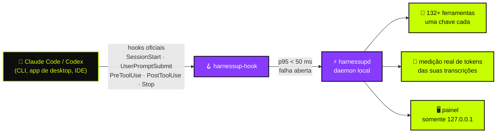

<!-- HarnessUp README · English is the source; translations live in i18n/ -->

<p align="center">
  <a href="https://harnessup.dev"></a>
</p>

<p align="center">
  <a href="../README.md">🇺🇸 English</a> ·
  <b>🇧🇷 Português</b> ·
  <a href="README.es.md">🇪🇸 Español</a> ·
  <a href="README.fr.md">🇫🇷 Français</a> ·
  <a href="README.de.md">🇩🇪 Deutsch</a> ·
  <a href="README.it.md">🇮🇹 Italiano</a> ·
  <a href="README.ja.md">🇯🇵 日本語</a> ·
  <a href="README.ko.md">🇰🇷 한국어</a> ·
  <a href="README.zh-CN.md">🇨🇳 简体中文</a> ·
  <a href="README.ar.md">🇸🇦 العربية</a> ·
  <a href="README.he.md">🇮🇱 עברית</a> ·
  <a href="README.hi.md">🇮🇳 हिन्दी</a>
</p>

<p align="center">
  <a href="https://www.npmjs.com/package/harnessup"></a>
  <a href="https://github.com/harnessup/harnessup/releases/latest"></a>
  
  
  
  
  <a href="https://github.com/harnessup/harnessup/stargazers"></a>
</p>

<p align="center">
  <a href="https://harnessup.dev/install/"></a>
  <a href="https://harnessup.dev/plans/"></a>
  <a href="https://harnessup.dev/"></a>
  <a href="#-patrocinadores"></a>
</p>

<h3 align="center">A maior economizadora de tokens do mundo para agentes de código.</h3>

<p align="center">
  Mais de <b>132 ferramentas</b> rodando na sua própria máquina para cortar o desperdício de tokens do <b>Claude Code</b> e do <b>Codex</b>.<br>
  Medição grátis, sem login, 100% local. Até <b>78% de desconto na sua conta</b>, com a prova medida no seu próprio uso.
</p>

<p align="center">
  
</p>

## 📑 Conteúdo

<table>
  <tr>
    <td valign="top">
      <a href="#-o-vilão">O vilão</a><br>
      <a href="#-o-que-o-harnessup-faz">O que o HarnessUp faz</a><br>
      <a href="#-os-números">Os números</a><br>
      <a href="#%EF%B8%8F-como-funciona">Como funciona</a>
    </td>
    <td valign="top">
      <a href="#-passeio">Passeio</a><br>
      <a href="#-10-frentes-132-ferramentas">10 frentes, 132+ ferramentas</a><br>
      <a href="#-os-danos-da-ia-desfeitos-com-um-botão">Desfazer com um botão</a><br>
      <a href="#%EF%B8%8F-galeria">Galeria</a>
    </td>
    <td valign="top">
      <a href="#-instalar-em-uma-linha">Instalar</a><br>
      <a href="#-feito-para-quem-vive-de-agentes">Para quem é</a><br>
      <a href="#-planos">Planos</a><br>
      <a href="#-privacidade-e-segurança">Privacidade e segurança</a>
    </td>
    <td valign="top">
      <a href="#-agentes-suportados">Agentes suportados</a><br>
      <a href="#-perguntas-frequentes">FAQ</a><br>
      <a href="#-patrocinadores">Patrocinadores</a><br>
      <a href="#-conheça-o-hup">Conheça o Hup</a>
    </td>
  </tr>
</table>

## 🪙 O vilão

<table>
  <tr>
    <td width="42%" valign="middle">
      
    </td>
    <td width="58%" valign="middle">
      <p><b>Sessão #217 · modelo caro · esforço alto.</b></p>
      <p>Você pede uma correção de uma linha. O agente responde com <i>"Claro! Vou te ajudar com isso. Ótima pergunta…"</i>, relê três arquivos que já leu, imprime um log de 4.000 linhas e só então escreve a correção. O contador de tokens não para de subir.</p>
      <p>Cada <i>"Claro! Vou te ajudar com isso"</i> é pago na resposta <b>e relido em cada rodada seguinte</b>. Seu limite semanal acaba na quarta-feira.</p>
      <p>O HarnessUp pede respostas diretas, bloqueia releituras de arquivos que não mudaram e corta saídas gigantes, para que você <b>chegue até sexta-feira com folga</b>.</p>
    </td>
  </tr>
</table>

## ⚡ O que o HarnessUp faz

O HarnessUp <b>não é um plugin, um MCP, uma skill nem um proxy</b>. É uma segunda camada que se encaixa por baixo do seu harness, dentro das regras: um daemon local que se conecta aos <b>hooks oficiais</b> do Claude Code e do Codex, mede cada token e aplica as ferramentas que você liga, cada uma com a sua própria chave.

<table>
  <tr>
    <td width="25%" align="center" valign="top">
      <br>
      <h3>📏 Medir</h3>
      <sub>Deep Scan e mais 19 ferramentas de medição e monitoramento, <b>grátis</b>. Contagens reais de tokens das suas transcrições, nunca chutes.</sub>
    </td>
    <td width="25%" align="center" valign="top">
      <br>
      <h3>💸 Economizar</h3>
      <sub>26 ferramentas de economia: compressão sem chamar o modelo, respostas mais enxutas, sem releituras, e um enxame de subagentes baratos onde <i>o modelo caro só decide</i>.</sub>
    </td>
    <td width="25%" align="center" valign="top">
      <br>
      <h3>🛡️ Proteger</h3>
      <sub>Stop Loss, Antiloop Protector, Secret Lock, Git Shield e desfazer com um clique. O dano da IA se desfaz com um botão.</sub>
    </td>
    <td width="25%" align="center" valign="top">
      <br>
      <h3>🎛️ Controlar</h3>
      <sub>Mais de 200 chaves de um clique em um painel local. Um clique liga uma ferramenta, outro clique a desfaz. Sem precisar de terminal.</sub>
    </td>
  </tr>
</table>

## 📊 Os números

| | Métrica | O que significa |
|:---:|---|---|
| 🚀 | **até 3x** | mais trabalho com os mesmos tokens em um plano fixo |
| 💰 | **até 78%** | menos na conta para quem usa API |
| 📈 | **mais de 260%** | mais vazão em algumas janelas de 5 horas |
| 🧰 | **132+** | ferramentas em **10 frentes**, todas rodando na sua máquina |
| ⌨️ | **200+** | chaves reversíveis de um clique no painel |
| ⏱️ | **p95 < 50 ms** | por hook, com timeout máximo de **2 s**, para o agente nunca travar |
| 🌍 | **12** | idiomas no painel |

> [!NOTE]
> "Até" significa os maiores ganhos medidos em janelas de uso reais. **Seu número sai das suas próprias transcrições**: o HarnessUp mede de graça antes de você pagar qualquer coisa. Veja a conta aberta em [harnessup.dev/metering](https://harnessup.dev/metering/).

## ⚙️ Como funciona



- **Somente superfícies oficiais.** O modelo roda pelos binários oficiais `claude` e `codex`, com a sua conta. O HarnessUp nunca lê, guarda nem repassa o seu token ou chave.
- **Falha aberta, sempre.** Se o HarnessUp ficar lento, desligado ou com erro, o seu agente continua funcionando como se ele não estivesse ali.
- **Nada é irreversível.** O que for cortado, comprimido ou bloqueado continua recuperável.
- **Baixa confiança passa direto.** É melhor não economizar do que entregar informação errada ao modelo.

## 🎬 Passeio

<p align="center">
  
</p>

## 🧰 10 frentes, 132+ ferramentas

Um canivete suíço para agentes de código. Cada ferramenta tem a sua própria chave, e toda chave pode ser desfeita.

| Frente | Ferramentas | Ferramenta destaque | Destaques |
|---|:---:|---|---|
| 📏 **Medição** | 14 | Deep Scan | Harness History, Inside the Wallet, Model Insights, HarnessUp Bench, Plan Usage |
| 📡 **Monitoramento** | 8 | Session Radar | The Numbers, Realtime Events, Reasoning Check, Subagents Work, Plan Advisor |
| 💸 **Economia** | 26 | Cheap Swarm | Smart Compress, Response Diet, Delta Read, Smart Cut, Terminal Guide, WebFetch Diet |
| 🎛️ **Controle** | 25 | Stop Loss | Budget Cap, ToolBox, Working Hours, Swarm Commander, Enforce TDD, Force Lint |
| 🛡️ **Proteção** | 10 | Smart Return | Secret Lock, UltraShield Guard, Antiloop Protector, Git Shield, Checkpoint |
| 🔐 **Segurança** | 8 | Sentinel | Smart Security, Security Check, SafeBox, No Touch, No Delete |
| 🚀 **Produtividade** | 26 | Code Deck | Smart Commit, Build Now, Super Code Review, HarnessUp Flow, HarnessUp Board |
| 🧪 **Utilitários** | 23 | Prompt Optimizer | Token Calculator, Frozen Cache, MetaPrompt, Mirror Master, HarnessUp Shop |
| 🎨 **Personalização** | 6 | Status Bar | Info Pills, Cache Alarm, Mod Themes, Finish Line Push |
| 🏗️ **Construtores** | 5 | /bones | SPEC/PRD Express, DOCs Generator, Website Builder |

<details>
<summary><b>📏 Medição e 📡 Monitoramento</b>: veja para onde vai cada token (quase tudo grátis)</summary>

<br>

- **Deep Scan** (grátis): diagnostica o desperdício no seu histórico e mostra o que o HarnessUp teria economizado.
- **Model Insights** (grátis): 24 perguntas respondidas por versão de modelo.
- **HarnessUp Bench** (grátis): nota por modelo e nível de esforço.
- **Openness Meter, Harness Meter, Cache Cycle, Inside the Wallet, Work Analytics, Bad Use, Plan Usage** (grátis).
- **Session Radar, The Numbers, Uptime, Realtime Events, Reasoning Check, Subagents Work, Harness Update, Plan Advisor** (todas grátis).
- **/diagnostic e /simulate** (Ultra): faça perguntas sobre o seu uso medido e simule decisões antes de tomá-las.

</details>

<details>
<summary><b>💸 Economia</b>: o mesmo trabalho com menos tokens</summary>

<br>

- **Smart Compress** (grátis): compacta a conversa sem chamar o modelo.
- **Response Diet** (grátis): respostas diretas, sem preâmbulo.
- **Delta Read, Code Finder, Smart Cut, Read Router, Head Limit** (Pro): leem só o necessário e nunca releem um arquivo que não mudou.
- **Terminal Guide, Output Diet, WebFetch Diet** (Pro): saídas longas de comandos e páginas da web aparadas antes de chegar ao contexto.
- **Renew Session, Hot Context, Context Graph, Session Protocol, Memory State** (Pro): sessões que começam enxutas e continuam enxutas.
- **First Pass, Way Out, No Comment, Stature Brake, Rules Auditor, Optimize Harness** (Pro).
- **Cheap Swarm** (Ultra): 26 classes de tarefa vão para subagentes baratos; o modelo caro só decide.

</details>

<details>
<summary><b>🎛️ Controle</b>: suas regras, aplicadas nas fronteiras de chamada de ferramenta</summary>

<br>

- **Stop Loss e Budget Cap** (Pro): defina um teto em US$ e a sessão para ali.
- **ToolBox** (Pro): 17 convenções prontas para o seu agente.
- **Working Hours, Scheduled Break, Reasoning Advisor, Rule Checker, Force Test, No Subagents** (Pro).
- **Swarm Commander, Subs Director, Enforce TDD, Force Lint, Doc Now, Anti-fading, Stick Prompt** (Ultra).
- **Anti-Collision** (GIGA) e **HarnessUp OFF** (grátis): pausam tudo sem desinstalar.

</details>

<details>
<summary><b>🛡️ Proteção e 🔐 Segurança</b>: nada vaza, nada se perde</summary>

<br>

- **Smart Return e Checkpoint** (Pro): desfazem o que o agente fez.
- **Git Shield e Eyes Off** (Pro): protegem seu histórico e seus arquivos sensíveis.
- **SafeBox** (Pro): o que for cortado ou bloqueado fica recuperável por 7 dias.
- **Secret Lock, UltraShield Guard, Antiloop Protector, Sandbox Mode, Deny MCP, Blackout** (Ultra).
- **No Touch e No Delete** (Ultra): arquivos que o agente pode ler, mas nunca alterar ou apagar.
- **Sentinel, Smart Security, Security Check, SEC Station** (GIGA).

</details>

<details>
<summary><b>🚀 Produtividade, 🧪 Utilitários, 🎨 Personalização e 🏗️ Construtores</b></summary>

<br>

- **Code Deck** (GIGA): 17+ CLIs de agentes lado a lado em 4 slots.
- **HarnessUp Flow e HarnessUp Board** (GIGA): automações descritas em linguagem natural e um quadro infinito.
- **Super Code Review** (GIGA): uma nota de 0 a 100 para cada mudança.
- **Smart Commit, Build Now, Smart Report, Save my Session, GitHub e Deploy em 1 clique** (Ultra).
- **Ez Work, Token Calculator, Frozen Cache, Cache Lock, Prompt Optimizer, MetaPrompt (34 tipos), HarnessUp Shop** (grátis).
- **Mirror Master** (Pro): mantém sincronizadas as instruções de CLAUDE.md, AGENTS.md, GEMINI.md, Copilot, Cursor, Windsurf, Cline e Aider.
- **Status Bar, Info Pills, Cache Alarm, Mod Themes** (grátis) e **Finish Line Push** (Pro).
- **SPEC/PRD Express, DOCs Generator, /bones, DOC for Website, Website Builder** (GIGA).

</details>

<p align="center">Catálogo completo com todas as ferramentas: <a href="https://harnessup.dev/tools/"><b>harnessup.dev/tools</b></a></p>

## ⏪ Os danos da IA, desfeitos com um botão

<table>
  <tr>
    <td width="58%" valign="middle">
      <p>O agente apagou a pasta errada? Vazou uma chave no contexto? Reescreveu meio repositório às 2 da manhã?</p>
      <ul>
        <li><b>Secret Lock</b> mantém as credenciais fora do contexto.</li>
        <li><b>Smart Return</b> e <b>Checkpoint</b> desfazem o que o agente fez.</li>
        <li><b>No Delete</b> e <b>Git Shield</b> bloqueiam movimentos destrutivos antes que aconteçam.</li>
        <li><b>SafeBox</b> guarda por 7 dias tudo o que foi cortado ou bloqueado.</li>
        <li><b>HarnessUp OFF</b> pausa todas as ferramentas de uma vez, sem desinstalar.</li>
      </ul>
      <p>Os freios agem só nas fronteiras de chamada de ferramenta: o HarnessUp <b>nunca interrompe o agente no meio de uma escrita</b>.</p>
    </td>
    <td width="42%" valign="middle">
      
    </td>
  </tr>
</table>

## 🖼️ Galeria

<table>
  <tr>
    <td align="center" width="33%"><a href="../assets/screens/01-model-insights.png"></a><br><sub><b>Model Insights</b> · compara versões de modelo</sub></td>
    <td align="center" width="33%"><a href="../assets/screens/02-subagents-work.png"></a><br><sub><b>Subagents Work</b> · o que a equipe faz e quanto custa</sub></td>
    <td align="center" width="33%"><a href="../assets/screens/04-bench.png"></a><br><sub><b>HarnessUp Bench</b> · nota por modelo e esforço</sub></td>
  </tr>
  <tr>
    <td align="center"><a href="../assets/screens/05-cheap-swarm.png"></a><br><sub><b>Cheap Swarm</b> · o que o enxame economizou</sub></td>
    <td align="center"><a href="../assets/screens/06-code-deck.png"></a><br><sub><b>Code Deck</b> · agentes em terminais lado a lado</sub></td>
    <td align="center"><a href="../assets/screens/07-context-graph.png"></a><br><sub><b>Context Graph</b> · memória de projeto indexada</sub></td>
  </tr>
  <tr>
    <td align="center"><a href="../assets/screens/10-antiloop.png"></a><br><sub><b>Antiloop Protector</b> · para loops improdutivos</sub></td>
    <td align="center"><a href="../assets/screens/08-openness-meter.png"></a><br><sub><b>Openness Meter</b> · como a abertura da sessão evoluiu</sub></td>
    <td align="center"><a href="../assets/screens/09-shop.png"></a><br><sub><b>HarnessUp Shop</b> · instalador de agentes e MCPs</sub></td>
  </tr>
  <tr>
    <td align="center"><a href="../assets/screens/14-flow-canvas.png"></a><br><sub><b>HarnessUp Flow</b> · automação em linguagem natural</sub></td>
    <td align="center"><a href="../assets/screens/15-board.png"></a><br><sub><b>HarnessUp Board</b> · quadro infinito</sub></td>
    <td align="center"><a href="../assets/screens/12-ez-work-timer.png"></a><br><sub><b>Ez Work</b> · Ghost Prompt e Work Timer</sub></td>
  </tr>
</table>

<details>
<summary>Mais telas</summary>
<br>
<p align="center">
  
  
  
</p>
</details>

## 📦 Instalar em uma linha

<table>
  <tr>
    <td width="40%" valign="middle">
      
    </td>
    <td width="60%" valign="middle">
      <p>Por usuário. <b>Sem admin, sem login, sem e-mail, sem serviço de sistema.</b> Os binários são verificados com SHA-256 antes de instalar, e as atualizações são assinadas.</p>
      <p><b>npm</b> (Windows, macOS, Linux · Node 18+)</p>

```sh
npm install -g harnessup
```

<p><b>Windows</b> · PowerShell, sem Node</p>

```powershell
irm https://harnessup.dev/install.ps1 | iex
```

<p><b>macOS e Linux</b> · sem Node, sem sudo</p>

```sh
curl -fsSL https://harnessup.dev/install.sh | sh
```

</td>
  </tr>
</table>

Depois:

```sh
harnessup install     # conecta o HarnessUp ao Claude Code e ao Codex
harnessup doctor      # verifica a instalação
harnessup uninstall   # remove tudo, sem deixar resíduos
```

<details>
<summary><b>Mais formas de instalar</b>: .exe, ZIP, pnpm/yarn/bun, ou deixe o seu agente fazer</summary>

<br>

- **Instalador para Windows**: `HarnessUp-Setup-x64.exe` (Windows 10/11 de 64 bits, por usuário) em [harnessup.dev/install](https://harnessup.dev/install/).
- **ZIP**: baixe em [GitHub Releases](https://github.com/harnessup/harnessup/releases/latest) e confira com `SHA256SUMS.txt`.
- **pnpm, yarn, bun**: `pnpm add -g harnessup` · `yarn global add harnessup` · `bun add -g harnessup`.
- **1 prompt**: cole isto no Claude Code ou no Codex e deixe o agente instalar para você:

```text
Instale o HarnessUp nesta máquina: execute npm install -g harnessup (sem Node: no Windows, irm https://harnessup.dev/install.ps1 | iex no PowerShell; no macOS e Linux, curl -fsSL https://harnessup.dev/install.sh | sh no Terminal), confirme que ele foi integrado ao Claude Code e ao Codex, e abra o painel. Não peça login, e-mail nem admin.
```

- **Em breve**: winget, Scoop, Chocolatey, Homebrew e Snap.

</details>

📘 Guia completo, com atualização, desinstalação e solução de problemas: **[INSTALL.pt-BR.md](INSTALL.pt-BR.md)**.

## 👥 Feito para quem vive de agentes

<table>
  <tr>
    <td width="33%" align="center" valign="top">
      <br>
      <h3>Em plano fixo</h3>
      <sub>Planos Claude Pro/Max ou ChatGPT. <b>Até 3x</b> mais trabalho na mesma janela: seu limite semanal praticamente dobra.</sub>
    </td>
    <td width="33%" align="center" valign="top">
      <br>
      <h3>Pagando por API</h3>
      <sub>Cada token é dinheiro. <b>Até 78% a menos</b> na conta, centenas de dólares por mês para quem usa muito.</sub>
    </td>
    <td width="33%" align="center" valign="top">
      <br>
      <h3>Sem terminal</h3>
      <sub>Um instalador para Windows e <b>mais de 200 chaves reversíveis</b> no painel. Clique, veja o número, clique de novo para desfazer.</sub>
    </td>
  </tr>
</table>

## 💳 Planos

<table>
  <tr>
    <th width="25%">Basic</th>
    <th width="25%">Pro</th>
    <th width="25%">Ultra</th>
    <th width="25%">GIGA UNLIMITED</th>
  </tr>
  <tr align="center">
    <td><h3>GRÁTIS</h3><sub>para sempre</sub></td>
    <td><h3>US$ 9<sub>/mês</sub></h3><sub>ou US$ 6/mês com cobrança anual</sub></td>
    <td><h3>US$ 12<sub>/mês</sub></h3><sub>ou US$ 9/mês com cobrança anual</sub></td>
    <td><h3>US$ 27<sub>/mês</sub></h3><sub>ou US$ 19/mês com cobrança anual</sub></td>
  </tr>
  <tr valign="top">
    <td><sub>1 conta do Claude Code · 1 projeto<br>Mede tudo: Deep Scan, Monitoramento e mais de 20 ferramentas grátis</sub></td>
    <td><sub>1 conta Claude + 1 conta Codex · 2 projetos<br>Economia, controle, proteção e desfazer</sub></td>
    <td><sub>2 contas Claude + 2 contas Codex · 6 projetos<br>Cheap Swarm, Secret Lock, Antiloop, automações</sub></td>
    <td><sub>Harnesses, contas e projetos ilimitados<br>Code Deck, Flow, Board, Segurança, Construtores</sub></td>
  </tr>
</table>

- ✅ **Teste grátis de 7 dias** nos planos pagos: sem cartão, sem cadastro.
- ✅ Cada plano inclui tudo o que está abaixo dele. Sessões ilimitadas em todos os planos. Cancele quando quiser, sem formulário.
- ✅ Reembolso em até 7 dias da compra. Uma ativação flutuante por chave.
- 👥 **Equipe**: 10 licenças GIGA por US$ 1,699 ao ano. **Corporativo**: [corporate@harnessup.dev](mailto:corporate@harnessup.dev).

<p align="center"><a href="https://harnessup.dev/plans/"><b>Compare todas as ferramentas por plano e veja os descontos early-bird vigentes →</b></a></p>

## 🔒 Privacidade e segurança

| | |
|---|---|
| 🏠 **100% local** | Tudo roda na sua máquina. Sem proxy, sem interceptação de API, sem MCP pesado. |
| 🔑 **Sua conta, seu token** | Roda o `claude` e o `codex` oficiais com a sua conta e nunca lê, guarda nem repassa o seu token ou chave. |
| 🖥️ **Painel em 127.0.0.1** | Responde só na sua máquina. Sua página de conta mostra **0 bytes de uso enviados**. |
| 🟢 **Falha aberta** | Se o HarnessUp ficar lento, desligado ou com erro, o agente continua funcionando. p95 < 50 ms, timeout máximo de 2 s. |
| ⏪ **Reversível** | Toda chave pode ser desfeita com um clique. O SafeBox guarda o que foi cortado por 7 dias. |
| 👤 **Sem conta para começar** | Sem login, sem e-mail, sem senha e sem direitos de admin para instalar e medir. |

Encontrou uma vulnerabilidade? Siga o [SECURITY.md](../SECURITY.md) em vez de abrir uma issue pública.

## 🤖 Agentes suportados

| Agente | Status | Onde |
|---|:---:|---|
| **Claude Code** | ✅ Integrado | CLI, app de desktop e extensões de IDE, com conta ou via API |
| **Codex** | ✅ Integrado | CLI, app de desktop e extensões de IDE, com conta ou via API |
| **Cursor** | 🔜 Em breve | |
| **OpenCode** | 🔜 Em breve | |
| **Hermes Agent** | 🔜 Em breve | |

**Code Deck** já roda 17+ CLIs de agentes lado a lado, e o **Mirror Master** mantém sincronizados os arquivos de instrução de 8 harnesses.

## ❓ Perguntas frequentes

<details>
<summary><b>É seguro?</b></summary>
<br>
Sim. Usa apenas os hooks oficiais, não há proxy, e roda 100% na sua máquina. Se ele parar, o seu agente continua funcionando normalmente.
</details>

<details>
<summary><b>Ele lê meu token ou minha chave de API?</b></summary>
<br>
Nunca. O modelo roda pelos binários oficiais <code>claude</code> e <code>codex</code>, com a sua conta. O HarnessUp nunca lê, guarda nem repassa o seu token ou chave.
</details>

<details>
<summary><b>Ele deixa o agente mais lento?</b></summary>
<br>
Não. Os hooks têm p95 abaixo de 50 ms e timeout máximo de 2 s. Se algo demorar, o agente segue sem esperar.
</details>

<details>
<summary><b>Funciona para quem usa API?</b></summary>
<br>
Sim, e é aí que a economia aparece mais: cada token economizado é dinheiro que fica no seu bolso.
</details>

<details>
<summary><b>Preciso usar o terminal?</b></summary>
<br>
Não. Há um instalador para Windows e um painel com mais de 200 chaves reversíveis de um clique.
</details>

<details>
<summary><b>Preciso de cartão para o plano grátis?</b></summary>
<br>
Não. O Basic é grátis para sempre, e os planos pagos têm teste de 7 dias sem cartão e sem cadastro.
</details>

<details>
<summary><b>Funciona no macOS e no Linux?</b></summary>
<br>
Sim, pelo npm ou pelo script <code>install.sh</code>.
</details>

<details>
<summary><b>Quantas máquinas posso usar?</b></summary>
<br>
Uma ativação por vez por chave. A licença é flutuante: mova-a entre máquinas quando quiser.
</details>

<details>
<summary><b>Por que o Windows mostra um aviso do SmartScreen no .exe?</b></summary>
<br>
É um aviso de reputação para editores novos. As rotas npm e PowerShell não têm esse aviso, e os hashes SHA-256 estão publicados em <a href="https://harnessup.dev/windows-warning/">harnessup.dev/windows-warning</a>. Um certificado de assinatura de código está entre as coisas que os patrocinadores ajudam a financiar.
</details>

<details>
<summary><b>Como desinstalo?</b></summary>
<br>
Rode <code>harnessup uninstall</code>. Para pausar sem desinstalar, ligue o <b>HarnessUp OFF</b> no painel.
</details>

<p align="center">Mais respostas em <a href="https://harnessup.dev/faq/"><b>harnessup.dev/faq</b></a></p>

## 💜 Patrocinadores

<table>
  <tr>
    <td width="30%" align="center" valign="middle">
      
    </td>
    <td width="70%" valign="middle">
      <p><b>O plano Basic é grátis para sempre, e queremos que continue assim.</b> O HarnessUp é feito por uma equipe pequena e independente, e o patrocínio é o que mantém a medição gratuita para todos.</p>
      <p><b>O que o seu patrocínio financia:</b></p>
      <ul>
        <li>🔏 Um certificado de assinatura de código para Windows, para que o aviso do SmartScreen desapareça</li>
        <li>🍎 Testes e suporte em máquinas reais com macOS e Linux</li>
        <li>📦 Pacotes para winget, Scoop, Chocolatey, Homebrew e Snap</li>
        <li>🤖 Integração com mais agentes: Cursor, OpenCode, Hermes Agent</li>
        <li>🌍 Manter o painel e o site em 12 idiomas</li>
      </ul>
    </td>
  </tr>
</table>

**Por que patrocinar o HarnessUp?** Seu logo chega a desenvolvedores no momento exato em que eles se importam com custo, controle e segurança dos seus agentes de código: neste README, em todas as 12 traduções e em [harnessup.dev](https://harnessup.dev).

<p align="center">
  <a href="mailto:corporate@harnessup.dev?subject=Patroc%C3%ADnio%20HarnessUp"></a>
</p>

<table>
  <tr>
    <td align="center" width="33%"><br>🥇<br><b>Seu logo aqui</b><br><sub>Patrocinador ouro</sub><br><br></td>
    <td align="center" width="33%"><br>🥈<br><b>Seu logo aqui</b><br><sub>Patrocinador prata</sub><br><br></td>
    <td align="center" width="33%"><br>🥉<br><b>Seu logo aqui</b><br><sub>Patrocinador bronze</sub><br><br></td>
  </tr>
</table>

**Não é empresa?** Você ajuda tanto dando ⭐ **estrela neste repositório**, indicando o HarnessUp a um amigo que queima tokens, ou entrando no **[programa de afiliados](https://harnessup.dev/affiliates/)**: indicou, ganhou. Você não precisa ser cliente para participar.

## 🤖 Conheça o Hup

<p align="center">
  
  
  
  
  
</p>

<p align="center">
  <b>Hup</b> é a mascote do HarnessUp: uma tecla verde-limão em um arnês roxo que segura os seus tokens,<br>
  para o preâmbulo com uma mão e rege os seus subagentes com uma batuta.
</p>

<p align="center">
  
</p>

## 🔗 Links

<p align="center">
  <a href="https://harnessup.dev/">Site</a> ·
  <a href="https://harnessup.dev/install/">Download</a> ·
  <a href="https://harnessup.dev/plans/">Planos</a> ·
  <a href="https://harnessup.dev/tools/">Ferramentas</a> ·
  <a href="https://harnessup.dev/faq/">FAQ</a> ·
  <a href="https://www.npmjs.com/package/harnessup">npm</a> ·
  <a href="https://github.com/harnessup/harnessup/releases">Releases</a> ·
  <a href="https://github.com/harnessup/harnessup/discussions">Discussões</a> ·
  <a href="../SUPPORT.md">Suporte</a> ·
  <a href="mailto:help@harnessup.dev">help@harnessup.dev</a>
</p>

## 📄 Licença

O HarnessUp é um software proprietário, grátis para começar com o plano Basic. Este repositório distribui o produto, os seus guias e a sua documentação, e não contém código-fonte. Veja [LICENSE.md](../LICENSE.md). Todos os direitos reservados.

<p align="center">
  <br>
  <sub>Feito com 💜 e 🍋 · <a href="https://harnessup.dev">harnessup.dev</a></sub>
</p>
