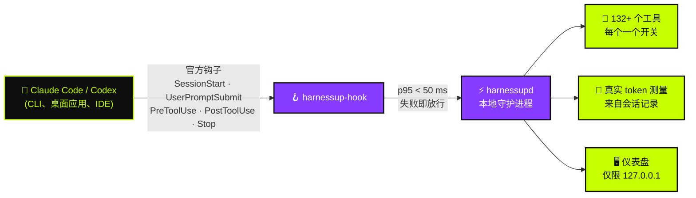

<!-- HarnessUp README · 原文为英文，译文位于 i18n/ 目录 -->

<p align="center">
  <a href="https://harnessup.dev"></a>
</p>

<p align="center">
  <a href="../README.md">🇺🇸 English</a> ·
  <a href="README.pt-BR.md">🇧🇷 Português</a> ·
  <a href="README.es.md">🇪🇸 Español</a> ·
  <a href="README.fr.md">🇫🇷 Français</a> ·
  <a href="README.de.md">🇩🇪 Deutsch</a> ·
  <a href="README.it.md">🇮🇹 Italiano</a> ·
  <a href="README.ja.md">🇯🇵 日本語</a> ·
  <a href="README.ko.md">🇰🇷 한국어</a> ·
  <b>🇨🇳 简体中文</b> ·
  <a href="README.ar.md">🇸🇦 العربية</a> ·
  <a href="README.he.md">🇮🇱 עברית</a> ·
  <a href="README.hi.md">🇮🇳 हिन्दी</a>
</p>

<p align="center">
  <a href="https://www.npmjs.com/package/harnessup"></a>
  <a href="https://github.com/harnessup/harnessup/releases/latest"></a>
  
  
  
  
  <a href="https://github.com/harnessup/harnessup/stargazers"></a>
</p>

<p align="center">
  <a href="https://harnessup.dev/zh/install/"></a>
  <a href="https://harnessup.dev/zh/plans/"></a>
  <a href="https://harnessup.dev/zh/"></a>
  <a href="#-%E8%B5%9E%E5%8A%A9%E8%80%85"></a>
</p>

<h3 align="center">全球最大的编码智能体省 token 工具。</h3>

<p align="center">
  在你自己的电脑上运行的 <b>132 多个工具</b>，减少 <b>Claude Code</b> 和 <b>Codex</b> 的 token 浪费。<br>
  免费测量，无需登录，100% 本地运行。用你自己的使用数据证明，最多可为你<b>节省 78% 的账单</b>。
</p>

<p align="center">
  
</p>

## 📑 目录

<table>
  <tr>
    <td valign="top">
      <a href="#-%E5%A4%B4%E5%8F%B7%E5%8F%8D%E6%B4%BE">头号反派</a><br>
      <a href="#-harnessup-%E8%83%BD%E5%81%9A%E4%BB%80%E4%B9%88">HarnessUp 能做什么</a><br>
      <a href="#-%E6%95%B0%E5%AD%97%E4%B8%80%E8%A7%88">数字一览</a><br>
      <a href="#%EF%B8%8F-%E5%B7%A5%E4%BD%9C%E5%8E%9F%E7%90%86">工作原理</a>
    </td>
    <td valign="top">
      <a href="#-%E6%BC%94%E7%A4%BA">演示</a><br>
      <a href="#-10-%E5%A4%A7%E9%A2%86%E5%9F%9F132-%E4%B8%AA%E5%B7%A5%E5%85%B7">10 大领域，132+ 个工具</a><br>
      <a href="#-ai-%E7%9A%84%E7%A0%B4%E5%9D%8F%E4%B8%80%E9%94%AE%E5%9B%9E%E6%BB%9A">一键回滚</a><br>
      <a href="#-%E5%9B%BE%E5%BA%93">图库</a>
    </td>
    <td valign="top">
      <a href="#-%E4%B8%80%E8%A1%8C%E5%91%BD%E4%BB%A4%E5%AE%89%E8%A3%85">安装</a><br>
      <a href="#-%E4%B8%BA%E4%B8%8E%E6%99%BA%E8%83%BD%E4%BD%93%E5%85%B1%E4%BA%8B%E7%9A%84%E4%BA%BA%E8%80%8C%E5%81%9A">适合人群</a><br>
      <a href="#-%E5%A5%97%E9%A4%90">套餐</a><br>
      <a href="#-%E9%9A%90%E7%A7%81%E4%B8%8E%E5%AE%89%E5%85%A8">隐私与安全</a>
    </td>
    <td valign="top">
      <a href="#-%E6%94%AF%E6%8C%81%E7%9A%84%E6%99%BA%E8%83%BD%E4%BD%93">支持的智能体</a><br>
      <a href="#-faq">FAQ</a><br>
      <a href="#-%E8%B5%9E%E5%8A%A9%E8%80%85">赞助者</a><br>
      <a href="#-%E8%AE%A4%E8%AF%86-hup">认识 Hup</a>
    </td>
  </tr>
</table>

## 🪙 头号反派

<table>
  <tr>
    <td width="42%" valign="middle">
      
    </td>
    <td width="58%" valign="middle">
      <p><b>会话 #217 · 昂贵的模型 · 高投入度。</b></p>
      <p>你只想要一行修复。智能体回答 <i>"当然！我很乐意帮你。这是个好问题……"</i>，把已经读过的三个文件又读了一遍，打印出一份 4,000 行的日志，然后才写出修复。token 计数器一路飙升。</p>
      <p>每一句 <i>"当然！我很乐意帮你"</i> 都在回复中付了费，<b>并在之后的每一轮中被重新读取</b>。你的每周额度在周三就用完了。</p>
      <p>HarnessUp 要求直接给出答案，阻止重复读取未改动的文件，并截断巨大的输出，让你<b>带着余量撑到周五</b>。</p>
    </td>
  </tr>
</table>

## ⚡ HarnessUp 能做什么

HarnessUp **不是插件、不是 MCP、不是技能，也不是代理**。它是一个在规则之内、位于你的 harness 之下的第二层：一个本地守护进程，接入 Claude Code 和 Codex 的**官方钩子**，测量每一个 token，并应用你开启的工具，每个工具都有自己的开关。

<table>
  <tr>
    <td width="25%" align="center" valign="top">
      <br>
      <h3>📏 测量</h3>
      <sub>Deep Scan 以及另外 19 个测量和监控工具，<b>免费</b>。来自你的会话记录的真实 token 数，从不猜测。</sub>
    </td>
    <td width="25%" align="center" valign="top">
      <br>
      <h3>💸 节省</h3>
      <sub>26 个节省工具：不调用模型的压缩、更精简的回答、不重复读取，以及一群廉价子智能体，其中<i>昂贵的模型只负责决策</i>。</sub>
    </td>
    <td width="25%" align="center" valign="top">
      <br>
      <h3>🛡️ 保护</h3>
      <sub>Stop Loss、Antiloop Protector、Secret Lock、Git Shield，以及一键撤销。AI 造成的破坏，一键即可回滚。</sub>
    </td>
    <td width="25%" align="center" valign="top">
      <br>
      <h3>🎛️ 控制</h3>
      <sub>本地仪表盘中 200 多个一键开关。点一下开启，再点一下撤销。无需终端。</sub>
    </td>
  </tr>
</table>

## 📊 数字一览

| | 指标 | 含义 |
|:---:|---|---|
| 🚀 | **最多 3 倍** | 固定套餐下，相同 token 完成更多工作 |
| 💰 | **最多 78%** | API 用户账单减少 |
| 📈 | **超过 260%** | 某些 5 小时窗口内的吞吐量提升 |
| 🧰 | **132+** | 分布在 **10 大领域**、全部运行在你电脑上的工具 |
| ⌨️ | **200+** | 仪表盘中可撤销的一键开关 |
| ⏱️ | **p95 < 50 ms** | 每个钩子；硬性 **2 秒** 超时，智能体永不卡死 |
| 🌍 | **12** | 仪表盘支持的语言 |

> [!NOTE]
> "最多"指在真实使用窗口中测得的最大收益。**你自己的数字来自你自己的会话记录**：HarnessUp 在你付费之前免费测量。计算过程公开在 [harnessup.dev/zh/metering](https://harnessup.dev/zh/metering/)。

## ⚙️ 工作原理



- **仅使用官方途径。** 模型通过官方的 `claude` 和 `codex` 可执行文件，以你自己的账户运行。HarnessUp 从不读取、存储或转交你的 token 或密钥。
- **始终失败即放行。** 如果 HarnessUp 变慢、关闭或出错，你的智能体仍会照常工作，就像它不存在一样。
- **没有任何操作不可逆。** 被截断、压缩或拦截的内容都可以恢复。
- **低置信度直接放行。** 不节省，好过给模型传递错误信息。

## 🎬 演示

<p align="center">
  
</p>

## 🧰 10 大领域，132+ 个工具

面向编码智能体的瑞士军刀。每个工具都有自己的开关，每个开关都可以撤销。

| 领域 | 工具数 | 明星工具 | 亮点 |
|---|:---:|---|---|
| 📏 **测量** | 14 | Deep Scan | Harness History、Inside the Wallet、Model Insights、HarnessUp Bench、Plan Usage |
| 📡 **监控** | 8 | Session Radar | The Numbers、Realtime Events、Reasoning Check、Subagents Work、Plan Advisor |
| 💸 **节省** | 26 | Cheap Swarm | Smart Compress、Response Diet、Delta Read、Smart Cut、Terminal Guide、WebFetch Diet |
| 🎛️ **控制** | 25 | Stop Loss | Budget Cap、ToolBox、Working Hours、Swarm Commander、Enforce TDD、Force Lint |
| 🛡️ **保护** | 10 | Smart Return | Secret Lock、UltraShield Guard、Antiloop Protector、Git Shield、Checkpoint |
| 🔐 **安全** | 8 | Sentinel | Smart Security、Security Check、SafeBox、No Touch、No Delete |
| 🚀 **效率** | 26 | Code Deck | Smart Commit、Build Now、Super Code Review、HarnessUp Flow、HarnessUp Board |
| 🧪 **实用工具** | 23 | Prompt Optimizer | Token Calculator、Frozen Cache、MetaPrompt、Mirror Master、HarnessUp Shop |
| 🎨 **个性化** | 6 | Status Bar | Info Pills、Cache Alarm、Mod Themes、Finish Line Push |
| 🏗️ **构建者** | 5 | /bones | SPEC/PRD Express、DOCs Generator、Website Builder |

<details>
<summary><b>📏 测量与 📡 监控</b>：看清每一个 token 去了哪里（大多免费）</summary>

<br>

- **Deep Scan**（免费）：诊断历史记录中的浪费，并显示 HarnessUp 本可节省的量。
- **Model Insights**（免费）：针对每个模型版本回答 24 个问题。
- **HarnessUp Bench**（免费）：按模型和投入度打分。
- **Openness Meter、Harness Meter、Cache Cycle、Inside the Wallet、Work Analytics、Bad Use、Plan Usage**（免费）。
- **Session Radar、The Numbers、Uptime、Realtime Events、Reasoning Check、Subagents Work、Harness Update、Plan Advisor**（均免费）。
- **/diagnostic 和 /simulate**（Ultra）：针对你测得的使用情况提问，并在做决定前进行模拟。

</details>

<details>
<summary><b>💸 节省</b>：同样的工作，更少的 token</summary>

<br>

- **Smart Compress**（免费）：在不调用模型的情况下压缩会话。
- **Response Diet**（免费）：直接给出答案，没有开场白。
- **Delta Read、Code Finder、Smart Cut、Read Router、Head Limit**（Pro）：只读需要的内容，从不重读未改动的文件。
- **Terminal Guide、Output Diet、WebFetch Diet**（Pro）：在进入上下文之前，裁剪过长的命令输出和网页。
- **Renew Session、Hot Context、Context Graph、Session Protocol、Memory State**（Pro）：启动精简，并保持精简的会话。
- **First Pass、Way Out、No Comment、Stature Brake、Rules Auditor、Optimize Harness**（Pro）。
- **Cheap Swarm**（Ultra）：26 类任务交给廉价的子智能体，昂贵的模型只负责决策。

</details>

<details>
<summary><b>🎛️ 控制</b>：你的规则，在工具调用边界上执行</summary>

<br>

- **Stop Loss 和 Budget Cap**（Pro）：设定美元上限，会话到达上限即停止。
- **ToolBox**（Pro）：为你的智能体准备的 17 条现成约定。
- **Working Hours、Scheduled Break、Reasoning Advisor、Rule Checker、Force Test、No Subagents**（Pro）。
- **Swarm Commander、Subs Director、Enforce TDD、Force Lint、Doc Now、Anti-fading、Stick Prompt**（Ultra）。
- **Anti-Collision**（GIGA）和 **HarnessUp OFF**（免费）：无需卸载，即可暂停一切。

</details>

<details>
<summary><b>🛡️ 保护</b>与 <b>🔐 安全</b>：不泄露，不丢失</summary>

<br>

- **Smart Return 和 Checkpoint**（Pro）：回退智能体所做的操作。
- **Git Shield 和 Eyes Off**（Pro）：保护你的历史记录和敏感文件。
- **SafeBox**（Pro）：被截断或拦截的内容，保留 7 天以便恢复。
- **Secret Lock、UltraShield Guard、Antiloop Protector、Sandbox Mode、Deny MCP、Blackout**（Ultra）。
- **No Touch 和 No Delete**（Ultra）：智能体可以读取，但无法修改或删除的文件。
- **Sentinel、Smart Security、Security Check、SEC Station**（GIGA）。

</details>

<details>
<summary><b>🚀 效率、🧪 实用工具、🎨 个性化、🏗️ 构建者</b></summary>

<br>

- **Code Deck**（GIGA）：17 个以上智能体 CLI 并排显示，共 4 个槽位。
- **HarnessUp Flow 和 HarnessUp Board**（GIGA）：用自然语言描述的自动化，以及无限画布。
- **Super Code Review**（GIGA）：为每次改动打 0–100 分。
- **Smart Commit、Build Now、Smart Report、Save my Session、GitHub 与 Deploy 一键完成**（Ultra）。
- **Ez Work、Token Calculator、Frozen Cache、Cache Lock、Prompt Optimizer、MetaPrompt（34 种）、HarnessUp Shop**（免费）。
- **Mirror Master**（Pro）：让 CLAUDE.md、AGENTS.md、GEMINI.md、Copilot、Cursor、Windsurf、Cline 和 Aider 的指令文件保持同步。
- **Status Bar、Info Pills、Cache Alarm、Mod Themes**（免费）以及 **Finish Line Push**（Pro）。
- **SPEC/PRD Express、DOCs Generator、/bones、DOC for Website、Website Builder**（GIGA）。

</details>

<p align="center">包含全部工具的完整目录：<a href="https://harnessup.dev/zh/tools/"><b>harnessup.dev/zh/tools</b></a></p>

## ⏪ AI 的破坏，一键回滚

<table>
  <tr>
    <td width="58%" valign="middle">
      <p>智能体删错了文件夹？把密钥泄露到了上下文里？凌晨两点改写了半个仓库？</p>
      <ul>
        <li><b>Secret Lock</b> 让凭据远离上下文。</li>
        <li><b>Smart Return</b> 和 <b>Checkpoint</b> 回退智能体的操作。</li>
        <li><b>No Delete</b> 和 <b>Git Shield</b> 在破坏性操作发生之前将其拦下。</li>
        <li><b>SafeBox</b> 将被截断或拦截的一切保留 7 天。</li>
        <li><b>HarnessUp OFF</b> 无需卸载，即可一次暂停所有工具。</li>
      </ul>
      <p>制动只在工具调用的边界生效：HarnessUp <b>从不在写入过程中打断智能体</b>。</p>
    </td>
    <td width="42%" valign="middle">
      
    </td>
  </tr>
</table>

## 🖼 图库

<table>
  <tr>
    <td align="center" width="33%"><a href="../assets/screens/01-model-insights.png"></a><br><sub><b>Model Insights</b> · 比较模型版本</sub></td>
    <td align="center" width="33%"><a href="../assets/screens/02-subagents-work.png"></a><br><sub><b>Subagents Work</b> · 团队做了什么、花了多少</sub></td>
    <td align="center" width="33%"><a href="../assets/screens/04-bench.png"></a><br><sub><b>HarnessUp Bench</b> · 按模型和投入度打分</sub></td>
  </tr>
  <tr>
    <td align="center"><a href="../assets/screens/05-cheap-swarm.png"></a><br><sub><b>Cheap Swarm</b> · 群体节省了多少</sub></td>
    <td align="center"><a href="../assets/screens/06-code-deck.png"></a><br><sub><b>Code Deck</b> · 并排终端中的智能体</sub></td>
    <td align="center"><a href="../assets/screens/07-context-graph.png"></a><br><sub><b>Context Graph</b> · 已建立索引的项目记忆</sub></td>
  </tr>
  <tr>
    <td align="center"><a href="../assets/screens/10-antiloop.png"></a><br><sub><b>Antiloop Protector</b> · 阻止无效循环</sub></td>
    <td align="center"><a href="../assets/screens/08-openness-meter.png"></a><br><sub><b>Openness Meter</b> · 会话开场方式的变化</sub></td>
    <td align="center"><a href="../assets/screens/09-shop.png"></a><br><sub><b>HarnessUp Shop</b> · 智能体与 MCP 的安装器</sub></td>
  </tr>
  <tr>
    <td align="center"><a href="../assets/screens/14-flow-canvas.png"></a><br><sub><b>HarnessUp Flow</b> · 自然语言描述的自动化</sub></td>
    <td align="center"><a href="../assets/screens/15-board.png"></a><br><sub><b>HarnessUp Board</b> · 无限画布</sub></td>
    <td align="center"><a href="../assets/screens/12-ez-work-timer.png"></a><br><sub><b>Ez Work</b> · Ghost Prompt 与 Work Timer</sub></td>
  </tr>
</table>

<details>
<summary>更多截图</summary>
<br>
<p align="center">
  
  
  
</p>
</details>

## 📦 一行命令安装

<table>
  <tr>
    <td width="40%" valign="middle">
      
    </td>
    <td width="60%" valign="middle">
      <p>按用户安装。<b>无需管理员、无需登录、无需邮箱、无需系统服务。</b>安装前使用 SHA-256 校验二进制文件，更新已签名。</p>
      <p><b>npm</b>（Windows、macOS、Linux · Node 18+）</p>

```sh
npm install -g harnessup
```

<p><b>Windows</b> · PowerShell，无需 Node</p>

```powershell
irm https://harnessup.dev/install.ps1 | iex
```

<p><b>macOS 和 Linux</b> · 无需 Node，无需 sudo</p>

```sh
curl -fsSL https://harnessup.dev/install.sh | sh
```

</td>
  </tr>
</table>

然后：

```sh
harnessup install     # 将 HarnessUp 接入 Claude Code 和 Codex
harnessup doctor      # 检查安装情况
harnessup uninstall   # 干净地移除
```

<details>
<summary><b>更多安装方式</b>：.exe、ZIP、pnpm/yarn/bun，或让智能体代劳</summary>

<br>

- **Windows 安装程序**：`HarnessUp-Setup-x64.exe`（Windows 10/11 64 位，按用户安装），可在 [harnessup.dev/zh/install](https://harnessup.dev/zh/install/) 下载。
- **ZIP**：从 [GitHub Releases](https://github.com/harnessup/harnessup/releases/latest) 下载，并与 `SHA256SUMS.txt` 核对。
- **pnpm、yarn、bun**：`pnpm add -g harnessup` · `yarn global add harnessup` · `bun add -g harnessup`。
- **一条提示词**：将以下内容粘贴到 Claude Code 或 Codex 中，让智能体替你安装：

```text
请在这台电脑上安装 HarnessUp：运行 npm install -g harnessup（如果没有 Node：Windows 上在 PowerShell 中运行 irm https://harnessup.dev/install.ps1 | iex；macOS 和 Linux 上在终端中运行 curl -fsSL https://harnessup.dev/install.sh | sh），确认它已与 Claude Code 和 Codex 集成，并打开仪表盘。不要要求登录、邮箱或管理员权限。
```

- **即将推出**：winget、Scoop、Chocolatey、Homebrew 和 Snap。

</details>

📘 完整指南，包含更新、卸载和故障排除：**[INSTALL.md](INSTALL.zh-CN.md)**。

## 👥 为与智能体共事的人而做

<table>
  <tr>
    <td width="33%" align="center" valign="top">
      <br>
      <h3>固定套餐</h3>
      <sub>Claude Pro/Max 或 ChatGPT 套餐。同一窗口内工作量<b>最多提升 3 倍</b>：每周额度大约翻一番。</sub>
    </td>
    <td width="33%" align="center" valign="top">
      <br>
      <h3>按 API 付费</h3>
      <sub>每个 token 都是钱。账单<b>最多减少 78%</b>，重度用户每月可省下数百美元。</sub>
    </td>
    <td width="33%" align="center" valign="top">
      <br>
      <h3>无需终端</h3>
      <sub>Windows 安装程序，以及仪表盘中 <b>200 多个可撤销的开关</b>。点击、看到数字，再点击即可撤销。</sub>
    </td>
  </tr>
</table>

## 💳 套餐

<table>
  <tr>
    <th width="25%">Basic</th>
    <th width="25%">Pro</th>
    <th width="25%">Ultra</th>
    <th width="25%">GIGA UNLIMITED</th>
  </tr>
  <tr align="center">
    <td><h3>免费</h3><sub>永久免费</sub></td>
    <td><h3>US$ 9<sub>/月</sub></h3><sub>或按年付费 US$ 6/月</sub></td>
    <td><h3>US$ 12<sub>/月</sub></h3><sub>或按年付费 US$ 9/月</sub></td>
    <td><h3>US$ 27<sub>/月</sub></h3><sub>或按年付费 US$ 19/月</sub></td>
  </tr>
  <tr valign="top">
    <td><sub>1 个 Claude Code 账户 · 1 个项目<br>测量全部：Deep Scan、监控，以及 20 多个免费工具</sub></td>
    <td><sub>1 个 Claude + 1 个 Codex 账户 · 2 个项目<br>节省、控制、保护与撤销</sub></td>
    <td><sub>2 个 Claude + 2 个 Codex 账户 · 6 个项目<br>Cheap Swarm、Secret Lock、Antiloop、自动化</sub></td>
    <td><sub>无限 harness、账户和项目<br>Code Deck、Flow、Board、安全、构建者</sub></td>
  </tr>
</table>

- ✅ 付费套餐享有 **7 天免费试用**：无需信用卡，无需注册。
- ✅ 每个套餐都包含其下方套餐的全部内容。所有套餐的会话均不限量。随时取消，无需填写表单。
- ✅ 购买后 7 天内可退款。每个密钥对应一个可浮动的激活名额。
- 👥 **团队**：10 个 GIGA 许可证，每年 US$ 1,699。**企业**：[corporate@harnessup.dev](mailto:corporate@harnessup.dev)。

<p align="center"><a href="https://harnessup.dev/zh/plans/"><b>按套餐比较每个工具，并查看当前早鸟优惠 →</b></a></p>

## 🔒 隐私与安全

| | |
|---|---|
| 🏠 **100% 本地** | 一切都在你的电脑上运行。没有代理，没有 API 拦截，没有沉重的 MCP。 |
| 🔑 **你的账户，你的 token** | 使用你的账户运行官方的 `claude` 和 `codex`，从不读取、存储或转交你的 token 或密钥。 |
| 🖥️ **127.0.0.1 上的仪表盘** | 仅响应你自己的电脑。你的账户页面显示 **已发送的使用数据：0 字节**。 |
| 🟢 **失败即放行** | 如果 HarnessUp 变慢、关闭或出错，智能体继续工作。p95 < 50 ms，硬性 2 秒超时。 |
| ⏪ **可撤销** | 每个开关都可以一键撤销。SafeBox 将被截断的内容保留 7 天。 |
| 👤 **无需账户即可开始** | 安装和测量无需登录、邮箱、密码，也无需管理员权限。 |

发现了安全漏洞？请按照 [SECURITY.md](../SECURITY.md) 的说明操作，而不是公开提交 Issue。

## 🤖 支持的智能体

| 智能体 | 状态 | 使用方式 |
|---|:---:|---|
| **Claude Code** | ✅ 已集成 | CLI、桌面应用和 IDE 扩展，使用账户或 API |
| **Codex** | ✅ 已集成 | CLI、桌面应用和 IDE 扩展，使用账户或 API |
| **Cursor** | 🔜 即将推出 | |
| **OpenCode** | 🔜 即将推出 | |
| **Hermes Agent** | 🔜 即将推出 | |

**Code Deck** 已能并排运行 17 个以上的智能体 CLI，**Mirror Master** 则让 8 种 harness 的指令文件保持同步。

## ❓ FAQ

<details>
<summary><b>安全吗？</b></summary>
<br>
安全。它只使用官方钩子，没有代理，并且 100% 在你的电脑上运行。即使它停止工作，你的智能体也会照常运行。
</details>

<details>
<summary><b>它会读取我的 token 或 API 密钥吗？</b></summary>
<br>
从不。模型通过官方的 <code>claude</code> 和 <code>codex</code> 可执行文件，以你自己的账户运行。HarnessUp 从不读取、存储或转交你的 token 或密钥。
</details>

<details>
<summary><b>会拖慢智能体吗？</b></summary>
<br>
不会。钩子的 p95 低于 50 ms，并有 2 秒的硬性超时。如果有任何环节变慢，智能体会继续前进，不等待。
</details>

<details>
<summary><b>API 用户也能用吗？</b></summary>
<br>
可以，而且节省效果在这里最明显：每节省一个 token，都是留在你口袋里的钱。
</details>

<details>
<summary><b>需要用终端吗？</b></summary>
<br>
不需要。有 Windows 安装程序，还有一个包含 200 多个可撤销一键开关的仪表盘。
</details>

<details>
<summary><b>免费套餐需要信用卡吗？</b></summary>
<br>
不需要。Basic 永久免费，付费套餐提供 7 天免费试用，无需信用卡，也无需注册。
</details>

<details>
<summary><b>在 macOS 和 Linux 上能用吗？</b></summary>
<br>
可以，通过 npm 或 <code>install.sh</code> 脚本即可。
</details>

<details>
<summary><b>我可以在几台电脑上使用？</b></summary>
<br>
每个密钥同一时间只能激活一台电脑。许可证可以浮动，你随时可以在电脑之间转移。
</details>

<details>
<summary><b>为什么 Windows 在 .exe 上显示 SmartScreen 警告？</b></summary>
<br>
这是针对新发布者的信誉警告。npm 和 PowerShell 方式没有此警告，SHA-256 哈希公布在 <a href="https://harnessup.dev/zh/windows-warning/">harnessup.dev/zh/windows-warning</a>。代码签名证书是赞助者资助的项目之一。
</details>

<details>
<summary><b>如何卸载？</b></summary>
<br>
运行 <code>harnessup uninstall</code>。如果只想暂停而不卸载，请在仪表盘中开启 <b>HarnessUp OFF</b>。
</details>

<p align="center">更多解答请见 <a href="https://harnessup.dev/zh/faq/"><b>harnessup.dev/zh/faq</b></a></p>

## 💜 赞助者

<table>
  <tr>
    <td width="30%" align="center" valign="middle">
      
    </td>
    <td width="70%" valign="middle">
      <p><b>Basic 套餐永久免费，我们希望它一直如此。</b>HarnessUp 由一个小型独立团队打造，赞助让测量对所有人保持免费。</p>
      <p><b>你的赞助将用于：</b></p>
      <ul>
        <li>🔏 Windows 代码签名证书，以消除 SmartScreen 警告</li>
        <li>🍎 在真实的 macOS 和 Linux 设备上进行测试与支持</li>
        <li>📦 winget、Scoop、Chocolatey、Homebrew 和 Snap 软件包</li>
        <li>🤖 接入更多智能体：Cursor、OpenCode、Hermes Agent</li>
        <li>🌍 让仪表盘和网站持续支持 12 种语言</li>
      </ul>
    </td>
  </tr>
</table>

**为什么赞助 HarnessUp？** 你的 logo 会在开发者最关心编码智能体的成本、控制与安全的那一刻出现在他们面前：在本 README 中、在全部 12 种语言的译文中，以及 [harnessup.dev](https://harnessup.dev)上。

<p align="center">
  <a href="mailto:corporate@harnessup.dev?subject=HarnessUp%20sponsorship"></a>
</p>

<table>
  <tr>
    <td align="center" width="33%"><br>🥇<br><b>你的 logo 在这里</b><br><sub>金牌赞助者</sub><br><br></td>
    <td align="center" width="33%"><br>🥈<br><b>你的 logo 在这里</b><br><sub>银牌赞助者</sub><br><br></td>
    <td align="center" width="33%"><br>🥉<br><b>你的 logo 在这里</b><br><sub>铜牌赞助者</sub><br><br></td>
  </tr>
</table>

**不是公司？** 你同样可以提供很大帮助：为 ⭐ **本仓库点星**，把 HarnessUp 分享给一位正在烧 token 的朋友，或加入 **[推广计划](https://harnessup.dev/zh/affiliates/)**：推荐即有收益。成为客户才能加入，这一点无需担心。

## 🤖 认识 Hup

<p align="center">
  
  
  
  
  
</p>

<p align="center">
  <b>Hup</b> 是 HarnessUp 的吉祥物：一个身披紫色挽具的青柠色键帽，它紧紧抓住你的 token，<br>
  一只手制止开场白，另一只手用指挥棒指挥你的子智能体。
</p>

<p align="center">
  
</p>

## 🔗 链接

<p align="center">
  <a href="https://harnessup.dev/zh/">官网</a> ·
  <a href="https://harnessup.dev/zh/install/">下载</a> ·
  <a href="https://harnessup.dev/zh/plans/">套餐</a> ·
  <a href="https://harnessup.dev/zh/tools/">工具</a> ·
  <a href="https://harnessup.dev/zh/faq/">FAQ</a> ·
  <a href="https://www.npmjs.com/package/harnessup">npm</a> ·
  <a href="https://github.com/harnessup/harnessup/releases">发布</a> ·
  <a href="https://github.com/harnessup/harnessup/discussions">讨论</a> ·
  <a href="../SUPPORT.md">支持</a> ·
  <a href="mailto:help@harnessup.dev">help@harnessup.dev</a>
</p>

## 📄 许可证

HarnessUp 是专有软件，可从 Basic 套餐免费开始使用。本仓库分发产品、其指南与文档，不包含源代码。详见 [LICENSE.md](../LICENSE.md)。保留所有权利。

<p align="center">
  <br>
  <sub>用 💜 和 🍋 制作 · <a href="https://harnessup.dev">harnessup.dev</a></sub>
</p>
